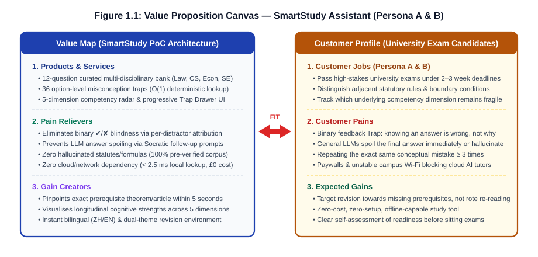
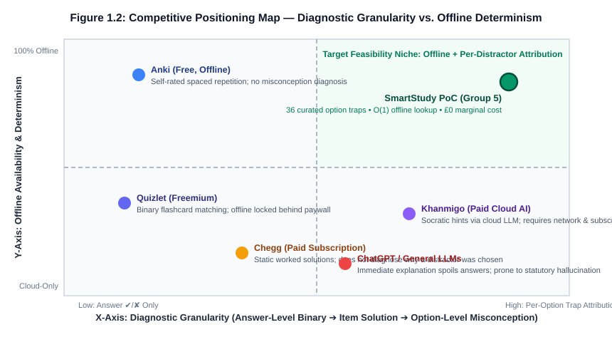

# 1 Introduction and Project Context

## 1.1 Problem and Context: The "Binary Feedback" Trap

Two weeks before final examinations, undergraduate students typically enter an intensive revision cycle centred on past examination papers, lecture slide decks, and shared question banks. Consider a second-year law student revising the General Provisions of the Civil Code. Across an afternoon practice session, the student misses three consecutive multiple-choice questions on contract rescission (`law_1`). After each error, the student's online practice tool returns a red cross (`✘`) followed by a one-line restatement of the correct option: *"Under Article 152 of the Civil Code, the right to rescind for fraud expires within one year from the date the party knew or ought to have known the cause."* Assuming the error resulted from weak memorisation, the student copies Article 152 into a flashcard deck and moves on. When a differently worded question tests the same boundary two days later, the student fails again—because the underlying mistake was never forgetting Article 152, but conflating a **formative right's preclusive period** (*Ausschlussfrist*, Article 152, one year, non-interruptible) with a **claim right's extinctive prescription** (*Verjährung*, Article 188, three years, subject to suspension and interruption).

Throughout this report, we use the term **binary feedback** to denote an answer-level correctness signal ($\text{correct} \in \{\text{true}, \text{false}\}$, optionally paired with a static explanation of the right answer) that carries zero diagnostic information about *which specific misconception* led the learner to select a given distractor. Binary feedback treats all three wrong options on a four-option multiple-choice item (`A`, `C`, and `D`) as identical failures. In practice, however, well-constructed distractors encode distinct cognitive traps:

- Selecting Option A on `law_1` reflects a **doctrinal category confusion** (applying the 3-year prescription of claim rights to a formative right);
- Selecting Option C reflects an **inception-point boundary error** (applying the termination-date rule of duress to a case of fraud);
- Selecting Option D reflects **obsolete statutory recall** (invoking a repealed 2-year rule from legacy contract legislation).

When an assessment system collapses these three distinct failure modes into a single `"Incorrect — the answer is B"` message, students default to rote repetition of the question stem rather than repairing the broken prerequisite link. Without explicit misconception attribution, learners repeatedly fall into the same conceptual trap three or more times across a revision cycle while accumulating a false sense of familiarity with the practice bank.

**Figure 1.1: Value Proposition Canvas aligning university exam candidate pains with the StudyGraph (SmartStudy) proof-of-concept architecture.**
(Source: Group 5 requirements workshop and `reports/audit/persona_provenance.csv`.)

## 1.2 Background and Related Work

Our approach to resolving the binary feedback problem builds on three established streams of educational and cognitive science research:

1. **Feedback Granularity and Pedagogical Effect Sizes**: In a landmark synthesis of over 800 meta-analyses, Hattie and Timperley (2007) demonstrated that feedback operating at the *process level* (explaining how the learner's reasoning strategy failed) and the *self-regulation level* (guiding prerequisite remediation) yields substantially higher learning gains than task-level correctness verification ($d = 0.73$ vs. $d = 0.19$). VanLehn (2011) corroborated this finding in a comparative meta-analysis of human tutoring and computer-based scaffolding: while simple answer-based Computer-Based Training (CBT) achieved an effect size of only $d = 0.31$ over no tutoring, step-based and misconception-aware tutoring systems achieved $d = 0.76$, approaching one-to-one human tutoring ($d = 0.79$).
2. **Multi-Dimensional Competency Modelling and Prerequisite Graphs**: Classical test scoring aggregates performance into a single scalar percentage, masking structural weaknesses. Corbett and Anderson (1994) introduced Bayesian Knowledge Tracing (BKT) to decompose mastery into fine-grained skill components, while Koedinger, Corbett and Perfetti (2012) formalised the Knowledge-Learning-Instruction (KLI) framework, showing that effective remediation requires mapping observed errors back to specific antecedent knowledge components (*prerequisites*). When a student misses a composite problem in computer architecture (`cs_3`) or econometrics (`econ_2`), isolating whether the failure stems from basic recall, boundary migration, or multi-step synthesis is essential for targeted study.
3. **Retrieval Practice versus Misconception Repair**: Cognitive psychology has firmly established the *testing effect*—active retrieval practice strengthens memory traces far more effectively than passive re-reading (Roediger and Karpicke, 2006). Spaced-repetition algorithms such as SuperMemo SM-2 and the Free Spaced Repetition Scheduler (FSRS) operationalise this effect by scheduling flashcard reviews along forgetting curves. However, spaced repetition presupposes that the learner already understands the concept being rehearsed. When a student harbours a structural misconception, scheduling the same flashcard more frequently merely reinforces surface-level cue recognition without correcting the underlying fallacy (Haladyna, Downing and Rodriguez, 2002).

## 1.3 Competitive Landscape

To verify whether existing commercial and open-source study tools already address option-level misconception diagnosis, we audited five widely adopted platforms alongside underlying algorithmic families (`reports/competitor_analysis.md`). Table 1.1 compares these five systems against StudyGraph (SmartStudy) across four operational dimensions.

**Table 1.1: Competitive comparison matrix across five mainstream revision tools and the StudyGraph PoC.**

| Product / Platform | Feedback Granularity | Diagnoses the Specific Misconception? | Works 100% Offline? | Direct Cost to Student |
| :--- | :--- | :--- | :--- | :--- |
| **Quizlet** | Answer-level binary (`✔` / `✘`) + static card back | **No** — treats all wrong attempts identically | Paid tier only (Quizlet Plus) | Freemium (£35.99/year for offline & Q-Chat) |
| **Anki** | Self-assessed recall rating (`Again` / `Hard` / `Good` / `Easy`) | **No** — schedules intervals via SM-2/FSRS without error attribution | **Yes** (local SQLite deck) | Free (Desktop / Android); £24.99 on iOS |
| **Khanmigo (Khan Academy)** | Conversational Socratic hints (cloud LLM) | **Partially** — prompts reflection, but depends on stochastic LLM inference | **No** (requires active cloud session) | Subscription ($4/month or institutional licence) |
| **ChatGPT / General LLMs** | Immediate full-text explanation | **No — and spoils the answer**: outputs the full solution immediately; prone to statutory/formula hallucination | **No** (cloud API dependent) | Free tier (rate-limited) / $20/month Plus |
| **Chegg Study** | Static step-by-step worked solutions | **No** — explains how to derive the right answer, not why a distractor appealed | **No** (web subscription only) | Paid ($15.95–$19.95/month) |
| **StudyGraph / SmartStudy (Ours)** | **Per-distractor trap (`TrapDetail`: title, desc, prereq, radar_hit)** | **Yes — by deterministic construction** (36 curated option traps) | **Yes** (single-process local bundle, 0 external calls) | **£0.00** (open local PoC; £0 marginal inference cost) |

Figure 1.2 maps these six systems across two orthogonal axes: **Diagnostic Granularity** (from binary answer verification on the left to per-distractor misconception attribution on the right) and **Offline Availability & Determinism** (from cloud-dependent generative services at the bottom to 100% offline deterministic execution at the top).

**Figure 1.2: Two-dimensional competitive positioning map across diagnostic granularity and offline determinism.**
(Source: Compiled from `reports/competitor_analysis.md` §3.3.)

As Figure 1.2 illustrates, existing tools cluster into two distinct regimes. Flashcard engines such as **Anki** and **Quizlet** occupy the left half: they are fast, deterministic, and (in Anki's case) offline-capable, but they remain blind to *why* a student chose Distractor A over Distractor C. Conversely, generative AI tools such as **ChatGPT** and **Khanmigo** move rightward by offering natural-language explanations, but they sit in the lower cloud-dependent half and introduce two severe pedagogical hazards: **answer spoiling** (immediately revealing the full derivation before the student reflects) and **domain hallucination** (fabricating statutory article numbers or conflating econometric assumptions).

**Defining Our Niche:** Existing products either stop at item-level correctness or rely on cloud-hosted language models; none performs attribution at the **individual distractor option** layer while running 100% offline with zero marginal inference cost. **This gap is not massive, but it is real and well-defined**, and it is precisely the engineering space our ten-person team chose to investigate over a ten-week course cycle.

## 1.4 Intended Users and Stakeholders

### 1.4.1 Target and Non-Target Personas

In accordance with the evidence-grading audit in `reports/audit/persona_provenance.csv` (where E1 denotes literature/competitor grounding and E2 denotes structured internal team workshops, $n = 10$), we define three operational personas in Table 1.3. We explicitly state that no large-scale external student questionnaire was conducted during this module; these personas represent literature-grounded design hypotheses (Level E1/E2) rather than statistically sampled demographic surveys.

**Table 1.3: User and stakeholder personas with evidence provenance (`reports/audit/persona_provenance.csv`).**

| Attribute | Persona A · The Exam-Sprint Undergraduate | Persona B · The Systematic Postgraduate Reviewer | Persona C · The Course Instructor / Marker |
| :--- | :--- | :--- | :--- |
| **Profile & Context** | Year 2 / Year 3 BSc student facing 4 module exams compressed into a 2-week assessment window (`PA-01`, E1). | Honours or MSc candidate conducting multi-month longitudinal revision across quantitative subjects (`PB-01`, E1). | University lecturer, module coordinator, or teaching assistant assessing course outcomes (`PC-01`, E1). |
| **Current Tooling** | Quizlet decks, peer-shared past-paper PDFs, group-chat answer keys (`PA-02`, E1). | Anki (FSRS), Markdown note vaults (Obsidian/Notion), textbook problem sets (`PB-02`, E1). | Virtual Learning Environment (MyAberdeen / Blackboard), Excel gradebooks (`PC-02`, E1). |
| **Core Pain Point** | **Binary Feedback Trap**: Misses practice items repeatedly without knowing which specific rule or boundary was confused; no time to cross-check 500-page textbooks (`PA-03`, E1). | **Dimension Blindness**: Knows overall accuracy is ~75%, but cannot tell whether errors stem from memory decay, boundary neglect, or trap susceptibility (`PB-03`, E1). | **Cohort Misconception Opacity**: Sees final exam scores but cannot inspect which specific distractors are trapping the cohort during self-study (`PC-03`, E1). |
| **Expectation from System** | Pinpoint the exact confused concept and prerequisite theorem within **5 seconds** of a wrong click (`PA-04`, E2). | Visualise competency trends across **5 distinct cognitive dimensions** (`recall`, `boundary`, `trapDefense`, `synthesis`, `precision`) (`PB-04`, E2). | *(Does not operate the PoC directly during the current cycle; evaluates via technical report and offline ZIP bundle)* (`PC-04`, E1). |
| **Target User Status** | **Primary Target User (Must-Have Scope)** (`PA-05`, E1). | **Primary Target User (Must-Have Scope)** (`PB-05`, E1). | **Explicitly Non-Target User for MVP UI** (Cut under R11 Lean Scoping; see Section 2.4) (`PC-05`, E1). |

**Why Persona C is Explicitly Excluded from the MVP Interface:** A common failure in student software projects is claiming to build a dual-sided platform for both students and instructors, resulting in an unfinished teacher dashboard with mock buttons. In Chapter 2 (Requirement R11), we deliberately cut multi-tenant instructor administration, class rosters, and gradebook exports (`Won't Have`). Explicitly designating Persona C as a **non-target operator** in Table 1.3 ensures architectural honesty: our proof of concept focuses 100% of its engineering budget on validating the student-facing diagnostic loop for Personas A and B.

### 1.4.2 Stakeholder Analysis

Beyond direct software operators, four stakeholder groups hold distinct interests in the project:

1. **University Exam Candidates (Personas A & B — Direct Operators)**: Require immediate, accurate, offline-accessible misconception feedback without subscription paywalls.
2. **Course Instructors and Academic Assessors (Persona C — Evaluators & Indirect Beneficiaries)**: Require a reproducible, self-contained proof of concept (`jc2001-group5-poc.zip`) that starts cleanly without cloud credentials, backed by verifiable automated tests and transparent architectural trade-offs.
3. **JC2001 Group 5 Development Team (10 BSc BMIS Authors — Builders & Maintainers)**: Require a modular architecture with strict interface contracts (`CamelModel`) and clear chapter ownership so ten members can contribute substantively without merge bottlenecks.
4. **University of Aberdeen Academic Governance (Institutional Stakeholder)**: Requires strict adherence to academic integrity, zero fabricated user-survey claims, and honest reporting of both positive and negative experimental outcomes.

## 1.5 Objectives: Five Verifiable SMART Goals

To prevent vague completion claims, we established five Specific, Measurable, Achievable, Relevant, and Time-bound (SMART) objectives at the start of the project. Every objective in Table 1.2 is bound to a quantitative metric, a numerical threshold, and an auditable file or command in the repository. Chapter 7 (Section 7.1) audits our final delivery against this exact table item by item.

**Table 1.2: Five verifiable SMART project objectives and their repository verification anchors.**

| ID | Objective Statement | Quantitative Metric | Target Threshold | Verification Artefact / Command |
| :-: | :--- | :--- | :--- | :--- |
| **O1** | **Deliver option-level misconception diagnosis across multiple disciplines** | Curated questions × disciplines × mapped distractor traps (`TrapDetail`) | **12 questions × 4 disciplines × 36 traps** (100% bijective distractor mapping) | `backend/app/data/seed_questions.py` & `tests/test_quiz.py` |
| **O2** | **Guarantee zero-dependency offline reproducibility on the demonstration path** | External network calls, database servers, or API keys required at demo startup | **0 external calls**; cold start **< 2.0 s**; diagnose P95 **< 5.0 ms** | `uvicorn backend.app.main:app` offline rehearsal (`Ch5.6`) |
| **O3** | **Maintain a 100% passing automated regression and adversarial test baseline** | Total `pytest` cases passing across unit, contract, and adversarial suites | **≥ 145 passing cases** (0 failures, < 10 s runtime) | `python -m pytest tests/ -q` (**147 passed** in current baseline) |
| **O4** | **Empirically evaluate whether knowledge-graph augmentation improves LLM accuracy** | MMLU subject subsets ($n = 4,445$ total items) showing positive accuracy delta ($\Delta > 0$) over base model | **≥ 7 of 12 subjects** with positive $\Delta$ (honestly reporting ties and regressions) | `graphrag（终）/final_systematic_report.csv` (**7 positive, 3 tied, 2 negative**; `Ch6.3`) |
| **O5** | **Distribute technical report authorship and defence readiness across all team members** | Team members authoring ≥ 3 pages of substantive analysis and passing viva checks | **10 of 10 members** | `Appendix A` (Group Workload Profile) & chapter attribution headers |

Two design choices in Table 1.2 warrant emphasis. First, **O3** sets the baseline at 145 test cases (matching our frozen Phase 2 specification), while our final repository executes **147 passing cases** after adding two bidirectional naming regression tests (`tests/test_reports.py`). Second, **O4** explicitly targets **$\ge 7$ of 12 subjects** rather than claiming universal improvement. As detailed in Section 6.3, our offline GraphRAG pipeline improved accuracy on 7 MMLU subjects, tied on 3, and degraded accuracy on 2 (`Econometrics` $-4.39\%$ and `High School European History` $-1.21\%$). Stating this mixed boundary upfront in Chapter 1 reflects our commitment to empirical honesty over promotional overclaiming.

## 1.6 Main Features and Practical & Business Value

### 1.6.1 Core System Features

StudyGraph (SmartStudy Assistant) is a single-process, offline-capable web application that transforms multiple-choice exam practice from binary scorekeeping into structured misconception diagnosis. Its implemented capabilities map directly to the functional requirements defined in Chapter 2:

- **Multi-Disciplinary Question Browsing and Assessment (`R01`, `R02`)**: Students filter and attempt curated benchmark questions across Law (`law`), Computer Architecture (`cs`), Econometrics (`econ`), and Software Engineering (`se`) via `GET /api/quiz`.
- **Deterministic Option-Level Trap Diagnosis (`R03`)**: Selecting any incorrect option triggers `POST /api/diagnose`, opening a five-layer **Trap Drawer** that displays the named fallacy (`title`), the statutory or theoretical conflict (`desc`), the missing antecedent concept (`prereq`), an interactive knowledge-graph neighbourhood (`GraphData`), and a Socratic reflection prompt (`socratic_prompt`).
- **Five-Dimensional Competency Radar and Telemetry Summary (`R04`, `R05`)**: Every attempt updates a five-axis ECharts radar profile (`recall`, `boundary`, `trapDefense`, `synthesis`, `precision`) and a weakness summary (`GET /api/reports/summary` and `GET /api/reports/trend`) with explicit provenance tagging (`data_source: "session_telemetry"`).
- **Zero-Build, Bilingual, Dual-Theme Single-Process Console (`R06`–`R09`)**: Built with vanilla ES6+, CSS custom properties, and FastAPI static mounting, the interface supports runtime Chinese/English switching (`R07`), instant Dark/Light theme toggling (`R08`), local authentication (`R06`), and 100% offline execution (`R09`).

### 1.6.2 Practical and Business Value Analysis

Evaluating the project through an early-stage venture lens reveals four concrete sources of practical and economic value:

1. **For Learners (Higher Revision Yield per Hour)**: By replacing binary `✘` signals with exact prerequisite pointers (e.g., directing a student from a missed 2SLS question immediately to the Staiger–Stock $F > 10$ weak-instrument rule), StudyGraph shifts revision time from redundant question drilling to targeted gap repair.
2. **For Unit Economics (£0.00 Marginal Inference Cost)**: Commercial AI tutoring platforms suffer from severe gross-margin compression because every student click invokes an expensive cloud LLM completion ($O(\text{tokens})$ cost + network latency). Because StudyGraph's runtime diagnosis is an $O(1)$ in-memory dictionary lookup against pre-engineered `TrapDetail` records, its marginal compute cost per 10,000 diagnoses is **£0.00**, and it operates reliably in zero-connectivity environments (such as examination halls, commuter trains, or restricted campus networks).
3. **For Domain Portability (Content-Driven Separation)**: The diagnostic engine (`backend/app/services/diagnostic_service.py`) contains zero hardcoded legal or computer-science rules; all domain intelligence lives inside the structured `QuizItem` and `TrapDetail` data schema (`backend/app/models/quiz.py`). Migrating the platform to medical licensing (USMLE/PLAB), chartered accounting (ACCA), or bar examinations requires authoring new data records rather than rewriting application code.
4. **For Instructors (Future Cohort Telemetry)**: While instructor dashboards were cut from the current cycle (`R11`), the underlying `trap_distribution` payload in `/api/reports/trend` captures exact distractor hit counts, providing a ready foundation for B2B cohort analytics in future iterations.

**Honest Commercial Positioning (Feasibility Prototype, Not a Market-Ready SaaS):** We **do not claim** that StudyGraph in its current 12-question, 10-week, zero-budget state is a commercially viable product ready for paid deployment. Rather, it is an engineering **feasibility prototype**. It proves two foundational propositions: first, that option-level misconception diagnosis is technically inexpensive and deterministic; second, that combining pre-verified traps with offline graph-augmented evaluation avoids the hallucination pitfalls of unconstrained chatbots. Real-world commercial viability depends on solving the **content-authoring bottleneck** (reducing the ~45-minute manual effort required to engineer three traps per question) and establishing institutional distribution channels—challenges we analyse with concrete unit-cost models in Section 7.3.

## 1.7 Report Structure

The remainder of this report follows the seven-chapter structure mandated by the JC2001 specification, arranged as a single deductive engineering argument:

- **Chapter 2 (*Functional and Non-Functional Requirements*)** fixes the project boundary via a 14-item MoSCoW specification (`R01`–`R14`) and ten measurable non-functional requirements across five quality categories, justifying the four features we deliberately cut (`Won't Have`).
- **Chapter 3 (*Use Cases and Requirements Modelling*)** translates the active requirements into a UML 2.5 use case diagram, six fully specified use case narratives (`UC-01` to `UC-06`) with exception flows, a behavioural state machine, and a bidirectional Requirements Traceability Matrix (`Appendix B`).
- **Chapter 4 (*System Design and Architecture*)** presents the four-layer modular monolith aligned with Kruchten's 4+1 View Model, including the system context diagram, domain UML class diagram, diagnostic sequence diagram, and seven Architecture Decision Records (`AD-1` to `AD-7`) documenting rejected alternatives.
- **Chapter 5 (*Implementation*)** details the FastAPI and vanilla ES6+ software structure (`5.1`–`5.2`), the pedagogical engineering of the 36 misconception traps and $O(1)$ diagnostic lookup algorithm (`5.3`–`5.4`), the progressive-disclosure GUI (`5.5`), and single-process offline packaging and reproducibility (`5.6`).
- **Chapter 6 (*Testing and Evaluation*)** reports our three-stage testing strategy across 147 automated `pytest` cases (`6.1`–`6.2`), the 12-subject MMLU empirical evaluation ($n = 4,445$) of our GraphRAG pipeline (`6.3`–`6.4`), a requirement-by-requirement verification audit (`6.5`), and six threats to validity (`6.6`).
- **Chapter 7 (*Conclusions and Future Work*)** audits final outcomes against the five SMART goals in Table 1.2 (`7.1`), consolidates technical and methodological limitations (`7.2`), proposes a realistic three-phase roadmap and content-authoring pipeline (`7.3`), and reflects candidly on three engineering failures encountered during the project (`7.4`).
