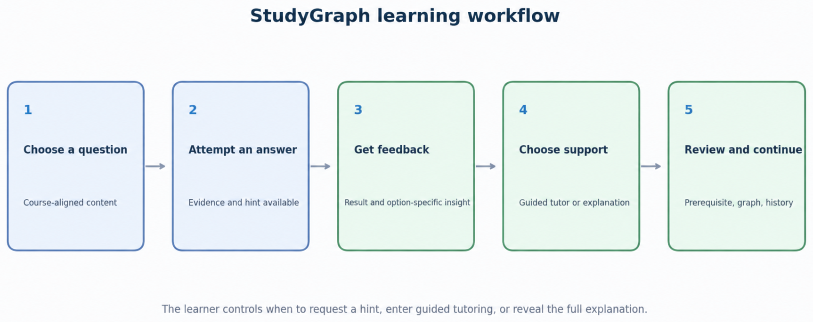
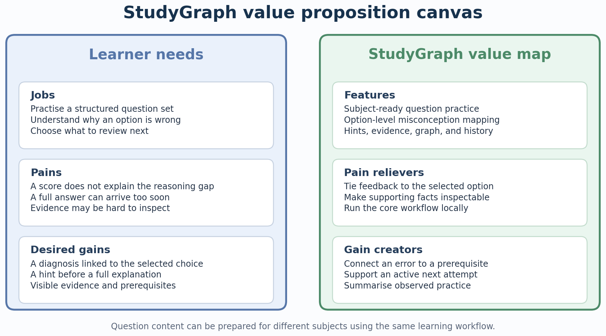

# 1 Introduction and Project Context

*Author: Yongtong Lin (50106038) | JC2001 Group 5*

## 1.1 Problem and project context

Many digital revision tools make it easy to practise, but a correct/incorrect mark often gives limited guidance about what to do next. The same wrong score can reflect different reasoning: a learner may have confused two concepts, missed a prerequisite condition, or followed the right method with an incorrect step. StudyGraph is designed to make this feedback more actionable by connecting each selected answer to the concept being tested, the reasoning associated with that option, relevant prerequisites, and supporting evidence.

In a processor-pipeline question, for example, different distractors can represent confusion between data, structural, and control hazards. StudyGraph links the chosen distractor to its corresponding misconception, then offers a short hint and access to a question-specific concept graph. This gives the learner a route from an answer to a targeted review action, while keeping the explanation tied to inspectable question content. The same interaction pattern can be applied to other subjects when their question content is structured in the same way.

## 1.2 Educational and technical background

Effective feedback answers three practical questions: what is the task asking, how does the current reasoning compare with the task, and what should the learner try next? Hattie and Timperley (2007) distinguish feedback about the task, the process, and self-regulation. For StudyGraph, the most useful response is therefore more than a correctness label: it identifies the misconception indicated by the selected option, points to the prerequisite or reasoning step to reconsider, and gives the learner a next action. StudyGraph therefore focuses feedback on the learner’s reasoning and the next step, rather than on personal judgement.

The timing and level of support matter as well. Before answering, a learner can inspect the question evidence or request a first-level hint, but the system keeps the correct answer hidden. After submission, it immediately identifies the misconception associated with the selected option and points to a relevant prerequisite. The learner can then open the guided tutor or choose to reveal the full explanation. This sequence preserves an initial attempt, makes help available at the moment of difficulty, and gives the learner control over how much explanation to see. VanLehn’s (2011) review compares answer-based, step-based, and substep-based tutoring; its results caution against assuming that ever more detailed assistance is automatically better. StudyGraph uses focused option-level feedback followed by learner-controlled help, matching the kind of support to the stage of the attempt.

Practice questions also prompt retrieval: learners must bring relevant knowledge to mind before receiving an explanation. Roediger and Karpicke (2006) found that retrieval through testing supported later retention under the conditions they studied. StudyGraph requires an initial answer before revealing the full explanation, while keeping the first-level hint optional, while its hints are intended to keep learners working through the problem rather than immediately replacing their reasoning with a worked answer. The explanation remains available when feedback is needed to correct or consolidate understanding.

The question-specific graph makes relationships among a topic, prerequisites, and common misconceptions visible. It complements rather than replaces a formal learner model. Knowledge-tracing methods estimate a learner’s changing knowledge state from repeated observations (Corbett and Anderson, 1995); StudyGraph’s practice dimensions instead summarise tagged attempts and provide a navigable view of question content. This distinction gives learners a useful map of what is connected without overstating what the progress view measures. VanLehn’s review also found that well-designed intelligent tutoring systems can support learning, while showing that tutoring format alone does not determine effectiveness. StudyGraph therefore combines structured content, diagnostic feedback, and controlled assistance as complementary parts of one workflow (VanLehn, 2011; Kulik and Fletcher, 2016).

For optional model-assisted tutoring, StudyGraph supplies the current question and its evidence to the server-side model endpoint. Retrieval-augmented generation research shows how retrieved material can ground responses in external knowledge (Lewis et al., 2020). In this design, evidence gives the tutor a relevant basis for its prompt and makes the basis visible to the learner; the local tutor remains available when an external service is not configured.

## 1.3 Related study systems

StudyGraph sits among flashcard systems, practice-test services, and conversational tutors. Anki centres on card review and scheduling, Quizlet offers flashcards and practice tests from study material, ChatGPT Study Mode offers guided study conversations, and Khanmigo is presented by Khan Academy as an AI tutor and teaching assistant. These products support different stages of revision, from remembering facts to exploring a topic through dialogue.

StudyGraph focuses on the step between an answer and a useful next action. Its distinguishing workflow connects the chosen distractor to a specific misconception, prerequisite, and supporting evidence. This positions the product as a complementary diagnostic layer: learners can practise in a structured way and then follow a visible route into the relevant concept or prerequisite.

**Table 1.1 Comparison of study systems**

| System | Study approach | Response to a wrong answer | Evidence and prerequisite links | Offline/core use |
| :--- | :--- | :--- | :--- | :--- |
| StudyGraph | Curated MCQ practice with a question-specific graph | Maps a selected distractor to a named misconception and prerequisite | Authored evidence is displayed with source status | Core local workflow; model endpoint optional |
| Anki | Flashcards and scheduled review | Depends on the card content; option-level diagnosis is not its central function | Deck content is user-created or shared; no required concept graph | Desktop study is local; synchronisation uses AnkiWeb |
| Quizlet | Flashcards and practice tests generated from study material | Explanation features depend on the activity and plan; no consistent option-to-prerequisite graph is documented | Uses uploaded notes or sets; availability varies by feature and language | Online service; feature access varies by plan and region |
| ChatGPT Study Mode | Guided conversation, practice questions, and explanations | Can discuss a missed answer through generated dialogue | Can work with user-provided material; output still needs checking | Online service with account and usage rules |
| Khanmigo | AI tutoring and teaching support | Guides learners through questions and hints | Tutor integrated with Khan Academy content; available features vary by access route | Online service; access conditions vary by location and age |

**Figure 1.2. StudyGraph learning workflow.**

## 1.4 Intended users and stakeholders

We designed StudyGraph for learners who practise through structured questions and want to understand why an answer is right or wrong. The learning workflow is not tied to a university major: although the current question bank focuses on computing and software engineering, the same pattern—question, answer options, concepts, misconceptions, prerequisites, evidence, and explanation—can support other disciplines. To add a subject, its questions must be converted into the supported content structure and its options linked to relevant concepts, misconceptions, prerequisites, and evidence. The current application does not ingest arbitrary raw files unchanged; subject expansion is a content-preparation task, not a limit on who can use the learning workflow.

The user needs in Table 1.3 follow from the product workflow and the content and deployment tasks required to operate it. An independent learner needs to practise and identify a useful next review step. A learner who gets stuck needs a hint before a complete explanation and a way to inspect the evidence. Educators, instructional designers, and learning-platform teams are content and deployment stakeholders: they can prepare question sets, define option-level misconceptions, and select evidence and prerequisites for their courses. The application currently serves the learner-facing practice workflow. A content team prepares or converts question sets into the supported format; arbitrary raw files are not automatically imported.

Educators and instructional designers define learning objectives and prepare questions, while institutions and education providers select how the practice workflow fits their teaching environment. These stakeholders shape the content and deployment; learners remain the primary users of the current application.

**Table 1.3 Intended users and stakeholders**

| User / stakeholder | Goal | StudyGraph value |
| :--- | :--- | :--- |
| Independent learner | Practise a topic and decide what to review next | Option-specific diagnosis, evidence, and a linked prerequisite |
| Learner seeking guidance | Work through difficulty without seeing the full answer immediately | Learner-controlled hints, guided prompts, and an explanation when requested |
| Educator or content designer | Build question sets that reflect a course's concepts and common errors | A structured content model that links questions, options, evidence, prerequisites, and topic graphs |
| University or education provider | Offer consistent formative practice across subjects | Reusable software with local deployment and institution-specific content packages |

**Figure 1.1. StudyGraph value proposition canvas.**

## 1.5 Project objectives

We set five objectives to guide our design, implementation, and evaluation of StudyGraph.

**Table 1.2 Project objectives**

| No. | Project objective |
| :--- | :--- |
| 1 | Deliver a runnable StudyGraph application by 14 December 2026, supporting question practice, option-level diagnosis, staged help, evidence inspection, knowledge-graph navigation, and learning history. |
| 2 | Develop a source-traceable content set with at least 15 reviewed demonstration questions and a reproducible evaluation corpus. |
| 3 | Compare a fixed baseline with an evidence-assisted configuration on the same held-out question IDs, reporting accuracy, invalid responses, evidence support, and latency. |
| 4 | Verify functional and non-functional requirements through automated tests, responsive browser checks, and installation on a clean environment. |
| 5 | Deliver the technical report, runnable software package, 8–12 page user manual, and 15-minute presentation. |

## 1.6 Main features, practical and business value

Our system brings together domain filtering, multiple-choice practice, option-level misconception diagnosis, first-level hints, guided tutoring, evidence inspection, a question-specific knowledge graph, and local learning history. Its five practice dimensions—conceptual recall, prerequisite reasoning, misconception recognition, procedural accuracy, and cross-topic reasoning—organise the types of question represented in the content set. Together, these features turn an answer into a structured feedback path: the learner can identify the concept to revisit, inspect the relevant evidence, and return to practice.

In practice, we provide a self-study and formative-learning workflow that runs with locally packaged content and does not depend on an external model for its core functions. Learners receive consistent, option-specific feedback at their own pace. Educators can organise questions around course concepts and prerequisites, review the evidence behind a diagnosis, and extend the workflow to further subjects by preparing compatible content. The system thus supports repeatable practice while leaving educators in control of the instructional material.

Our business value comes from combining reusable software with institution-specific content. One platform can support multiple courses, while universities, tutoring providers, and education technology companies can tailor question banks to their own curricula. Potential delivery models include institutional licensing, branded deployments, question-bank conversion, and ongoing content-maintenance services. This creates value for organisations that need a consistent practice experience across courses without commissioning a separate application for every subject.

The content-led model provides a clear route for growth: begin with a well-defined subject bank, then add reviewed content packages for other fields as demand develops. The commercial opportunity will depend on content quality, integration with existing learning platforms, and sustained use by learners and educators. These are practical conditions for scaling the product, rather than reasons to limit its intended audience.

### Chapter 1 References

Anki (n.d.) Anki: powerful, intelligent flashcards. Available at: https://apps.ankiweb.net/ (Accessed: 23 October 2026).

Corbett, A.T. and Anderson, J.R. (1995) “Knowledge tracing: Modeling the acquisition of procedural knowledge”, User Modeling and User-Adapted Interaction, 4(4), pp. 253–278. doi: 10.1007/BF01099821.

Hattie, J. and Timperley, H. (2007) “The power of feedback”, Review of Educational Research, 77(1), pp. 81–112. doi: 10.3102/003465430298487.

Khan Academy (n.d.) Meet Khanmigo: Khan Academy’s AI-powered teaching assistant and tutor. Available at: https://www.khanacademy.org/khan-labs (Accessed: 23 October 2026).

Kulik, J.A. and Fletcher, J.D. (2016) “Effectiveness of intelligent tutoring systems: A meta-analytic review”, Review of Educational Research, 86(1), pp. 42–78. doi: 10.3102/0034654315581420.

Lewis, P. et al. (2020) “Retrieval-augmented generation for knowledge-intensive NLP tasks”, Advances in Neural Information Processing Systems, 33, pp. 9459–9474. Available at: https://arxiv.org/abs/2005.11401.

OpenAI (n.d.) Using study mode in ChatGPT. Available at: https://help.openai.com/en/articles/11780217-using-study-mode-in-chatgpt (Accessed: 23 October 2026).

Quizlet (n.d.) Studying with Practice Tests. Available at: https://help.quizlet.com/hc/en-us/articles/25946589648013-Studying-with-Practice-Tests (Accessed: 23 October 2026).

Roediger, H.L. and Karpicke, J.D. (2006) “Test-enhanced learning: Taking memory tests improves long-term retention”, Psychological Science, 17(3), pp. 249–255. doi: 10.1111/j.1467-9280.2006.01693.x.

VanLehn, K. (2011) “The relative effectiveness of human tutoring, intelligent tutoring systems, and other tutoring systems”, Educational Psychologist, 46(4), pp. 197–221. doi: 10.1080/00461520.2011.611369.
