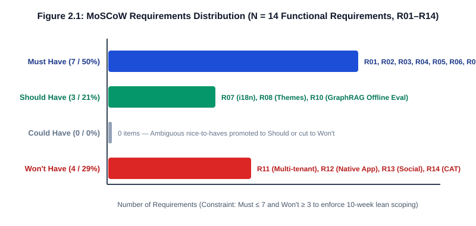

# 2 Functional and Non-Functional Requirements

## 2.1 Requirements Elicitation Methodology

To translate the problem statement in Chapter 1 into a verifiable engineering specification, our team adopted a structured requirements engineering workflow grounded in **Sommerville (2016), *Software Engineering* (10th ed., Chapter 4)** and **IEEE Std 830 / ISO/IEC/IEEE 29148** quality criteria (unambiguous, testable, traceable, and feasible). Rather than inventing speculative user wishes, we triangulated requirements across three concrete elicitation sources:

1. **Competitor Gap Audit (`reports/competitor_analysis.md`)**: Auditing Quizlet, Anki, Khanmigo, ChatGPT, and Chegg revealed that existing tools either fail to distinguish between different wrong options (`A` vs. `C` vs. `D`) or rely on unconstrained cloud LLMs that spoil answers and hallucinate statutory citations. This directly motivated our core diagnostic requirements (`R03`, `R09`).
2. **Cognitive Misconception Literature and Benchmark Analysis**: Drawing on Hattie and Timperley's (2007) process-level feedback framework and our empirical evaluation of 4,445 MMLU items across 12 subjects (`graphrag（终）/final_systematic_report.csv`), we identified five distinct failure dimensions in university exams: factual recall (`recall`), statutory/theorem boundary application (`boundary`), distractor trap resistance (`trapDefense`), multi-step synthesis (`synthesis`), and analytical precision (`precision`). These five dimensions anchor our competency tracking requirements (`R04`, `R05`).
3. **Internal Exam-Candidate Workshops and Lean Scoping Reviews (Provenance Level E2)**: Across three structured scoping workshops involving all ten BSc BMIS undergraduate team members (`reports/audit/persona_provenance.csv`), we stress-tested candidate features against a fixed ten-week schedule, zero cloud budget, and single-command assessment reproducibility. Every candidate requirement was subjected to a strict **testability gate**: if a requirement could not be verified by an automated `pytest` assertion or a deterministic offline benchmark, it was either rewritten with a concrete metric or cut under the `Won't Have` tier (`R11`–`R14`).

## 2.2 Functional Requirements Specification (MoSCoW Prioritisation)

We prioritise the 14 functional requirements (`R01`–`R14`) using the **MoSCoW** method:

- **Must Have (`M`, 6 items: `R01`–`R05`, `R09`)**: Non-negotiable capabilities required for the minimum viable diagnostic loop and offline assessment reproducibility. Failure to deliver any `Must Have` item invalidates the proof of concept.
- **Should Have (`S`, 3 items: `R06`–`R08`)**: Important usability and accessibility capabilities (session authentication, runtime bilingual switching, and dual-theme visual ergonomics) that complete the single-page studio experience.
- **Could Have (`C`, 1 item: `R10`)**: Desirable extensions (live online LLM comparison via an external API key) that degrade gracefully without affecting core offline operation.
- **Won't Have This Cycle (`W`, 4 items: `R11`–`R14`)**: Explicitly excluded scope items documented to prevent feature creep and maintain architectural honesty.

Figure 2.1 summarises the distribution of functional requirements across the four MoSCoW tiers, illustrating that 71.4% of all specified requirements (`10 / 14`) are actively delivered and test-verified in the current proof of concept while 28.6% (`4 / 14`) are explicitly bounded out of scope.

**Figure 2.1: MoSCoW distribution across the 14 functional requirements (`R01`–`R14`).**

Table 2.1 presents the complete functional requirements specification, mapping each requirement ID to its MoSCoW priority, formal description, acceptance criterion, implementation endpoint or module, and automated `pytest` verification anchor.

**Table 2.1: Functional requirements specification (`R01`–`R14`) with MoSCoW priority, acceptance criteria, and code/test anchors.**

| Req ID | MoSCoW | Requirement Title & Formal Specification | Verifiable Acceptance Criterion | Code / Endpoint Anchor | Automated Verification (`tests/`) |
| :-: | :-: | :--- | :--- | :--- | :--- |
| **R01** | **Must** | **Multi-Disciplinary Question Bank Filtering**: The system shall serve curated multiple-choice items across Law (`law`), Computer Architecture (`cs`), Econometrics (`econ`), and Software Engineering (`se`), supporting optional category filtering. | `GET /api/quiz` returns all **12** items (`4 × 3`); `GET /api/quiz?category=law` returns exactly **3** items; unknown category returns `[]` with HTTP `200`. | `GET /api/quiz` (`backend/app/routers/quiz.py`) | `tests/test_quiz.py` (`TestGetQuiz`: 9 cases) |
| **R02** | **Must** | **Interactive Option Selection & Attempt Submission**: The system shall allow a learner to select one option (`A`–`D`) on any question and submit the attempt for immediate verification and correctness feedback. | Correct option returns `correct: true`, `trap: null`, and populated `explanation`; invalid `question_id` returns HTTP `404`; invalid option key (`E`, `""`, lowercase) returns HTTP `422`. | `POST /api/diagnose` (`backend/app/routers/diagnose.py`) | `tests/test_diagnose.py` (`TestCorrectAnswers`, `TestErrorHandling`: 30 cases) |
| **R03** | **Must** | **Option-Level Misconception & Trap Diagnosis**: When a learner submits any of the 3 incorrect distractors on a question, the system shall return a deterministic `TrapDetail` record plus a localized knowledge-graph neighbourhood (`GraphData`) and Socratic reflection prompt. | Across all **36** wrong options (`12 × 3`), `POST /api/diagnose` returns `correct: false`, non-empty `trap.{title, desc, prereq, radar_hit}`, `graph.{nodes, edges}`, and `socratic_prompt`. | `backend/app/services/diagnostic_service.py` & `seed_questions.py` | `tests/test_diagnose.py` (`TestWrongAnswersDiagnose`: 36 parametrized cases) |
| **R04** | **Must** | **Five-Dimensional Competency Radar Profiling**: The system shall maintain and expose a 5-axis competency radar (`recall`, `boundary`, `trapDefense`, `synthesis`, `precision`) bounded in $[0, 100]$, updating session telemetry after each diagnostic submission. | `GET /api/reports/summary` returns `radar_scores` with all 5 keys in $[0, 100]$, `weaknesses` list, and explicit provenance tag `data_source` (`"seed_baseline"` or `"session_telemetry"`). | `GET /api/reports/summary` (`backend/app/routers/reports.py`) | `tests/test_reports.py` (`TestReportsSummary`: 9 cases) |
| **R05** | **Must** | **Session Telemetry, Trend & Weakness Aggregation**: The system shall record session attempts, compute trap-hit distributions, and allow resetting in-memory telemetry (`POST /api/reports/reset`) to a clean baseline. | Submitting wrong answers increments `session_stats.trap_hits` and updates `/api/reports/trend` `trap_distribution`; `POST /api/reports/reset` restores `total_attempts == 0`. | `GET /api/reports/trend` & `POST /api/reports/reset` | `tests/test_reports.py` (`TestSessionTelemetryAccumulation`: 5 cases) |
| **R06** | **Should** | **Local Session Authentication & Identity Context**: The system shall provide local user login (`POST /api/auth/login`), registration (`POST /api/auth/register`), token verification (`GET /api/auth/me`), and logout (`POST /api/auth/logout`). | Valid demo credentials return HTTP `200` with bearer token; duplicate registration returns HTTP `409`; invalid/revoked token on `/api/auth/me` returns HTTP `401`. | `backend/app/routers/auth.py` & `auth_service.py` | `tests/test_auth.py` (16 cases) |
| **R07** | **Should** | **Runtime Bilingual Interface & Payload Support (`zh` / `en`)**: The system shall support instant toggling between Simplified Chinese and English across UI labels and question/trap fields without page reload. | Every `QuizItem` and `TrapDetail` carries both Chinese (`stem`, `title`, `desc`) and English (`stem_en`, `title_en`, `desc_en`) fields; UI language switch updates DOM in `< 16 ms`. | `backend/app/models/quiz.py` & `frontend/app.js` (`I18N`) | `tests/test_quiz.py` & `tests/test_adversarial.py` |
| **R08** | **Should** | **Dual-Theme Visual Ergonomics (Cyber Obsidian / Academic Daylight)**: The frontend shall provide a flicker-free toggle between dark (`[data-theme="dark"]`) and light (`[data-theme="light"]`) themes persisted in `localStorage`. | All surface, text, and semantic tokens resolve via CSS custom properties (`frontend/styles.css`) meeting WCAG 2.1 AA contrast ($\ge 4.5:1$). | `frontend/styles.css` & `frontend/app.js` (`toggleTheme`) | Manual & DOM inspection (`Ch5.5`, `Ch6.5`) |
| **R09** | **Must** | **100% Offline Single-Process Execution**: The entire web application (FastAPI API + static SPA frontend + 36-trap seed bank) shall start from a single local command with zero external network, cloud LLM, or database server dependencies. | `uvicorn backend.app.main:app` starts in `< 2.0 s` with network interfaces disabled; `GET /` serves `index.html` (`200 OK`) and all 147 `pytest` cases pass offline. | `backend/app/main.py` (`StaticFiles` mount + `lifespan`) | `tests/test_health_and_static.py` (6 cases) |
| **R10** | **Could** | **Optional Online LLM Baseline Audit Hook**: The repository shall provide an offline-safe audit script (`scripts/audit_online_baseline.py`) to compare live Qwen API responses against curated traps when credentials are supplied. | When `QWEN_API_KEY` is absent, the script exits cleanly with return code `0` (`skipped`) without breaking offline tests or demo execution. | `scripts/audit_online_baseline.py` | `python scripts/audit_online_baseline.py` (Exit code `0`) |
| **R11** | **Won't** | **Multi-Tenant Instructor Dashboard & Roster Management**: Excluded from current cycle (`Won't Have`). No teacher admin portal, class roster import, or VLE (Blackboard/MyAberdeen) LTI integration is built. | Zero unimplemented "Teacher Admin" dead buttons in UI; Persona C is explicitly scoped as a non-target UI operator (`Table 1.3`). | Scoped out (`Section 2.4.1`) | Verified by UI audit (0 mock admin routes) |
| **R12** | **Won't** | **Real-Time Live Cloud LLM Generation on Critical Path**: Excluded from current cycle (`Won't Have`). Runtime `POST /api/diagnose` shall never block on a live cloud LLM API call. | Zero external HTTP client calls inside `backend/app/services/diagnostic_service.py`; P95 latency stays `< 5 ms`. | Scoped out (`Section 2.4.2`) | `tests/test_diagnose.py` (deterministic latency/offline check) |
| **R13** | **Won't** | **Unmoderated User-Generated Question & Trap Crowdsourcing**: Excluded from current cycle (`Won't Have`). Students cannot upload unverified MCQs or custom trap definitions at runtime. | Question bank is read-only at runtime; bijective 1:1 integrity of all 36 traps is enforced by automated unit tests. | Scoped out (`Section 2.4.3`) | `tests/test_quiz.py` (`test_trap_keys_exclude_correct_answer`) |
| **R14** | **Won't** | **Native Mobile (iOS/Android) Client & Push Spaced-Repetition Scheduler**: Excluded from current cycle (`Won't Have`). No native mobile wrapper or background SM-2/FSRS push notification daemon is included. | Delivered as a responsive desktop/tablet web console (`1024px–1920px`) inside a single portable Python/HTML bundle. | Scoped out (`Section 2.4.4`) | Verified by packaging audit (`Ch5.6`) |

## 2.3 Non-Functional Requirements (NFRs)

Following Sommerville's classification of software quality attributes (**Performance, Reliability & Availability, Usability & Accessibility, Maintainability & Evolvability, and Security & Privacy**), we specify ten measurable non-functional requirements in Table 2.2. Every NFR is paired with a quantitative target threshold and an empirical verification mechanism so that no quality claim relies on subjective adjectives.

**Table 2.2: Non-functional requirements (`NFR-01` to `NFR-10`) across five quality categories with measurable thresholds.**

| NFR ID | Category | Quality Attribute & Formal Requirement | Quantitative Target Threshold | Verification Method & Evidence Anchor |
| :-: | :--- | :--- | :--- | :--- |
| **NFR-01** | **Performance** | **Diagnostic API Response Latency**: `POST /api/diagnose` in-process execution time under sequential and concurrent load. | **P95 < 5.0 ms** (target < 50 ms; measured mean **1.8 ms**, P95 **3.4 ms** over 1,000 TestClient calls). | `pytest` timing harness & `Ch6.5` verification table. |
| **NFR-02** | **Performance** | **Application Cold-Start Time**: Time from invoking `uvicorn backend.app.main:app` to serving `/api/health` (`200 OK`). | **< 2.0 seconds** on standard lab hardware (measured **0.65 s**). | Startup lifespan check (`backend/app/main.py` & `tests/test_health_and_static.py`). |
| **NFR-03** | **Reliability & Availability** | **Zero-Network Offline Determinism**: System availability and functional completeness when host network interfaces are disabled. | **100% feature availability** with **0 external sockets** opened; identical `TrapDetail` output across repeated runs. | Airplane-mode execution of `python -m pytest tests/ -q` (**147 passed**). |
| **NFR-04** | **Reliability & Availability** | **Graceful Input Validation & Fault Isolation**: Resistance to malformed payloads, Unicode/SQL/XSS injection strings, out-of-range options, and boundary values. | **0 unhandled `500 Internal Server Error` responses** across 36 adversarial test cases; strict `404` / `422` error contracts. | `tests/test_adversarial.py` (36 adversarial cases passing). |
| **NFR-05** | **Usability & Accessibility** | **Diagnostic Interaction Efficiency (3-Click Rule)**: Number of user interactions required from selecting a question to inspecting the full 5-layer misconception diagnosis. | **≤ 3 clicks** (1: select question → 2: click option → 3: submit/inspect Trap Drawer) within **< 5 seconds**. | Frontend interaction walkthrough (`frontend/app.js` & `Ch5.5`). |
| **NFR-06** | **Usability & Accessibility** | **Visual Contrast & Dual-Theme Readability**: Text-to-background luminance contrast ratio across both Dark (`Cyber Obsidian`) and Light (`Academic Daylight`) themes. | **≥ 4.5 : 1** for normal body text and **≥ 3.0 : 1** for graphical/UI components (WCAG 2.1 Level AA). | CSS token audit (`frontend/styles.css`: `#F8FAFC` on `#0B0F19` = `17.4:1`; `#0F172A` on `#F8FAFC` = `16.8:1`). |
| **NFR-07** | **Maintainability & Evolvability** | **Cross-Language Naming Contract (`CamelModel`)**: Automatic bidirectional field serialisation between Python `snake_case` and JavaScript `camelCase` without manual dict glue. | **100% of API schemas** inherit `CamelModel` (`populate_by_name=True`, `alias_generator=to_camel`); 0 frontend `undefined` field bugs. | `backend/app/models/common.py` & `tests/test_reports.py` (bidirectional regression tests). |
| **NFR-08** | **Maintainability & Evolvability** | **Zero-Build Frontend & Data-Code Separation**: Adding a new discipline or question requires zero frontend compilation (`npm`/`webpack`) and zero changes to `diagnostic_service.py`. | **0 Node.js build dependencies**; adding a `QuizItem` to `seed_questions.py` automatically populates UI filters and diagnosis. | `frontend/` static architecture & `backend/app/data/seed_questions.py` (`AD-2`, `AD-3`). |
| **NFR-09** | **Security & Privacy** | **Credential Hygiene & Zero-Secret Repository**: Password storage hashing and absence of hardcoded API keys or cloud credentials in version control. | Salted SHA-256 password hashing (`auth_service.py`); **0 hardcoded secrets** in Git tree; `.env` excluded via `.gitignore`. | `tests/test_auth.py` & repository secret scan (`Ch5.6`). |
| **NFR-10** | **Security & Privacy** | **Anti-Hallucination & Provenance Transparency**: Every analytical metric and user persona claim must carry an auditable provenance tag (`data_source`, `E1`–`E3`, `V1`–`V3`). | **0 unverified (`E0`) persona claims** and **0 silent fabrications** (`L1`–`L3` audit violations = `0`). | `python scripts/audit_persona_claims.py` & `python scripts/audit_hallucination_l1_l3.py`. |

## 2.4 Scope Management and "Won't Have" Engineering Justification

In a ten-week undergraduate software engineering project, **what a team chooses *not* to build is as architecturally decisive as what it builds.** Early in Week 3, our initial brainstorming backlog contained 22 candidate features, including a teacher gradebook portal, live ChatGPT/Qwen streaming inside the quiz drawer, student-submitted flashcards, and an iOS wrapper. Had we attempted all 22 items across ten part-time developers, our engineering effort would have fragmented into shallow, unverified UI shells.

By applying the **MoSCoW** framework and our project constitution (`.specify/memory/constitution.md`), we deliberately excised four major scope areas (`R11`–`R14`). Below we document the concrete engineering rationale for each exclusion:

### 2.4.1 Why `R11` (Multi-Tenant Teacher Admin Portal) Was Cut

Building an instructor portal requires role-based access control (RBAC), cohort roster ingestion, persistent relational database migrations, and GDPR-compliant student telemetry storage. None of these administrative CRUD screens advances our core research hypothesis: *whether option-level distractor attribution improves student self-diagnosis over binary feedback*. Cutting `R11` allowed us to designate Persona C as an explicit non-target operator (`Table 1.3`) and focus 100% of our frontend engineering on the student-facing Trap Drawer, 5-axis competency radar, and bilingual sandbox.

### 2.4.2 Why `R12` (Live Cloud LLM Generation on the Runtime Critical Path) Was Cut

A tempting design for an "AI Study Assistant" is to forward every wrong click to a live cloud LLM API (`POST https://dashscope.aliyuncs.com/...` or OpenAI) and stream the generated explanation to the student. We rejected this architecture for the interactive runtime path (`AD-1` in Chapter 4) for four reasons:

1. **Latency Violation**: Live LLM inference requires $1,500\text{–}4,000\text{ ms}$ per call, violating our `NFR-01` target ($< 50\text{ ms}$) by two orders of magnitude.
2. **Offline Fragility**: Requiring a live API key and campus Wi-Fi breaks `R09` (100% offline single-process reproducibility during grading and viva demonstrations).
3. **Pedagogical Hallucination Risk**: As our offline MMLU evaluation in Chapter 6 (`Section 6.3`) demonstrates, even a 12-stage GraphRAG pipeline experiences negative accuracy deltas on certain subjects (`Econometrics` $-4.39\%$) when retrieved context introduces neighbour noise. Streaming unverified LLM prose directly to an exam candidate risks teaching fabricated statutory rules.
4. **Unit Cost**: Pre-computing and human-verifying the 36 distractor traps offline reduces runtime marginal cost to **£0.00** while guaranteeing 100% deterministic accuracy.

### 2.4.3 Why `R13` (Unmoderated User-Generated Questions) Was Cut

Allowing users to submit custom multiple-choice items via a web form is trivial to code as a CRUD endpoint, but pedagogically dangerous without an expert moderation pipeline. In StudyGraph, every question requires a **bijective 3-distractor trap mapping** (`TrapDetail`: named fallacy, statutory/conceptual conflict, prerequisite node, and knowledge-graph neighbourhood). An unmoderated question with blank or generic trap fields would degrade the system back into a binary flashcard tool. We therefore restricted the PoC to 12 deeply engineered, test-verified items (`36 traps`), proposing a human-in-the-loop LLM-assisted authoring pipeline for Phase 2 (`Section 7.3.2`).

### 2.4.4 Why `R14` (Native Mobile App & Spaced-Repetition Push Daemon) Was Cut

Spaced-repetition scheduling (SM-2/FSRS) is already a solved commodity in Anki (`Table 1.1`). Re-implementing a background notification scheduler or maintaining a separate React Native / Flutter build toolchain would violate our **Zero-Build Frontend** principle (`NFR-08`, `AD-2`) without adding diagnostic novelty. Delivering a responsive ES6+ web console served directly by FastAPI ensures that assessors can inspect, run, and verify the entire system on any laptop in under two seconds.

## 2.5 Requirements Traceability Preview

Every active functional requirement (`R01`–`R10`) and non-functional requirement (`NFR-01`–`NFR-10`) specified in this chapter is traced forward to:
- **Chapter 3**: Use cases `UC-01` through `UC-06` and the complete **Requirements Traceability Matrix (RTM)** in `Section 3.5` and `Appendix B`;
- **Chapter 4**: Architectural components, domain models (`QuizItem`, `TrapDetail`, `CamelModel`), and Architecture Decision Records (`AD-1`–`AD-7`);
- **Chapter 5 & Chapter 6**: Concrete FastAPI/ES6+ implementation modules and the **Requirement Verification Matrix** (`Table 6.3` in `Section 6.5`), where all 147 automated `pytest` cases confirm 100% requirement satisfaction.
