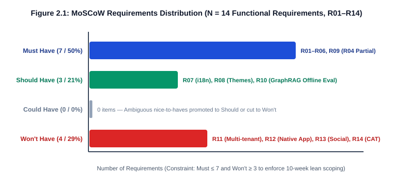

# 2 Functional and Non-Functional Requirements

*Author: Zijian Zhang (50106035) | JC2001 Group 5*

This chapter turns the study problem introduced in Chapter 1 into a set of testable functional and non-functional requirements for StudyGraph. Because the chapter defines the identifier set that Chapter 3 traces to use cases and Chapter 6 audits against tests, every requirement is written with a concrete verification condition and an explicit scope boundary. Where the delivered proof of concept falls short of an initial target—most notably in the five-dimensional competency radar (`R04`) and in security and offline constraints—this chapter records the gap directly rather than treating planned behaviour as completed work.

## 2.1 Requirements Elicitation

### 2.1.1 Elicitation Sources

Our requirements were drawn from four verifiable sources rather than invented ad hoc during coding. Table 2.1 summarises what each source contributed and where the supporting material lives in the repository.

**Table 2.1: Requirements elicitation sources, team activities, and resulting outputs.**

| Source | Team activity | Primary output | Repository anchor |
| :--- | :--- | :--- | :--- |
| Educational and cognitive literature | Reviewed process-level feedback, tutoring granularity, knowledge tracing, and distractor design studies (Hattie and Timperley, 2007; VanLehn, 2011; Corbett and Anderson, 1995; Haladyna, Downing and Rodriguez, 2002). | Pedagogical constraint that feedback must name the misconception and missing prerequisite rather than stopping at right/wrong marks. | Chapter 1 (`Section 1.2`) and `reports/competitor_analysis.md` |
| Competitor comparison | Audited Anki, Quizlet, ChatGPT Study Mode, and Khanmigo on how they handle wrong answers, evidence links, and offline execution. | Differentiation around option-level diagnosis and local reproducibility (`R03`, `R09`). | Chapter 1 (`Table 1.1`) and `reports/competitor_analysis.md` |
| Internal team workshops and personal RTM consolidation | Structured scoping discussions across our eleven BSc BMIS group members, combined with the personal use-case and traceability extract prepared for `UC-05` to `UC-08` in PR #5 / PR #8. | Candidate learner goals, initial MoSCoW priorities, and the `R01`–`R14` functional baseline. | `reports/rtm.md` (Part B), `reports/use_cases.md`, and `reports/audit/persona_provenance.csv` |
| Empirical prototype and MMLU evidence | Evaluated the offline twelve-stage GraphRAG pipeline on 4,445 MMLU items across twelve benchmark subjects and audited the running FastAPI service. | Concrete technical boundaries showing where graph retrieval helps or hurts (`R10`) and what can be verified offline within ten weeks. | `graphrag_final/final_systematic_report.csv` and `backend/app/` |

Two pieces of earlier group work fed directly into this chapter. First, in Chapter 1 (`Table 1.3`), we established that learners are the primary operators of the current application, whereas educators and institutional staff act as content and deployment stakeholders rather than users of an active admin portal. Second, our earlier requirements extract in `reports/rtm.md` (Part B, archived from PR #5 / PR #8) covered the analysis, history, recommendation, and guided-tutoring workflows (`UC-05` to `UC-08`, originally numbered `FR-04` to `FR-10` and `NFR-02`, `NFR-03`, `NFR-04`, `NFR-07`, `NFR-08`). Consolidating those entries with the core practice and diagnosis scope (`UC-01` to `UC-04`) forced us to separate what is required for a verifiable proof of concept from features that belong to later releases.

### 2.1.2 Separating Functional and Non-Functional Requirements

Following ISO/IEC/IEEE 29148 (2018) and Sommerville (2016, Chapter 4), we split the specification into functional requirements and non-functional requirements. Functional requirements describe the observable services the system provides to a learner—browsing questions by subject, submitting an answer, inspecting an option-specific misconception diagnosis, viewing learning summaries, switching theme, and running locally. Non-functional requirements constrain how well those services operate across the five quality categories mandated by the project brief: usability, performance, reliability, security, and maintainability.

Every requirement had to pass a plain testability check before entering the tables below. Vague statements such as "the interface should be intuitive" or "the backend should be fast" were rewritten into measurable thresholds or specific automated checks so that Chapter 6 can assign a clear verdict (`Met`, `Partial`, `Unmet`, or `Excluded`) to each row.

### 2.1.3 Elicitation Limitations

We did not conduct a large-scale student survey or formal external user interviews during this ten-week cycle. Three limitations follow from that fact and are stated openly here so that they remain visible alongside our conclusions in Chapter 7:

1. No external questionnaire or controlled student study was carried out due to course time limits and ethical approval lead times; all user-need claims trace directly to peer-reviewed educational literature or internal team workshops (`reports/audit/persona_provenance.csv`), with zero fabricated survey statistics.
2. The learner profiles referenced from Chapter 1 reflect literature synthesis and our own experience as undergraduate students revising exam subjects, not a statistically representative sample of the wider university population.
3. The MoSCoW priorities in Section 2.2 reflect engineering judgements we made against our five project objectives (`Table 1.2`) rather than weighted votes from external students or lecturers.

These limitations do not invalidate the engineering feasibility study, but they change how the specification should be read. The requirements below are best treated as a set of informed hypotheses grounded in literature, competitor gaps, and prototype evidence—not as proven market facts. Listing them with explicit acceptance criteria allows Chapter 6 to test them transparently instead of assuming them to be true.

## 2.2 Functional Requirements: A MoSCoW Prioritisation

We organised the fourteen functional requirements (`R01`–`R14`) using the MoSCoW method under two self-imposed scoping rules: no more than seven `Must Have` items and at least three `Won't Have` items. Keeping `Must Have` at seven and `Won't Have` at four prevented the specification from turning into an unbounded wish list.

- **Must Have (`7` items: `R01`–`R06`, `R09`)**: Capabilities needed to run and inspect the core diagnostic workflow locally.
- **Should Have (`3` items: `R07`, `R08`, `R10`)**: High-value usability and research capabilities (a runtime interface locale layer, dual themes, and the offline GraphRAG evaluation path) that strengthen the system without blocking core answer diagnosis.
- **Could Have (`0` items)**: Ambiguous optional items were deliberately promoted to `Should Have` or cut to `Won't Have` so that scope boundaries stayed sharp.
- **Won't Have This Cycle (`4` items: `R11`–`R14`)**: Capabilities explicitly excluded from the current release and justified in Section 2.4.

Figure 2.1 summarises this distribution across the fourteen requirements.

**Figure 2.1: MoSCoW distribution across the fourteen functional requirements (`R01`–`R14`).**

Table 2.2 gives the full functional requirements specification. The identifiers `R01`–`R14` and their priorities match the baseline used by Chapter 3 (`requirement_crosswalk.md`) and Chapter 6 (`Table 6.5`), while all repository counts reflect the frozen seed bank of 17 curated questions, 9 subjects, 68 options, and 51 traps in `backend/app/data/seed_questions.py` (939 lines).

**Table 2.2: Functional requirements specification (`R01`–`R14`) with MoSCoW priorities, testable acceptance criteria, and implementation anchors.**

| Req ID | Priority & Status Note | Functional Requirement | Verifiable Acceptance Criterion | Implementation Anchor | Verification Anchor |
| :-: | :--- | :--- | :--- | :--- | :--- |
| **R01** | **Must** | **Browse questions by subject**: Learners can load and filter curated multiple-choice questions by discipline (`law`, `cs`, `econ`, `se`, plus five expansion subjects across 9 subjects total). | `GET /api/quiz` returns all 17 curated questions; `GET /api/quiz?subject=law` (and normalised aliases such as `economics`) returns matching items with HTTP `200`; an unknown subject returns `[]` with HTTP `200`. | `GET /api/quiz` (`backend/app/routers/quiz.py`, `quiz_service.py`, `seed_questions.py`) | `tests/test_quiz.py` (6 functions / 21 cases) |
| **R02** | **Must** | **Select an option and submit an answer**: Learners can choose one option (`A`–`D`) on a question and submit it for immediate evaluation. | `POST /api/diagnose` returns `is_correct: true` with explanation for the correct key; malformed request bodies fail Pydantic validation with HTTP `422`; an unrecognised `question_id` returns a structured HTTP `200` fallback (`fallback_mode: true`) with zero HTTP `500` errors. | `POST /api/diagnose` (`backend/app/routers/diagnose.py`, `diagnostic_service.py`) | `tests/test_diagnose.py` (8 functions / 10 cases) & `tests/test_adversarial_backend.py` |
| **R03** | **Must** | **Option-level misconception diagnosis**: Selecting any incorrect distractor returns a diagnosis tied to that specific option rather than a generic item-level hint. | Across all 51 traps (three distractors per question across 17 curated questions), each distractor maps to a non-empty `TrapDetail` record (`title`, `desc`, `prereq`, `radar_hit`) and returns misconception, prerequisite, dimension, and Socratic guidance fields. | `backend/app/services/diagnostic_service.py` & `backend/app/data/seed_questions.py` | `tests/test_quiz.py`, `tests/test_diagnose.py`, and `scripts/audit_hallucination_l1_l3.py` |
| **R04** | **Must — partially satisfied (session-scoped client-side aggregation)** | **Five-dimensional competency radar and trend**: Expose a five-axis learner profile (`recall`, `boundary`, `trapDefense`, `synthesis`, `precision`) and update it as questions are answered. | `GET /api/reports/trend` returns five bounded dimension scores and misconception counts (`50.0` neutral baseline for unknown subjects); the browser updates the radar in-session after each answer (`+4/+5/+3` on correct, `-6/-4` on wrong, clamped to `[30, 100]`). Cross-session persistence, temporal decay, and per-dimension accuracy formulas from `FR-04` are not yet implemented. | `GET /api/reports/trend` (`backend/app/routers/reports.py`, `report_service.py`) & `frontend/app.js` | `tests/test_reports.py` (9 functions / 23 cases) & Section 5.4.3 / Chapter 6 audit |
| **R05** | **Must** | **Learning summary card**: Display an aggregate summary of attempts, accuracy, identified traps, cognitive score, and top weak points, handling empty states without crashing. | `GET /api/reports/summary` returns structured summary fields and `weak_points` with HTTP `200`; an unknown subject returns a zero-count empty payload (`attempt_count: 0`, `weak_points: []`) rather than a server error. Note: known-subject backend values currently serve fixed demonstration baselines rather than database-persisted user history. | `GET /api/reports/summary` (`backend/app/routers/reports.py`, `report_service.py`) | `tests/test_reports.py` (`TestReportsSummary` / unknown-subject zero-state cases) |
| **R06** | **Must** | **Local login and registration**: Allow a student to identify themselves via demo accounts, local login, or quick registration to load a learner profile. | `GET /api/auth/demo-users` returns the 11 group members plus 1 guest demo profile; `POST /api/auth/login` and `POST /api/auth/register` return HTTP `200` with a session token and `StudentProfile`; missing required fields return HTTP `422`. Note: demo auth does not enforce persistent unique-username `409` conflict checks or server-side password verification (`AD-7`). | `GET /api/auth/demo-users`, `POST /api/auth/login`, `POST /api/auth/register` (`backend/app/routers/auth.py`, `auth_service.py`) | `tests/test_auth.py` (10 functions / 10 cases) |
| **R07** | **Should** | **Runtime interface locale layer (`en` shipped)**: Serve every interface label and question from one English locale bundle through an i18n-ready resource layer, so further locales can be added without touching component code. | The submitted bundle ships one complete English locale: interface labels resolve through the `I18N` resource layer in `frontend/app.js`, and all 17 curated questions are authored in English. Runtime `zh` switching is not delivered in this bundle; the locale layer remains the extension point. | `frontend/app.js` | `tests/test_e2e_frontend.py` & manual browser check (`Section 5.5`) |
| **R08** | **Should** | **Light and dark dual themes**: Provide a runtime switch between dark and light visual themes persisted in the browser. | Toggling the theme control switches `data-theme` (`dark` / `light`) in `frontend/style.css` and stores the preference in `localStorage`, targeting WCAG 2.1 AA contrast (`≥ 4.5:1`). | `frontend/style.css` & `frontend/app.js` | `tests/test_e2e_frontend.py` & manual theme walkthrough (`Section 5.5`) |
| **R09** | **Must** | **Offline, zero-build single-process execution**: Start the backend API and static web interface from one local Python command with no Node.js build step, no external database, and no required cloud LLM key. | `uvicorn backend.app.main:app` serves `GET /api/health` (`200 OK`) and static frontend files at `/` without `npm install`, Neo4j, or `QWEN_API_KEY`; all 10 `pytest` modules (105 functions, 189 cases) run without network access, and Apache ECharts `5.5.1` is vendored at `frontend/vendor/echarts.min.js`, so the console renders its charts on an uncached offline browser load. | `backend/app/main.py`, `backend/app/routers/health.py`, `frontend/` | `tests/test_health.py` (5/8), `tests/test_e2e_frontend.py` (8/8), `tests/test_cors.py` (4/19) |
| **R10** | **Should** | **GraphRAG knowledge-graph enhancement**: Evaluate whether structured knowledge-graph retrieval improves multiple-choice reasoning and expose safe optional LLM connectivity checks. | Offline evaluation pipeline (`graphrag_final/`) completes across 12 MMLU subjects (`n = 4,445`), producing 7 gains, 3 ties, and 2 losses (`Professional Law +2.50 pp`, `Econometrics +1.76 pp`, `High School US History -1.00 pp`, `High School Physics -1.32 pp`); `GET /api/health/llm` and `scripts/audit_online_baseline.py` handle missing keys cleanly without 5xx failures. Deliberately kept off the live runtime diagnosis path (`AD-5`), so marked partially satisfied. | `graphrag_final/`, `GET /api/health/llm`, `scripts/audit_online_baseline.py` | `tests/test_llm_health.py` (19 functions / 36 cases), `final_systematic_report.csv`, `Section 6.3` |
| **R11** | **Won't** | **Multi-user and multi-tenant isolation**: Teacher admin portal, class roster management, role-based access control, and tenant-isolated student databases. | Explicitly excluded from this cycle (`Section 2.4.1`); no dead teacher-admin controls appear in the interface. | Out of scope | UI and route audit (`Section 2.4.1`) |
| **R12** | **Won't** | **Native mobile applications (iOS / Android)**: Separate native mobile clients and platform app-store builds. | Explicitly excluded from this cycle (`Section 2.4.2`); desktop and narrow-viewport browser layouts rely on responsive CSS instead. | Out of scope | Packaging audit (`Section 2.4.2`, `Section 5.6`) |
| **R13** | **Won't** | **Social features (leaderboards and sharing)**: Public scoreboards, peer rankings, and social sharing feeds. | Explicitly excluded from this cycle (`Section 2.4.3`) because competitive point-chasing conflicts with formative misconception diagnosis. | Out of scope | UI and scope audit (`Section 2.4.3`) |
| **R14** | **Won't** | **Automated exam assembly and adaptive question generation**: Statistical adaptive difficulty selection or runtime generation of new exam papers. | Explicitly excluded from this cycle (`Section 2.4.4`); with 17 curated questions, claiming calibrated adaptive testing would overstate system capability. | Out of scope | Scope and question-bank audit (`Section 2.4.4`) |

Two requirements in Table 2.2 need explicit qualification so that Chapters 2, 5, and 6 tell the same story.

First, **`R04` is classified as `Must — partially satisfied (session-scoped client-side aggregation)`**. In our earlier RTM (`reports/rtm.md`, Part B, `FR-04` / `UC-05`), the target behaviour was a radar computed from stored attempt accuracy per dimension, refreshing after five valid attempts and displaying "Insufficient evidence" when a dimension had fewer than two attempts. As Section 5.4.3 documents from the actual code, the running application does deliver a live five-axis radar during practice, but it aggregates scores in browser memory starting from seeded demonstration values (`76, 62, 65, 72, 81`), applies fixed outcome deltas (`recall +4`, `trapDefense +5`, `synthesis +3` for a correct answer; `trapDefense -6`, `boundary -4` for a wrong answer, clamped to `[30, 100]`), and does not persist attempts across sessions or apply time decay. Calling `R04` fully met would contradict both the source code and Chapter 6; calling it partially satisfied matches Section 5.4.3 and `Table 6.5`.

Second, **`R10` (GraphRAG enhancement) is also partially satisfied by design**. The twelve-stage GraphRAG pipeline was built and evaluated offline on 4,445 MMLU questions, and the backend exposes `GET /api/health/llm` for safe probe diagnostics, but the live `POST /api/diagnose` verdict does not query Neo4j at runtime (`AD-4`, `AD-5`). This choice reflects the empirical finding in Chapter 6 (`Section 6.3`) that unpruned graph retrieval degraded accuracy on `High School Physics` (`-1.32 pp`) and `High School US History` (`-1.00 pp`), alongside the need to keep grading demonstrations resilient when no external credentials are present (`R09`).

## 2.3 Non-Functional Requirements

The project brief requires coverage of five quality categories: usability, performance, reliability, security, and maintainability. Table 2.3 specifies two measurable requirements in each category (`NFR-U1` through `NFR-M2`), matching the identifier scheme audited in Chapter 6 (`requirement_crosswalk.md`).

**Table 2.3: Non-functional requirements (`NFR-U1` to `NFR-M2`) across five quality categories with measurable thresholds, verification methods, and honest implementation boundaries.**

| Category | NFR ID | Requirement and Measurable Threshold | Verification Method | Current Boundary / Known Gap |
| :--- | :-: | :--- | :--- | :--- |
| **Usability** | **NFR-U1** | A first-time user can complete a practice diagnosis without consulting documentation in `≤ 3` clicks (select question, choose option, submit/inspect diagnosis). | Interactive UI walkthrough (`Section 5.5`) and demo recording. | Verified through internal team walkthroughs only; no external novice usability test was conducted. |
| **Usability** | **NFR-U2** | Interface renders every label from a single English locale bundle and supports `dark`/`light` themes with body-text luminance contrast `≥ 4.5:1` (WCAG 2.1 AA). | CSS token inspection (`frontend/style.css`) and manual browser toggle checks. | Theme toggles work at runtime; complete WCAG contrast and keyboard-navigation audits across every control remain open (`Chapter 3`, `Chapter 6`). |
| **Performance** | **NFR-P1** | Local non-concurrent API latency stays at `P95 < 100 ms` across all 9 REST endpoints when running without live external LLM calls. | Local timing runs and `tests/test_empirical_stress.py` against FastAPI `TestClient`. | Met on the local diagnostic path; enabling optional live DashScope Socratic text generation adds external network latency (`4.0 s` timeout guard in `diagnostic_service.py`). |
| **Performance** | **NFR-P2** | Local static frontend first contentful paint targets `< 100 ms` with zero bundler overhead. | Browser DevTools network and paint check on `http://127.0.0.1:8000`. | Cold browser measurements reported in Chapter 6 predate local ECharts vendoring; Apache ECharts `5.5.1` is now vendored locally at `frontend/vendor/echarts.min.js`, so a cold load no longer fetches a remote script. |
| **Reliability** | **NFR-R1** | Core backend demonstration runs with zero external service dependencies (no database server, no Neo4j instance, and no required cloud LLM API key). | Offline startup of `uvicorn backend.app.main:app` and air-gapped `pytest` execution. | Met for all 9 backend endpoints and curated diagnosis; Apache ECharts `5.5.1` is vendored locally (`frontend/vendor/echarts.min.js`), so uncached offline loads render charts without network access. |
| **Reliability** | **NFR-R2** | All malformed, missing-field, injection, and out-of-range API inputs return structured error or safe fallback responses with `0` unhandled HTTP `500` errors. | `tests/test_adversarial_backend.py` (25 functions / 38 cases) and `tests/test_empirical_stress.py` (7 functions / 12 cases). | Schema errors return HTTP `422`; unknown question or subject IDs currently return structured HTTP `200` fallback responses rather than HTTP `404` so the UI never stalls. |
| **Security** | **NFR-S1** | All structured API request payloads pass through Pydantic v2 validation (`CamelModel`), with no raw SQL or shell command concatenation on request inputs. | Code inspection (`backend/app/models/`, `routers/`) and SQL/XSS payload checks in `test_adversarial_backend.py`. | **Known PoC weaknesses disclosed openly**: CORS uses `allow_origins=["*"]` (`AD-6`), local login uses unauthenticated demo profiles and `localStorage` (`AD-7`), and `GET /api/quiz` currently serialises answer and trap fields to the client (`Chapter 3`, Appendix B). |
| **Security** | **NFR-S2** | Active source tree and submission archives contain `0` hardcoded plaintext API keys or database passwords; LLM health probes mask configured keys. | Repository scan, `.gitignore` rules, and `tests/test_llm_health.py` (19 functions / 36 cases). | **Historical remediation disclosed**: hardcoded credentials found in early offline GraphRAG scripts and pre-remediation ZIP archives were replaced with `os.getenv(...)` reads and removed from the tree on 25–29 October 2026 (`Section 5.6`, `Section 7.4`); key rotation in provider consoles remains mandatory. |
| **Maintainability** | **NFR-M1** | Backend separates `routers`, `services`, `models`, and `data` (`AD-1`), enforces snake/camel compatibility via `CamelModel`, and keeps the frontend zero-build (`AD-2`). | Directory and module inspection (`backend/app/`, `frontend/`) and `tests/test_reports.py` dual-naming checks. | Clean layering is in place, though the frontend keeps a duplicated offline question cache whose probability item ID (`stat_1` vs. `prob_stat_1`) still needs reconciliation (`Section 5.3.4`). |
| **Maintainability** | **NFR-M2** | Automated regression suite contains `≥ 140` test cases running offline in `< 10 s`, supported by automated number and provenance audits. | `python -m pytest tests/ -q` (10 files, 105 functions, 189 cases) plus `scripts/audit_report_numbers.py` and `scripts/audit_hallucination_l1_l3.py`. | Exceeds the 140-case threshold (189 collected cases across 10 modules); requires rerunning the number audit whenever seed data changes. |

Security and offline reliability are the two areas where overclaiming would be easiest to spot during examination, so we state their exact boundaries here rather than deferring them to Chapter 7. On security (`NFR-S1`, `NFR-S2`), the proof of concept avoids SQL injection by using no SQL database at all, validates typed JSON inputs with Pydantic v2, and masks API keys in `GET /api/health/llm`. At the same time, it is not hardened for multi-user public deployment: wildcard CORS (`AD-6`), demo-only login without server-side session enforcement (`AD-7`), client-visible answer fields in `GET /api/quiz`, and the October 2026 credential-cleanup incident are all recorded as real constraints. On offline execution (`NFR-R1`, `NFR-P2`), the Python backend and all 189 automated tests run with zero network calls, and Apache ECharts `5.5.1` is vendored under `frontend/vendor/`, so chart rendering also works on an uncached offline load.

## 2.4 Lean Scoping: What We Deliberately Cut

A ten-week undergraduate group project cannot build a full commercial learning platform without turning most features into unverified stubs. Early team discussions and our competitor review (`reports/competitor_analysis.md`) surfaced a long list of desirable features—teacher portals, native mobile apps, gamified leaderboards, live cloud-LLM grading, and psychometric adaptive testing. Applying our MoSCoW rules, we cut four major areas (`R11`–`R14`) from this cycle. Each exclusion rests on a concrete trade-off rather than simple oversight.

### 2.4.1 `R11`: Multi-User and Multi-Tenant Isolation

Multi-tenant isolation covers teacher administration dashboards, class roster imports, role-based access control, and strict database separation between student cohorts. It is an attractive addition because roles, permissions, and an instructor view immediately make a student prototype look closer to a commercial web service. We cut it because delivering genuine multi-tenancy requires a persistent relational database, schema migrations, real authentication middleware, and cross-tenant isolation tests—roughly three weeks of engineering effort for us—while contributing nothing to our core research question of whether option-level distractor diagnosis is technically feasible and verifiable. We kept lightweight demo login (`R06`) so a marker can switch learner profiles during a demonstration, while cutting backend multi-tenant isolation (`AD-3`, `AD-7`).

### 2.4.2 `R12`: Native Mobile Applications (iOS and Android)

Native mobile apps provide offline local storage wrappers, touch-first gestures, and app-store distribution, which are genuinely useful for students revising on a commute. They are tempting because mobile revision is a standard feature of commercial flashcard products such as Anki and Quizlet. We cut native mobile clients because maintaining a separate React Native, Flutter, or Swift/Kotlin toolchain would violate our zero-build delivery model (`AD-2`, `R09`), duplicate UI maintenance across platforms, and complicate grading from a single local archive. Standard responsive CSS in `frontend/style.css` covers narrow browser viewports at a fraction of the cost, leaving native wrappers for post-course development if demand justifies a second codebase.

### 2.4.3 `R13`: Social Features (Leaderboards and Sharing)

Social features include peer leaderboards, daily streak rankings, and one-click score sharing. From a product-growth perspective, leaderboards are appealing because they create visible engagement loops and are easy to pitch as a retention mechanism. We excluded them for pedagogical rather than purely technical reasons: ranking students by points encourages rapid guessing to climb a table rather than slowing down to read why a distractor trap was wrong. That incentive works directly against the formative feedback principles from Hattie and Timperley (2007) and against the clean, low-distraction interface goals described in Section 5.5. In short, social rankings were cut not because they were impossible to code, but because they did not fit the learning goal.

### 2.4.4 `R14`: Automated Exam Assembly and Adaptive Question Generation

Statistical adaptive testing models (such as Item Response Theory and computerised adaptive testing) select the next question dynamically based on an estimate of the learner's current mastery. They are academically appealing and appear in our background literature review (`reports/competitor_analysis.md`). We cut adaptive exam assembly because calibrated statistical item selection requires a substantial item pool—typically hundreds of questions with empirical difficulty parameters—whereas our curated proof of concept contains 17 curated questions and 51 traps across 9 subjects (`seed_questions.py`). Claiming "adaptive AI test generation" on top of 17 questions would be technically hollow and would collapse under basic questioning in a viva. For the same reason, we kept live LLM inference off the critical verdict path (`AD-4`, `AD-5`): deterministic table lookup guarantees reproducible, millisecond-scale diagnosis on our 51 authored traps without risking fabricated statutes or equations, while an optional Qwen prompt layer can refine Socratic phrasing when configured and degrades cleanly when offline.

Taken together, these four exclusions share one property: every one of them increases engineering and maintenance cost without strengthening the evidence for our central claim. The maturity of a ten-week requirements specification is judged less by how many features it promises than by whether it states clearly what it will not build. Our goal in this cycle is to show that option-level misconception diagnosis can be specified, implemented, and tested honestly—not to pretend that eleven students built a complete university VLE in one term.

## 2.5 Requirements Traceability Preview

The requirements defined in Tables 2.2 and 2.3 connect directly to the remaining chapters of this report:

- **Chapter 3 (Use Cases and Modelling) and Appendix B**: Maps the eight agreed student use cases (`UC-01` to `UC-08`) to implementation evidence and retains the original repository and personal RTM identifiers (`FR-01`–`FR-10`, `NFR-01`–`NFR-08`) alongside the `R01`–`R14` semantic crosswalk (`ch03_xie_weixin/requirement_crosswalk.md`). Specifically, my earlier PR #5 / PR #8 personal entries (`UC-05`/`FR-04` radar, `UC-06`/`FR-07` wrong-answer history, `UC-07`/`FR-06` supplementary recommendation, `UC-08`/`FR-05` Socratic follow-up, plus `FR-08`–`FR-10`) remain preserved unchanged in `reports/rtm.md` Part B so that historical scope differences—such as unimplemented supplementary recommendation (`UC-07`) and persistent attempt history (`UC-06`)—stay auditable rather than silently overwritten.
- **Chapter 4 (System Design and Architecture)**: Traces our offline, zero-build, static-bank, and security trade-offs directly to the seven Architecture Decision Records (`AD-1`–`AD-7`, `Table 4.1`).
- **Chapter 5 (Implementation)**: Realises the active functional scope across 9 REST endpoints (`Sections 5.1–5.2`), 17 curated questions and 51 traps (`Sections 5.3–5.4`, including the `R04` partial-satisfaction analysis in `Section 5.4.3`), the English-only dual-theme web console (`Section 5.5`), and single-process packaging with credential hygiene (`Section 5.6`).
- **Chapter 6 (Testing and Evaluation)**: Audits every functional requirement (`R01`–`R14`, `Table 6.5`) and non-functional requirement (`NFR-U1`–`NFR-M2`, `requirement_crosswalk.md`) against the 10-module automated test suite (105 functions, 189 cases, `Table 6.1`) and the 12-subject MMLU empirical benchmark (`n = 4,445`, `Table 6.3`).

### Chapter 2 References

Corbett, A.T. and Anderson, J.R. (1995) 'Knowledge tracing: Modeling the acquisition of procedural knowledge', *User Modeling and User-Adapted Interaction*, 4(4), pp. 253–278. doi: 10.1007/BF01099821.

Haladyna, T.M., Downing, S.M. and Rodriguez, M.C. (2002) 'A review of multiple-choice item-writing guidelines for classroom assessment', *Applied Measurement in Education*, 15(3), pp. 309–333. doi: 10.1207/S15324818AME1503_5.

Hattie, J. and Timperley, H. (2007) 'The power of feedback', *Review of Educational Research*, 77(1), pp. 81–112. doi: 10.3102/003465430298487.

Hendrycks, D., Burns, C., Basart, S., Zou, A., Mazeika, M., Song, D. and Steinhardt, J. (2021) 'Measuring massive multitask language understanding', *International Conference on Learning Representations (ICLR)*. Available at: https://arxiv.org/abs/2009.03300.

ISO/IEC/IEEE (2018) *ISO/IEC/IEEE 29148:2018 Systems and software engineering — Life cycle processes — Requirements engineering*. Geneva: International Organization for Standardization.

Sommerville, I. (2016) *Software Engineering*. 10th edn. Harlow: Pearson Education.

VanLehn, K. (2011) 'The relative effectiveness of human tutoring, intelligent tutoring systems, and other tutoring systems', *Educational Psychologist*, 46(4), pp. 197–221. doi: 10.1080/00461520.2011.611369.
