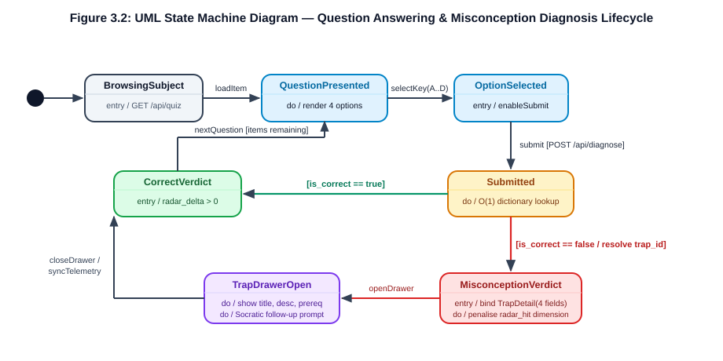

# 3 Use Cases and Requirements Modelling

## 3.1 Actor Identification and System Boundary

Following **Sommerville (2016), *Software Engineering* (10th ed., Chapter 5: System Modeling)** and the **UML 2.5 Use Case Specification** taught in Week 5 (`Lecture 6: System Modeling` and `Week 5 Use Case Lab`), we establish a formal behavioural model bridging the functional requirements in Chapter 2 (`R01`–`R10`) to the architectural components in Chapter 4.

A use case diagram defines a clear **System Boundary** (`StudyGraph / SmartStudy Assistant Single-Process Runtime`) separating internal software responsibilities from external entities (**Actors**). We identify two primary human actors, one secondary system/pipeline actor, and one explicitly excluded non-target actor:

1. **Primary Actor — `Student` (Exam Candidate, Personas A & B)**: An undergraduate or postgraduate learner operating the web console (`http://127.0.0.1:8000`) to filter multi-disciplinary questions, submit option attempts, inspect option-level misconception traps, and review 5-axis competency radar telemetry (`UC-01` through `UC-05`).
2. **Primary Actor — `Evaluator / Developer` (Course Assessor / Researcher)**: A marker or developer executing offline reproducibility checks, resetting session telemetry (`POST /api/reports/reset`), or running the offline GraphRAG MMLU benchmark evaluation (`UC-05`, `UC-06`).
3. **Secondary Actor — `Offline Seed & Graph Store` (`backend/app/data/` & `graphrag（终）/`)**: The deterministic local data subsystem supplying the 12 curated questions (`36 traps`), user credential fixtures (`seed_users.py`), and pre-computed MMLU knowledge-graph triples (`4,445` benchmark items).
4. **Explicitly Excluded Actor — `Course Instructor Admin` (Persona C)**: In strict alignment with `Table 1.3` and Requirement `R11` (`Won't Have`), no multi-tenant teacher administration actor interacts with the runtime UI.

## 3.2 UML 2.5 Use Case Diagram and Relationship Semantics

Figure 3.1 presents the UML 2.5 Use Case Diagram for StudyGraph, illustrating the system boundary, actors, six core use cases (`UC-01` to `UC-06`), and formal `«include»` and `«extend»` dependencies.

**Figure 3.1: UML 2.5 Use Case Diagram for the StudyGraph (SmartStudy) proof-of-concept system.**
(Source: Compiled from `specs/003-cycle3-startup-report/spec.md` and Week 5 UML modelling guidelines.)

### Formal Semantics of `«include»` vs. `«extend»` (Week 5 Lab Alignment)

A frequent modelling error in undergraduate software engineering reports is reversing the arrow direction or conflating `«include»` with `«extend»`. In Figure 3.1, we enforce strict UML 2.5 semantics:

- **`«include»` (Mandatory Sub-Behavior — Dashed Arrow from Base Use Case to Included Use Case)**:
  - `UC-02 (Submit Answer & Trigger Option-Level Trap Diagnosis) ──«include»──► UC-04 (Update 5-Axis Radar & Session Telemetry)`: Every time a student submits an answer in `UC-02` (`POST /api/diagnose`), the backend **unconditionally** executes `_record_diagnosis(question_id, correct, trap_title)` inside `backend/app/routers/reports.py` to update the in-memory session telemetry counters (`total_attempts`, `correct_count`, `trap_hits`). Because `UC-02` cannot complete its postcondition without updating session state, the dashed arrow points **from the base use case (`UC-02`) to the included use case (`UC-04`)**.
- **`«extend»` (Conditional Optional Behavior — Dashed Arrow from Extending Use Case to Base Use Case)**:
  - `UC-03 (Inspect Knowledge-Graph Prerequisite Subgraph & Socratic Prompt) ──«extend»──► UC-02 (Submit Answer & Trigger Option-Level Trap Diagnosis)` with **Extension Point: `Wrong Option Selected (correct == False)`**: When a student selects the *correct* option (`correct == True`), `POST /api/diagnose` returns `trap: null` and the interaction concludes with a green confirmation banner. Only when the guard condition `[selected_option != answer]` holds does the system populate `TrapDetail`, render the interactive SVG knowledge-graph neighbourhood (`GraphData`), and open the Socratic reflection drawer (`UC-03`). Similarly, `Export / Compare Online LLM Baseline (R10)` conditionally extends `UC-06` only when `[QWEN_API_KEY is present]`. In accordance with UML 2.5, the dashed `«extend»` arrow points **from the extending use case (`UC-03`) back to the base use case (`UC-02`)**.

## 3.3 Detailed Use Case Specifications (`UC-01` to `UC-06`)

To ensure every use case is directly implementable and testable, we provide structured tabular specifications for all six core use cases (`UC-01` through `UC-06`), explicitly detailing actors, triggers, preconditions, postconditions, main success scenarios, and alternative/exception flows mapped to HTTP status codes and `pytest` assertions.

### `UC-01`: Filter & Browse Multi-Disciplinary Question Bank (`R01`, `R07`, `R08`)

**Table 3.1a: Formal specification for Use Case `UC-01` (Filter & Browse Question Bank).**

| Field | Specification Details |
| :--- | :--- |
| **Use Case ID & Name** | **UC-01: Filter & Browse Multi-Disciplinary Question Bank** (`R01`, `R07`, `R08`) |
| **Primary Actor** | `Student` (Personas A & B) |
| **Trigger** | Student loads the application root (`GET /`) or clicks a discipline filter tab (`All`, `Law`, `Computer Architecture`, `Econometrics`, `Software Engineering`) or language toggle (`ZH` / `EN`). |
| **Preconditions** | FastAPI server is running locally (`uvicorn backend.app.main:app`); `SEED_QUESTIONS` (`12 items`) is loaded in memory (`backend/app/data/seed_questions.py`). |
| **Postconditions** | Question selector and active stem card render the matching `QuizItem` list in the active language (`zh` or `en`) and theme (`dark` or `light`); no answer or trap data is leaked prematurely. |
| **Main Success Scenario** | 1. Student selects a category pill (e.g., `law`) in the top navigation bar. 2. Frontend dispatches `GET /api/quiz?category=law`. 3. Backend router (`backend/app/routers/quiz.py`) filters `SEED_QUESTIONS` by `category == "law"` (`case-insensitive`) and serialises 3 `QuizItem` objects via `CamelModel`. 4. Frontend (`frontend/app.js`) renders the question navigation pills (`law_1`, `law_2`, `law_3`), question stem (`stem` / `stem_en`), difficulty badge, and four clickable options (`A`–`D`). |
| **Alternative & Exception Flows** | - **1a. Unknown Category Parameter (`GET /api/quiz?category=biology`)**: Backend returns HTTP `200 OK` with an empty JSON array `[]` (`tests/test_quiz.py::test_filter_unknown_category_returns_empty`); frontend displays an empty-state notice without crashing. - **4a. Runtime Language Switch (`R07`)**: Student clicks `EN`/`中文`; frontend re-binds `stem_en`/`options_en` in `< 16 ms` without network re-fetch. - **4b. Theme Toggle (`R08`)**: Student clicks theme icon; `document.documentElement.dataset.theme` switches between `"dark"` and `"light"` and persists to `localStorage`. |

### `UC-02`: Submit Answer & Trigger Option-Level Trap Diagnosis (`R02`, `R03`)

**Table 3.1b: Formal specification for Use Case `UC-02` (Submit Answer & Trigger Option-Level Trap Diagnosis).**

| Field | Specification Details |
| :--- | :--- |
| **Use Case ID & Name** | **UC-02: Submit Answer & Trigger Option-Level Trap Diagnosis** (`R02`, `R03`) |
| **Primary Actor** | `Student` (Personas A & B) |
| **Included / Extended Use Cases** | Mandatory `«include»` of **UC-04** (`Update Session Telemetry`); conditionally extended by **UC-03** (`Inspect Prerequisite Graph & Trap Drawer`) at extension point `Wrong Option Selected`. |
| **Trigger** | Student selects an option card (`A`, `B`, `C`, or `D`) on an active question (e.g., `law_1`) and clicks **"Submit & Diagnose"**. |
| **Preconditions** | An active `QuizItem` (`question_id` $\in$ `QUESTIONS_BY_ID`) is displayed; one option key is selected. |
| **Postconditions** | Backend returns a validated `DiagnoseResponse` (`CamelModel`); in-memory session telemetry is incremented (`UC-04`); UI renders either the verified explanation (`correct == True`) or invokes `UC-03` (`correct == False`). |
| **Main Success Scenario (Wrong Option — Diagnostic Path)** | 1. Student selects Distractor `A` on `law_1` and clicks Submit. 2. Frontend sends `POST /api/diagnose` with JSON body `{"question_id": "law_1", "selected_option": "A"}`. 3. Pydantic validates `DiagnoseRequest` (`selected_option` matches `^[A-D]$`). 4. `diagnose_answer("law_1", "A")` (`backend/app/services/diagnostic_service.py`) performs an $O(1)$ lookup in `QUESTIONS_BY_ID["law_1"]`, determines `selected_option != item.answer` (`"A" != "B"`), and retrieves `item.traps["A"]` (`TrapDetail`: *"Conflating Limitation Period with Preclusive Period"*). 5. Router invokes `_record_diagnosis("law_1", False, trap.title)` (`UC-04`) and returns HTTP `200 OK` with `DiagnoseResponse(correct=False, trap=trap, graph=item.graph, socratic_prompt=...)`. 6. Extension point `Wrong Option Selected` triggers **UC-03** to open the 5-layer Trap Drawer. |
| **Alternative & Exception Flows** | - **4a. Correct Option Selected (`selected_option == item.answer`, e.g., `"B"` on `law_1`)**: `diagnose_answer` sets `correct=True`, `trap=None`; `_record_diagnosis("law_1", True, None)` increments `correct_count`; UI highlights Option B in emerald green (`#10B981`) and displays the verified statutory explanation. - **3a. Invalid Option Key (`selected_option: "E"`, `""`, or `"a"`)**: Pydantic regex validator `^[A-D]$` rejects the payload with **HTTP `422 Unprocessable Entity`** (`tests/test_diagnose.py::TestErrorHandling`). - **4b. Non-Existent Question ID (`question_id: "nonexistent_99"`)**: `diagnose_answer` raises `KeyError`, caught by router to return **HTTP `404 Not Found`** (`{"detail": "Question 'nonexistent_99' not found"}`). |

### `UC-03`: Inspect Knowledge-Graph Prerequisite Subgraph & Socratic Prompt (`R03`, `R07`)

**Table 3.1c: Formal specification for Use Case `UC-03` (Inspect Prerequisite Subgraph & Socratic Prompt).**

| Field | Specification Details |
| :--- | :--- |
| **Use Case ID & Name** | **UC-03: Inspect Knowledge-Graph Prerequisite Subgraph & Socratic Prompt** (`R03`, `R07`) |
| **Primary Actor** | `Student` (Personas A & B) |
| **Relationship** | `«extend»` **UC-02** when guard condition `[DiagnoseResponse.correct == False]` is satisfied. |
| **Trigger** | `UC-02` receives a `DiagnoseResponse` with `correct: false` and a non-null `trap` object. |
| **Preconditions** | `DiagnoseResponse` contains validated `trap` (`TrapDetail`), `graph` (`GraphData` with `nodes` and `edges`), and `socratic_prompt` / `socratic_prompt_en`. |
| **Postconditions** | Student views the exact misconception title, conceptual conflict description, prerequisite node badge, interactive SVG/Canvas concept graph, and Socratic reflection question. |
| **Main Success Scenario** | 1. Frontend opens the slide-out **Trap Drawer** (`frontend/app.js`) and populates the amber fallacy badge (`trap.title` / `trap.title_en`). 2. System renders the conceptual conflict analysis (`trap.desc` / `trap.desc_en`) and highlights the violated prerequisite knowledge component (`trap.prereq` / `trap.prereq_en`) and targeted radar dimension (`trap.radar_hit`, e.g., `"boundary"`). 3. System renders the local knowledge-graph subgraph (`graph.nodes` classified by `category`: `core`, `prereq`, `trap`, `context`; `graph.edges` labelled with semantic relations such as `"excludes"` or `"governed by"`). 4. System displays the Reasoning Accordion containing the Socratic prompt (`socratic_prompt` / `socratic_prompt_en`) before revealing the full answer key. |
| **Alternative & Exception Flows** | - **3a. Bilingual Graph & Drawer Inspection (`R07`)**: If the student toggles language while the drawer is open, all drawer fields (`title_en`, `desc_en`, `prereq_en`, `socratic_prompt_en`, and node `label_en`) switch language immediately without re-submitting the attempt. |

### `UC-04`: View & Reset 5-Axis Competency Radar & Session Telemetry (`R04`, `R05`)

**Table 3.1d: Formal specification for Use Case `UC-04` (View & Reset Competency Radar & Telemetry).**

| Field | Specification Details |
| :--- | :--- |
| **Use Case ID & Name** | **UC-04: View & Reset 5-Axis Competency Radar & Session Telemetry** (`R04`, `R05`) |
| **Primary Actor** | `Student` (Personas A & B) / `Evaluator` |
| **Trigger** | Included automatically after `UC-02`, or triggered directly when the user opens the **Competency Analytics** panel (`GET /api/reports/summary`, `GET /api/reports/trend`) or clicks **"Reset Session Telemetry"** (`POST /api/reports/reset`). |
| **Preconditions** | FastAPI backend is active; `_session_stats` store in `backend/app/routers/reports.py` is initialised. |
| **Postconditions** | 5-axis radar chart (`recall`, `boundary`, `trapDefense`, `synthesis`, `precision`), weakness cards, and trap-hit distribution reflect exact session state with explicit `data_source` provenance. |
| **Main Success Scenario** | 1. Frontend requests `GET /api/reports/summary` and `GET /api/reports/trend`. 2. Backend computes `radar_scores` bounded in $[0, 100]$, tags `data_source` as `"seed_baseline"` (if `total_attempts == 0`) or `"session_telemetry"` (if `total_attempts > 0`), and aggregates `trap_distribution`. 3. Frontend renders the 5-axis radar polygon, accuracy KPI cards, and top weakness remedies (`weaknesses`). |
| **Alternative & Exception Flows** | - **3a. Reset Session Telemetry (`POST /api/reports/reset`)**: User clicks Reset; backend clears `_session_stats` (`total_attempts = 0`, `correct_count = 0`, `trap_hits = {}`) and returns `{"status": "reset", "total_attempts": 0}` (`tests/test_reports.py::test_reset_restores_seed_baseline`). |

### `UC-05`: Authenticate Local Study Session (`R06`, `NFR-09`)

**Table 3.1e: Formal specification for Use Case `UC-05` (Authenticate Local Study Session).**

| Field | Specification Details |
| :--- | :--- |
| **Use Case ID & Name** | **UC-05: Authenticate Local Study Session** (`R06`, `NFR-09`) |
| **Primary Actor** | `Student` / `Evaluator` |
| **Trigger** | User submits credentials via the Login / Register modal (`POST /api/auth/login` or `POST /api/auth/register`) or clicks Logout (`POST /api/auth/logout`). |
| **Preconditions** | `SEED_USERS` (`backend/app/data/seed_users.py`) is loaded with salted SHA-256 password hashes (`demo_student`, `abdn_marker`). |
| **Postconditions** | Valid authentication issues an in-memory bearer token (`AuthResponse`) and displays user profile context (`GET /api/auth/me`); logout revokes the active token. |
| **Main Success Scenario** | 1. User submits `username` and `password` to `POST /api/auth/login`. 2. `auth_service.py` verifies the salted SHA-256 digest and generates a cryptographic session token. 3. Frontend stores the token and displays the authenticated badge (`display_name`, `role`). |
| **Alternative & Exception Flows** | - **2a. Invalid Password or Unknown Username**: Backend returns **HTTP `401 Unauthorized`** (`tests/test_auth.py`). - **2b. Duplicate Username Registration**: `POST /api/auth/register` with existing username returns **HTTP `409 Conflict`**. |

### `UC-06`: Execute Offline GraphRAG Benchmark & Provenance Audit (`R10`, `O4`, `NFR-10`)

**Table 3.1f: Formal specification for Use Case `UC-06` (Execute Offline GraphRAG Benchmark & Audit).**

| Field | Specification Details |
| :--- | :--- |
| **Use Case ID & Name** | **UC-06: Execute Offline GraphRAG Benchmark & Provenance Audit** (`R10`, `O4`, `NFR-10`) |
| **Primary Actor** | `Evaluator / Developer` |
| **Trigger** | Evaluator runs `python scripts/audit_hallucination_l1_l3.py`, `python scripts/audit_persona_claims.py`, or `python scripts/audit_online_baseline.py` from the CLI. |
| **Preconditions** | Repository checkout with Python 3.13 environment and `graphrag（终）/final_systematic_report.csv` ($n = 4,445$ MMLU records). |
| **Postconditions** | Audit scripts validate schema contracts, verify 0 fabricated claims (`L1`–`L3`), and output structured JSON/Markdown verification reports under `reports/audit/`. |
| **Main Success Scenario** | 1. Evaluator invokes audit scripts. 2. Scripts cross-check report claims against `seed_questions.py`, `final_systematic_report.csv`, and `persona_provenance.csv`. 3. Scripts exit with return code `0` confirming 100% provenance compliance. |
| **Alternative & Exception Flows** | - **1a. Missing `QWEN_API_KEY` (`R10` Conditional Extension)**: `scripts/audit_online_baseline.py` detects absent API key, logs an explicit skip notice, and exits cleanly with code `0` (`skipped`). |

## 3.4 Behavioural State Machine: Question Diagnostic Lifecycle

While use cases capture actor-system interactions, a **UML State Machine Diagram** (taught in Week 5 `Lecture 6: System Modeling`) models how an individual question attempt transitions across internal states in response to user events and guard conditions. Figure 3.2 depicts the state machine governing the frontend and backend diagnostic lifecycle (`frontend/app.js` and `backend/app/services/diagnostic_service.py`).

**Figure 3.2: UML 2.5 Behavioural State Machine for the question attempt and misconception diagnosis lifecycle.**
(Source: Modelled from `frontend/app.js` state transitions and `POST /api/diagnose` response guards.)

As shown in Figure 3.2, every attempt traverses five well-defined states with explicit guard conditions:
1. **`Idle / Browsing`**: Initial state upon loading or switching category filters (`GET /api/quiz`). Selecting a question transitions to **`Question Active`**.
2. **`Question Active`**: Displays the stem and four unselected options (`A`–`D`). Clicking an option transitions to **`Option Selected [key ∈ {A,B,C,D}]`**.
3. **`Submitting & Validating`**: Triggered by clicking Submit (`POST /api/diagnose`). If Pydantic validation fails (`[key ∉ {A..D}]` or unknown `question_id`), the transition branches to the error banner state (`HTTP 422 / 404`) and returns gracefully to **`Question Active`** without mutating telemetry.
4. **Guarded Branching (`[correct == True]` vs. `[correct == False]`)**:
   - When `[selected_option == answer]`, the state machine enters **`Correct Verified`**, rendering the green confirmation banner and incrementing `correct_count`.
   - When `[selected_option != answer]`, the state machine enters **`Trap Diagnosed (Drawer Open)`**, rendering the 5-layer `TrapDetail` breakdown, interactive `GraphData` neighbourhood, and Socratic prompt while incrementing `trap_hits[trap.title]`.
5. **`Telemetry Updated`**: Both branches converge to refresh `/api/reports/summary` (`data_source: "session_telemetry"`), from which the learner can either select the next question or trigger `POST /api/reports/reset` to return to the clean baseline.

## 3.5 Requirements Traceability Matrix (RTM Summary)

To guarantee that no requirement is orphaned and no implemented endpoint lacks a specification origin, Table 3.2 summarises the bidirectional **Requirements Traceability Matrix (RTM)** across our active functional requirements (`R01`–`R10`), use cases (`UC-01`–`UC-06`), architectural components (`Chapter 4`), code modules (`Chapter 5`), and automated test suites (`Chapter 6`). The exhaustive item-level matrix (including `R11`–`R14` and `NFR-01`–`NFR-10`) is provided in **Appendix B**.

**Table 3.2: Bidirectional Requirements Traceability Matrix (RTM) summary linking requirements, use cases, architecture, implementation, and tests.**

| Req ID | Priority | Mapped Use Case(s) | Architectural Component / ADR (`Ch 4`) | Implementation Module (`Ch 5`) | Verification Test Suite (`Ch 6`) | Status |
| :-: | :-: | :-: | :--- | :--- | :--- | :-: |
| **R01** | Must | `UC-01` | Presentation & API Router (`AD-3`, `AD-4`) | `backend/app/routers/quiz.py`, `seed_questions.py` | `tests/test_quiz.py` (9 cases) | ✅ Verified |
| **R02** | Must | `UC-02` | Diagnostic Service & Request Validator (`AD-4`) | `backend/app/routers/diagnose.py`, `models/quiz.py` | `tests/test_diagnose.py` (30 cases) | ✅ Verified |
| **R03** | Must | `UC-02`, `UC-03` | Deterministic Trap Lookup Engine (`AD-1`, `AD-3`) | `backend/app/services/diagnostic_service.py` (36 traps) | `tests/test_diagnose.py` (36 wrong-option cases) | ✅ Verified |
| **R04** | Must | `UC-04` | Telemetry & 5-Axis Radar Aggregator (`AD-4`, `AD-7`) | `backend/app/routers/reports.py` (`/summary`) | `tests/test_reports.py` (18 cases) | ✅ Verified |
| **R05** | Must | `UC-04` | Session Trend & Reset Controller (`AD-7`) | `backend/app/routers/reports.py` (`/trend`, `/reset`) | `tests/test_reports.py` (12 cases) | ✅ Verified |
| **R06** | Should | `UC-05` | Local Token Auth Service (`AD-5`) | `backend/app/services/auth_service.py`, `routers/auth.py` | `tests/test_auth.py` (16 cases) | ✅ Verified |
| **R07** | Should | `UC-01`, `UC-03` | Bilingual Schema & DOM I18N Engine (`AD-2`, `AD-4`) | `backend/app/models/quiz.py`, `frontend/app.js` | `tests/test_quiz.py` & `tests/test_adversarial.py` | ✅ Verified |
| **R08** | Should | `UC-01` | CSS Custom Property Theme Engine (`AD-2`) | `frontend/styles.css`, `frontend/app.js` | `tests/test_health_and_static.py` & WCAG Audit | ✅ Verified |
| **R09** | Must | `UC-01`–`UC-05` | Single-Process Static-Mounted Monolith (`AD-1`, `AD-6`) | `backend/app/main.py` (`StaticFiles`) | `tests/test_health_and_static.py` (6 cases) | ✅ Verified |
| **R10** | Could | `UC-06` | Offline-Safe Audit CLI Hook (`AD-1`, `AD-7`) | `scripts/audit_online_baseline.py` | CLI Exit Code `0` Verification | ✅ Verified |
