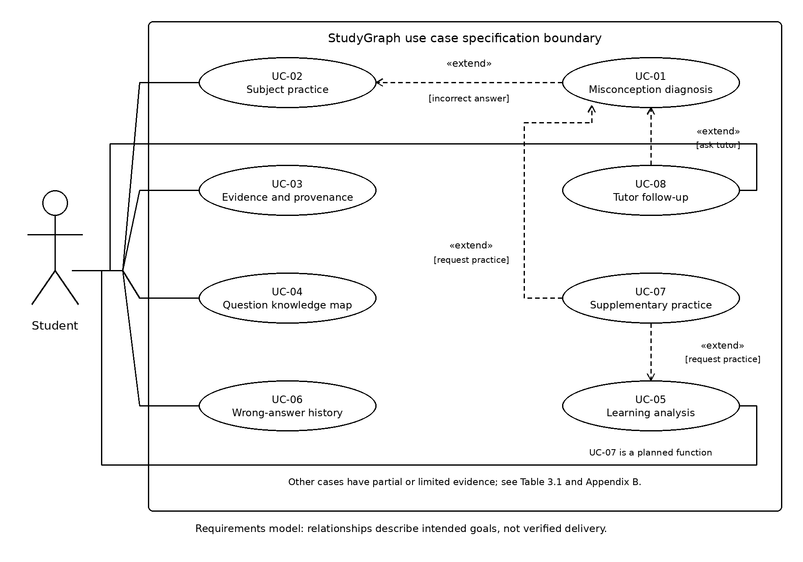
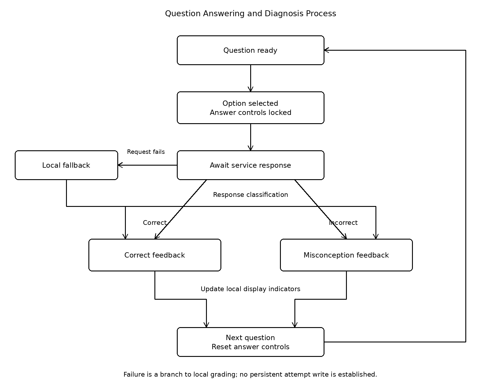

# 3 Use Cases and Requirements Modelling

Weixin Xie | JC2001 Group 5

## 3.1 System Context and Actors

The system supports university students revising course material through question practice and misconception feedback. The eight agreed use cases describe intended learning activities; implementation findings distinguish delivered behaviour from remaining requirements. Existing specifications provide the goals, while the GitHub develop snapshot supplies implementation evidence. Including a goal in the model does not establish that the software already delivers it.

The Student is the primary actor. The browser presents questions, accepts selections and displays feedback; the local FastAPI service exposes question and diagnosis endpoints. Bundled question and trap data also support browser-side grading when a diagnosis request fails. An optional external model can enhance guidance. A question-specific graph is a representation of bundled relationships, not evidence of a deployed GraphRAG retrieval chain.

Markers assess the report and demonstration but do not operate an implemented teacher portal. Developers maintain the system rather than acting within the student learning workflow. Login, registration and teacher administration are not added to the agreed eight identifiers. The inspection baseline and source links are recorded in sources.md so that implementation findings can be reproduced without putting version codes in figure titles.

## 3.2 Global Use Case Diagram and Summary

Figure 3.1 uses UC-01 to UC-08 consistently with Table 3.1 and the detailed specifications. UC-01 extends UC-02 when an answer is incorrect. UC-08 extends UC-01 when the student requests tutor follow-up. UC-07 extends UC-01 or UC-05 when supplementary practice is requested; it is explicitly a planned function. The arrows point from each extension to its base use case.

Evidence inspection, graph exploration, analysis, history and tutoring are directly initiated student goals. They do not require include relationships simply because they exchange data or occur in the same learning workflow. History may lead to a new practice attempt, and practice may supply analysis data, but neither dependency makes every history view a mandatory retry or every submission a mandatory analysis visit. An include relationship would require behaviour performed as a necessary part of the base case.

Figure 3.1: Eight-use-case model.

Table 3.1: Use case summary.

| ID | Use case | Student goal | Actor | Requirement and status |
| --- | --- | --- | --- | --- |
| UC-01 | Misconception diagnosis | Understand an incorrect choice | Student | Diagnosis code present; acceptance unexecuted |
| UC-02 | Subject practice | Answer subject questions | Student | Practice code present; storage gap |
| UC-03 | Evidence and provenance | Inspect support and review status | Student | Evidence/source-status workflow not established |
| UC-04 | Knowledge map | Explore related concepts | Student | Graph drawn; interactive details unverified |
| UC-05 | Learning analysis | Review dimensional performance | Student | Heuristic radar, not target rate formula |
| UC-06 | Wrong-answer history | Review and retry errors | Student | History workflow not established |
| UC-07 | Supplementary practice | Practise the same knowledge point | Student | Unimplemented target |
| UC-08 | Tutor follow-up | Check reasoning with guidance | Student | Partial chat; recovery gaps |

## 3.3 Detailed Use Case Specifications

Each specification states the goal, trigger and preconditions, normal interaction, exceptions, postconditions and acceptance focus. The current implementation note records observed source behaviour separately. Proposed protections remain requirements unless supported by implementation and execution evidence; none is presented as an executed acceptance result.

### 3.3.1 UC-01 Intelligent Misconception Diagnosis

Actor and goal: the Student understands the misconception associated with a selected distractor and identifies prerequisite knowledge to revisit. Trigger and preconditions: a loaded question has an incorrect submitted option and a trap mapping.

Main flow: (1) select and submit an option; (2) validate and evaluate it; (3) locate the associated misconception and prerequisite; (4) display explanatory feedback; (5) optionally continue practice, inspect an explanation or request tutoring. A correct answer follows UC-02 instead.

Exceptions and postconditions: invalid or missing data must not be presented as a confirmed misconception. The target is option-specific feedback, not one generic explanation for every distractor. Acceptance checks should compare distinct wrong options and examine failed submissions. Current implementation: POST /api/diagnose returns diagnosis data; request failure invokes browser-side seeded grading. This differs from the older error-and-unlock specification. Persistent accepted-attempt storage is not established.

### 3.3.2 UC-02 Domain-Based Question Practice and Answer Submission

Actor and goal: the Student selects relevant practice and receives an answer result. Trigger and preconditions: practice is opened or the subject changes, and eligible question data is available.

Main flow: (1) select a subject; (2) inspect the question and options; (3) browse using navigation controls; (4) select an answer; (5) receive correct feedback or UC-01 diagnosis; (6) continue or retry. The target includes recording accepted attempts and updating learning evidence.

Exceptions and postconditions: distinguish loading failure, empty selections, repeated clicks and unsuccessful submissions. Viewing or navigating must not itself create an attempt. Acceptance checks cover filtering, correct grading and answer protection. Current implementation: subjects use bundled browser data, selections lock the displayed question, and navigation resets that guard. GET /api/quiz exists but is not requested on every subject switch. The guard is not proof of server idempotency, and persistent attempts remain a gap.

### 3.3.3 UC-03 Inspect Supporting Evidence and Provenance

Actor and goal: the Student checks the supporting material, source notes and review status of the current item. Trigger and preconditions: the evidence area is opened for a question carrying the required metadata.

Main flow: (1) open the item; (2) inspect its review state and evidence count; (3) read the supporting statements; (4) read source names and notes; (5) optionally inspect the knowledge map. The goal is informed interpretation rather than cross-question free-text search.

Exceptions and postconditions: pending sources remain pending; missing or malformed evidence requires correction rather than invented support. Viewing evidence changes neither the question nor attempt totals. Acceptance checks examine item alignment and whether unreviewed material is falsely labelled verified. Current implementation: this evidence/source/review-status inspection workflow is not established in the inspected renderer. It remains a requirement gap, notwithstanding its description in the earlier specifications.

### 3.3.4 UC-04 Explore the Question-Specific Knowledge Map

Actor and goal: the Student explores relationships among concepts, prerequisites and misconceptions. Trigger and preconditions: the map is opened for a question containing valid nodes and edges.

Main flow: (1) open the map; (2) load the current item's graph; (3) display typed nodes and relationships; (4) select a node by pointer or keyboard; (5) read its details; (6) explore another node or question.

Exceptions and postconditions: no selected question requires an appropriate empty state; invalid edge references require data correction. Arbitrary expansion and dragging are not implied. Browsing must not modify graph data or create an attempt. Acceptance checks separately cover graph validity, detail updates and keyboard access. Current implementation: renderGraph produces question-specific SVG nodes and edges, but node-detail handlers and keyboard activation are not established there. A complete interactive graph and live graph retrieval must not be claimed from rendering alone.

### 3.3.5 UC-05 Five-Dimension Learning Analysis

Actor and goal: the Student reviews practice evidence across conceptual recall, prerequisite reasoning, misconception recognition, cross-topic reasoning and procedural accuracy. Trigger and preconditions: analysis is opened or a valid attempt completes; records can be read and questions label their dimensions.

Main flow: (1) read records; (2) count attempts and correct answers per dimension; (3) calculate the correct rate; (4) show the radar, scores and counts; (5) choose further practice or review. The target score is correct dimensional attempts divided by total dimensional attempts, multiplied by 100 percent.

Exceptions and postconditions: no records produce an empty state; unreadable records are an error, not zero performance. Fewer than two dimensional attempts show insufficient evidence without a percentage. Five valid attempts should refresh results, but fewer must not prevent opening the page. Current implementation: initial demonstration scores change through heuristic deltas; the target formula and evidence thresholds are not delivered. Radar changes therefore do not prove long-term mastery.

### 3.3.6 UC-06 Find and Practise Historical Wrong Answers

Actor and goal: the Student locates an earlier error, examines its diagnosis and retries. Trigger and preconditions: history is opened and records contain question, subject, time, result and misconception information.

Main flow: (1) list errors newest first; (2) search or filter by subject, topic, misconception, result and date; (3) show matching records and counts; (4) inspect an original attempt; (5) hide its answer when retry begins; (6) save the accepted retry separately.

Exceptions and postconditions: empty or unreadable history, unmatched filters and removed questions need distinct treatment. Removed items retain their summary but disable retry. Clearing requires confirmation; cancellation preserves records. Targets include case-insensitive English search, inclusive date boundaries and no attempt creation when viewing. Retry must not overwrite an original error. Current implementation: persistent attempt-history writing, history filters, historical retry archives and confirmed deletion are not established. Earlier claims of stored attempts do not describe this snapshot.

### 3.3.7 UC-07 Recommend Supplementary Practice

Actor and goal: the Student practises a wrong answer's knowledge point through another question. Trigger and preconditions: supplementary practice is requested from diagnosis or analysis; the error has a knowledge-point label and suitable questions can be searched.

Target main flow: (1) identify the knowledge point; (2) find another item, preferably unattempted and similarly difficult; (3) explain the recommendation without revealing the answer; (4) let the student accept; (5) enter ordinary practice and record the accepted answer.

Exceptions and postconditions: missing labels, no suitable new item and search failure require clear messages and an ordinary-practice alternative. Rejection creates no attempt. An isomorphic variant preserves the main knowledge and method while changing conditions or wording; a broadly related item must not be mislabelled. Review status stays visible. One error is a practice signal, not proof of lasting weakness. Current implementation: no supplementary recommendation workflow is established; both diagram extensions represent planned behaviour.

### 3.3.8 UC-08 Socratic AI Tutor Follow-up

Actor and goal: the Student receives contextual guidance for checking reasoning. Trigger and preconditions: a question is asked from diagnosis or tutoring, with current question context available; an external model is optional.

Target main flow: (1) review context; (2) enter a question; (3) validate input; (4) generate local or external guidance; (5) display the actual mode; (6) ask again or resume practice. Targets require two or three sentences, a thinking prompt, relevance and no direct answer. Messages must not create attempts.

Exceptions and postconditions: empty or over-1200-character input should not submit. External failure should use a labelled local prompt where available; unavailable local service should preserve a recoverable state. Delayed replies must not be assigned to a new question. Current implementation: unconfigured or mock tutoring uses local replies, but failed configured chat calls display errors rather than automatically falling back. This differs from diagnostic-service recovery. Input-length and stale-reply protections remain unestablished.

## 3.4 Behavioural Modelling

Figure 3.2 models question readiness, option selection, pending processing and feedback. The source guards repeated selection of the displayed question. A successful response branches to correct feedback or misconception feedback; a failed request or unsuccessful status invokes browser-side local grading, which also branches by the locally determined result. Thus submission failure is represented explicitly without importing the older unlock-and-retry behaviour.

Figure 3.2: Question answering and diagnosis process.

The browser updates local indicators after feedback. Navigation loads another question and resets answer controls. This cycle establishes neither persistent attempt storage nor a transactional history service. A state diagram emphasises when another selection is allowed; tutor, evidence and graph interactions remain optional rather than expanding into competing workflows. Returning a structured fallback also does not prove that an unknown question was accurately diagnosed.

## 3.5 Requirements Traceability

Appendix B links the original 25 functional and non-functional entries to use cases, code locations, verification sources and gaps. Original FR/NFR numbers and descriptions are retained; repeated numbers are distinguished by their descriptions. The R01-R14 comparison is a semantic crosswalk, not an approved replacement numbering scheme. Diagram identifiers, summary entries and detailed cases all use the agreed eight-case baseline.

Source inspection supports diagnosis, practice, graph drawing and partial radar and chat behaviour. Evidence inspection, interactive graph details, history and supplementary practice have specific gaps. Public quiz models include answers and trap data, so pre-submission answer protection is not met by merely locating the endpoint. Direct model probes confirmed field exposure; they did not exercise HTTP or browser acceptance.

## Appendix B Requirements Traceability Matrix

Original requirement numbers and descriptions are retained. Evidence is source inspection, not executed acceptance results.

| Requirement ID and description | Use case | Implementation evidence | Verification evidence | Status and gap |
| --- | --- | --- | --- | --- |
| FR-01 / Select a study domain | UC-02 | switchSubject; initSubjectSelector | test_quiz.py; not executed | Subject flow present; UI unexecuted |
| FR-02 / Submit one answer per on-screen attempt | UC-01, UC-02 | handleSelectOption; models/quiz.py | test_diagnose.py; not executed | Answer flow present; public quiz exposes answer and traps |
| FR-03 / Identify misconception and missing prerequisite | UC-01 | diagnostic_service.py; seed_questions.py | test_diagnose.py; not executed | Option mapping present; content accuracy not independently checked |
| FR-05 / Inspect evidence, source and content-review status  | UC-03 | Question renderer and model fields inspected | No dedicated provenance test found; not executed | Source/review-status workflow not established in current renderer |
| FR-06 / Inspect question-specific knowledge subgraph  | UC-04 | renderGraph in app.js | No node-detail acceptance test established; not executed | Graph rendering present; node click/detail and keyboard not established |
| NFR-01 / Secure API and credential handling | UC-01, UC-02 | models/quiz.py; routers/quiz.py | test_quiz.py is not proof of hidden keys; not executed | Gap: quiz response model exposes answer, explanation and traps |
| NFR-02 / Local reliability / no cloud dependency  | UC-01, UC-02 | handleSelectOption local fallback | test_diagnose.py (backend); not executed | Local data fallback exists; clean-machine air-gap test pending |
| NFR-03 / Transparent diagnosis and provenance  | UC-01, UC-03, UC-04 | diagnostic_service.py; question rendering | test_diagnose.py; not executed | Diagnosis supported; provenance/review display gap |
| NFR-04 / Keyboard accessibility  | UC-02, UC-04 | renderGraph; option-card div creation | No keyboard audit executed; not executed | Keyboard acceptance not established |
| NFR-05 / Responsive layout | UC-02, UC-04 | frontend/style.css | No viewport run executed; not executed | Responsive styles only; acceptance pending |
| NFR-06 / Reproducible provenance and evaluation | UC-03 (evidence linkage) | Evidence schema and renderer inspection | No controlled evaluation executed; not executed | Old provenance/evaluation workflow not established |
| NFR-07 / Local performance  | UC-01, UC-02 | Local endpoints | No benchmark executed; not executed | Timing target not verified |
| NFR-08 / Modular software organisation  | UC-01–UC-04 | backend/app/routers and services; frontend/ | Existing test source only; not executed | Modular source present; reproducibility run pending |
| FR-04 / Five-dimension learning radar and mastery analysis | UC-05 | state.radar; updateRadarCharts | No dimension acceptance run; not executed | Partial: fixed initial scores and heuristic deltas, not target correct-rate formula |
| FR-05 / Socratic guided follow-up | UC-08 | handleUserChatMessage; getLocalSmartReply | No tutor acceptance run; not executed | Partial: local/online chat; provider failure shows error rather than local chat fallback |
| FR-06 / Same-knowledge-point variant or supplementary question recommendation | UC-07 | No recommendation flow located | No recommendation test established; not executed | Not implemented in inspected workflow |
| FR-07 / Search, filter and retry historical wrong answers | UC-06 | localStorage writes; navigation functions | No history acceptance test established; not executed | Persistent attempt history, filters and retry archive not established |
| FR-08 / Traceable question evidence, source and review status | UC-05, UC-07, UC-08 | Question rendering and quiz model | No provenance acceptance test established; not executed | Evidence/source/review-status workflow not established |
| FR-09 / Hints and student-requested explanations | UC-05, UC-08 | handleSelectOption result drawer | No request-only disclosure acceptance run; not executed | Gap: explanation may appear automatically; correct option highlighted |
| FR-10 / Save, read and clear learning records | UC-05, UC-06, UC-07 | All localStorage.setItem calls reviewed | No persistence/deletion run; not executed | Settings/profile writes found; persistent attempts and confirmed deletion not established |
| NFR-02 / Fallback behaviour when an external model or service fails | UC-05, UC-06, UC-07, UC-08 | Answer fallback and tutor exception branches | test_diagnose.py covers backend fallback; not executed | Partial: answer/backend fallback differs from tutor chat recovery |
| NFR-03 / Usability and accessibility | UC-05, UC-06, UC-07, UC-08 | initTheme; result drawer labels; renderGraph | No accessibility run executed; not executed | Theme and text feedback present; full accessibility unverified |
| NFR-04 / Learning-record privacy and answer protection | UC-05, UC-06, UC-07, UC-08 | models/quiz.py; localStorage writes | No privacy acceptance run; not executed | Gap: public answer/traps; attempt deletion not established |
| NFR-07 / Clear explanations without overstating results | UC-05, UC-07, UC-08 | state.stats; state.radar; loadQuestion | No clarity acceptance run; not executed | Gap: demonstration values; no verified insufficient-evidence threshold |
| NFR-08 / Mobile and desktop support | UC-05, UC-06, UC-07, UC-08 | frontend/style.css | No mobile/desktop browser run; not executed | Responsive styles present; viewport acceptance pending |

## References

Group 5 (2026) StudyGraph use-case specifications, requirements matrix and application source. Repository snapshot and exact file links are recorded in sources.md.
