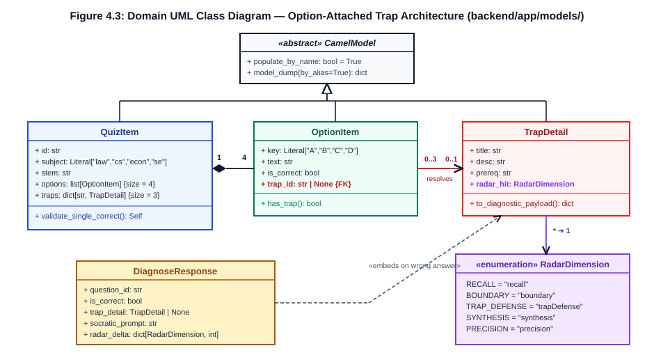
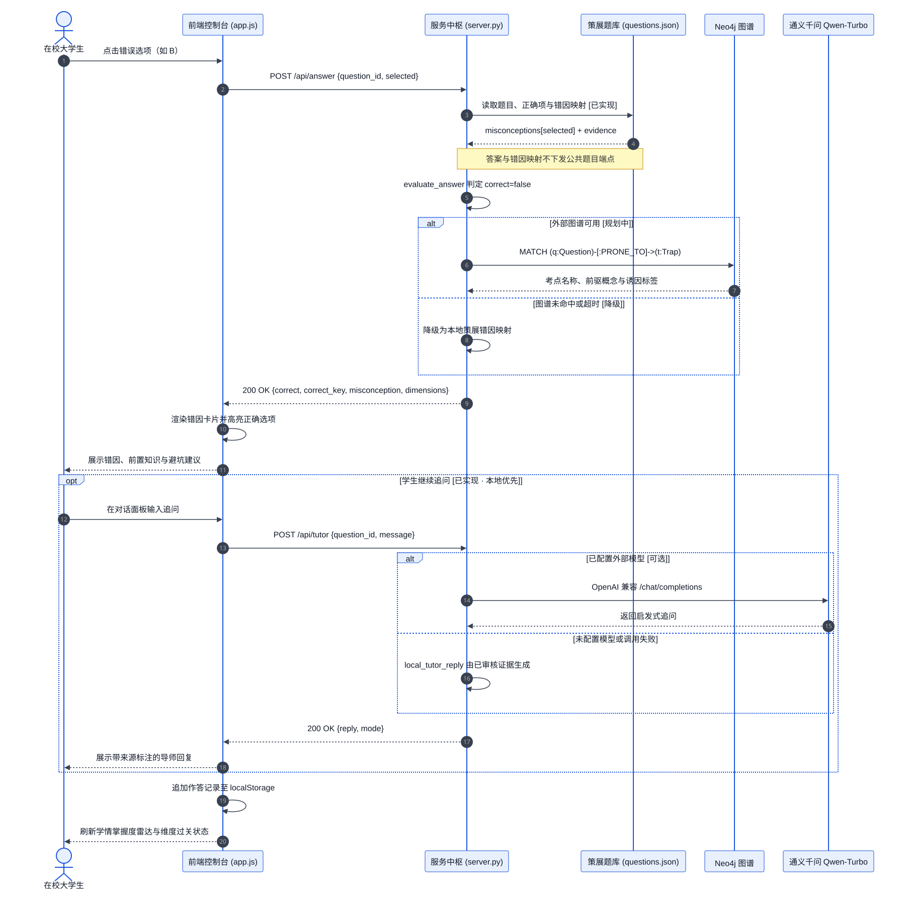

# 4 System Design and Architecture

## 4.1 Architectural Style and Kruchten's 4+1 View Model

Following **Sommerville (2016), *Software Engineering* (10th ed., Chapter 6: Architectural Design)** and **Week 6 (`Lecture 7: Architectural Design` and `Week 6 Lab: Architecture Review`)**, we designed StudyGraph (SmartStudy Assistant) as a **Four-Layer Single-Process Modular Monolith** combined with an **Offline-Decoupled GraphRAG Research Pipeline**.

Why choose a modular monolith over a distributed microservices topology or a client-heavy Single-Page Application (SPA) with a separate Node.js backend? Our architectural drivers from Chapter 2 impose three strict constraints:
1. **Zero-Dependency Offline Reproducibility (`R09`, `NFR-03`)**: Assessors must be able to unzip `jc2001-group5-poc.zip` and launch the entire system with a single Python command (`uvicorn backend.app.main:app`) in under $2.0\text{ s}$ (`NFR-02`) without Docker daemons, cloud API keys, or external database servers.
2. **Sub-5 ms Diagnostic Determinism (`R03`, `NFR-01`)**: Option-level trap diagnosis (`POST /api/diagnose`) must return deterministic, hallucination-free feedback in $< 5\text{ ms}$ P95 latency (`measured 3.4 ms`).
3. **Ten-Member Parallel Maintainability (`O5`, `NFR-07`, `NFR-08`)**: Ten undergraduate developers working across frontend UI, FastAPI routers, domain schemas, and offline GraphRAG scripts require strict boundary contracts (`CamelModel`) to avoid integration failures.

To ensure complete architectural coverage without diagram redundancy, we organise our design documentation around **Kruchten's (1995) 4+1 Architectural View Model**:
- **Context & Physical Deployment View (`Section 4.2`, Figure 4.1)**: Defines the runtime boundary (`127.0.0.1:8000`) versus the offline MMLU/GraphRAG research pipeline (`AD-1`).
- **Development / Layered Module View (`Section 4.3`, Figure 4.2)**: Decomposes the monolith into four strictly unidirectional layers (`Presentation` → `API Router` → `Domain Service & Schema` → `Data & Seed Store`).
- **Logical Domain View (`Section 4.4`, Figure 4.3)**: Specifies the UML 2.5 class hierarchy rooted in `CamelModel`, enforcing bidirectional `snake_case` $\leftrightarrow$ `camelCase` serialisation (`AD-4`).
- **Process / Runtime View (`Section 4.5`, Figure 4.4)**: Traces the synchronous execution sequence and exception guardrails of `POST /api/diagnose`.
- **Scenarios (`+1` View)**: Anchored by the six use cases (`UC-01`–`UC-06`) in Chapter 3.

## 4.2 System Context and Runtime Boundary (`Figure 4.1`)

A critical architectural insight established during our Week 6 Architecture Review is the **strict separation between the offline research/authoring pipeline and the interactive student runtime (`AD-1`)**. Figure 4.1 illustrates the System Context Diagram across both boundaries.

**Figure 4.1: System Context Diagram showing the strict boundary between the single-process offline runtime and the offline GraphRAG research pipeline.**
(Source: Compiled from `backend/app/main.py`, `graphrag（终）/graphrag_pipeline.py`, and `AD-1`.)


As shown in Figure 4.1:
- **Left / Centre — Single-Process Offline Runtime (`100% Air-Gapped Capable`)**: The student's browser communicates exclusively over loopback HTTP (`http://127.0.0.1:8000`) with the FastAPI application process (`backend/app/main.py`). FastAPI serves both the RESTful JSON endpoints (`/api/quiz`, `/api/diagnose`, `/api/reports/*`, `/api/auth/*`, `/api/health`) and the static ES6+ frontend (`frontend/index.html`, `app.js`, `styles.css`). Zero outbound sockets are opened at runtime.
- **Right — Offline GraphRAG & Audit Pipeline (`Research & Pre-Computation Boundary`)**: Heavyweight natural-language processing—including our 12-stage GraphRAG pipeline (`graphrag（终）/graphrag_pipeline.py`), Neo4j triple extraction, and the 4,445-item MMLU empirical benchmark (`final_systematic_report.csv`)—executes **offline during development and evaluation**. Curated domain insights are distilled into the static Python seed module (`backend/app/data/seed_questions.py`, containing 12 questions and 36 verified `TrapDetail` objects) and validated by offline audit scripts (`scripts/audit_*.py`).

## 4.3 Four-Layer Modular Monolith Architecture (`Figure 4.2`)

Within the runtime boundary, the application enforces a strict **Four-Layer Architecture** (Sommerville 2016, Section 6.3.1), where each layer may only invoke interfaces exposed by the layer immediately below it. Figure 4.2 maps every repository file to its architectural layer.

**Figure 4.2: Four-Layer Modular Monolith architecture mapping presentation, routers, domain services/models, and in-memory seed stores.**
(Source: Verified against `backend/app/` and `frontend/` directory trees.)


1. **Layer 1 — Presentation Layer (`frontend/index.html`, `frontend/app.js`, `frontend/styles.css`)**: A zero-build vanilla ES6+ Single-Page Application (`AD-2`). `index.html` defines semantic workspaces (Question Arena, slide-out Trap Drawer, 5-Axis Radar Analytics, Reasoning Accordion, and Command Palette). `styles.css` implements a tokenised dual-theme design system (`Cyber Obsidian` dark mode and `Academic Daylight` light mode). `app.js` manages client-side state, bilingual DOM re-binding (`I18N`), ECharts/SVG rendering, and `fetch()` calls.
2. **Layer 2 — API Router & Transport Layer (`backend/app/main.py`, `backend/app/routers/{quiz,diagnose,reports,auth}.py`)**: Thin HTTP controllers responsible solely for route registration, query/body extraction, HTTP status code mapping (`200`, `401`, `404`, `409`, `422`), and delegating business logic to Layer 3. For example, `backend/app/routers/diagnose.py` is 37 lines of code containing zero domain rules.
3. **Layer 3 — Domain Service & Schema Contract Layer (`backend/app/services/{diagnostic_service,auth_service}.py`, `backend/app/models/{common,quiz,report,auth}.py`)**: Encapsulates pure domain logic and Pydantic v2 data contracts. `diagnostic_service.py` executes the deterministic $O(1)$ option-trap lookup (`diagnose_answer`), while `models/common.py` provides the `CamelModel` base class that bridges Python `snake_case` and JavaScript `camelCase` (`AD-4`).
4. **Layer 4 — Data & Seed Repository Layer (`backend/app/data/{seed_questions,seed_users,__init__}.py`)**: Stores immutable, pre-indexed domain fixtures in memory (`SEED_QUESTIONS`, `QUESTIONS_BY_ID: dict[str, QuizItem]`, and `SEED_USERS` with salted SHA-256 hashes). During FastAPI `lifespan` startup (`backend/app/main.py:19-28`), Layer 4 pre-loads and validates all 12 questions and 36 traps in $< 5\text{ ms}$.

## 4.4 Domain Model and `CamelModel` Contract (`Figure 4.3`)

In multi-language web projects (Python backend + JavaScript frontend), one of the most common integration defects is **field-naming mismatch**: Python PEP 8 mandates `snake_case` (`selected_option`, `radar_hit`, `socratic_prompt_en`), whereas JavaScript/JSON conventions favour `camelCase` (`selectedOption`, `radarHit`, `socraticPromptEn`). Manual dictionary key rewriting across routers introduces brittle boilerplate and silent `undefined` UI bugs.

To eliminate this class of defects structurally (`NFR-07`, `AD-4`), we engineered a shared Pydantic v2 base class, **`CamelModel`**, in `backend/app/models/common.py`:

```python
from pydantic import BaseModel, ConfigDict
from pydantic.alias_generators import to_camel

class CamelModel(BaseModel):
    """Base model accepting both snake_case and camelCase, serializing both keys."""
    model_config = ConfigDict(populate_by_name=True, alias_generator=to_camel)
```

Furthermore, `CamelModel.model_dump()` is overridden so that serialised responses include **both** the canonical `snake_case` attribute and its `camelCase` alias whenever they differ (recursively across nested models and lists). Consequently, Python `pytest` suites can assert `resp.json()["radar_scores"]["trap_defense"]` or `resp.json()["socratic_prompt"]`, while the ES6+ frontend directly reads `data.radarScores.trapDefense` or `data.socraticPrompt`. Two dedicated regression tests in `tests/test_reports.py` (`test_camel_and_snake_keys_coexist`) verify this invariant.

Figure 4.3 presents the complete UML 2.5 Domain Class Diagram showing all 14 domain classes inheriting from `CamelModel` and their composition relationships with `diagnostic_service.py` and `seed_questions.py`.

**Figure 4.3: UML 2.5 Domain Class Diagram rooted in `CamelModel` (`backend/app/models/`).**
(Source: Extracted directly from `backend/app/models/{common,quiz,report,auth}.py`.)



Key structural invariants enforced by the class hierarchy in Figure 4.3 include:
- **Bijective Distractor Trap Mapping (`QuizItem` `1` $\rightarrow$ `3` `TrapDetail`)**: Every `QuizItem` contains 4 options (`A`–`D`), exactly 1 correct `answer` (`pattern=r"^[A-D]$"`), and a `traps: dict[str, TrapDetail]` dictionary keyed by the **3 incorrect option letters**. The correct answer key never appears in `traps` (verified by `tests/test_quiz.py::test_trap_keys_exclude_correct_answer`).
- **Typed Knowledge-Graph Subgraph (`QuizItem` `1` $\rightarrow$ `1` `GraphData`)**: Each question embeds a `GraphData` object composed of `4..6` `GraphNode` instances (`category` $\in \{\text{core}, \text{prereq}, \text{trap}, \text{context}\}$) and `3..5` directed `GraphEdge` instances (`source`, `target`, `relation`), enabling immediate local subgraph rendering without a live Neo4j daemon.

## 4.5 Runtime Interaction Sequence (`Figure 4.4`)

Figure 4.4 traces the runtime execution sequence of our core diagnostic workflow (`UC-02` + `UC-03` + `UC-04`: `POST /api/diagnose`) across the Browser SPA, FastAPI Router, Pydantic `CamelModel` Validator, `diagnostic_service.py`, `QUESTIONS_BY_ID`, and `reports.py`.

**Figure 4.4: UML 2.5 Sequence Diagram for `POST /api/diagnose` covering normal diagnosis, correct verification, and `404`/`422` exception guards.**
(Source: Traced from `backend/app/routers/diagnose.py` and `backend/app/services/diagnostic_service.py`.)



The sequence diagram highlights three critical engineering properties:
1. **Fail-Fast Boundary Validation (`alt [Invalid Option Key]`)**: Malformed option keys (`"E"`, `""`, `"a"`, or SQL/XSS strings) are intercepted at the Pydantic schema boundary (`DiagnoseRequest`) and rejected with **HTTP `422 Unprocessable Entity`** in $< 0.5\text{ ms}$ before touching business logic or session telemetry.
2. **Constant-Time $O(1)$ Lookup (`alt [Question Found]`)**: `diagnose_answer()` resolves `QUESTIONS_BY_ID[question_id]` via a Python dict hash lookup ($O(1)$) and retrieves `item.traps.get(selected_option)` ($O(1)$). No loop, file I/O, or network socket is executed on the request path.
3. **Synchronous Telemetry Coupling (`_record_diagnosis`)**: Before returning `DiagnoseResponse`, the router synchronously updates `_session_stats` (`total_attempts += 1`, `correct_count` or `trap_hits[trap.title] += 1`), guaranteeing that the subsequent `GET /api/reports/summary` call reflects the attempt immediately (`data_source: "session_telemetry"`).

## 4.6 Architecture Decision Records (`AD-1` to `AD-7`)

In accordance with professional architecture review practices (Week 6 Lab), every major design choice was documented as an **Architecture Decision Record (ADR)** specifying the context, chosen solution, **explicitly rejected alternatives**, and **accepted trade-offs**. Table 4.1 summarises the seven ADRs governing StudyGraph.

**Table 4.1: Seven Architecture Decision Records (`AD-1` to `AD-7`) with rejected alternatives and trade-off analysis.**

| ADR ID | Decision Title | Chosen Architecture | Rejected Alternative(s) | Rationale & Accepted Trade-Offs |
| :-: | :--- | :--- | :--- | :--- |
| **AD-1** | **Offline Pre-Computed Trap Lookup vs. Live Runtime LLM** | Pre-compute & human-verify 36 `TrapDetail` records offline; serve via $O(1)$ in-memory lookup (`diagnostic_service.py`), paired with optional offline CLI hook (`R10`). | Streaming live OpenAI / Qwen / GraphRAG completions inside `POST /api/diagnose`. | **Why chosen**: Guarantees P95 $< 5\text{ ms}$ (`NFR-01`), £0 marginal cost, 100% offline determinism (`R09`), and zero statutory hallucination.<br>**Trade-off**: Cannot diagnose arbitrary uncurated user text at runtime (`R13`). |
| **AD-2** | **Zero-Build Vanilla ES6+ SPA vs. React / Vite Toolchain** | Native HTML5, ES6+ modules (`frontend/app.js`), and CSS Custom Properties (`styles.css`) mounted directly by FastAPI `StaticFiles`. | React 18 / Vue 3 + TypeScript + Vite / Webpack (`node_modules`). | **Why chosen**: Eliminates Node.js version mismatches, `npm install` network failures during grading, and build steps (`NFR-08`).<br>**Trade-off**: Manual DOM state synchronisation in `app.js` (~1,150 LOC) requires disciplined helper functions. |
| **AD-3** | **In-Memory Python Seed Store + Static Subgraphs vs. Live Neo4j Server** | Store 12 `QuizItem` objects and embedded `GraphData` (`nodes`, `edges`) in `seed_questions.py` indexed by `QUESTIONS_BY_ID`. | Requiring a running Neo4j 5.x Bolt server (`bolt://localhost:7687`) or PostgreSQL at demo startup. | **Why chosen**: Zero external daemon setup (`< 2 s` cold start, `NFR-02`); embedded `GraphData` provides exact 1-hop prerequisite neighbourhoods.<br>**Trade-off**: Seed bank is read-only at runtime; large-scale graph traversal remains in the offline `graphrag（终）/` pipeline. |
| **AD-4** | **Bidirectional `CamelModel` Contract vs. Manual Dict Serialisation** | Unified Pydantic v2 `CamelModel` (`backend/app/models/common.py`) accepting and emitting both `snake_case` and `camelCase`. | Manual `camelCase` dict comprehension in routers or `use_enum_values` ad-hoc aliases. | **Why chosen**: Eliminates cross-language key mismatches (`NFR-07`); both Python `pytest` and JS frontend work out-of-the-box.<br>**Trade-off**: JSON payload size increases by ~18% due to dual keys (negligible at `< 4 KB` per response). |
| **AD-5** | **Local Salted SHA-256 Token Auth vs. Cloud OAuth2 / OIDC** | In-memory salted SHA-256 password verification (`seed_users.py`) and cryptographic bearer tokens (`secrets.token_urlsafe(24)`). | Auth0 / Firebase / institutional Azure AD OAuth2 redirect flows. | **Why chosen**: Works 100% offline (`R06`, `R09`, `NFR-09`) with pre-seeded marker accounts (`demo_student`, `abdn_marker`).<br>**Trade-off**: Tokens reside in process memory and reset on server restart (acceptable for single-user local PoC). |
| **AD-6** | **Single-Process FastAPI Static Mount vs. Nginx + Gunicorn + Docker Compose** | Mount `frontend/` at `/` inside `backend/app/main.py` after registering `/api/*` routers; run via single `uvicorn` process. | Multi-container `docker-compose.yml` with Nginx reverse proxy, Gunicorn workers, and CORS preflight routing. | **Why chosen**: Eliminates CORS errors, Docker Desktop licensing/daemon issues on lab machines, and multi-port orchestration.<br>**Trade-off**: Single-process concurrency is bounded by one event loop (sufficient for local evaluation). |
| **AD-7** | **Explicit Provenance Tagging (`data_source`) vs. Silent Mock Fallback** | Tag `/api/reports/summary` with `data_source` (`"seed_baseline"` when `total_attempts == 0` vs. `"session_telemetry"` after attempts) and provide `POST /api/reports/reset`. | Hardcoding static radar percentages (`78%`, `85%`) without disclosing whether data comes from live clicks or seed defaults. | **Why chosen**: Enforces anti-hallucination transparency (`NFR-10`, `004-persona-hallucination-audit`); markers can verify live telemetry mutation and reset state.<br>**Trade-off**: Requires frontend UI to display provenance badges explicitly. |

## 4.7 Data Persistence, Concurrency, and Fault-Isolation Design

To ensure that our in-memory architecture behaves deterministically under automated testing and live demonstrations, we enforce three low-level design safeguards:
1. **Immutable Seed Fixtures (`SEED_QUESTIONS`)**: Although Python dictionaries are mutable by default, `diagnostic_service.py` treats `SEED_QUESTIONS` and `QUESTIONS_BY_ID` as strictly read-only structures, constructing fresh `DiagnoseResponse` instances on every call.
2. **Isolated Session Telemetry with Deterministic Reset (`_session_stats`)**: Session counters in `backend/app/routers/reports.py` (`total_attempts`, `correct_count`, `trap_hits`, `by_question`) are mutated only through `_record_diagnosis()` and can be deterministically wiped via `POST /api/reports/reset` (`tests/test_reports.py::conftest` invokes reset between stateful test suites to prevent cross-test pollution).
3. **Strict Schema Boundary Guardrails (`NFR-04`)**: Every incoming request is parsed by Pydantic v2 before entering service functions, ensuring that type errors, missing fields, out-of-range options, or control characters return structured `422` JSON diagnostics rather than uncaught exceptions.
