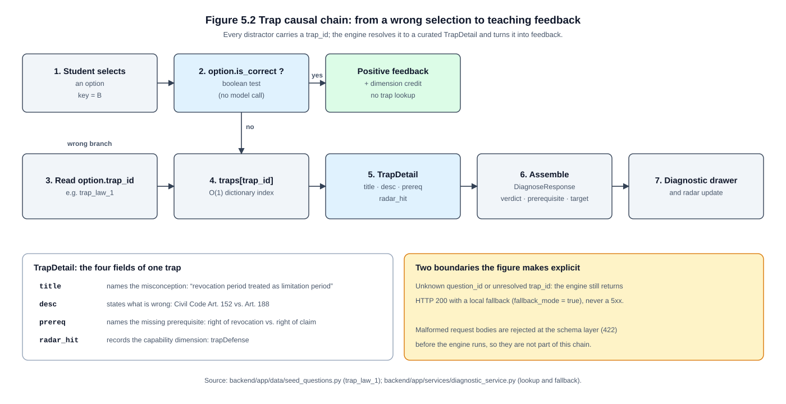

## 5.3 Question Bank and Trap Engineering

*Author: Siqin Dong (50106060) | JC2001 Group 5*

The diagnostic value of this system comes from what each distractor encodes, not from the questions alone. This section reports the scale of the bank, the anatomy of a single trap, the design rules behind the traps, and the automated checks that keep the data consistent. Every count below was extracted programmatically from the seed data at the time of writing, rather than recalled from memory.

### 5.3.1 Scale and Composition of the Question Bank

The bank contains seventeen questions spread across nine subjects. Twelve of them sit in the four rule-dense subjects the product was originally scoped around — Law, Computer Science, Econometrics and Software Engineering, three questions each. Five further questions were added later, one each in Operational Research, Management Information Systems, Probability and Statistics, Marketing and Academic English, to check that the trap mechanism is not an artefact of one faculty. We selected subjects built on rules with stated boundaries. A statutory period, a cache addressing scheme or a regression assumption can be named precisely, so a distractor can be tied to a specific misconception rather than to general difficulty. Each question carries four options. Exactly one option is correct, and each of the three remaining options carries one trap identifier. The bank therefore holds fifty-one traps, exactly three per question. Difficulty is spread across three levels: six questions are rated three stars, nine are rated four stars, and two are rated five stars. Table 5.4 lists the full composition.

The bound on size is deliberate. Seventeen questions are enough to exercise every branch of the diagnosis pipeline, and small enough for hand curation. We do not present the bank as a product. It is a feasibility artefact, and Section 5.3.3 states the limits of the evidence it provides.

**Table 5.4: Composition of the seed question bank (seventeen questions, fifty-one traps).**

| ID | Subject | Difficulty | Traps | Knowledge point |
| :--- | :--- | :-: | :-: | :--- |
| law_1 | Law | ★★★☆☆ | 3 | Revocable juristic acts; limitation period of the right of revocation |
| law_2 | Law | ★★★★☆ | 3 | Property law; requirements and defences of bona fide acquisition |
| law_3 | Law | ★★★★☆ | 3 | General provisions; apparent authority and appearance-based liability |
| cs_1 | Computer Science | ★★★★☆ | 3 | RISC pipeline; hazards, forwarding and bypassing |
| cs_2 | Computer Science | ★★★★☆ | 3 | Memory hierarchy; set-associative mapping and conflict misses |
| cs_3 | Computer Science | ★★★★★ | 3 | Virtual memory; TLB and page-fault handling |
| econ_1 | Econometrics | ★★★★☆ | 3 | Classical assumptions; multicollinearity and omitted-variable bias |
| econ_2 | Econometrics | ★★★★★ | 3 | Causal inference; instrumental variables and weak instruments |
| econ_3 | Econometrics | ★★★★☆ | 3 | Classical assumptions; heteroskedasticity and robust inference |
| se_1 | Software Engineering | ★★★☆☆ | 3 | Process models; Scrum versus waterfall |
| se_2 | Software Engineering | ★★★★☆ | 3 | Object-oriented design; SOLID and dependency inversion |
| se_3 | Software Engineering | ★★★★☆ | 3 | Quality assurance; boundary-value analysis and mutation testing |
| or_1 | Operational Research | ★★★☆☆ | 3 | Linear programming; decision-variable non-negativity and feasible-region boundaries |
| mis_1 | Management Information Systems | ★★★☆☆ | 3 | TPS–DSS hierarchy; C2M reverse supply chains and data granularity |
| prob_stat_1 | Probability and Statistics | ★★★★☆ | 3 | Bayesian updating; base rates, independence and posterior probability |
| mkt_1 | Marketing | ★★★☆☆ | 3 | STP positioning, the 4Ps and Porter's generic strategies |
| eng_1 | Academic English | ★★★☆☆ | 3 | IMRaD discourse structure and hedging in academic writing |

### 5.3.2 The Three-Part Anatomy of a Trap

A trap is not a note attached to a question. It is a record with four fields, and each field does a different teaching job. The `title` names the misconception so that a student can remember it. The `desc` field states what is wrong and creates a moment of cognitive conflict. The `prereq` field names the prerequisite that the student is missing, which gives the student a direction for revision. The `radar_hit` field records which capability dimension the error belongs to, so that repeated errors accumulate into a profile rather than into a single score. Table 5.5 shows the four fields for one real trap, the first distractor of the Law question on revocation periods.

**Table 5.5: The four fields of a `TrapDetail` record and their teaching function, illustrated with one real trap (`law_1` / `trap_law_1`).**

| Field | Teaching function | Value in this trap |
| :--- | :--- | :--- |
| `title` | Names the misconception so it can be remembered | Treating the revocation period of a formative right as the ordinary three-year limitation period |
| `desc` | Explains what is wrong and why the student chose it | The student applies the three-year limitation period (Civil Code Art. 188) to a right of revocation, which is governed by the one-year period in Art. 152 |
| `prereq` | Names the missing prerequisite | The distinction between a right of revocation (a formative right) and a right of claim |
| `radar_hit` | Records the capability dimension | `trapDefense` |

This separation is the core contribution of the data layer, and it is the reason the interface shows more than a mark. A conventional quiz reports a boolean: the student was wrong. Our record supports three statements at once: which concept was confused, which prerequisite is missing, and which dimension of competence the error belongs to. The distinction matters in the learning-science literature. Knowledge-tracing models treat competence as a set of skills that accumulate independently, which is what the dimension field encodes (Corbett and Anderson, 1994). The prerequisite field follows the argument that robust learning depends on the availability of the component knowledge that a procedure builds on (Koedinger, Corbett and Perfetti, 2012). Distractor design itself is not ad hoc; item-writing guidelines require each distractor to be plausible for a nameable reason (Haladyna, Downing and Rodriguez, 2002). Figure 5.2 traces that path.



**Figure 5.2: Trap causal chain, from a wrong selection to teaching feedback. (Source: `backend/app/data/seed_questions.py`; `backend/app/services/diagnostic_service.py`.)**

### 5.3.3 Trap Design Methodology and Its Limits

The fifty-one traps were not written one by one. They follow four recurring patterns, and each pattern attacks a different kind of reasoning error. We describe each pattern with the question that instantiates it.

The first pattern is the conceptual neighbour. Two adjacent concepts are swapped so that the answer is defensible in general but wrong in this case. In `law_1`, the distractor applies the three-year limitation period to a right of revocation, when the statute prescribes one year. The two periods are neighbours in the syllabus and both are described as time limits, which is what makes the swap attractive.

The second pattern is the boundary condition. A correct rule is applied outside the range in which it holds. In `cs_2`, one distractor assumes that a larger cache block always reduces misses. A larger block does reduce the compulsory miss rate, but it also reduces the number of sets, which increases conflict misses for the access pattern in the question. The student who applies the rule without its boundary reaches a confident wrong answer.

The third pattern is causal inversion. A true relationship is reversed. In `econ_3`, one distractor treats a loss of efficiency under heteroskedasticity as a loss of unbiasedness. Ordinary least squares remains unbiased in that case; only its variance, and therefore its efficiency, is affected. Reversing the direction of the implication produces an answer that sounds sophisticated and is still wrong.

The fourth pattern is terminology contamination. A familiar term is used with the wrong technical meaning. In `se_3`, one distractor equates mutation testing with load testing. Both are forms of testing, and both are concerned with quality, but one measures the adequacy of a test suite while the other measures behaviour under load. The student recognises the word and not the definition.

Two authoring restrictions applied throughout. First, every explanation carries an explicit authority, either a statutory article or a formula. Correctness therefore does not depend on our opinion. Second, the trap labels in the data are written for the interface and are deliberately informal; this report paraphrases them instead of quoting them.

The limits of this evidence are real and we state them plainly. Seventeen questions and fifty-one traps cannot support any statistical claim. We did not measure how often students make these errors; the traps rest on our syllabus analysis and judgement, cross-checked among us. The bank is therefore feasibility evidence for a mechanism, not a benchmark of student performance. Fine-grained feedback has strong support in the literature (VanLehn, 2011), but this project does not test whether our particular traps improve learning. That question is left to future work, and Chapter 7 records it.

### 5.3.4 Automated Data-Integrity Assurance

A trap bank fails silently when a distractor points at a trap that no longer exists. We therefore made the data rules machine-checkable. All five rules hold for all seventeen questions at the time of writing:

- exactly four options per question;
- exactly one correct option;
- every distractor carries a trap identifier that resolves in that question's trap map;
- all four trap fields are non-empty;
- every explanation carries an authority marker.

The rules are enforced by the test suite rather than by review. Six test functions in `tests/test_quiz.py` check the structure of the bank. A further twenty-five functions in `tests/test_adversarial_backend.py` check the pipeline against malformed and boundary inputs. Those functions are organised in six classes. The full suite collects 189 tests across ten files. A new question with a dangling trap reference, a missing prerequisite or two correct options fails the suite before it can be merged.

One inconsistency remains, and we prefer to name it. The frontend embeds its own English copy of the bank for offline demonstration. That copy holds seventeen question blocks with fifty-one dimension annotations, so the two sides now agree on question count but not on identifier spelling: the client calls its probability question `stat_1` where the Python seed calls it `prob_stat_1`, and the client stores its knowledge subgraphs inline rather than loading them from the seed. We treat the Python seed as the source of truth. The client copy is a presentation cache. We list the reconciliation of the two identifiers as future work, and we do not claim a single source of truth.

## 5.4 Diagnostic Algorithm

The engine separates two questions that are easy to confuse: what the student got wrong, and how we tell them. The first is a data problem and the second is a presentation problem. This section describes the algorithm, defends its central design choice, and documents how the five-dimension profile is aggregated.

### 5.4.1 Diagnosis Is a Lookup, Not an Inference

The algorithm is a lookup. Given a question identifier and a selected option, the engine indexes the question by identifier, reads the identifier of the chosen option, and resolves the associated trap record by key. It then assembles a response from fields that a human wrote and reviewed. No model is consulted to decide what the student misunderstood, and no text is generated to decide which prerequisite is missing. The lookup has constant cost in the number of questions, and it works with no network connection, which is a requirement of the offline demonstration (R09).

The procedure is shown below. It is pseudocode, not a listing of the implementation.

```text
FUNCTION diagnose(question_id, selected_option):
    question <- bank[question_id]                  # O(1) dictionary index
    IF question IS NULL:
        RETURN graceful_fallback(question_id)      # HTTP 200, fallback_mode = true

    option <- question.options[selected_option]
    IF option IS NULL:
        RETURN graceful_fallback(question_id)

    IF option.is_correct:
        RETURN { verdict: "correct", dimension_delta: positive }

    trap <- question.traps[option.trap_id]
    RETURN {
        verdict:       "misconception",
        trap_title:    trap.title,
        explanation:   trap.desc,
        prerequisite:  trap.prereq,
        dimension:     trap.radar_hit,
        authority:     question.explanation         # statutory article or formula
    }
END
```

Two boundaries are visible in the pseudocode and both were verified against the running service. An unknown question identifier does not produce a client error. The engine returns a complete response with a generic prerequisite hint and a fallback flag, so the interface always has something to display. Malformed request bodies are rejected earlier, by schema validation, with a 422 status before the engine runs. The endpoint never returns a server error for an unusable identifier.

### 5.4.2 Why the Diagnostician Is Not an LLM

The central design decision is that the diagnosis is curated, not generated. Table 5.6 compares the two approaches on the dimensions that matter for this product.

**Table 5.6: Deterministic lookup versus live generation by a language model, on six dimensions. The final row records the dimension on which our approach loses.**

| Dimension | Curated lookup (our approach) | Live model generation |
| :--- | :--- | :--- |
| Latency | Constant, local, under five milliseconds | Network bound; our probe measured about 1.3 seconds for a minimal request |
| Offline operation | Works with no network | Fails without a network |
| Reproducibility | Same input, same output | Output varies with sampling and model version |
| Testability | Assertions on exact fields | Assertions only on properties of free text |
| Teaching correctness | Guaranteed by the reviewed authority in the data | Risk of plausible but wrong statutory or formula content |
| Coverage | **Only predefined traps** | Can respond to open-ended student input |

The last row is the cost we accept. If a student writes a free-form answer, or asks a question that no trap anticipates, the lookup has nothing to resolve. We chose a closed multiple-choice interface precisely because it makes the lookup complete for every input the interface allows, and because the teaching content must not drift. A statutory period that is generated as three years instead of one year is not a stylistic flaw; it is the kind of error the product exists to prevent.

The system does use a language model, but not as an adjudicator. The Socratic wording of the guidance can be generated by Qwen at request time. That layer is optional and sits behind a switch. Any failure is classified and degraded to the curated text. The diagnosis therefore stays correct when the model is unavailable or the key is rejected. The model writes the sentence; the data decides the verdict. Separating the two roles is what allows the project to claim offline reliability and determinism while still using a modern model where it adds value.

### 5.4.3 Aggregating the Five-Dimension Radar

The five dimensions are `recall`, `boundary`, `trapDefense`, `synthesis` and `precision`. Aggregation is session-scoped and runs in the client, not on the server, and it applies no temporal decay.

The scoring rule is simple. A correct answer adds four points to `recall`, five points to `trapDefense` and three points to `synthesis`, and it raises a predicted-score indicator by half a point, capped at 99. A wrong answer subtracts six points from `trapDefense` and four points from `boundary`. Dimension values are clamped between 30 and 100, so a single answer can never empty a profile. A student who answers ten questions therefore moves each dimension by a bounded amount.

Two properties of this design should be stated rather than implied. First, the client does not consume the dimension or score fields returned by the server. The increment is fixed for the outcome, and it does not vary with the specific trap that was hit. The per-trap dimension label in the data therefore describes where an error belongs, while the interface applies a uniform correction. Second, the radar starts from a seeded baseline rather than from zero: 76, 62, 65, 72 and 81 points across the five dimensions. A first visit therefore shows a profile instead of an empty chart.

The consequence for the requirements is a partial satisfaction. R04 asks for a five-dimension profile with trends. The profile is delivered and is visible after each answer. The trend, however, is session-scoped and does not decay over time. Persistence across sessions and a weighted decay model are not implemented. We record this in Chapter 7 rather than describing the radar as complete.

---

### Section 5.3–5.4 References

Corbett, A.T. and Anderson, J.R. (1994) 'Knowledge tracing: Modeling the acquisition of procedural knowledge', *User Modeling and User-Adapted Interaction*, 4(4), pp. 253–278. doi:10.1007/BF01099821.

Haladyna, T.M., Downing, S.M. and Rodriguez, M.C. (2002) 'A review of multiple-choice item-writing guidelines for classroom assessment', *Applied Measurement in Education*, 15(3), pp. 309–333. doi:10.1207/s15324818ame1503_5.

Koedinger, K.R., Corbett, A.T. and Perfetti, C. (2012) 'The Knowledge-Learning-Instruction framework: Bridging the science-practice chasm to enhance robust student learning', *Cognitive Science*, 36(5), pp. 757–798. doi:10.1111/j.1551-6709.2012.01245.x.

VanLehn, K. (2011) 'The relative effectiveness of human tutoring, intelligent tutoring systems, and other tutoring systems', *Educational Psychologist*, 46(4), pp. 197–221. doi:10.1080/00461520.2011.611369.
