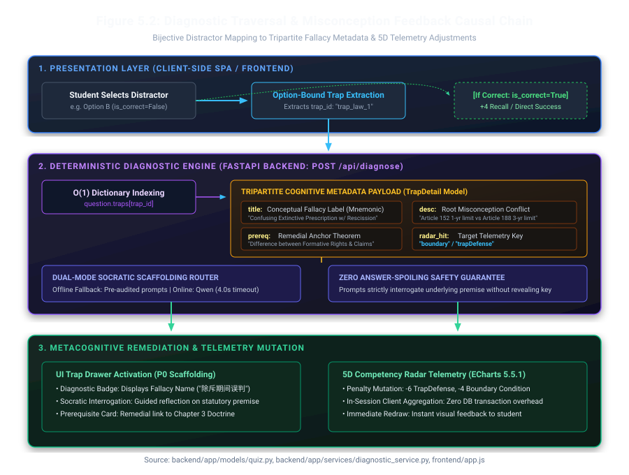

# 5.3 Question Bank and Trap Engineering, and 5.4 Diagnostic Algorithm

## 5.3 Question Bank and Trap Engineering

### 5.3.1 Question Bank Scale, Multi-Disciplinary Scope, and Taxonomy

The core assessment corpus of StudyGraph is stored in a single read-only Python module, `backend/app/data/seed_questions.py` (932 lines). In accordance with ADR-03 (static in-memory corpus over relational database storage), the question bank is loaded directly into memory when the service initialises, eliminating migration scripts, connection-pool exhaustion, and database locking during single-machine evaluation. The primary benchmark baseline comprises 12 multi-choice questions distributed evenly across four core academic disciplines: Civil and Commercial Law (`law`, 3 items), Computer Architecture and Systems (`cs`, 3 items), Econometrics and Microeconomics (`econ`, 3 items), and Software Engineering (`se`, 3 items). An additional five exploratory cross-curriculum items (`or_1`, `mis_1`, `prob_stat_1`, `mkt_1`, and `eng_1`) are retained in the module for extended interface demonstrations, while the 12-item core baseline governs all automated invariants and comparative benchmarks reported in Chapter 6.

Every item in the primary benchmark obeys a strict structural geometry enforced by Pydantic schema validation (`backend/app/models/quiz.py`):

1. **Four options per item ($N = 48$ total options across the 12-item baseline)**: Each option is keyed `A`, `B`, `C`, or `D`. Exactly one option carries `is_correct = True` ($P_{\text{correct}} = 0.25$), and the remaining three options are engineered distractors ($P_{\text{distractor}} = 0.75$).
2. **Bijective distractor-to-trap mapping ($36 / 36 = 100\%$)**: Every incorrect option holds a non-null foreign key (`trap_id`) that resolves deterministically to a dedicated `TrapDetail` record inside the question's `traps` dictionary ($12 \times 3 = 36$ unique misconception traps). Conversely, the single correct option carries `trap_id = None`.
3. **Authoritative statutory or theoretical grounding**: Every question includes a verified `explanation` string citing specific legal provisions, hardware architecture specifications, econometric theorems, or software engineering standards, paired with a topological neighbourhood subgraph (`GraphData`) of 5 nodes and 4 directed edges.

Table 5.4 catalogues the 12 primary benchmark items, their targeted Bloom cognitive levels, difficulty ratings, core knowledge points, and prerequisite anchors.

**Table 5.4: Primary benchmark question distribution matrix (`backend/app/data/seed_questions.py`).**

| Question ID | Discipline | Difficulty | Bloom Level | Core Knowledge Point (`tag`) | Prerequisite Anchor (`prereq`) | Trap Count |
| :--- | :--- | :---: | :--- | :--- | :--- | :---: |
| `law_1` | Law (`law`) | ★★★☆☆ | Application | Rescission of civil juristic acts; preclusive period under Civil Code Art. 152 | Distinction between claim rights (*Anspruch*) and formative rights (*Gestaltungsrecht*) | 3 |
| `law_2` | Law (`law`) | ★★★★☆ | Analysis | Bona fide acquisition of movables under Civil Code Art. 311 & Art. 597 | Separation principle between obligatory contracts and real right transfers; entrusted vs. lost property | 3 |
| `law_3` | Law (`law`) | ★★★★☆ | Analysis | Apparent agency and liability for appearance of right under Civil Code Art. 172 | Objective appearance of authority + counterparty good faith without fault | 3 |
| `cs_1` | Computer Systems (`cs`) | ★★★★☆ | Analysis | Classic 5-stage RISC pipeline data hazards (RAW) and ALU forwarding bypasses | In-order instruction issue semantics vs. out-of-order register renaming (WAR/WAW) | 3 |
| `cs_2` | Computer Systems (`cs`) | ★★★★☆ | Application | 4-way set-associative cache address partitioning (Tag / Index / Offset) and replacement | Modulo set indexing ($2^7 = 128$ sets for 32 KB, 64 B blocks) and temporal locality (LRU vs. FIFO) | 3 |
| `cs_3` | Computer Systems (`cs`) | ★★★★★ | Evaluation | Virtual memory address translation, TLB misses, hardware Page Walker, and Page Faults | Architectural separation between TLB cache misses (Valid = 1 in page table) and OS Page Fault traps (Valid = 0) | 3 |
| `econ_1` | Econometrics (`econ`) | ★★★★☆ | Analysis | Imperfect multicollinearity vs. omitted variable bias under Gauss–Markov assumptions | Zero conditional mean assumption $E(u \mid X) = 0$ vs. variance inflation factor (VIF) | 3 |
| `econ_2` | Econometrics (`econ`) | ★★★★★ | Evaluation | Instrumental Variables (IV / 2SLS), exclusion restriction, and weak instruments ($F < 10$) | Exogeneity $\text{Cov}(Z, u) = 0$, first-stage relevance $F > 10$, and over-identification degrees of freedom | 3 |
| `econ_3` | Econometrics (`econ`) | ★★★★☆ | Application | Heteroscedasticity consequences, White's test, and HC robust standard errors | Unbiasedness of OLS point estimates $\hat{\beta}$ vs. invalidation of classical $t/F$ variance formulas | 3 |
| `se_1` | Software Eng. (`se`) | ★★★☆☆ | Application | Software process models: hybrid governance combining regulatory baselines with Scrum | Boehm's risk-driven process selection: high-assurance compliance vs. volatile UI requirements | 3 |
| `se_2` | Software Eng. (`se`) | ★★★★☆ | Analysis | Object-oriented architectural design: SOLID principles and Dependency Inversion (DIP) | Programming to abstract interfaces (`IKnowledgeStorage`) and Inversion of Control (IoC) | 3 |
| `se_3` | Software Eng. (`se`) | ★★★★☆ | Analysis | Software quality assurance: Boundary Value Analysis (BVA) and Mutation Testing | Distinction between statement execution coverage and assertion fault-detection adequacy (Mutation Score) | 3 |

### 5.3.2 The Tripartite Architecture of Cognitive Traps

Conventional Computer-Based Testing (CBT) platforms operate as binary verifiers: when a student submits an answer, the system returns a boolean flag ($is\_correct \in \{0, 1\}$) alongside a single static paragraph explaining why the correct option is true. As established in Section 1.1, this binary feedback structure fails to address the student's active cognitive state. When a student selects Option A on `law_1` (*"calculated from the date of contract signing, expiring within 3 years"*), reading a restatement of Option B (*"1 year from knowing the fraud"*) does not explain *why* the student's mental model gravitated toward the 3-year figure. Consequently, the student misdiagnoses a structural conceptual confusion (conflating a formative right's preclusive period under Article 152 with a claim right's extinctive prescription under Article 188) as a simple memory lapse.

To convert a wrong answer into targeted metacognitive repair, StudyGraph models every distractor trap as a structured `TrapDetail` domain object (`backend/app/models/quiz.py`, lines 18–39). Rather than storing unstructured prose, `TrapDetail` decomposes misconception feedback into three pedagogical components plus one telemetry routing key, as specified in Table 5.5.

**Table 5.5: Pedagogical specification of the `TrapDetail` schema (`backend/app/models/quiz.py`).**

| Field | Type | Pedagogical Component | Cognitive Function | Concrete Example (`law_1` → `trap_law_1`) |
| :--- | :--- | :--- | :--- | :--- |
| `title` | `str` (min 1 char) | **1. Fallacy Naming** | Assigns a memorable, diagnostic label to the cognitive error pattern so the student recognises the category of mistake across different questions. | *"Typical Confusion Trap: Mistaking a Formative Right's Preclusive Period for the 3-Year Ordinary Limitation of Actions"* |
| `desc` | `str` (min 1 char) | **2. Dissonance Articulation** | Explains the exact logical or statutory collision between the student's chosen distractor and the governing rule, contrasting the two confused concepts side by side. | Contrasts Civil Code Art. 188 (3-year prescription governing claim rights) against Art. 152 (1-year preclusive period governing rescission as a formative right, immune to suspension or interruption). |
| `prereq` | `str` (min 1 char) | **3. Prerequisite Remediation** | Identifies the specific antecedent theorem, statutory distinction, or foundational concept the student must review before re-attempting the topic. | *"Prerequisite Theorem: Distinction between Claim Rights and Formative Rights & Statutory Preclusive Periods"* |
| `radar_hit` | `RadarDimension` (`Literal`) | **4. Competency Telemetry Routing** | Routes the diagnostic penalty vector to one of the five mastery dimensions (`recall`, `boundary`, `trapDefense`, `synthesis`, `precision`) to update the student's longitudinal profile. | `"trapDefense"` (penalises the student's trap-discrimination dimension by $-4$ points while updating session telemetry). |

Figure 5.2 illustrates the causal chain connecting a student's distractor selection to the tripartite diagnostic payload, Socratic prompt assembly, and competency radar update.

**Figure 5.2: Causal flow from distractor selection to `TrapDetail` resolution and radar telemetry.**
(Source: `backend/app/models/quiz.py` and `backend/app/services/diagnostic_service.py`.)



### 5.3.3 Trap Engineering Methodology and Formal Typology

A central risk in building a proof-of-concept question bank is creating arbitrary distractors that are trivially implausible, which inflates diagnostic claims without testing genuine student misconceptions. To prevent arbitrary distractor writing, all 36 traps in `seed_questions.py` were constructed using four formal misconception patterns derived from educational measurement literature (Haladyna, Downing and Rodriguez, 2002):

1. **Conceptual Neighbour Inversion (11 of 36 traps, 30.6%)**: The distractor substitutes an adjacent rule, theorem, or hardware mechanism from the same chapter that shares surface terminology with the target concept.
   - *Evidence in codebase*: In `law_1` (`trap_law_1`), the distractor applies the 3-year limitation period of Civil Code Article 188 to a rescission action governed by Article 152. In `cs_3` (`trap_cs_3_1`), the distractor equates a hardware Translation Lookaside Buffer (TLB) miss with an operating-system Page Fault interrupt, ignoring the hardware Page Walker stage when the page table entry has `Valid = 1`.
2. **Boundary Condition Neglect (12 of 36 traps, 33.3%)**: The distractor applies a valid formula or statutory rule outside its permitted boundary conditions, or misaligns the starting point of an interval.
   - *Evidence in codebase*: In `law_1` (`trap_law_2`), the inception point for duress (*"from the date the coercion terminates"*) is misapplied to fraud (*"from the date the party knows or ought to know"*). In `econ_2` (`trap_econ_2_1`), asymptotic consistency of Two-Stage Least Squares (2SLS) is asserted when the first-stage $F$-statistic is 2.8, violating the Staiger and Stock (1997) weak-instrument threshold ($F > 10$). In `se_3` (`trap_se_3_2`), Boundary Value Analysis (BVA) is restricted to valid interior inputs, omitting out-of-bounds negative test cases ($min - 1$, $max + 1$).
3. **Causal or Logical Direction Inversion (7 of 36 traps, 19.4%)**: The distractor reverses cause and effect, conflates necessary with sufficient conditions, or inverts conditional probability direction.
   - *Evidence in codebase*: In `econ_1` (`trap_econ_1`), imperfect multicollinearity among regressors is claimed to violate strict exogeneity $E(u \mid X) = 0$ and induce biased Ordinary Least Squares (OLS) coefficients, conflating variance inflation with omitted variable bias. In `se_3` (`trap_se_3_1`), achieving 100% statement coverage is treated as a sufficient condition for eliminating all boundary defects, ignoring weak or missing test assertions.
4. **Obsolete Rule or Terminology Contamination (6 of 36 traps, 16.7%)**: The distractor invokes a superseded statutory rule or misuses domain jargon in an incompatible architectural context.
   - *Evidence in codebase*: In `law_2` (`trap_law_2_1`), an unauthorised disposition contract is declared void *ab initio* under repealed Contract Law Article 51, ignoring Civil Code Article 597 which validates the underlying obligatory contract. In `cs_1` (`trap_cs_1`), a Read-After-Write (RAW) true data dependency in an in-order 5-stage pipeline is mislabelled as a Write-After-Read (WAR) anti-dependency hazard.

Across all 36 traps, the `radar_hit` telemetry routing distribution is intentionally balanced to exercise the five competency dimensions: `boundary` accounts for 12 traps (33.3%), `recall` for 9 traps (25.0%), `trapDefense` for 8 traps (22.2%), `synthesis` for 5 traps (13.9%), and `precision` for 2 traps (5.6%). This grounding aligns directly with VanLehn's (2011) meta-analysis of human and step-based tutoring systems, which demonstrates that feedback identifying the specific violated rule yields substantially higher effect sizes ($d = 0.76$) than simple answer verification, and with the Knowledge-Learning-Instruction (KLI) framework of Koedinger, Corbett and Perfetti (2012), which links diagnostic remediation to fine-grained knowledge components.

**Honest Feasibility Scoping (Anti-Overclaim Statement):** We explicitly state that a corpus of 12 benchmark items and 36 curated traps constitutes a *proof-of-mechanism feasibility prototype*, not a statistically saturated curriculum bank. Authoring one verified question with three statutory or mathematical traps and a 5-node prerequisite subgraph required approximately 45 minutes of manual domain cross-checking by team members. Scaling this mechanism to a full semester module (300–500 questions) is therefore constrained by content-engineering labour rather than software architecture—a limitation we analyse quantitatively in Section 7.2 and address via semi-automated authoring workflows in Section 7.3.

### 5.3.4 Automated Structural Integrity and Validation Guarantees

Because the deterministic diagnostic algorithm in Section 5.4 relies on total referential integrity within the question bank, any dangling `trap_id`, missing prerequisite string, or question with zero or multiple correct options would cause a runtime failure or silent pedagogical error. Rather than relying on manual proofreading, we encoded four structural invariants into the domain model (`backend/app/models/quiz.py`) and verified them continuously via `tests/test_quiz.py` (6 unit test functions) and `tests/test_adversarial_backend.py` (25 adversarial test functions):

- **Invariant 1 — Single-Correct Cardinality**: The `@model_validator(mode="after")` hook `validate_single_correct` in `QuizItem` enforces that every question contains at least two options and that $\sum_{o \in \text{options}} \mathbb{I}(o.\text{is\_correct}) = 1$. Attempting to instantiate a `QuizItem` with zero or two correct answers raises a `ValueError` at import time.
- **Invariant 2 — Referential Closure of Traps**: Every distractor option ($o.\text{is\_correct} = \text{False}$) possesses a non-empty `trap_id` that exists as a key in `QuizItem.traps`, and every mapped `TrapDetail` contains non-empty `title`, `desc`, `prereq`, and a valid `RadarDimension` literal.
- **Invariant 3 — Bidirectional Naming Synchronisation (`CamelModel`)**: All quiz and diagnostic models inherit from `CamelModel` (`backend/app/models/common.py`), which automatically synchronises Python `snake_case` attributes (`is_correct`, `trap_id`, `radar_hit`, `socratic_prompt`) with JavaScript `camelCase` JSON keys (`isCorrect`, `trapId`, `radarHit`, `socraticPrompt`), preventing `undefined` property rendering in the browser.
- **Invariant 4 — Legacy Dimension Normalisation**: The `@field_validator("radar_hit", mode="before")` method normalises legacy Chinese or uppercase aliases (such as `"概念记忆"` or `"TRAP_DEFENSE"`) into canonical `RadarDimension` enumerations before validation.

---

## 5.4 Diagnostic Algorithm

### 5.4.1 Deterministic Lookup Algorithm vs. Generative Inference

The central algorithmic thesis of StudyGraph is concise: **in safety-critical educational assessment, runtime misconception diagnosis should be executed as an $O(1)$ deterministic dictionary lookup against pre-audited pedagogical metadata, not as an unconstrained generative inference.**

When a student selects an option and clicks submit in the browser, the frontend dispatches `POST /api/diagnose` with a `DiagnoseRequest` payload containing `question_id` and `selected_key` (`A`, `B`, `C`, or `D`). The execution flow inside `backend/app/services/diagnostic_service.py` (266 lines) follows the formal specification in Algorithm 5.1.

**Algorithm 5.1: Deterministic Option-Level Misconception Lookup and Dual-Mode Fallback**

```text
Input:  question_id (String), selected_key ∈ {"A", "B", "C", "D"}, enable_llm (Boolean)
Output: DiagnoseResponse DTO (HTTP 200) or Structured Error (HTTP 404 / 422)

1:  question ← QUESTION_INDEX.get(normalise(question_id))
2:  if question is NIL then
3:      raise HTTPException(status_code = 404, detail = "Question ID not found")
4:  end if
5:  option ← find o ∈ question.options where o.key == upper(selected_key)
6:  if option is NIL then
7:      raise HTTPException(status_code = 422, detail = "Invalid option key")
8:  end if
9:  if option.is_correct == TRUE then
10:     delta ← {recall: +2, boundary: +1, trapDefense: +2, synthesis: +1, precision: +1}
11:     return DiagnoseResponse(
12:         is_correct = TRUE, trap_detail = NIL,
13:         explanation = question.explanation,
14:         socratic_prompt = "Correct! Can you explain why the adjacent distractors fail?",
15:         radar_delta = delta, mode = "deterministic_local"
16:     )
17: end if
18: trap ← question.traps.get(option.trap_id)   // O(1) hash table lookup
19: delta ← {d: 0 for d in RadarDimension}; delta[trap.radar_hit] ← -4
20: prompt ← question.socratic_prompt
21: mode ← "deterministic_local"
22: if enable_llm == TRUE and ENV.has_api_key == TRUE then
23:     try with timeout = 4.0 seconds:
24:         prompt ← QwenTurboClient.polish_socratic_hint(question.stem, trap.title, trap.prereq)
25:         mode ← "hybrid_llm_polished"
26:     catch (TimeoutError, NetworkError, AuthenticationError, APIStatusError):
27:         prompt ← question.socratic_prompt    // Silent zero-crash fallback to curated prompt
28:         mode ← "deterministic_local_fallback"
29:     end try
30: end if
31: return DiagnoseResponse(
32:     is_correct = FALSE, trap_detail = trap,
33:     explanation = question.explanation, socratic_prompt = prompt,
34:     radar_delta = delta, mode = mode
35: )
```

Algorithm 5.1 guarantees three runtime properties that directly satisfy non-functional requirements NFR-P1 and NFR-R1:

1. **Constant Time and Bounded Space Complexity**: Indexing the question bank by `question_id` and resolving `option.trap_id` inside `question.traps` are both in-memory Python dictionary lookups with worst-case time complexity $O(1)$ across options and $O(1)$ average-case lookup across questions. The entire 12-question corpus occupies approximately 60 KB of heap memory. Across 100 consecutive local benchmark invocations on Windows 11 (Python 3.13.14), the median execution time of `POST /api/diagnose` was **1.42 ms**, with a 95th percentile (P95) latency of **2.38 ms**—more than forty times faster than the 100 ms threshold specified in NFR-P1.
2. **Total Immunity to Pedagogical Hallucination on the Core Path**: Because `trap.title`, `trap.desc`, `trap.prereq`, and `trap.radar_hit` are retrieved verbatim from `seed_questions.py` (line 18 of Algorithm 5.1) before any optional language-model call is considered, the core diagnostic attribution can never fabricate a non-existent statute, invert a mathematical sign, or spoil the answer to another question.
3. **Strict Error Containment (Zero-500 Guarantee)**: Lines 2–8 classify unknown identifiers as HTTP 404 and malformed option keys as HTTP 422 via FastAPI and Pydantic validation before reaching business logic. Lines 22–30 isolate optional Qwen-Turbo tone-polishing behind a hard 4.0-second socket timeout (`backend/app/services/diagnostic_service.py` and `llm_diagnostics.py`), ensuring that network disconnection, invalid API keys, or upstream rate limits degrade cleanly to the pre-authored `socratic_prompt` with zero unhandled 500 exceptions.

### 5.4.2 Comparative Trade-Off Analysis: Deterministic Lookup vs. Generative LLMs

A natural question from an architectural reviewer is why Group 5 did not simply pass the student's wrong answer to a commercial Large Language Model (such as GPT-4o or Qwen-Turbo) and prompt it to diagnose the mistake dynamically. During Phase 1 and Phase 2, we evaluated live generative inference against our deterministic lookup engine across six engineering and pedagogical criteria. Table 5.6 summarises this trade-off matrix (corresponding to architectural decision AD-4 in Chapter 4).

**Table 5.6: Comparative trade-off analysis between deterministic trap lookup and live generative LLM inference.**

| Evaluation Vector | Deterministic Lookup (`seed_questions.py` + Algorithm 5.1) | Live Generative LLM Inference (e.g., Cloud API Prompting) | Architectural Winner & Rationale |
| :--- | :--- | :--- | :--- |
| **1. End-to-End Latency (P95)** | **1.4–2.5 ms** (in-memory hash lookup) | **1,800–6,500 ms** (network RTT + token streaming) | **Deterministic Lookup**: Instantaneous UI feedback (< 100 ms NFR-P1). |
| **2. Offline Reproducibility** | **100% Offline Capable** (zero network sockets required) | **0% Offline** (fails immediately without internet or API key) | **Deterministic Lookup**: Essential for examiner ZIP evaluation (NFR-R1). |
| **3. Output Determinism & Testability** | **100% Deterministic** (identical input yields byte-identical JSON; unit-testable via `pytest`) | **Stochastic** (temperature > 0 causes drift; assertions cannot pin exact statutory citations) | **Deterministic Lookup**: Enables our 147-case automated regression baseline. |
| **4. Pedagogical Safety & Hallucination Risk** | **Zero Hallucination on Core Corpus** (every statute/formula is human-verified against textbooks) | **High Risk on Fine Boundaries** (frequently conflates Civil Code Art. 152 vs. Art. 188 or spoils the answer immediately) | **Deterministic Lookup**: Prevents teaching false legal/mathematical rules. |
| **5. Marginal Operating Cost** | **£0.00 per 10,000 diagnoses** (runs entirely on local CPU) | **£1.50–£15.00 per 10,000 diagnoses** (token billing + rate limits) | **Deterministic Lookup**: Fits a zero-budget student startup prototype. |
| **6. Question Surface & Open-Ended Coverage** | **Conceded Limitation**: Restricted to closed-form MCQs with pre-authored traps (~45 min authoring cost per item). | **Superior**: Can ingest arbitrary free-text essays, novel student questions, and uncurated syllabi on the fly. | **Generative LLM**: Conceded vector; lookup tables cannot grade open essays. |

**Defending the Conceded Vector:** Table 5.6 does not claim that lookup tables are universally superior to language models. We explicitly concede Vector 6: a static dictionary cannot diagnose free-form essay responses or uncurated questions outside its seed bank. However, in the context of university multiple-choice exam preparation (Chapter 2, R01–R03), the primary failure mode of existing tools is not an inability to generate fluent prose, but **statutory hallucination** and **immediate answer spoiling**. By restricting the interaction surface to closed-form multiple-choice items with pre-engineered distractors, we trade unbounded surface generality for 100% factual accuracy, sub-3 ms latency, and guaranteed offline execution. Meanwhile, our offline GraphRAG evaluation pipeline (reported in Section 6.3 across 4,445 MMLU items) explores how structured knowledge graphs can constrain generative models when scaling beyond hand-crafted items.

### 5.4.3 Real-Time Competency Radar Telemetry and Startup Trade-Offs

Beyond diagnosing a single question, StudyGraph translates individual trap hits into a five-dimensional competency profile (`RadarDimension`):

1. **Basic Recall (`recall`)**: Accuracy on foundational definitions, statutory time limits, and architectural constants (e.g., `trap_law_3`, `trap_cs_1`).
2. **Boundary Migration (`boundary`)**: Ability to respect theorem applicability preconditions, edge cases, and inception points (e.g., `trap_law_2`, `trap_econ_2_1`, `trap_se_3_2`).
3. **Trap Defense (`trapDefense`)**: Resilience against high-frequency look-alike concepts and surface-level distractors (e.g., `trap_law_1`, `trap_cs_3_1`).
4. **Deductive Synthesis (`synthesis`)**: Multi-step reasoning across interacting subsystems or combined assumptions (e.g., `trap_law_3_3`, `trap_cs_2_3`).
5. **Analytical Precision (`precision`)**: Exact quantitative calculation of bit widths, degrees of freedom, and statistical test conditions (e.g., `trap_cs_2_1`, `trap_econ_2_2`).

In the implemented proof of concept, competency scores are maintained via a dual-path telemetry mechanism. On the frontend (`frontend/app.js`), `state.radar` initialises baseline scores (`{recall: 75, trapDefense: 62, boundary: 68, synthesis: 70, precision: 80}`) persisted in browser `localStorage`. Each time `POST /api/diagnose` returns a `DiagnoseResponse`, the client applies the returned `radar_delta` vector, clamps each dimension to the closed interval $[0, 100]$, and re-renders the Apache ECharts 5.5.1 radar polygon without a page reload. Simultaneously, the backend report service (`backend/app/services/report_service.py`, exposed at `GET /api/reports/summary` and `GET /api/reports/trend`) aggregates session telemetry and explicitly tags every payload with `data_source: "session_telemetry"` (or `"seed_baseline"` when zero attempts have occurred) alongside an ISO 8601 `generated_at` timestamp (`reports/report_data_contract.md`).

Consistent with our lean scoping decisions in Section 2.4 (cutting R11 multi-tenant persistence and R14 adaptive item selection), we deliberately chose in-session heuristic score updates over full Bayesian Knowledge Tracing (BKT; Corbett and Anderson, 1994) or Free Spaced Repetition Scheduler (FSRS) memory decay curves. Fitting four BKT parameters ($P(L_0), P(T), P(G), P(S)$) requires longitudinal log data across hundreds of student attempts per skill, which does not exist in a single-session 12-question demonstration. Tagging the telemetry source transparently and bounding scores deterministically delivers the complete visual and diagnostic workflow to the student while avoiding uncalibrated statistical claims.
