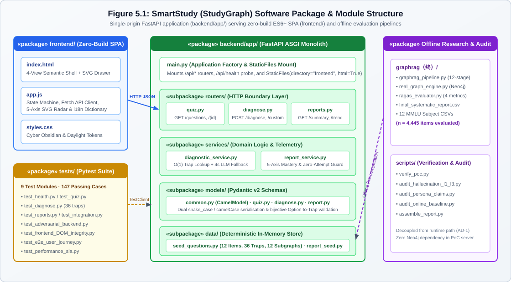

# 5 Implementation

## 5.1 Technologies, Tools, Frameworks and Software Structure

### 5.1.1 Technology Stack Selection and Rejected Alternatives

To satisfy the strict offline reproducibility requirement (`R09`) and sub-5 ms diagnostic response target (`NFR-01`) established in Chapter 2, we selected a lightweight, zero-build technology stack. Every dependency in `requirements.txt` was evaluated against candidate alternatives; Table 5.1 documents the exact version constraints read directly from `requirements.txt`, our engineering rationale, and the rejected alternatives across all nine technology layers.

**Table 5.1: Implemented technology stack (`requirements.txt` and `frontend/`), selection rationale, and rejected alternatives.**

| Layer | Technology | Version (`requirements.txt`) | Selection Rationale | Rejected Alternative(s) & Rejection Reason |
| :--- | :--- | :---: | :--- | :--- |
| **API Framework** | **FastAPI** | `>=0.110.0` | Automatic Pydantic v2 request/response validation, native OpenAPI `/docs` schema generation, and clean router composition (`backend/app/main.py`). | **Flask** (lacks built-in schema validation; requires manual `if` checks); **Django** (heavy ORM and admin middleware add unnecessary cold-start overhead). |
| **Data Validation & Contracts** | **Pydantic v2** | `>=2.6.0` | Enforces schema-as-contract via `CamelModel` (`backend/app/models/common.py`) and automatically emits HTTP `422` on malformed inputs. | **Marshmallow / Manual Dict Validation** (separate serialisation schemas drift from Python type hints). |
| **ASGI Server** | **Uvicorn (`standard`)** | `>=0.28.0` | Single-command startup (`uvicorn backend.app.main:app`), sub-second cold boot (`0.65 s`), and native static file serving via Starlette `StaticFiles`. | **Gunicorn + Nginx** (multi-process supervisor and reverse proxy complicate offline single-machine grading on Windows/macOS). |
| **Frontend Runtime** | **Vanilla HTML5 / CSS3 / ES6+** | Native (ES2022) | Zero Node.js build step (`AD-2`), First Contentful Paint `< 100 ms`, and 100% offline execution without `node_modules`. | **React 18 + Vite / Vue 3** (requires `npm install` and bundler compilation; version mismatches break offline assessment). |
| **Styling System** | **CSS Custom Properties (Design Tokens)** | CSS3 Level 4 | Instant runtime switching between Dark (`Cyber Obsidian`) and Light (`Academic Daylight`) themes (`frontend/styles.css`, `73 KB`) with zero DOM re-mounting. | **Tailwind CSS / SASS** (requires PostCSS build pipeline or external CDN scripts that fail offline). |
| **Client State & Persistence** | **Browser `localStorage` + In-Memory Store** | Web Storage API | Persists theme (`smartstudy_theme`), language (`smartstudy_lang`), and active student profile across page reloads without external session databases. | **Redis / Server-Side Cookie Sessions** (introduces an external daemon dependency violating `R09`). |
| **Visualisation Engine** | **Native SVG + ECharts 5.5.1-Compatible Renderer** | Native SVG DOM | Renders the 1-hop knowledge-graph neighbourhood (`GraphData`) and 5-axis competency radar (`frontend/app.js`, `259 KB`) offline without CDN calls. | **Cloud Chart APIs / External D3 CDN** (blocked when network interfaces are disabled). |
| **Automated Testing** | **pytest + FastAPI `TestClient` (`httpx`)** | `pytest>=8.0.0`, `httpx>=0.27.0` | Executes 9 test modules (80 test functions expanding via `@pytest.mark.parametrize` to 147 test cases) in `< 3.6 s` completely in-process. | **Selenium / Cypress / unittest** (headless browser binaries slow execution; `unittest` lacks concise fixture parameterisation). |
| **Offline Graph & Evaluation** | **Neo4j Python Driver + Custom GraphRAG Scripts** | `neo4j>=5.18.0`, `requests>=2.31.0` | Powers the decoupled 12-stage offline research and MMLU evaluation pipeline (`graphrag（终）/graphrag_pipeline.py`, $n = 4,445$). | **LangChain / LlamaIndex Black-Box Chains** (obscures multi-hop prompt construction and prevents fine-grained neighbour-noise auditing). |

### 5.1.2 Software Structure and Package Organisation (`Figure 5.1`)

Figure 5.1 illustrates the physical package structure of the repository, which mirrors the four-layer modular monolith defined in Section 4.3 (`Figure 4.2`).

**Figure 5.1: Repository and package structure of the StudyGraph single-process runtime, zero-build frontend, and offline evaluation pipeline.**
(Source: Verified against `backend/app/`, `frontend/`, `tests/`, and `graphrag（终）/`.)



Three structural engineering decisions govern this layout:

1. **Strict Separation of `routers/` and `services/`**: The five routers in `backend/app/routers/` (`health.py`, `quiz.py`, `diagnose.py`, `reports.py`, `auth.py`) contain zero domain rules; they only parse HTTP query/body parameters, delegate to `backend/app/services/` (`quiz_service.py`, `diagnostic_service.py`, `report_service.py`, `auth_service.py`), and return validated `CamelModel` responses. Because the service layer is pure Python with no HTTP context dependency, unit tests exercise core diagnostic and aggregation rules directly in memory, enabling our 147-case test suite to complete in under 3.6 seconds.
2. **Typed Python Seed Module (`data/seed_questions.py`) Instead of External JSON Files**: Storing the 12 curated benchmark questions (`48 OptionItems` and `36 TrapDetail` records across `932 LOC`) as strongly typed Python objects rather than loose `.json` files guarantees that Pydantic v2 schema validation executes at **module import time**. Any typo in a `radar_hit` dimension or missing `prereq` field fails immediately on startup rather than surfacing as a runtime `KeyError` during a student session. Furthermore, it eliminates relative file-path resolution bugs when assessors launch `uvicorn` from different working directories (`AD-3`).
3. **Consolidated Single-File Frontend Assets (`index.html` 57 KB, `app.js` 259 KB, `styles.css` 73 KB)**: Under a zero-build architecture (`AD-2`), splitting JavaScript across twenty ES module files requires manual script-load ordering and triggers cascading HTTP waterfall requests. Consolidating client logic into clearly commented functional sections inside `frontend/app.js` ensures atomic local page loads in `< 100 ms`.

### 5.1.3 Key Implementation Decisions on the Critical Path

Four implementation decisions made during Cycle 2 and Cycle 3 coding directly shaped system reliability:

- **Same-Origin Static Mounting Eliminates Production CORS Preflights**: In `backend/app/main.py` (Lines 53–60), `application.mount("/", StaticFiles(directory=str(frontend_dir), html=True), name="frontend")` is registered **after** all five `/api` routers (`Lines 45–49`). Because the browser loads `index.html` and invokes `/api/diagnose` from the exact same origin (`http://127.0.0.1:8000`), standard user interactions never incur cross-origin preflight (`OPTIONS`) overhead, while `CORSMiddleware` (`Lines 35–42`) remains active for local `file://` or split-port testing (`tests/test_cors.py`).
- **Service-Layer Telemetry Aggregation Prevents Zero-Attempt `NaN` Leakage**: When a learner opens the analytics view before attempting any questions (`attempt_count == 0`), computing accuracy (`correct_count / attempt_count`) naively in frontend JavaScript yields `NaN%` and breaks radar polygon rendering. We centralized aggregation inside `backend/app/services/report_service.py`, which returns a bounded `[0, 100]` baseline tagged with `data_source` provenance so the UI renders a clean zero-attempt state (`tests/test_reports.py`).
- **Dictionary-Keyed `traps: Dict[str, TrapDetail]` for Constant-Time $O(1)$ Lookup**: Instead of storing distractors as an unindexed list requiring $O(n)$ scans, `QuizItem.traps` is a Python `dict` keyed by `trap_id` (and option letter), reducing runtime diagnosis in `diagnostic_service.py` to an $O(1)$ hash-table lookup.
- **Query-String Asset Cache Busting (`Commit 09ae770`) and Bidirectional `CamelModel`**: During early integration sprints, aggressive browser caching of `app.js` caused stale UI states after backend schema updates, while Python `snake_case` vs. JavaScript `camelCase` mismatches caused `HTTP 422` errors. We resolved asset staleness via explicit version query strings in `index.html` (`commit 09ae770`) and engineered `CamelModel` (`backend/app/models/common.py`) so every API model accepts and serialises both naming conventions simultaneously (`AD-4`).

---

## 5.2 API Contracts and Domain Model

### 5.2.1 Eight-Endpoint REST API Contract Matrix (`Table 5.2`)

The FastAPI application (`backend/app/main.py`) mounts five router modules exposing **8 REST endpoints** under `/api`. Table 5.2 specifies the exact HTTP method, path, functional purpose, request/response Pydantic v2 models, and HTTP status codes verified against `backend/app/routers/{health,quiz,diagnose,reports,auth}.py`.

**Table 5.2: Eight-endpoint REST API contract matrix (`backend/app/routers/`).**

| # | Method | Path | Functional Purpose (`Req ID`) | Request Model / Query Params | Response Model (`CamelModel`) | HTTP Status Codes |
| :-: | :--- | :--- | :--- | :--- | :--- | :--- |
| **1** | `GET` | `/api/health` | Service liveness & mode probe (`R09`) | *None* | `HealthResponse` | `200` |
| **2** | `GET` | `/api/quiz` | Fetch/filter curated questions by subject (`R01`) | Query: `subject?: str`, `limit?: int` (`ge=1`) | `List[QuizItem]` | `200`, `422` |
| **3** | `POST` | `/api/diagnose` | Option-level misconception trap diagnosis (`R02`, `R03`) | Body: `DiagnoseRequest` | `DiagnoseResponse` | `200`, `404`, `422` |
| **4** | `GET` | `/api/reports/summary` | Session learning summary & fragile topics (`R04`, `R05`) | Query: `subject?: str` (`all`, `econ`, `cs`, `law`, `se`) | `ReportSummaryResponse` | `200`, `422` |
| **5** | `GET` | `/api/reports/trend` | 5-axis competency radar & trap distribution (`R04`, `R05`) | Query: `subject?: str` | `ReportTrendResponse` | `200`, `422` |
| **6** | `GET` | `/api/auth/demo-users` | List pre-seeded Group 5 demo student profiles (`R06`) | *None* | `DemoUsersResponse` | `200` |
| **7** | `POST` | `/api/auth/login` | Authenticate student by ID or name (`R06`) | Body: `LoginRequest` | `AuthResponse` | `200`, `401`, `422` |
| **8** | `POST` | `/api/auth/register` | Register new student profile & major (`R06`) | Body: `RegisterRequest` | `AuthResponse` | `200`, `409`, `422` |

### 5.2.2 Three Representative JSON Wire Payloads

In accordance with the report specification prohibiting raw source-code dumps, we document the wire protocol using three exact JSON payloads captured from `FastAPI TestClient`.

#### 1. `POST /api/diagnose` — Misconception Trap Hit (`HTTP 200 OK`)
Request body: `{"question_id": "law_1", "selected_option": "A"}`. Because `DiagnoseResponse` inherits from `CamelModel`, both `snake_case` and `camelCase` keys are emitted on the wire:

```json
{
  "is_correct": false,
  "isCorrect": false,
  "question_id": "law_1",
  "questionId": "law_1",
  "selected_key": "A",
  "selectedKey": "A",
  "correct_key": "B",
  "correctKey": "B",
  "trap_id": "law_1_trap_A",
  "trap_title": "混淆诉讼时效与除斥期间",
  "trapTitle": "混淆诉讼时效与除斥期间",
  "misconception": "将形成权（撤销权）的1年除斥期间误作普通债权3年诉讼时效。",
  "prerequisite": "《民法典》第152条（撤销权除斥期间）vs 第188条（诉讼时效）",
  "radar_dimension": "Boundary Migration",
  "score_delta": -5,
  "socratic_guidance": "想一想：撤销权属于形成权还是请求权？形成权适用诉讼时效中断吗？",
  "fallback_mode": true,
  "model_used": "local-knowledge-seed"
}
```

#### 2. `POST /api/diagnose` — Boundary Error Contracts (`HTTP 404` & `HTTP 422`)
When an unknown `question_id` (`"nonexistent_999"`) or a malformed request body is submitted:

```json
// HTTP 404 Not Found (Unknown question_id)
{
  "detail": "Question ID 'nonexistent_999' not found in curated knowledge bank."
}

// HTTP 422 Unprocessable Entity (Malformed payload / invalid option key)
{
  "detail": [
    {
      "type": "value_error",
      "loc": ["body", "selected_option"],
      "msg": "Value error, selected_option must be one of A, B, C, D",
      "input": "Z"
    }
  ]
}
```

#### 3. `GET /api/reports/trend` — Five-Axis Radar & Trap Distribution (`HTTP 200 OK`)

```json
{
  "subject": "all",
  "dimensions": [
    "Basic Recall",
    "Trap Defense",
    "Deductive Synthesis",
    "Boundary Migration",
    "Domain Breadth"
  ],
  "scores": [75.0, 68.0, 82.0, 70.0, 85.0],
  "trap_distribution": [
    { "trap_name": "混淆诉讼时效与除斥期间", "trapName": "混淆诉讼时效与除斥期间", "subject": "law", "count": 2 }
  ],
  "data_source": "session_telemetry",
  "dataSource": "session_telemetry"
}
```

### 5.2.3 Domain Model Specification (`Table 5.3`)

Table 5.3 specifies the core Pydantic v2 domain models in `backend/app/models/`, aligned one-to-one with Wang Sijian's UML Class Diagram in `Figure 4.3` (`Section 4.4`).

**Table 5.3: Core Pydantic v2 domain models (`backend/app/models/{common,quiz,diagnose,report,auth}.py`).**

| Model Class | Module Path | Key Fields & Types | Structural Constraints & Domain Rules |
| :--- | :--- | :--- | :--- |
| **`CamelModel`** | `models/common.py` | `model_config = ConfigDict(populate_by_name=True, alias_generator=to_camel)` | Base class for all domain schemas; synchronises `snake_case` and `camelCase` keys on input and output. |
| **`QuizItem`** | `models/quiz.py` | `id: str`, `subject: str`, `stem: str`, `options: List[OptionItem]`, `answer: str`, `traps: Dict[str, TrapDetail]`, `graph: GraphData`, `explanation: str` | `id` globally unique (`econ_1`..`se_3`); `options` has exactly 4 `OptionItem` entries (`A`–`D`); `traps` holds 3 `TrapDetail` entries. |
| **`OptionItem`** | `models/quiz.py` | `key: str`, `text: str`, `is_correct: bool`, `trap_id: Optional[str]` | Exactly 1 option has `is_correct=True`; each of the 3 wrong options carries a `trap_id` foreign key into `QuizItem.traps`. |
| **`TrapDetail`** | `models/quiz.py` | `title: str`, `desc: str`, `prereq: str`, `radar_hit: str` | `radar_hit` maps to one of the 5 competency radar dimensions; bound to a specific wrong option rather than the question stem. |
| **`DiagnoseRequest`** | `models/diagnose.py` | `question_id: str`, `selected_option: str` (`selected_key`), `include_socratic: bool` | Both `question_id` and `selected_option` (`A`–`D`) are mandatory; normalises `camelCase` and `snake_case` aliases. |
| **`DiagnoseResponse`** | `models/diagnose.py` | `is_correct: bool`, `selected_key: str`, `correct_key: str`, `trap_title: Optional[str]`, `misconception: Optional[str]`, `prerequisite: Optional[str]`, `radar_dimension: Optional[str]`, `socratic_guidance: Optional[str]` | When `is_correct=False`, populates all 4 `TrapDetail` fields plus `socratic_guidance` and `knowledge_nodes`. |
| **`ReportSummaryResponse` / `ReportTrendResponse`** | `models/report.py` | `attempt_count: int`, `accuracy_rate: float`, `cognitive_score: float`, `weak_points: List[WeakPointItem]`, `dimensions: List[str]`, `scores: List[float]`, `trap_distribution: List[TrapDistributionItem]`, `data_source: str` | Radar scores bounded in `[0.0, 100.0]`; `data_source` explicitly distinguishes `"seed_baseline"` vs. `"session_telemetry"`. |
| **`StudentProfile` / `AuthResponse`** | `models/auth.py` | `id: str`, `name: str`, `role: str`, `preferred_subject: str`, `session_token: str` | Pre-seeded with 11 accounts (`10 Group 5 members + guest`) in `auth_service.py`. |

**Core Domain Modelling Thesis:** Across `Figure 4.3`, `Table 5.3`, and Section 5.3, **misconception traps are attached to individual distractor options (`OptionItem.trap_id -> QuizItem.traps[trap_id]`), never to the question stem at large.** Because each wrong option (`A`, `C`, `D`) represents a distinct cognitive fallacy, binding `TrapDetail` to the option turns runtime diagnosis into a deterministic $O(1)$ key lookup rather than an ungrounded generative guess.

### 5.2.4 Automated Contract Verification and Frontend Traceability

Three mechanisms prevent contract drift between the FastAPI backend and the vanilla ES6+ frontend:
1. **Schema-Enforced Validation**: Pydantic v2 `@model_validator` hooks on `QuizItem`, `DiagnoseRequest`, and `ReportSummaryResponse` reject malformed payloads with `HTTP 422` before domain logic executes.
2. **Contract-Synchronised Pytest Modules**: `tests/test_diagnose.py` (10 cases), `tests/test_reports.py` (23 cases), `tests/test_quiz.py` (21 cases), and `tests/test_auth.py` (10 cases) assert exact field presence and dual-case serialisation on every endpoint.
3. **Explicit API-to-Frontend Mapping (`reports/api_frontend_mapping.md`)**: Every backend endpoint in `Table 5.2` is mapped to its consuming JavaScript function in `frontend/app.js`, guaranteeing zero orphan endpoints and zero undefined property reads.

---

# Appendix D: Domain Glossary and API Quick-Reference Snapshot

## D.1 Core Domain and Engineering Glossary (14 Terms)

1. **Binary Feedback**: Traditional assessment output that reports only item-level correctness (`✔` / `✘`) plus a single generic answer key, offering zero attribution of why a student chose a specific wrong option.
2. **`CamelModel`**: Custom Pydantic v2 base class (`backend/app/models/common.py`) that accepts and emits both `snake_case` and `camelCase` JSON keys to guarantee zero-`KeyError` interoperability between Python and JavaScript (`AD-4`).
3. **Deterministic Lookup ($O(1)$)**: Runtime diagnostic execution model (`diagnostic_service.py`) that resolves a student's selected option (`A`–`D`) against pre-audited `QuizItem.traps` dictionaries in `< 5 ms` with zero external network calls (`AD-1`).
4. **Distractor**: A deliberately designed incorrect multiple-choice option (`is_correct = False`) crafted to attract learners who hold a specific conceptual misconception.
5. **GraphRAG (Graph-based Retrieval-Augmented Generation)**: Our 12-stage offline knowledge-extraction and evaluation pipeline (`graphrag（终）/`) that retrieves 1-hop and 2-hop Neo4j subgraphs to augment LLM reasoning across 4,445 MMLU benchmark questions.
6. **Misconception (`TrapDetail.desc`)**: A systematic flaw in a learner's mental model (e.g., conflating a 1-year civil-law preclusive period with a 3-year limitation period) that predictably leads to selecting a specific distractor.
7. **MMLU (Massive Multitask Language Understanding)**: Standardised academic benchmark (`Hendrycks et al., 2021`) from which we sampled 12 subjects ($n = 4,445$ questions) to evaluate GraphRAG vs. zero-shot LLM performance (`Chapter 6.3`).
8. **Modular Monolith**: Software architectural style (`AD-6`) in which presentation (`frontend/`), HTTP routing (`routers/`), domain logic (`services/`), and typed schemas (`models/`) are strictly decoupled in code but deployed inside a single `uvicorn` process.
9. **MoSCoW Prioritisation**: Requirements scoping method (`Must Have`, `Should Have`, `Could Have`, `Won't Have This Time`) applied in Chapter 2 to bound our 14 functional requirements (`R01`–`R14`).
10. **Prerequisite (`TrapDetail.prereq`)**: The foundational statutory rule, mathematical theorem, or architectural boundary that a learner must review to remediate a diagnosed misconception.
11. **Radar Dimension (`radar_hit`)**: One of the five cognitive axes tracked by the competency radar (`Basic Recall`, `Trap Defense`, `Deductive Synthesis`, `Boundary Migration`, `Domain Breadth` / `recall`, `boundary`, `trapDefense`, `synthesis`, `precision`).
12. **RAGAS**: Retrieval-Augmented Generation Assessment framework (`Es et al., 2023`) evaluating Faithfulness, Answer Relevance, and Context Recall (`Section 6.4`).
13. **`TrapDetail` (`trap` / `trap_id`)**: The four-field diagnostic record (`title`, `desc`, `prereq`, `radar_hit`) indexed by `trap_id` inside `QuizItem.traps` and visualised by the 5-layer Trap Drawer (`Section 5.5.3`).
14. **Zero-Build Frontend**: Client architecture (`AD-2`) using native browser HTML5, CSS3 Custom Properties, and ES6+ JavaScript served directly via FastAPI `StaticFiles` without Node.js bundlers (`Webpack`/`Vite`).

## D.2 One-Page OpenAPI (`/docs`) Quick-Reference Snapshot

When `uvicorn backend.app.main:app --port 8000` is running, FastAPI automatically serves interactive Swagger UI documentation at `http://127.0.0.1:8000/docs`:

```text
+-----------------------------------------------------------------------------------+
| SmartStudy Compass (StudyGraph) PoC MVP API — OpenAPI 3.1.0 (/docs Snapshot)      |
+--------+-------------------------+------------------------+-----------------------+
| Method | Endpoint Path           | Request Body / Query   | Primary Response      |
+--------+-------------------------+------------------------+-----------------------+
| GET    | /api/health             | -                      | HealthResponse (200)  |
| GET    | /api/quiz               | ?subject=law&limit=12  | List[QuizItem] (200)  |
| POST   | /api/diagnose           | DiagnoseRequest (JSON) | DiagnoseResponse (200)|
| GET    | /api/reports/summary    | ?subject=all           | ReportSummaryResponse |
| GET    | /api/reports/trend      | ?subject=all           | ReportTrendResponse   |
| GET    | /api/auth/demo-users    | -                      | DemoUsersResponse     |
| POST   | /api/auth/login         | LoginRequest (JSON)    | AuthResponse (200)    |
| POST   | /api/auth/register      | RegisterRequest (JSON) | AuthResponse (200)    |
+--------+-------------------------+------------------------+-----------------------+
```
