# 5.6 Deployment and Reproducibility

## 5.6.1 A Single Process as the Deployment Target

StudyGraph is deployed as one operating-system process. A single `uvicorn` server loads the FastAPI
application, which mounts two things on the same port: the JSON API below `/api` and the browser
application at `/` through `StaticFiles(..., html=True)`. The browser therefore talks to the same
origin that served the page, with no reverse proxy, no container, no build step and no second
server.

This is a deliberate consequence of ADR-01 (single process, single port) rather than an absent
deployment story. The assessed artefact is a proof of concept that an examiner runs on their own
machine; hosting it on a public cloud would add a dependency that fails precisely when the network
is unavailable. The demonstration path consequently needs no database, no language-model endpoint
and no cloud account, because the question bank is a Python source module
(`backend/app/data/seed_questions.py`, 657 lines) that is imported when the process starts.

We measured the deployed shape on a Windows 11 machine with Python 3.14.0. A cold start — process
launch to the first successful `GET /api/health` — took 1.12 s, and the first request for the
application shell (`GET /`) returned 40,390 bytes of HTML in 50.9 ms. That response had the same
size as `frontend/index.html`, which is consistent with the browser application being served by the
same process rather than by a second web server. The health endpoint reported `has_api_key: false`
throughout, so every measurement in this section was taken in offline mode.

The application still registers a permissive CORS middleware (`allow_origins=["*"]`), and in this
deployment shape it is inert: with both mounts on one port the browser never issues a cross-origin
request. It exists for the development path, where a teammate may serve the frontend from a local
file or a second port, and for the examiner who reopens the interface on a port of their choosing.
Productionising the service would mean replacing the wildcard with an explicit origin list.

Neo4j Aura appears in Figure 5.5 only as a dashed, optional dependency. The cloud instance is used
exclusively by the offline evaluation scripts that produce the benchmark numbers reported in
Chapter 6; it is never contacted while a student works through the application. This matches ADR-05
and the context model in Figure 4.2.

**Figure 5.5: Deployment topology — one process, one port, two mounts.**
(Source: `backend/app/main.py`; verified by execution on 19 October 2026.)



## 5.6.2 Environment and Prerequisites

Table 5.7 states what a second machine has to satisfy. The Python floor of 3.10 is declared in
`requirements.txt` and in the README, but it is not enforced
by the code: we found no `match` statement and no PEP 604 union in the backend, so 3.10 is a policy
choice rather than a technical constraint. The twelve dependencies are lower-bounded only — no
version is pinned — which makes a clean installation reproducible in spirit but not byte-for-byte
identical across dates.

The dependency list is also wider than the running service needs. Four of the twelve entries
(`streamlit`, `streamlit-agraph`, `neo4j` and `pypdf`) support the exploratory evaluation prototype
and the document tooling rather than the FastAPI application; the service itself needs fastapi,
uvicorn, pydantic and python-dotenv, and the test suite adds pytest and httpx. Installing the full
list therefore costs more than running the product requires. On the verification machine the full
manifest resolved to 63 packages, produced a 416 MB environment and took 397 s; the seven packages
the service and the suite actually import resolved to 32 packages and a 50 MB environment in 44 s,
and the test suite still reported 150 passes. The narrower manifest is a recommendation for
Section 5.6.5 rather than a change applied here.

**Table 5.7: Execution environment required by the proof of concept.**

| Item | Requirement | Basis and caveat |
| :--- | :--- | :--- |
| Operating system | Windows 10/11, macOS, Linux | Pure Python, no platform-specific code; verified on Windows 11 |
| Python | 3.10 or later (declared); 3.14.0 verified | Declared in `requirements.txt` and README; no 3.10-only syntax was found, so the floor is a policy |
| Packages | 12 direct dependencies via `pip install -r requirements.txt` | fastapi, uvicorn[standard], pydantic, requests, httpx, python-dotenv, neo4j, streamlit, streamlit-agraph, pytest, python-docx, pypdf; all `>=`, none pinned |
| Port | 8000 by default, overridable | `PORT` in `backend/app/config.py`; `--port` on the command line |
| Browser | Any current browser with ES6 and CSS custom properties | Chrome, Edge, Firefox or Safari from the last two years |
| Network | Not required on the demonstration path | Cloud services appear only in the offline evaluation scripts |
| Disk | 1.82 MB as the unpacked archive (3.99 MB for the full working snapshot); 50–416 MB for the environment | Measured; the range depends on whether the seven runtime packages or the full twelve-dependency manifest is installed |

## 5.6.3 Deployment Procedure

The procedure is five commands. It is the only place in this report where executable commands
appear, because it documents operation rather than source code.

```bash
# 1. unpack and enter the project
# NOTE (2026-10-25): use the archive rebuilt from the credential-remediated HEAD;
# the previously committed snapshot was quarantined (nested pre-remediation credentials).
unzip jc2001-group5-poc.zip && cd jc2001-group5-poc

# 2. create an isolated environment (recommended, not required)
python -m venv .venv
.venv\Scripts\activate            # Windows
source .venv/bin/activate          # macOS / Linux

# 3. install dependencies
pip install -r requirements.txt

# 4. start the service
uvicorn backend.app.main:app --port 8000

# 5. open http://127.0.0.1:8000
```

No configuration file, environment variable or credential is needed before step 4. `.env.example`
documents the optional keys (a DashScope key and the Neo4j connection settings) and is shipped as a
template with placeholders; when no key is present the service starts in strictly offline mode and
says so at `/api/health`.

The procedure is fast after the first run and slow on it, and the measurements are worth stating
plainly because they contradict an assumption the project had been making. On the verification
machine step 2 took 7.6 s and step 4 took 1.12 s, but step 3 took **397 s**. A first run therefore
needs roughly seven minutes, not the five that the study plan assumed, and the cause is the manifest
rather than the machine: four of the twelve entries exist for the evaluation prototype, and their
transitive closure is far larger than the service. Installing only the seven packages that the
service and the test suite import completes in 44 s and still yields 150 passing cases, so the
five-minute target is achievable — by trimming the manifest, not by hoping for a faster network.
Once the environment exists, restarting the service is effectively instantaneous, which is what
matters in the live demonstration.

The repository's own start command does not work, and we report this rather than hide it.
`backend/run.py` documents itself as `Run with: python backend/run.py`, but that invocation fails
from the project root with `ModuleNotFoundError: No module named 'backend'`, because Python places
the script's own directory on `sys.path` instead of the repository root. We reproduced the failure
and verified two working alternatives: `uvicorn backend.app.main:app` (used above) and
`python -m backend.run`. The README currently documents neither, so the command in step 4 is the one
this chapter verified end to end. Replacing the docstring and adding step 4 to the README is a
pre-submission task for the repository.

## 5.6.4 Verification and Reproducibility

Running `python -m pytest tests/ -q` on the verification machine produced **150 passed, 1 warning in
1.79 s**. The 150 cases are generated by 80 test functions in nine test files and expanded by
pytest parametrisation, which is why counting functions in the source understates the suite. The
earlier study plan's figure (145 cases) predates the last two modules and is superseded by the
measured value. No test
contacts an external service: the session fixture deletes `DASHSCOPE_API_KEY` and `QWEN_API_KEY`
before each case, so what the suite exercises by default is the offline fallback path. This is the
sense in which the test evidence is reproducible — the same command produces the same result on a
machine that has never seen a credential.

The study content is equally self-contained. The twelve-item bank lives in
`backend/app/data/seed_questions.py` (59,653 bytes) and `GET /api/quiz` returned exactly twelve
items in our run, so no database export has to be restored before the application can be
demonstrated.

The evaluation data are shipped but only partly re-runnable, and we state the boundary explicitly.
The directory `graphrag(终)/` contains the twelve MMLU subject files and one result snapshot,
`final_systematic_report.csv` (741 bytes), which records the before-and-after figures quoted in
Chapter 6. Re-running the evaluation, however, requires a live Neo4j Aura instance whose credential
has since been rotated; the free-tier instance may also be dormant. We therefore do not claim that
the benchmark can be re-executed end to end. We claim only that every number in Chapter 6 can be
traced to the snapshot that ships with the repository. The RAGAS metrics discussed in Section 6.4
are in the same position. A report that claimed full reproducibility here would be contradicted by
the first inspection of the evaluation scripts.

## 5.6.5 Packaging for Submission

The submission tree follows the structure required by the course brief. The evaluation scripts are
carried inside it but remain outside the demonstration path; the interface manual is the one required
member that is still missing (see below).

```text
<submission tree>
├── backend/                  # FastAPI service and seed data
├── frontend/                 # HTML, CSS and JavaScript, no build step
├── tests/                    # automated regression suite, runs offline
├── requirements.txt          # 12 direct dependencies
├── README.md                 # quick start
├── docs/
│   └── User_Manual.pdf       # 8–12 pages
├── graphrag（终）/            # offline evaluation scripts and CSVs
└── .env.example              # optional keys, placeholder values only
```

Four exclusions are enforced when the archive is built: no `.venv/`, no `__pycache__/`, no `.git/`
and no `.env`. A submitted archive must contain no
credential, so the packaging step greps the extracted tree for the strings `sk-`, `neo4j+ssc` and
`password` before the archive is written, and the result of that scan is recorded in the submission
checklist.

The archive itself is not a repository artefact. It is built at submission time from the HEAD that
is being submitted, and `.gitignore` now refuses every `*.zip` so that a stale snapshot cannot be
committed again. The version we measured while preparing this chapter carried 48 entries and
1.05 MB and unpacked into a single top-level directory so that the documented `cd` step works;
unpacking it into an empty directory and running the suite and the service from there produced a
passing suite at the time, a healthy `/api/health` and a 40,390-byte shell, so the procedure in
Section 5.6.3 was verified against an unpacked archive rather than against the working copy. Those
counts date from 25 October 2026 and the tree has moved since; the numbers to quote in the viva are
the ones the packaging script prints on the day.

That check is not cosmetic for this project. The four exploratory scripts in `graphrag（终）/`
(`real_graph_engine.py`, `auto_builder.py`, `systematic_eval_engine.py` and `ragas_evaluator.py`)
once embedded a literal DashScope key, a literal Neo4j URI and password, and two literal Zhipu keys
inherited from the prototype phase. All four now read them through `os.getenv` as
`backend/app/config.py` already does, and `ragas_evaluator.py` refuses to start when
`ZHIPU_API_KEY` is unset. Two binary snapshots of the pre-remediation tree — `graphrag(终).zip` and
`jc2001-group5-poc.zip` — were committed in September and October and were deleted from the tree on
29 October 2026; they remain in the git history and must be assumed public. Because deleting a file
cannot un-publish a credential, rotating the five keys in their provider consoles is the only
effective remedy, and it is scheduled first in the packaging checklist. The scripts are not imported
by the backend, are not exercised by the test suite and are not part of the demonstration, so the
runtime exposure was confined to the evaluation archive — but a leaked key is the single most
damaging defect a submission of this kind can carry.

One required member is still outstanding. The brief requires an 8–12 page user manual as a PDF
inside the archive; no such PDF exists in the repository at the time of writing, and the manual is
owned by the testing chapter (Chapter 6). Until it is added, the archive is complete with respect to
source, tests and documentation, but not with respect to the assessed packaging requirements.
