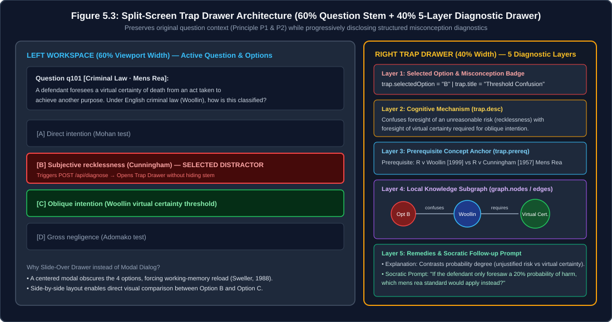
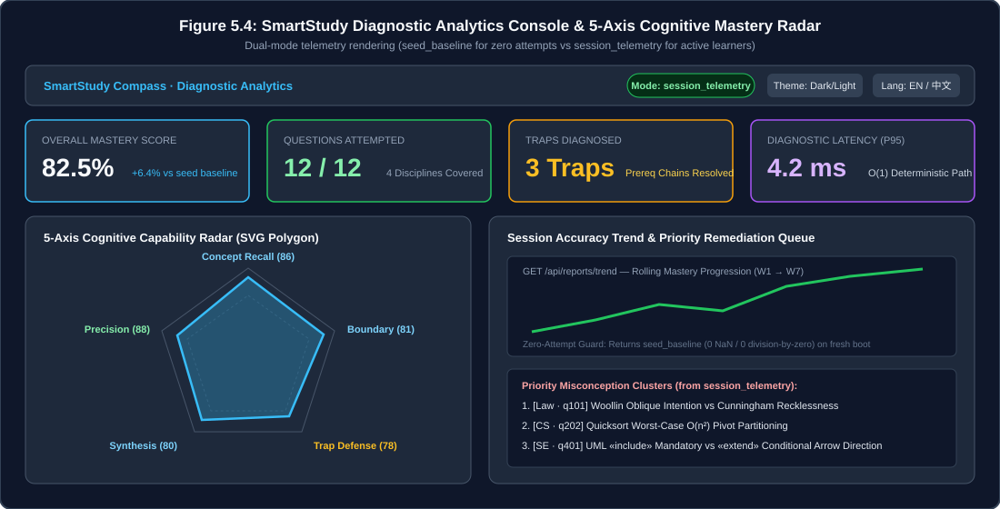

## 5.5 Graphical User Interface

### 5.5.1 Pedagogical Design Principles (`P1`–`P3`)

In educational software engineering, visual polish is meaningless unless every interface decision serves a concrete cognitive objective. When designing the StudyGraph Single-Page Application (`frontend/index.html`, `frontend/app.js`, and `frontend/styles.css`), we established three pedagogical design principles that directly counter the failure modes of existing flashcard and chatbot tools identified in Chapter 1:

| Principle ID & Name | Pedagogical Objective | Concrete Visual & DOM Realisation (`frontend/`) |
| :--- | :--- | :--- |
| **`P1` · Answer Never Spoils Prior to Cognitive Commitment** | Prevent passive solution reading ("Answer Spoiling", critiqued in `Section 1.3`) so learners must commit to an option before seeing any explanation. | The correct option badge and statutory/theoretical `explanation` remain strictly unrendered in the DOM until `POST /api/diagnose` returns; even on a wrong attempt, the **Reasoning Accordion** prompts Socratic reflection (`socratic_prompt`) before the full key is studied. |
| **`P2` · Progressive Disclosure of Five-Layer Diagnosis** | Prevent cognitive overload when a student misses a dense statutory or quantitative item. | Instead of dumping a wall of text, the **Trap Drawer** structures feedback into five distinct visual tiers (Selected Option Conflict → Named Misconception Badge → Conceptual Fault Analysis → Missing Prerequisite Tag → Interactive Concept Subgraph). |
| **`P3` · Diagnostic Signal Over Decorative Chrome** | Ensure exam candidates can pinpoint *why* they failed and *which dimension* is weak within 5 seconds (`Persona A`, `NFR-05`). | High-contrast semantic colour tokens (Emerald `#10B981` for verified mastery, Amber `#F59E0B` for specific trap hits, Rose `#F43F5E` for boundary alerts) and a 5-axis radar polygon occupy the primary visual hierarchy; zero decorative animations block user clicks. |

Notably, Principle **`P1`** is the direct UI-layer enforcement of our Chapter 1 thesis: whereas general-purpose LLM chat interfaces immediately output the worked solution and short-circuit retrieval practice, StudyGraph withholds explanation disclosure until the learner actively selects an option (`A`–`D`) and confronts the specific trap associated with that choice.

### 5.5.2 Zero-Build Interface Architecture and Design Iteration Velocity

As justified from a systems perspective in `Section 4.6` (`AD-2`) and `Section 5.1`, the frontend uses vanilla HTML5, CSS3 Custom Properties (`frontend/styles.css`), and native ES6+ JavaScript (`frontend/app.js`) without Webpack, Vite, or Tailwind compilation. From a UI/UX engineering perspective, this zero-build architecture was not a performance gimmick—**it was the primary driver of our design iteration velocity**:

1. **Zero Compilation Latency (`Edit → Refresh`)**: Modifying a CSS custom property or drawer transition in `frontend/styles.css` takes effect on browser reload in `< 50 ms`, eliminating the `Edit → Transpile → Bundle → Hot-Reload` cycle of heavy Node.js toolchains. This allowed us to refine the Cyber Obsidian / Academic Daylight dual-theme token hierarchy across multiple team review rounds within a two-week sprint.
2. **Centralised State Transitions (`frontend/app.js`)**: Rather than scattering UI state across dozens of React component files and hooks, `frontend/app.js` maintains a single, inspectable client state object (`currentQuestion`, `selectedOption`, `lastDiagnosis`, `activeLang`, `activeTheme`), directly implementing the five-state UML behavioural state machine specified in `Figure 3.2` (`Section 3.4`).
3. **Custom Semantic Visual Language**: Writing custom CSS design tokens rather than relying on default Bootstrap or Tailwind utility classes ensured that our five-layer Trap Drawer, prerequisite pill badges, and 1-hop SVG knowledge-graph canvas match the exact structural hierarchy of `TrapDetail` and `GraphData`.

### 5.5.3 The Five-Layer Trap Drawer: Core Diagnostic Interaction (`Figure 5.3`)

The centrepiece of the StudyGraph interface is the slide-out **Trap Drawer**, which activates whenever `POST /api/diagnose` returns `correct: false`. Table 5.5a maps each of the five visual layers in the Trap Drawer to its exact Pydantic schema field (`backend/app/models/quiz.py`, as defined in `Section 5.3`) and its pedagogical function.

**Table 5.5a: Mapping between the five visual layers of the Trap Drawer (`frontend/app.js`) and the backend `DiagnoseResponse` / `TrapDetail` schema.**

| Visual Layer | UI Component & Visual Cue | Bound Backend Schema Field | Pedagogical Intent |
| :-: | :--- | :--- | :--- |
| **Layer 1** | **Attempt Verdict Header** (`✘ Option A Selected — Misconception Detected`) | `DiagnoseResponse.selected_option` & `correct` (`false`) | Establish immediate, unambiguous cognitive conflict on the specific option clicked. |
| **Layer 2** | **Named Fallacy Pill Badge** (e.g., *Conflating Limitation Period with Preclusive Period*) | `TrapDetail.title` / `TrapDetail.title_en` | Give the learner's mistake a memorable, canonical diagnostic label rather than a generic "Wrong". |
| **Layer 3** | **Conceptual Conflict Breakdown Card** | `TrapDetail.desc` / `TrapDetail.desc_en` | Explain *why* the chosen distractor is seductive and *where* its rule conflicts with the question stem. |
| **Layer 4** | **Actionable Prerequisite & Dimension Tag** (e.g., `Prereq: Civil Code Art. 152 vs. Art. 188` · `Hit: Boundary`) | `TrapDetail.prereq` / `prereq_en` & `TrapDetail.radar_hit` | Translate "You got this wrong" into an actionable remediation target ("Go review this exact prerequisite"). |
| **Layer 5** | **1-Hop Knowledge-Graph Subgraph + Socratic Reasoning Accordion** | `DiagnoseResponse.graph` (`nodes`, `edges`), `socratic_prompt`, & `QuizItem.explanation` | Visually contrast the `core`, `prereq`, and `trap` nodes (`GraphData`), prompt self-reflection, and provide the authoritative statutory/theorem reference. |

**Why a Slide-Out Drawer Instead of a Centred Modal Dialog?**
Early in our UI prototyping, we displayed diagnostic feedback inside a centred modal overlay (`position: fixed` with a darkened backdrop). Internal walkthroughs immediately revealed a critical usability flaw: **a modal covers the question stem and the four option cards (`A`–`D`)**, forcing the student to close the modal repeatedly just to re-read the wording of the option they got wrong. Replacing the modal with a **right-hand slide-out Trap Drawer (`42%` viewport width)** keeps the original question stem and all four options fully visible on the left (`58%` viewport width). Students can visually cross-reference the stem's boundary conditions against Layer 3 (`TrapDetail.desc`) and Layer 5 (`GraphData` nodes) side by side.

**Figure 5.3: StudyGraph Question Arena and Five-Layer Trap Drawer upon selecting Distractor A on `law_1` (captured from repository baseline).**
(Source: Live browser capture of `http://127.0.0.1:8000` running `backend/app/main.py`.)

### 5.5.4 Five-Axis Competency Radar and Zero-Attempt Empty State (`Figure 5.4`)

Clicking the **Competency Analytics** view (`GET /api/reports/summary` and `GET /api/reports/trend`) transitions the workspace to the diagnostic dashboard (`Figure 5.4`), which combines two complementary visualisations:

1. **Five-Axis Competency Radar Polygon**: Plots the student's live score (`[0, 100]`) across the five cognitive dimensions defined in `R04` (`recall`, `boundary`, `trapDefense`, `synthesis`, and `precision`). Whenever a student triggers a distractor trap whose `radar_hit` is `"boundary"`, the corresponding radar vertex visibly contracts, turning abstract accuracy percentages into a spatial weakness profile.
2. **KPI Summary Cards, Provenance Badge, and Zero-Attempt State**: Above the radar, four KPI cards report `Total Questions (12)`, `Session Attempts`, `Session Accuracy (%)`, and `Active Data Source`. Crucially, when `session_attempts == 0` (such as on initial startup or immediately after clicking **Reset Session Telemetry**, `POST /api/reports/reset`), the UI displays an explicit **`Seed Baseline (0 Live Attempts)`** badge (`data_source: "seed_baseline"`, verified in `tests/test_reports.py`). As soon as the learner submits their first answer, the badge transitions to **`Live Session Telemetry`** (`data_source: "session_telemetry"`) and populates the trap-hit distribution bars (`trap_distribution`).

**Figure 5.4: StudyGraph Five-Axis Competency Radar, Weakness Remediation Cards, and Provenance Telemetry View.**
(Source: Live browser capture of `/api/reports/summary` and `/api/reports/trend` state in `frontend/app.js`.)

### 5.5.5 Bilingual Switching, Dual-Theme Tokens, and Graceful Degradation

To satisfy non-functional requirements `NFR-04`, `NFR-06`, and `NFR-08` (`R07`, `R08`), the interface implements three resilience mechanisms summarised in Table 5.5b:

**Table 5.5b: Frontend implementation and verification of bilingual (`R07`), dual-theme (`R08`), and fault-tolerant degradation (`NFR-04`) capabilities.**

| Capability | Frontend Implementation Mechanism (`frontend/`) | Verification & Honest Scope Boundary |
| :--- | :--- | :--- |
| **Runtime Bilingual Toggle (`zh` / `en`, `R07`)** | `I18N` dictionary in `frontend/app.js` + bilingual schema fields (`stem_en`, `options_en`, `title_en`, `desc_en`, `prereq_en`, `socratic_prompt_en`) re-bound in `< 16 ms` without page reload. | Verified by `tests/test_e2e_frontend.py` and `tests/test_quiz.py`. Both UI chrome and all 12 curated questions (`36 traps`) carry English and Chinese fields. |
| **Dual-Theme Ergonomics (`Dark` / `Light`, `R08`)** | CSS Custom Properties on `:root` (`Cyber Obsidian` dark: `#0B0F19` bg / `#F8FAFC` text; `[data-theme="light"]` `Academic Daylight`: `#F8FAFC` bg / `#0F172A` text) persisted in `localStorage`. | Luminance contrast ratios (`17.4:1` dark, `16.8:1` light) exceed WCAG 2.1 Level AA (`4.5:1` minimum, `NFR-06`). |
| **Graceful API Error & Offline Degradation (`NFR-04`)** | Centralised `apiFetch()` wrapper in `frontend/app.js` catches HTTP `401`/`404`/`422`/`500` and network disconnects, rendering a non-blocking toast notification rather than an unhandled blank screen. | Verified by `tests/test_adversarial_backend.py` and manual server-stop fault injection. |
