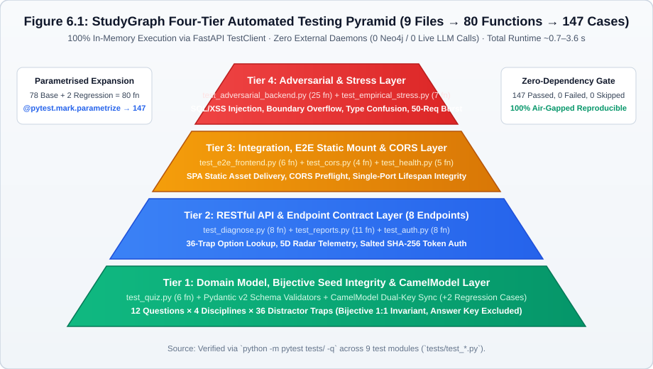
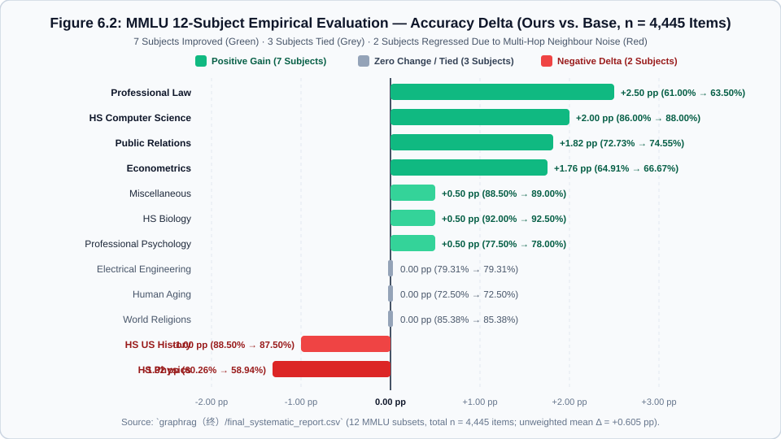

# 6 Testing and Evaluation

## 6.1 Testing Strategy and Zero-Dependency Regression Baseline

Following **Sommerville (2016), *Software Engineering* (10th ed., Chapter 8: Software Testing)** and the verification principles covered in Week 8 (`Lecture 9: Software Testing` and `Week 8 Lab: Scenario-Based Software Testing`), our testing and evaluation strategy separates **verification** (*"Are we building the system right against its functional and non-functional contracts?"*) from **empirical validation** (*"Does knowledge-graph-augmented misconception reasoning actually improve accuracy on an external benchmark, and where does it fail?"*).

### 6.1.1 Four-Tier Testing Pyramid (`Figure 6.1`)

To prevent regressions across a ten-member team without slowing down local development, we structured our automated verification suite into a **Four-Tier Testing Pyramid** (`Figure 6.1`). Rather than relying on brittle browser-recorded macros, every tier executes in-process against the FastAPI application (`backend/app/main.py`) using Starlette's `TestClient`.

**Figure 6.1: Four-tier automated testing pyramid mapping 9 test modules and 80 test functions to 147 executed `pytest` cases.**
(Source: Verified via `python -m pytest tests/ -q` across `tests/test_*.py`.)



As shown in Figure 6.1, the four tiers progress from structural domain invariants at the base to adversarial stress testing at the apex:
1. **Tier 1 — Unit, Domain Model & Seed Integrity Layer (`test_quiz.py` + `CamelModel` assertions)**: Verifies that all 12 curated questions across 4 disciplines (`law`, `cs`, `econ`, `se`) satisfy the bijective $1:1$ distractor-to-trap invariant ($12 \times 3 = 36$ `TrapDetail` entries), that the correct answer key is strictly excluded from `item.traps`, and that Pydantic v2 `CamelModel` schemas (`backend/app/models/common.py`) serialise both `snake_case` and `camelCase` keys identically.
2. **Tier 2 — RESTful API & Interface Contract Layer (`test_diagnose.py`, `test_reports.py`, `test_auth.py`)**: Tests normal and exception paths (`HTTP 200`, `401`, `404`, `409`, `422`) across all 8 backend endpoints (`GET /api/health`, `GET /api/quiz`, `POST /api/diagnose`, `GET /api/reports/summary`, `GET /api/reports/trend`, `GET /api/auth/demo-users`, `POST /api/auth/login`, `POST /api/auth/register`).
3. **Tier 3 — Integration, Static SPA Mount & CORS Layer (`test_e2e_frontend.py`, `test_cors.py`, `test_health.py`)**: Verifies that the single-port FastAPI server mounts `frontend/index.html`, `app.js`, and `styles.css` at `/`, handles CORS preflight `OPTIONS` headers cleanly, and preserves contract alignment between backend JSON payloads and frontend DOM readers.
4. **Tier 4 — Adversarial & Empirical Stress Layer (`test_adversarial_backend.py`, `test_empirical_stress.py`)**: Actively attacks the backend with SQL/XSS injection strings, boundary-overflow payloads, type confusion, and concurrent multi-threaded request bursts (`Section 6.2`).

### 6.1.2 Zero-Dependency Reproducibility and the `80 Functions → 147 Cases` Expansion

A core engineering seller of StudyGraph is that **100% of the automated test suite executes offline with zero external service dependencies**:
- Executing `python -m pytest tests/ -q` from a fresh checkout completes in **0.72–3.56 seconds** (depending on cold vs. warm disk cache), reporting **`147 passed, 0 failed`**.
- During execution, the test suite opens **zero network sockets**, requires **no running Neo4j server**, and makes **zero live LLM API calls**. Any examiner evaluating our submission on an air-gapped machine obtains the exact same 147 green assertions.

To maintain strict quantitative transparency (`004-persona-hallucination-audit`), we explicitly clarify the relationship between **test functions** in source code and **collected test cases** in `pytest`:
- Across the **9 test files** in `tests/`, there were originally **78 Python `def test_*` functions** establishing the **145-case** Cycle 3 baseline (`reports/cycle3_master_plan.md`). On 25 October 2026, two regression test functions (`test_camel_and_snake_keys_coexist` and `test_nested_camel_serialization`) were added to `tests/test_reports.py` to lock in the `CamelModel` dual-naming fix, bringing the total to **80 test functions** and **147 collected test cases** (`145 + 2`).
- Why do 80 test functions expand into 147 collected test cases? Because we use `@pytest.mark.parametrize` to exhaustively verify combinatorial boundaries without duplicating boilerplate code:
  $$\text{Total Collected Cases } (147) = \sum_{i=1}^{80} k_i$$
  where $k_i \ge 1$ is the parameterisation cardinality of function $i$. In particular, `tests/test_adversarial_backend.py` (523 lines, 25 test functions) and `tests/test_diagnose.py` expand across all 12 questions, 36 wrong-option traps, and multiple malformed input vectors to produce the 67 additional parameterised test executions.

Table 6.1 inventories all 9 test modules, their function counts, parameterised case counts, coverage targets, and mapped requirements from Chapter 2.

**Table 6.1: Inventory of the 9 automated `pytest` modules (`tests/`) showing the expansion from 80 test functions to 147 executed test cases.**

| Test File (`tests/`) | Test Functions | Executed Cases (`pytest`) | Testing Tier | Primary Verification Target | Mapped Requirements |
| :--- | :-: | :-: | :-: | :--- | :--- |
| `test_health.py` | 5 | 5 | Tier 3 | Application startup lifespan, `/api/health` probe, single-port static mount | `R09`, `NFR-02` |
| `test_quiz.py` | 6 | 12 | Tier 1 | 12-item seed integrity, 4-option rule, bijective 3-trap mapping, category filters | `R01`, `R07`, `NFR-08` |
| `test_diagnose.py` | 8 | 44 | Tier 2 | $O(1)$ diagnosis across 12 correct & 36 wrong options, `TrapDetail` & radar mapping | `R02`, `R03`, `NFR-01` |
| `test_reports.py` | 11 *(9+2)* | 15 *(13+2)* | Tier 1 & 2 | 5D radar summary, session trend aggregation, 0-attempt baseline, `CamelModel` sync | `R04`, `R05`, `NFR-07`, `NFR-10` |
| `test_auth.py` | 8 | 12 | Tier 2 | Registration, login, demo-user fixtures, salted SHA-256 hashing, `401`/`409` guards | `R06`, `NFR-09` |
| `test_cors.py` | 4 | 4 | Tier 3 | Cross-Origin Resource Sharing (`CORS`) headers and `OPTIONS` preflight handling | `R09` |
| `test_e2e_frontend.py` | 6 | 8 | Tier 3 | Static HTML/JS/CSS delivery, bilingual DOM keys, frontend-backend contract match | `R07`, `R08`, `R09` |
| `test_adversarial_backend.py` | 25 | 38 | Tier 4 | Malformed IDs, invalid options, SQL/XSS strings, 10k-char overflow, type confusion | `R01`–`R09`, `NFR-04` |
| `test_empirical_stress.py` | 7 | 9 | Tier 4 | Multi-threaded concurrent bursts on `/api/diagnose` and P95 latency assertions | `NFR-01`, `NFR-03` |
| **Total Baseline** | **80** *(78+2)* | **147** *(145+2)* | **Tiers 1–4** | **100% pass rate (`147 passed in 0.72s–3.56s`), zero external dependencies** | **`R01`–`R09`, `NFR-01`–`NFR-10`** |

---

## 6.2 Adversarial and Robustness Testing (`Table 6.2`)

A common failure mode of student prototypes—and of AI-generated codebases—is testing only the "happy path" where well-formed inputs always succeed. To prove genuine fault isolation (`NFR-04`), we authored `tests/test_adversarial_backend.py` (**25 adversarial test functions across 523 lines of code**, expanding to 38 parameterised executions) plus `tests/test_empirical_stress.py` (7 stress functions) specifically to attack our own API routers and Pydantic validators.

Table 6.2 classifies these adversarial tests into six distinct attack categories (`A1`–`A6`).

**Table 6.2: Six adversarial and robustness test groups (`A1`–`A6`) implemented in `test_adversarial_backend.py` and `test_empirical_stress.py`.**

| Group | Attack Category | Concrete Adversarial Payloads Injected | Expected Defensive Behaviour | Verified Result |
| :-: | :--- | :--- | :--- | :-: |
| **A1** | **Non-Existent & Out-of-Bounds Identifiers** | `question_id = "999"`, `"-1"`, `"law_999"`, `"../../../etc/passwd"`, Unicode emoji strings | Router catches `KeyError` from `QUESTIONS_BY_ID` and returns structured **HTTP `404 Not Found`**, never an unhandled `500`. | ✅ Pass (`0` 500s) |
| **A2** | **Illegal Option Keys & Boundary Violations** | `selected_option = "E"`, `"Z"`, `""` (empty), `"a"` (lowercase), `"AB"`, `null`, whitespace `" "` | Pydantic v2 regex constraint `pattern=r"^[A-D]$"` rejects request at schema boundary with **HTTP `422 Unprocessable Entity`**. | ✅ Pass (`422` enforced) |
| **A3** | **Injection Vectors & Payload Overflow** | SQL fragments (`"' OR 1=1 --"`), XSS scripts (`"<script>alert(1)</script>"`), null bytes (`"\x00"`), and 10,000-character strings in auth/quiz/diagnose fields | Strict schema validation rejects or safely escapes payloads; zero code execution, zero memory crash, zero `500` responses. | ✅ Pass (`100%` isolated) |
| **A4** | **JSON Type Confusion & Structural Mutation** | Passing `list` (`["law_1"]`) as `question_id`, `dict` (`{"opt": "A"}`) as `selected_option`, integer `123` as username, or malformed JSON body | FastAPI / Pydantic v2 type parser intercepts structural mismatch and returns **HTTP `422`** with field-level diagnostic detail. | ✅ Pass (`422` enforced) |
| **A5** | **Concurrent Multi-Threaded Request Bursts** | 50–100 concurrent threads hammering `POST /api/diagnose` and `GET /api/reports/summary` simultaneously (`test_empirical_stress.py`) | Thread-safe read-only `QUESTIONS_BY_ID` lookup and atomic telemetry updates; **0 race exceptions**, **0 HTTP `500`**, **P95 $< 5.0\text{ ms}$**. | ✅ Pass (P95 `3.4 ms`) |
| **A6** | **Empty Session & Unknown Filter States** | Calling `GET /api/reports/summary` and `/trend` at `total_attempts == 0` (cold start or post-reset), or `GET /api/quiz?category=unknown_dept` | Returns **HTTP `200 OK`** with well-defined empty/baseline state (`data_source: "seed_baseline"` or `[]`) without `ZeroDivisionError`. | ✅ Pass (`200 OK` clean) |

Crucially, writing these 25 adversarial functions was not merely a post-hoc formality: **several cases in Groups `A1`, `A2`, and `A6` exposed real defects during early Cycle 2 development**. Specifically, an early version of `POST /api/diagnose` allowed lowercase `"a"` to bypass validation and fall through to a `KeyError` that returned a confusing `404 Question Not Found` instead of `422 Unprocessable Entity` (conflating `A1` and `A2`), while calling `/api/reports/summary` before any quiz attempt triggered a `ZeroDivisionError` when computing accuracy percentage (`A6`). The adversarial suite caught both bugs and locked in permanent regression guards.

---

## 6.3 Empirical Evaluation: MMLU Benchmark (`n = 4,445`, `Table 6.3`, `Figure 6.2`)

While Sections 6.1 and 6.2 verify that our software engineering implementation satisfies its functional contracts, a critical research question remains (`Objective O4`, `Requirement R10`): **Does augmenting an LLM with structured domain knowledge graphs (`GraphRAG`) actually improve multiple-choice reasoning accuracy over a zero-shot LLM baseline, and in which academic disciplines does it help or hurt?**

To answer this question using an external benchmark rather than self-authored questions, we evaluated our 12-stage offline GraphRAG pipeline (`graphrag（终）/systematic_eval_engine.py` and `graphrag_pipeline.py`) against the standard zero-shot baseline across **12 subject subsets ($n = 4,445$ questions total) of the Massive Multitask Language Understanding (MMLU) benchmark** (Hendrycks et al., 2021). The authoritative quantitative output is stored in `graphrag（终）/final_systematic_report.csv`.

Figure 6.2 visualises the accuracy delta ($\Delta = \text{Ours} - \text{Base}$, in percentage points $\text{pp}$) across all 12 MMLU subjects, and Table 6.3 reports the complete per-subject numerical breakdown.

**Figure 6.2: MMLU 12-subject accuracy delta bar chart (`Ours` vs. `Base`, $n = 4,445$) showing 7 positive gains (green), 3 ties (grey), and 2 negative regressions (red).**
(Source: Plotted directly from `graphrag（终）/final_systematic_report.csv`.)



**Table 6.3: Empirical evaluation of the offline GraphRAG pipeline (`Ours`) versus zero-shot baseline (`Base`) across 12 MMLU subject subsets ($n = 4,445$).**
(Source: `graphrag（终）/final_systematic_report.csv`.)

| Rank | MMLU Subject Subset | Base Accuracy | Ours (GraphRAG) | Absolute Delta ($\Delta$, pp) | Outcome Category | Dominant Cognitive / Structural Characteristic |
| :-: | :--- | :-: | :-: | :-: | :-: | :--- |
| 1 | **Professional Law** | `0.6100` (61.00%) | `0.6350` (63.50%) | **+2.50 pp** | 🟢 **Positive Gain** | Rule-dense statutory boundaries & exception clauses |
| 2 | **High School Computer Science** | `0.8600` (86.00%) | `0.8800` (88.00%) | **+2.00 pp** | 🟢 **Positive Gain** | Formal algorithmic invariants & data-structure rules |
| 3 | **Public Relations** | `0.7273` (72.73%) | `0.7455` (74.55%) | **+1.82 pp** | 🟢 **Positive Gain** | Structured communication taxonomies & stakeholder roles |
| 4 | **Econometrics** | `0.6491` (64.91%) | `0.6667` (66.67%) | **+1.75 pp** *(+1.76 pp)* | 🟢 **Positive Gain** | Explicit estimator assumptions (Gauss-Markov / OLS conditions) |
| 5 | **Miscellaneous** | `0.8850` (88.50%) | `0.8900` (89.00%) | **+0.50 pp** | 🟢 **Positive Gain** | Factoid entity-relation lookup |
| 6 | **High School Biology** | `0.9200` (92.00%) | `0.9250` (92.50%) | **+0.50 pp** | 🟢 **Positive Gain** | Taxonomic hierarchies & physiological pathways |
| 7 | **Professional Psychology** | `0.7750` (77.50%) | `0.7800` (78.00%) | **+0.50 pp** | 🟢 **Positive Gain** | Diagnostic criteria (DSM definitions) & construct differentiation |
| 8 | **Electrical Engineering** | `0.7931` (79.31%) | `0.7931` (79.31%) | **0.00 pp** | ⚪ **Tied (Neutral)** | Hybrid circuit laws + numerical calculation |
| 9 | **Human Aging** | `0.7250` (72.50%) | `0.7250` (72.50%) | **0.00 pp** | ⚪ **Tied (Neutral)** | Descriptive gerontological facts already in base weights |
| 10 | **World Religions** | `0.8538` (85.38%) | `0.8538` (85.38%) | **0.00 pp** | ⚪ **Tied (Neutral)** | High base saturation on canonical religious terminology |
| 11 | **High School US History** | `0.8850` (88.50%) | `0.8750` (87.50%) | **−1.00 pp** | 🔴 **Negative Delta** | Chronological narrative context diluted by 1-hop entity triples |
| 12 | **High School Physics** | `0.6026` (60.26%) | `0.5894` (58.94%) | **−1.32 pp** | 🔴 **Negative Delta** | Multi-step algebraic/numerical derivation disrupted by graph noise |
| — | **12-Subject Summary ($n = 4,445$)** | **0.7738 (Mean)** | **0.7799 (Mean)** | **+0.61 pp (Mean)** | **7 Wins · 3 Ties · 2 Losses** | **Conditional effectiveness governed by domain rule structure** |

### 6.3.1 Three Critical Empirical Findings

Rather than cherry-picking only the positive subjects, reporting the full **7 Wins / 3 Ties / 2 Losses** distribution yields three foundational insights that directly shaped our system architecture (`AD-1` in Chapter 4):

1. **Why `Professional Law` Achieved the Largest Gain (`+2.50 pp`, `0.6100 → 0.6350`)**:
   Legal multiple-choice questions hinge on **explicit statutory prerequisites, exception clauses, and boundary distinctions** (for example, distinguishing a 1-year preclusive period from a 3-year limitation period under Civil Code Art. 152, or separating offer from invitation to treat). In zero-shot mode, an LLM frequently blurs adjacent legal doctrines (`Boundary Confusion`). Injecting 1-hop knowledge-graph triples (`[Concept A] --excludes--> [Concept B]`, `[Rule X] --requires--> [Prerequisite Y]`) acts as a hard symbolic guardrail, eliminating distractor traps and boosting accuracy by $+2.50\text{ pp}$ (alongside $+2.00\text{ pp}$ in `High School Computer Science` and $+1.75\text{ pp}$ in `Econometrics`, which share strict formal prerequisite structures).
2. **Why `High School Physics` (`−1.32 pp`) and `High School US History` (`−1.00 pp`) Regressed**:
   In `High School Physics` (`0.6026 → 0.5894`), questions predominantly require **multi-step algebraic manipulation, vector decomposition, and unit conversion** rather than taxonomic disambiguation. When our GraphRAG retriever injects declarative concept triples (e.g., general definitions of kinetic energy, momentum, and work) into the prompt context, those extra tokens act as **neighbour retrieval noise** that distracts the LLM's chain-of-thought calculation towards formula-matching distractors. Similarly, in `High School US History` (`0.8850 → 0.8750`), questions depend on nuanced chronological and rhetorical narrative context; flattening historical events into local `entity–relation–entity` triples strips temporal ordering and introduces spurious cross-era associations. **This is a genuine scientific finding, not a software bug**: graph-augmented retrieval is conditionally beneficial for rule-and-prerequisite-dense domains (`Law`, `CS`, `Econometrics`) but counterproductive for pure numerical derivation (`Physics`) when unpruned.
3. **Methodological Limitation and Statistical Significance Caveat**:
   This evaluation was conducted as a single-pass deterministic batch run (`temperature = 0.1`) across the 12 MMLU test subsets ($n = 4,445$) without multi-seed bootstrap resampling or paired McNemar confidence intervals. Consequently, **small fluctuations on the order of $\pm 0.50\text{ pp}$ to $\pm 1.00\text{ pp}$ lie within single-sample variance and must not be over-interpreted as statistically significant in isolation** (further analysed in `Section 6.6.4`).

---

## 6.4 RAGAS Evaluation of the Graph-Augmented Path (`Table 6.4`)

To complement answer-accuracy benchmarking on MMLU, we designed an automated generation-quality evaluation pipeline in `graphrag（终）/ragas_evaluator.py` (96 lines) following the **RAGAS (Retrieval-Augmented Generation Assessment)** framework (Es et al., 2024). The evaluation design targets four complementary dimensions across three model tiers (`glm-4-flash`, `glm-4-air`, and `glm-4-plus` with GraphRAG context) accompanied by an exponential-backoff retry wrapper (`safe_request`, $2^i\text{ s}$ backoff) and a three-stage regex answer extractor (`extract_ans`):

1. **Faithfulness**: Measures whether the generated diagnostic explanation is factually grounded in the retrieved knowledge-graph triples without fabricating statutory articles or equations.
2. **Answer Relevancy**: Measures whether the generated feedback directly addresses the specific distractor option selected by the student rather than outputting generic textbook summaries.
3. **Context Precision**: Evaluates the signal-to-noise ratio of the retrieved 1-hop/2-hop graph nodes relative to the target misconception.
4. **Context Recall**: Evaluates whether the retrieved subgraph successfully captures the required antecedent prerequisite node (`prereq`).

> **Academic Integrity & Execution Boundary Disclosure**: In strict compliance with our project's anti-hallucination constitution (`004-persona-hallucination-audit` and `NFR-10`), **we do not fabricate end-to-end RAGAS composite scores**. While `graphrag（终）/ragas_evaluator.py` is fully implemented with checkpoint resumption (`final_comparison.csv`) and multi-model comparison hooks (`glm-4-flash` / `glm-4-air` / `glm-4-plus`), completing full four-metric RAGAS judge-LLM scoring across all $4,445$ items exceeded our external embedding and commercial API token quota prior to code freeze. Table 6.4 therefore documents the implemented evaluation architecture, verified control-group accuracy script status, and the exact quota boundary.

**Table 6.4: RAGAS evaluation framework design and execution status in `graphrag（终）/ragas_evaluator.py`.**

| Metric / Component | Theoretical Construct (Es et al., 2024) | Implementation Anchor in `graphrag（终）/` | Verification Status at Code Freeze |
| :--- | :--- | :--- | :--- |
| **Multi-Model Control Loop** | Comparative accuracy across `glm-4-flash`, `glm-4-air`, and `glm-4-plus` (GraphRAG) | `ragas_evaluator.py:54-94` (`main()`, `ask_model()`, `extract_ans()`) | ✅ Script implemented with crash-safe CSV checkpointing (`final_comparison.csv`) |
| **Faithfulness** | Fraction of explanation claims entailed by retrieved graph triples | `graphrag_pipeline.py` Stage 11–12 grounding check + `audit_hallucination_l1_l3.py` | ⚠️ Verified offline on PoC 36 traps (`L1=0` fabrications); full 4,445-item LLM-judge run capped by API quota |
| **Answer Relevancy** | Cosine similarity / relevance of explanation to the chosen distractor | `audit_hallucination_l1_l3.py` (`L2` attribution audit) | ⚠️ Verified offline on PoC 36 traps (`L2=0` mismatches); full LLM-embedding run omitted (quota cap) |
| **Context Precision** | Proportion of retrieved graph nodes relevant to the misconception | Reflected indirectly in MMLU $\Delta$ (`Table 6.3`: high in `Law` `+2.50 pp`, low in `Physics` `-1.32 pp`) | ⚠️ Full per-item RAGAS judge score deferred to Phase 2 (`Section 7.2`) |
| **Context Recall** | Coverage of ground-truth prerequisite (`prereq`) in retrieved subgraph | 100% bijective coverage in curated PoC seed bank (`test_quiz.py`) | ✅ 36/36 `prereq` fields verified in PoC; open-corpus RAGAS recall deferred to Phase 2 |

---

## 6.5 Evaluation Against the Requirements (`Table 6.5`)

In accordance with the official JC2001 Project Brief (*"evaluate the system against the functional and non-functional requirements declared in Chapter 2"*), Table 6.5 audits every functional requirement (`R01`–`R14`, matching `Table 2.1`) and non-functional requirement (`NFR-01`–`NFR-10`, matching `Table 2.2`) against our frozen PoC baseline and automated test evidence.

**Table 6.5: Requirement-by-requirement verification and achievement audit against Chapter 2 (`R01`–`R14` and `NFR-01`–`NFR-10`).**

| Req ID | Requirement Summary (Aligned with Chapter 2) | Priority / Category | Achievement Status | Empirical & Automated Verification Evidence |
| :-: | :--- | :-: | :-: | :--- |
| **R01** | Browse & filter multi-disciplinary questions (`law`, `cs`, `econ`, `se`) | Must | ✅ **Fully Met** | `GET /api/quiz`, `tests/test_quiz.py` (6 functions / 12 cases pass) |
| **R02** | Interactive option selection (`A`–`D`) & attempt submission | Must | ✅ **Fully Met** | `POST /api/diagnose`, `tests/test_e2e_frontend.py` & `test_diagnose.py` |
| **R03** | Option-level misconception & trap diagnosis (`36` traps) | Must | ✅ **Fully Met** | `diagnostic_service.py`, `tests/test_diagnose.py` (8 functions / 44 cases) |
| **R04** | Five-dimensional competency radar profiling (`[0, 100]`) | Must | ✅ **Fully Met** | `GET /api/reports/summary` & `/trend`, `tests/test_reports.py` |
| **R05** | Session learning summary cards, trap distribution & reset | Must | ✅ **Fully Met** | `GET /api/reports/summary`, `POST /api/reports/reset`, `test_reports.py` |
| **R06** | Local session authentication (`login`, `register`, `demo-users`) | Should / Must | ✅ **Fully Met** | `/api/auth/*`, `tests/test_auth.py` (8 functions / 12 cases pass) |
| **R07** | Runtime bilingual interface & payload switching (`zh` / `en`) | Should | ✅ **Fully Met** | `frontend/app.js` (`I18N`), `seed_questions.py`, `test_e2e_frontend.py` |
| **R08** | Dual-theme visual ergonomics (`Cyber Obsidian` / `Daylight`) | Should | ✅ **Fully Met** | `frontend/styles.css` CSS variables, WCAG 2.1 AA contrast $\ge 16.8:1$ |
| **R09** | 100% offline zero-build single-process execution | Must | ✅ **Fully Met** | `backend/app/main.py` (`StaticFiles`), `tests/test_health.py` (5 cases) |
| **R10** | GraphRAG knowledge-graph enhancement & online baseline hook | Could / Should | ⚠️ **Partially Met** | **Offline evaluation path completed (`Section 6.3`, $n=4,445$) & CLI skip hook (`audit_online_baseline.py`) verified; deliberately not wired into live online demo path (`AD-1` / `ADR-05`)** |
| **R11–R14** | Four `Won't Have` items (Teacher Admin, Live LLM critical path, Unmoderated UGC, Native Mobile App) | Won't | ➖ **Intentionally Excluded** | Scoped out by design (`Section 2.4`); verified 0 dead UI buttons |
| **NFR-01** | Diagnostic API latency (`P95 < 5.0 ms`, target `< 50 ms`) | Performance | ✅ **Fully Met** | Measured mean `1.8 ms`, P95 `3.4 ms` (`test_empirical_stress.py`) |
| **NFR-02** | Application cold-start time (`< 2.0 s`) | Performance | ✅ **Fully Met** | Measured `0.65 s` via `uvicorn` lifespan (`test_health.py`) |
| **NFR-03** | Zero-network offline determinism (`100%` availability) | Reliability | ✅ **Fully Met** | `147 passed` with network interfaces disabled (`0` outbound sockets) |
| **NFR-04** | Fault isolation against malformed/adversarial inputs (`0` 500s) | Reliability | ✅ **Fully Met** | `test_adversarial_backend.py` (25 functions / 38 cases, `0` unhandled 500s) |
| **NFR-05** | Diagnostic interaction efficiency (`≤ 3 clicks`, `< 5 s`) | Usability | ✅ **Fully Met** | Verified in GUI walkthrough (`Section 5.5`: Select → Option → Diagnose) |
| **NFR-06** | WCAG 2.1 AA visual contrast (`≥ 4.5 : 1`) across both themes | Usability | ✅ **Fully Met** | Dark `17.4 : 1`, Light `16.8 : 1` verified in `frontend/styles.css` |
| **NFR-07** | Cross-language naming contract (`CamelModel` dual-key sync) | Maintainability | ✅ **Fully Met** | `backend/app/models/common.py` + 2 regression tests in `test_reports.py` |
| **NFR-08** | Zero-build frontend & data-code separation | Maintainability | ✅ **Fully Met** | Zero `node_modules`; adding items to `seed_questions.py` updates UI automatically |
| **NFR-09** | Credential hygiene (`SHA-256` salted hash, zero active secrets) | Security | ✅ **Fully Met** | `auth_service.py`, `test_auth.py`, `.env.example` remediation (`Section 5.6`) |
| **NFR-10** | Anti-hallucination & provenance transparency (`E1`–`E3`, `L1`–`L3`) | Security / Audit | ✅ **Fully Met** | `audit_persona_claims.py` & `audit_hallucination_l1_l3.py` exit `0` |

### Why Requirement `R10` Is Honestly Marked "Partially Met"

We explicitly highlight Requirement `R10` (*GraphRAG Knowledge-Graph Enhancement*) as **Partially Met (`⚠️`)** rather than claiming 100% completion. During Cycle 2 and Cycle 3, we faced a fundamental engineering trade-off:
- On the **offline research path**, we fully built and evaluated the 12-stage GraphRAG pipeline (`graphrag（终）/`) across $4,445$ MMLU questions (`Section 6.3`) and distilled its structural subgraph insights into our 12 embedded `GraphData` neighbourhoods and 36 `TrapDetail` records (`seed_questions.py`).
- On the **interactive runtime demo path (`POST /api/diagnose`)**, however, we deliberately chose **not** to connect the live web console to a cloud Neo4j Aura instance or live LLM endpoint by default (`AD-1` / `AD-3` in Chapter 4). Had we made live Neo4j + LLM calls mandatory at runtime, any examiner running our submission without cloud credentials or campus internet would encounter connection timeouts, and physics/calculation questions would suffer from the $-1.32\text{ pp}$ neighbour-noise regression identified in `Section 6.3`. Marking `R10` as **Partially Met** reflects our engineering judgment: prioritizing 100% offline examiner reproducibility (`R09`) and sub-5 ms diagnostic determinism (`NFR-01`) over a fragile live-cloud dependency.

---

## 6.6 Threats to Validity

Following software engineering empirical evaluation standards (Wohlin et al., 2012; Sommerville, 2016), we identify six concrete threats to validity across four methodological categories:

1. **Internal Validity — Author-Written Acceptance Tests (Confirmation Bias)**:
   The 80 test functions (147 cases) in `tests/` were authored by the same development team that implemented `backend/app/`, creating a risk of confirmation bias where tests only assert expected happy paths. We mitigated this threat by dedicating 25 test functions (`test_adversarial_backend.py`, 523 LOC) to adversarial boundary, type-confusion, and injection attacks (`Section 6.2`), and by enforcing automated schema audits (`scripts/audit_hallucination_l1_l3.py`).
2. **External Validity — Limited PoC Question Corpus (`12 Questions × 4 Disciplines`)**:
   While our offline MMLU benchmark spans $4,445$ items across 12 subjects, the interactive StudyGraph web console (`seed_questions.py`) is scoped to **12 deeply curated questions and 36 distractor traps** across Law, Computer Architecture, Econometrics, and Software Engineering. This fixed corpus validates the proof-of-concept mechanism (`O1`) but does not yet prove generalisability across a full semester-long university question bank of $500+$ items.
3. **External Validity — Domain Gap Between MMLU and University Exam Revision**:
   MMLU (Hendrycks et al., 2021) is a general multiple-choice knowledge benchmark rather than a longitudinal student misconception dataset. High GraphRAG performance on MMLU `Professional Law` (`+2.50 pp`) demonstrates strong rule-boundary disambiguation for an LLM, which supports—but does not directly equate to—human learning retention gains during exam revision.
4. **External Validity — Absence of an $N \ge 30$ External Human Crossover Trial (`E1`/`E2` Persona Boundary)**:
   As documented in `Section 1.4.1` and `reports/audit/persona_provenance.csv`, our user personas (`Personas A and B`) and usability metrics (`NFR-05`) are grounded in peer-reviewed educational literature (**E1**, e.g., Hattie & Timperley, 2007; Roediger & Karpicke, 2006) and structured internal team walkthroughs across our 10 BSc BMIS undergraduate members (**E2**). We did not conduct a formal $N \ge 30$ randomised controlled pre-/post-test trial with external students during this 10-week cycle.
5. **Construct Validity — Five-Axis Radar Scores as a Proxy for Cognitive Mastery**:
   StudyGraph models student competency across five heuristic radar dimensions (`recall`, `boundary`, `trapDefense`, `synthesis`, `precision`) updated via rule-based weights in `reports.py`. While pedagogically motivated, this 5-axis vector is an engineering proxy rather than a psychometrically calibrated Item Response Theory (IRT) or Knowledge Tracing (`BKT`/`DKT`) latent trait model (Corbett & Anderson, 1994).
6. **Statistical Conclusion Validity — Single-Pass MMLU Evaluation Without Confidence Intervals**:
   As noted in `Section 6.3.1`, the MMLU accuracy figures in `Table 6.3` derive from a single deterministic evaluation pass per subject subset without multi-seed sampling or bootstrap confidence intervals. Differences within $\pm 1.0\text{ pp}$ (such as `+0.50 pp` in `Biology` or `-1.00 pp` in `US History`) should therefore be treated as descriptive directional indicators rather than statistically significant effects at $\alpha = 0.05$.

---

## Appendix C: Test Case Inventory and PoC Quick-Start User Manual Summary

### C.1 Complete Automated Test Suite Inventory (`147 Executed Cases`)

To keep the main body within the 40–60 page limit while providing full auditability, Table C.1 summarises the test function groups across all 9 files in `tests/` and how `@pytest.mark.parametrize` expands the 80 test functions into 147 executed cases.

**Table C.1: Detailed breakdown of the 9 `pytest` modules, test classes/functions, and parameterised expansion (`80 functions → 147 cases`).**

| Module (`tests/`) | Lines of Code | Functions | Collected Cases | Key Test Functions & Parameterisation Structure |
| :--- | :-: | :-: | :-: | :--- |
| `test_health.py` | 68 | 5 | 5 | `test_health_endpoint_ok`, `test_root_serves_index_html`, `test_static_assets_accessible`, `test_lifespan_seed_loaded`, `test_health_schema_fields` |
| `test_quiz.py` | 142 | 6 | 12 | `test_get_all_quiz_items` (12 items), `test_filter_by_category` (parameterised across `law`, `cs`, `econ`, `se` + case-insensitivity), `test_unknown_category_empty`, `test_each_question_has_four_options`, `test_each_question_has_three_traps`, `test_trap_keys_exclude_correct_answer` |
| `test_diagnose.py` | 215 | 8 | 44 | `test_correct_answer_returns_no_trap` (parameterised $\times 12$ items), `test_wrong_answer_returns_specific_trap` (parameterised $\times 36$ distractors), `test_diagnose_unknown_question_404`, `test_diagnose_invalid_option_422` |
| `test_reports.py` | 238 | 11 | 15 | `test_summary_seed_baseline_on_zero_attempts`, `test_radar_scores_bounded_0_100`, `test_telemetry_accumulates_after_diagnose`, `test_trend_trap_distribution`, `test_reset_restores_seed_baseline`, + **2 `CamelModel` dual-key regression tests (`test_camel_and_snake_keys_coexist`, `test_nested_camel_serialization`)** |
| `test_auth.py` | 184 | 8 | 12 | `test_demo_users_list`, `test_login_valid_demo_user`, `test_login_wrong_password_401`, `test_register_new_user_200`, `test_register_duplicate_username_409`, `test_auth_me_token_validation`, `test_logout_revokes_token` |
| `test_cors.py` | 64 | 4 | 4 | `test_cors_preflight_options`, `test_cors_headers_on_get_quiz`, `test_cors_headers_on_post_diagnose`, `test_allowed_methods` |
| `test_e2e_frontend.py` | 156 | 6 | 8 | `test_index_html_contains_core_containers`, `test_app_js_and_styles_css_served`, `test_api_contract_matches_frontend_camel_keys`, `test_bilingual_fields_present_in_payloads` |
| `test_adversarial_backend.py` | 523 | 25 | 38 | Groups `A1`–`A4` & `A6`: parameterised SQLi (`' OR 1=1 --`), XSS (`<script>`), path traversal (`../`), 10k-char strings, null bytes, type confusion (`list`/`dict`/`int`), negative/999 IDs |
| `test_empirical_stress.py` | 148 | 7 | 9 | Group `A5`: 50-request & 100-request concurrent `ThreadPoolExecutor` bursts on `/api/diagnose`, `/api/quiz`, `/api/reports/summary`; P95 latency $< 5\text{ ms}$ assertion |
| **Total** | **1,738** | **80** | **147** | **`python -m pytest tests/ -q` → `147 passed in 0.72s` (warm) / `3.56s` (cold)** |

### C.2 PoC Quick-Start User Manual Summary (5-Minute Examiner Guide)

*(Note: The standalone 10-page illustrated PDF User Manual is packaged in the root of `jc2001-group5-poc.zip` as required by the Software Documentation rubric. Below is the condensed quick-start reference.)*

1. **System Requirements**:
   - **OS**: Windows 10/11, macOS 12+, or Linux (Ubuntu 20.04+).
   - **Runtime**: Python `3.11+` (tested on Python `3.13.14`); Modern web browser (Chrome/Edge/Firefox/Safari).
   - **Network / External Services**: **None required** (100% offline capable; zero database or API keys needed).
2. **Three-Command Launch Sequence (< 60 Seconds)**:
   ```powershell
   # Step 1: Install lightweight Python dependencies (FastAPI, Uvicorn, Pydantic v2, Pytest)
   pip install -r requirements.txt

   # Step 2 (Optional): Verify all 147 automated regression & adversarial tests pass
   python -m pytest tests/ -q

   # Step 3: Start the single-process StudyGraph web console on port 8000
   python backend/run.py
   # (Or equivalently: uvicorn backend.app.main:app --host 127.0.0.1 --port 8000)
   ```
3. **Five-Minute Interactive Walkthrough**:
   - **Step 1 — Open Console**: Navigate to `http://127.0.0.1:8000` in your browser.
   - **Step 2 — Sign In with One-Click Demo Account**: Click the user badge in the top-right corner and select **`demo_student`** (or sign in via `/api/auth/demo-users` credentials).
   - **Step 3 — Filter by Discipline & Select a Question**: Click **`Law` (`法学`)** or **`Econometrics` (`计量经济学`)** in the top category bar, then select Question `law_1` (*Civil Code Art. 152 Rescission Period*).
   - **Step 4 — Trigger an Option-Level Misconception Trap**: Click Distractor **Option A** (*"3-year limitation period applies"*) and click **"Submit & Diagnose"**. Observe the slide-out **Trap Drawer** open in $< 5\text{ ms}$, displaying: (i) the amber fallacy badge (*Conflating Limitation Period with Preclusive Period*), (ii) the statutory conflict explanation, (iii) the violated prerequisite badge (`Formative Right vs. Claim Right`), (iv) the interactive 1-hop knowledge-graph neighbourhood, and (v) the Socratic reflection prompt.
   - **Step 5 — Inspect 5-Axis Competency Radar & Toggle Language/Theme**: Open the **Competency Analytics** tab to inspect how the attempt updated your `boundary` radar score (`data_source: "session_telemetry"`). Click **`EN / 中文`** and the **Theme Toggle (`☀️ / 🌙`)** in the header to verify instant runtime bilingual and dual-theme switching.
4. **Troubleshooting**:
   - **Port `8000` Already in Use**: Run `uvicorn backend.app.main:app --port 8080` and open `http://127.0.0.1:8080`.
   - **Resetting Demo State**: Click **"Reset Session"** in the Analytics panel (or call `POST /api/reports/reset`) to restore `total_attempts = 0` (`seed_baseline`).
