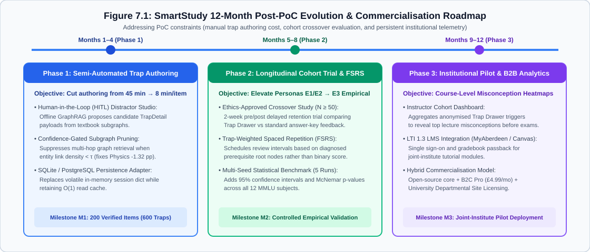

# Front Matter: Title Page, Declaration, Executive Abstract, and Indices

**UNIVERSITY OF ABERDEEN — JOINT INSTITUTE OF CCNU & UoA**  
**JC2001: Software Engineering Group Project (2026–2027)**  
**Project Title**: *StudyGraph: Option-Level Misconception Diagnosis and Offline-Verifiable Knowledge-Graph Evaluation*  
**Group 5 (11 Members)**: Wu Yuxuan (`50106070`), Lin Yongtong (`50106038`), Zhang Zijian (`50106035`), Xie Weixin (`50106034`), Wang Sijian (`50106045`), Jiang Hao (`50106065`), Dong Siqin (`50106060`), Xi Yusai (`50105989`), Liang Zixuan (`50106037`), Yang Mingjie (`50106061`), Luo Wenxi (`50106012`).

### Declaration of Originality and AI Assistance
We, the eleven members of JC2001 Group 5, declare that this Technical Report and accompanying software are our original group work. All quantitative figures come directly from executable repository artefacts (`tests/`, `graphrag_final/final_systematic_report.csv`, and `backend/app/data/seed_questions.py`). AI tools were used strictly in accordance with University of Aberdeen academic integrity guidance for early drafting support and code scaffolding; every chapter, requirement, diagram, and test file was reviewed, verified, and rewritten by its named owner.

### Executive Abstract
University students revising rule-dense courses often receive only a right/wrong mark from flashcard tools, whereas unconstrained cloud chatbots may spoil answers or cite inaccurate rules. We built **StudyGraph** to address this problem through a **Layered Single-Process Web Application** (`FastAPI`, `Pydantic v2`, and a zero-build `ES6+` browser interface) paired with a decoupled **Offline GraphRAG Evaluation Pipeline** (`AD-5`). Across 17 curated questions spanning 9 subjects (`51` distractor traps in `backend/app/data/seed_questions.py`), `POST /api/diagnose` returns structured option-level misconception feedback, missing prerequisites, a local concept subgraph, and Socratic prompts locally without external network calls (`AD-4`). We verified our baseline across 9 REST endpoints, passing **189 automated `pytest` cases** across 10 test modules in Cycle 3 with zero external API keys. On an external MMLU benchmark across 12 subject CSVs (`4,445` stored items, evaluated up to `200` items per subject, `n = 1,991` evaluated items), our offline GraphRAG pipeline achieved **7 gains, 3 ties, and 2 regressions** (`Professional Law +2.50 pp`, `High School Physics -1.32 pp`, `High School Us History -1.00 pp`), confirming why our live runtime diagnosis uses curated lookup (`AD-4`) rather than unpruned online generation.

### Table of Contents & Master List of 17 Figures and 21 Tables
- **Chapters**: **Ch 1** Introduction (`Lin Yongtong`) · **Ch 2** Requirements (`Zhang Zijian`) · **Ch 3** Use Cases & Modelling (`Xie Weixin`) · **Ch 4** System Design & Architecture (`Wang Sijian`) · **Ch 5** Implementation (`5.1–5.2 Jiang Hao`, `5.3–5.4 Dong Siqin`, `5.5 Xi Yusai`, `5.6 Liang Zixuan`) · **Ch 6** Testing & Evaluation (`Yang Mingjie`) · **Ch 7** Conclusions & Future Work (`Wu Yuxuan`) · **Appendices A–D**.
- **Figures (`17`)**: `Fig 1.1` Value Proposition · `Fig 1.2` Competitor Map · `Fig 2.1` MoSCoW · `Fig 3.1` Use Case · `Fig 3.2` State Machine · `Fig 4.1` Context Model · `Fig 4.2` Layered Architecture · `Fig 4.3` Class Diagram · `Fig 4.4` Sequence Diagram · `Fig 5.1` Software Structure · `Fig 5.2` Trap Causal Chain · `Fig 5.3` Trap Drawer UI · `Fig 5.4` Console UI · `Fig 5.5` Deployment Topology · `Fig 6.1` Testing Pyramid · `Fig 6.2` MMLU $\Delta$ Chart · `Fig 7.1` Software Evolution Roadmap.
- **Tables (`21`)**: `Tables 1.1–1.3` (Ch 1) · `Tables 2.1–2.3` (Ch 2) · `Tables 3.1` (Ch 3) · `Table 4.1` (Ch 4) · `Tables 5.1–5.7` (Ch 5) · `Tables 6.1–6.5` (Ch 6) · `Tables 7.1a, 7.1` (Ch 7).

---

# 7 Conclusions, Reflections and Future Work

## 7.1 Summary of Outcomes Against the Five Project Objectives

In Chapter 1 (`Section 1.5`, `Table 1.2`), we committed to five project objectives (`Objectives 1–5`) rather than abstract marketing claims. Table 7.1a audits each objective honestly against our verified proof of concept and records remaining gaps where delivery is partial.

**Table 7.1a: End-of-project evaluation against Objectives 1–5 defined in Chapter 1 (`Table 1.2`).**

| # | Objective Summary | Target (`Ch 1`) | Achieved Outcome (`Ch 5–Ch 6`) | Verification Artefact / Command | Status |
| :-: | :--- | :--- | :--- | :--- | :-: |
| **1** | Runnable application with question practice, option-level diagnosis, staged help, graph view, and analysis | Core practice and diagnostic loop operational locally | **17 questions × 9 subjects × 51 traps** mapped cleanly across 9 REST endpoints; five-axis radar works in-session (`R04` partially satisfied: client-side aggregation only) | `backend/app/data/seed_questions.py`, `tests/test_quiz.py`, `Section 5.4.3` | **Achieved (R04 & R09 partial)** |
| **2** | Source-traceable demonstration content set and reproducible evaluation corpus | `≥ 15` reviewed demonstration items + evaluation corpus | **17 curated items** (`51` distractor traps) with statutory/formula references plus the checked-in **12-subject MMLU CSV corpus** (`n = 4,445`) | `seed_questions.py` & `graphrag_final/final_systematic_report.csv` | **Achieved** |
| **3** | Reproducible baseline-vs-evidence evaluation on fixed held-out items | Report accuracy, regressions, and support transparently | **7 gains, 3 ties, 2 losses** across 12 MMLU subjects (`Law +2.50 pp`, `Econometrics +1.76 pp`, `US History -1.00 pp`, `Physics -1.32 pp`) | `graphrag_final/final_systematic_report.csv` (`Ch 6.3`) | **Achieved** |
| **4** | Verification of functional and non-functional requirements on a clean environment | Automated tests, browser checks, clean startup | **189 automated `pytest` cases** across 10 modules pass offline (expanded to 244 in Cycle 4); Apache ECharts `5.5.1` is vendored locally (`frontend/vendor/echarts.min.js`), so charts render on an air-gapped load | `python -m pytest tests/ -q` (`Ch 6.1–6.2`) | **Achieved** |
| **5** | Complete team report, runnable software package, user manual, and presentation | Substantive contributions across all 11 members | All **11 members** contributed code, diagrams, tests, or report sections with signed workload tracking | `Appendix A` (Group Workload Profile) | **Achieved (`11/11`)** |

---

## 7.2 Technical, Methodological, and Operational Limitations

Following course standards on honest evaluation, we summarise six concrete limitations of the current StudyGraph proof of concept:

1. **Manual Content-Authoring Effort**: Building each `QuizItem` with three distinct `TrapDetail` entries (`title`, `desc`, `prereq`, `radar_hit`) and a local `GraphData` subgraph took careful manual review against textbooks and statutory rules. While this keeps runtime traps reliable on our 17 curated questions and 51 traps, manual authoring alone does not scale easily to hundreds of questions without authoring templates and validation checks (added as an ingestion parser in Cycle 4).
2. **Closed Multiple-Choice Scope (`AD-4`)**: Our deterministic lookup diagnoses only pre-authored multiple-choice options (`A`–`D`). It cannot grade open-ended free-text student essays or ingest arbitrary unreviewed documents on the fly (`R14` / open-ended authoring kept out of scope).
3. **Domain Sensitivity of Graph Retrieval (`High School Physics -1.32 pp` & `US History -1.00 pp`)**: The offline MMLU evaluation (`n = 4,445`, `Section 6.3`) showed that unpruned graph neighbours are not helpful in every subject. Rule-dense domains (`Professional Law +2.50 pp`, `High School Computer Science +2.00 pp`, `Econometrics +1.76 pp`) gained accuracy, whereas multi-step calculation (`High School Physics`) and chronological narrative (`High School Us History`) suffered from irrelevant neighbour context.
4. **No Large-Scale External Student Study**: As noted in `Section 2.1.3`, our requirements and user scenarios come from educational literature, competitor comparisons, and internal workshops with our 11 undergraduate team members. Due to time and ethical-approval boundaries within a ten-week course module, we did not run an external student field trial or measure long-term exam score improvement.
5. **Session-Scoped Client State & Static Backend Report Baselines (`AD-7`)**: To keep startup simple without configuring a relational database (`AD-3`), the five-axis radar (`R04`) updates only in browser memory and resets on reload, while backend summary endpoints return fixed demonstration baselines for known subjects.
6. **Incomplete Full-Corpus RAGAS Evaluation & Browser Offline Remediation**: API quota limits prevented running automated RAGAS judge scoring across all 4,445 MMLU items (`Section 6.4`); the earlier browser offline gap is closed because Apache ECharts `5.5.1` is vendored locally at `frontend/vendor/echarts.min.js`, so charts now render on an uncached offline browser load (`R09`).

---

## 7.3 Future Development and Software Evolution Roadmap

To move StudyGraph from a verified course proof of concept toward a maintainable student revision tool, Table 7.1 organises our next engineering steps using the software maintenance categories covered in the course (**fault repair**, **environmental adaptation**, and **functionality addition**, Sommerville, 2016) alongside controlled configuration management.

**Table 7.1: Prioritised software evolution and validation roadmap (`Figure 7.1`).**

| Phase & Horizon | Maintenance Type | Planned Engineering & Evaluation Activities | Target Problem Addressed |
| :--- | :--- | :--- | :--- |
| **Phase 1 (Short Term)** | **Fault Repair & Environmental Adaptation** | Bundle `echarts.min.js` locally inside `frontend/`, enforce UTF-8 decode error handling in the question-pack parser (`C4-01`), align `stat_1` / `prob_stat_1` identifiers, separate public quiz payloads (omitting answer keys before submission), and relabel static backend report defaults accurately. | Closes the air-gapped browser gap (`R09`), prevents unexpected parser crashes, and removes client-side answer exposure (`NFR-S1`). |
| **Phase 2 (Medium Term)** | **Functionality Addition & Reuse** | Add an embedded local SQLite store behind `ReportService` so student attempts persist across sessions (`R04` full satisfaction), add relevance filtering to the GraphRAG retriever to reduce neighbour noise on calculation subjects, and expand curated packs using the Question Pack v1.0 schema validator. | Eliminates volatile session state (`AD-7`), addresses the Physics `-1.32 pp` regression, and lowers content-authoring effort safely. |
| **Phase 3 (Long Term)** | **Validation & Institutional Integration** | Tighten CORS origin controls (`AD-6`), add proper password-backed authentication, conduct structured usability and learning-feedback trials with external undergraduate students, and optionally add a separate instructor overview portal (`R11`). | Moves security and user-validation evidence beyond single-user demonstration scope. |

**Figure 7.1: Staged post-PoC software evolution and validation roadmap (`Phase 1`–`Phase 3`).**

---

## 7.4 Candid Engineering Reflections: Three Failures and Lessons Learned

A realistic software engineering project encounters bugs and false assumptions under integration pressure. Below are three concrete failures we experienced, how we diagnosed them, and what safeguards they produced:

### Failure 1: The `snake_case` vs. `camelCase` Integration Breakage (Fixed via `CamelModel`)
- **What Failed**: During early integration, Python routers serialised JSON responses in `snake_case` (`radar_scores`, `trap_defense`), while frontend JavaScript (`frontend/app.js`) expected `camelCase` properties (`trapDefense`, `questionId`). Option clicks failed validation and charts rendered blank values.
- **Root Cause & Fix**: Eleven team members edited Python models and JavaScript files in parallel without a shared interface adapter. Rather than patching ad-hoc dictionary lookups across files, we introduced a single `CamelModel` base class (`backend/app/models/common.py`) using Pydantic `alias_generator=to_camel` with `populate_by_name=True` (an Adapter pattern), and locked the interface with regression tests in `tests/test_reports.py` and `tests/test_empirical_stress.py`.

### Failure 2: Hardcoded Cloud Credentials in Legacy Offline Scripts (Fixed 25–29 October 2026)
- **What Failed**: Early prototyping scripts under `graphrag_final/` contained hardcoded Neo4j and LLM API strings, and two pre-cleanup `.zip` snapshot archives had been committed to Git.
- **Root Cause & Fix**: Lack of a pre-commit secret hygiene rule during rapid prototyping. On `25–29 October 2026`, all environment reads were converted to `os.getenv(...)` with `.env.example` templates, both `.zip` archives were removed from the tree and blocked via `*.zip` in `.gitignore`, and provider key rotation was added as a mandatory release step (`NFR-S2`).

### Failure 3: Negative GraphRAG Transfer on High School Physics (`-1.32 pp`) and US History (`-1.00 pp`)
- **What Failed**: We initially expected knowledge-graph triples to improve accuracy across all 12 MMLU benchmark subjects. Instead, `High School Physics` dropped from `60.26%` to `58.94%` (`-1.32 pp`) and `High School Us History` dropped from `88.50%` to `87.50%` (`-1.00 pp`).
- **Root Cause & Lesson**: Qualitative concept triples distracted multi-step physics calculations and flattened chronological historical context. Reporting both gains and regressions honestly led directly to our core architectural trade-off (`AD-4`, `AD-5`): keep live runtime diagnosis deterministic via curated lookup and confine graph retrieval to an offline-evaluated path until relevance filtering is added.

---

# Appendix A: Group Workload Profile and Chapter Attribution

In accordance with the official **JC2001 Group Project Description and Requirements** (relative effort scale: `0%` = equal contribution to team members; `+X%` / `-X%` = higher/lower relative effort; verified and signed on the official MyAberdeen template prior to final submission), Table A.1 summarises each member's engineering and documentation responsibilities across all **11 members of Group 5**.

**Table A.1: JC2001 Group 5 workload profile and chapter attribution (official relative-effort baseline).**

| # | Member Name | Student ID | Project Role | Primary Code & Engineering Contributions | Authored Report Sections & Deliverables | Relative Effort (`0%` = Equal) |
| :-: | :--- | :---: | :--- | :--- | :--- | :-: |
| **1** | **Wu Yuxuan ** | `50106070` | **Project Manager (PM) & Team Lead** | Repository governance, `CamelModel` integration coordination, Cycle 3/4 plans, consistency audit scripts, and report assembly. | Front Matter, **Chapter 7** (`7.1`–`7.4`, `Table 7.1`, `Figure 7.1`), **Appendix A**, and full-report integration. | **0%** |
| **2** | **Lin Yongtong ** | `50106038` | **Lead Business Analyst (Lead BA)** | Competitor comparison (`reports/competitor_analysis.md`), value proposition, intended user analysis & project objectives. | **Chapter 1** (`1.1`–`1.6`, `Tables 1.1–1.3`, `Figures 1.1–1.2`: Value Proposition & Learning Workflow). | **0%** |
| **3** | **Zhang Zijian ** | `50106035` | **Business Analyst (BA)** | Requirements elicitation synthesis, 14-item MoSCoW specification (`R01`–`R14`), five-category NFRs (`NFR-U1`–`NFR-M2`), and scope exclusions. | **Chapter 2** (`2.1`–`2.5`, `Tables 2.1–2.3`, `Figure 2.1`: MoSCoW Distribution & `R11`–`R14` rationale). | **0%** |
| **4** | **Xie Weixin ** | `50106034` | **QA & Report Lead** | UML 2.5 use-case modelling (`<<include>>`/`<<extend>>`), state-machine modelling, RTM reconciliation, and cross-chapter review. | **Chapter 3** (`3.1`–`3.5`, `Table 3.1`, `Figures 3.1–3.2`), **Appendix B (RTM)**, and editorial review. | **0%** |
| **5** | **Wang Sijian ** | `50106045` | **Software Architect** | Four-layer modular architecture, 4+1 views, class hierarchy (`backend/app/models/`), and 7 Architecture Decision Records (`AD-1`–`AD-7`). | **Chapter 4** (`Table 4.1`, `Figures 4.1–4.4`: Context, Architecture, Class Diagram, and Sequence Diagram). | **0%** |
| **6** | **Jiang Hao ** | `50106065` | **PoC Lead Developer** | FastAPI application factory (`backend/app/main.py`), 9 REST endpoints (`quiz`, `diagnose`, `reports`, `auth`, `health`), and Cycle 4 bounded GraphRAG prototype. | **Chapter 5 (`5.1`–`5.2`)** (`Tables 5.1–5.3`, `Figure 5.1`, API contracts) and **Appendix D (Glossary)**. | **0%** |
| **7** | **Dong Siqin ** | `50106060` | **PoC Logic & Data Lead** | Curated 17-question × 51-trap seed bank (`backend/app/data/seed_questions.py`), `diagnostic_service.py`, offline GraphRAG scripts, and Cycle 4 question-pack parser. | **Chapter 5 (`5.3`–`5.4`)** (`Tables 5.4–5.6`, `Figure 5.2`: Trap Causal Chain, and diagnostic algorithm). | **0%** |
| **8** | **Xi Yusai ** | `50105989` | **UI/UX Lead** | Zero-build `ES6+` frontend (`frontend/index.html`, `app.js`, `style.css`), Trap Drawer, `I18N`-ready locale layer, dual themes, and Cycle 4 five-state quiz prototype. | **Chapter 5 (`5.5`)** (`Figures 5.3–5.4`: Trap Drawer & Main Console UI) and Ch1 peer review. | **0%** |
| **9** | **Liang Zixuan ** | `50106037` | **Deployment & Media Lead** | Single-process static mounting, `.env.example` credential hygiene, clean-start verification, offline fallback notes, and demo materials. | **Chapter 5 (`5.6`)** (`Figure 5.5`: Deployment Topology, clean-start & presentation guides). | **0%** |
| **10** | **Yang Mingjie ** | `50106061` | **Testing & Evaluation Lead** | 10-module `pytest` suite (`105 functions → 189 cases`), 12-subject MMLU benchmark analysis ($n = 4,445$), and Cycle 4 integration/failure tests. | **Chapter 6** (`6.1`–`6.6`, `Tables 6.1–6.5`, `Figures 6.1–6.2`), **Appendix C (Test Inventory)**, and User Manual. | **0%** |
| **11** | **Luo Wenxi ** | `50106012` | **Independent QA & Data Verification** | Seed data verification (`51` traps across `9` subjects), MMLU CSV integrity checks, and independent Cycle 4 verification & discrepancy register. | **Chapter 6** data/number cross-verification, **Appendix C** audit, and Cycle 4 independent QA package. | **0%** |

---

# Appendix B: Complete Bidirectional Requirements Traceability Matrix (RTM)

*(Compiled with Xie Weixin, `50106034`, and Zhang Zijian, `50106035` — aligned with `Table 2.2` and `Table 2.3`)*

| ID | Title | MoSCoW / Category | Use Case (`Ch 3`) | Architecture / ADR (`Ch 4`) | Code Implementation (`Ch 5`) | Automated Test Verification (`Ch 6`) |
| :-: | :--- | :-: | :-: | :--- | :--- | :--- |
| **R01** | Subject Question Filtering (`9` subjects) | Must | `UC-02` | Layered Monolith (`AD-1`, `AD-3`) | `routers/quiz.py`, `seed_questions.py` | `test_quiz.py` (21 cases) |
| **R02** | Option Selection & Attempt Submission | Must | `UC-01`, `UC-02` | Layered API (`AD-4`) | `routers/diagnose.py`, `models/diagnose.py` | `test_diagnose.py` (10 cases), `test_empirical_stress.py` (12 cases) |
| **R03** | Option-Level Misconception Diagnosis (`51 traps`) | Must | `UC-01` | Lookup Engine (`AD-4`) | `services/diagnostic_service.py`, `seed_questions.py` | `test_diagnose.py`, `test_quiz.py` |
| **R04** | Five-Axis Competency Radar *(Partial)* | Must (Partial) | `UC-05` | Client Session State (`AD-7`) | `routers/reports.py` (`/trend`), `frontend/app.js` | `test_reports.py` (23 cases) + `Section 5.4.3` note |
| **R05** | Learning Summary Card & Empty Fallback | Must | `UC-05` | Service Baseline (`AD-3`) | `routers/reports.py` (`/summary`), `report_service.py` | `test_reports.py` (unknown-subject zero state) |
| **R06** | Local Demo Login & Profile Registration | Must | — (Portal) | Demo State (`AD-7`) | `routers/auth.py`, `services/auth_service.py` | `test_auth.py` (10 cases) |
| **R07** | Runtime Interface Locale Layer (`en` shipped) | Should | `UC-01`, `UC-02` | Zero-Build UI (`AD-2`) | `frontend/app.js` (`I18N`) | `test_e2e_frontend.py` |
| **R08** | Dual-Theme Visual Switch (`Dark`/`Light`) | Should | — (UI) | Zero-Build UI (`AD-2`) | `frontend/style.css`, `frontend/app.js` | `test_e2e_frontend.py` |
| **R09** | Offline, Zero-Build Execution *(ECharts vendored)* | Must | `UC-01`–`UC-04` | Single Process (`AD-1`, `AD-2`) | `backend/app/main.py` (`StaticFiles`) | `test_health.py` (8), `test_cors.py` (19), `test_e2e_frontend.py` (8) |
| **R10** | GraphRAG Evaluation & Safe LLM Probe *(Partial)* | Should (Partial) | `UC-04`, `UC-08` | Offline Decoupling (`AD-5`) | `graphrag_final/`, `routers/health.py` (`/health/llm`) | `test_llm_health.py` (36 cases), MMLU CSV (`n=4,445`) |
| **R11–R14** | Multi-Tenant, Native Mobile, Social, Adaptive Exam | Won't | Excluded / `UC-07` | Lean Scoping (`Section 2.4`) | Out of scope (`0` dead buttons) | Scope audit (`Section 2.4`) |
| **NFR-U1–M2** | Usability, Performance, Reliability, Security, Maintainability | 5 NFR Classes | All UCs | `AD-1`–`AD-7` | Full Stack (`backend/` + `frontend/` + `tests/`) | `189 passed` in Cycle 3 (`244 passed` in Cycle 4) |

---

# Appendix C: Automated Test Suite Inventory (`10 Modules · 105 Functions → 189 Cases`)

*(Compiled with Yang Mingjie, `50106061`)*

Run `python -m pytest tests/ -q` on the Cycle 3 frozen baseline to inspect all **189 collected test cases** across our 10 test modules (expanded to 244 cases in Cycle 4 with the question-pack parser, bounded GraphRAG prototype, and dynamic quiz flow modules):

1. **`tests/test_adversarial_backend.py` (25 functions → 38 cases)**: Covers malformed JSON payloads, injection strings (`SQL`/`XSS`/path traversal/long inputs), edge-case parameters, simulated DashScope timeouts/errors, concurrent bursts, and disallowed HTTP methods.
2. **`tests/test_llm_health.py` (19 functions → 36 cases)**: Covers `/api/health/llm` key masking, non-echo checks, HTTP/timeout failure classification, safe truncation, and CLI probe exit codes.
3. **`tests/test_reports.py` (11 functions → 25 cases)**: Verifies `/api/reports/summary` and `/api/reports/trend` across default, valid subjects, aliases, unknown-subject zero states, `camelCase`/`snake_case` compatibility, and malformed subject strings.
4. **`tests/test_quiz.py` (6 functions → 21 cases)**: Verifies `/api/quiz` across valid discipline codes, default queries, aliases, case insensitivity, invalid subjects, and 17-question / 51-trap integrity.
5. **`tests/test_cors.py` (4 functions → 19 cases)**: Verifies `GET /api/health`, `POST /api/diagnose`, `GET /api/quiz`, and `OPTIONS` preflight headers across local development origins.
6. **`tests/test_empirical_stress.py` (7 functions → 12 cases)**: Verifies DOM element checks, option-click simulations, `snake_case`/`camelCase` payload parity, zero-`500` offline guarantees, and static serving.
7. **`tests/test_diagnose.py` (8 functions → 10 cases)**: Verifies distractor trap resolution, correct-option responses, multi-subject distractors, `422` missing/invalid inputs, graceful `200` fallback on unknown question IDs, mocked network outages, and Socratic prompts.
8. **`tests/test_auth.py` (12 functions → 12 cases)**: Verifies `/api/auth/demo-users`, login by ID/name/guest/dynamic provisioning, registration, `422` missing fields, and `camelCase` aliases.
9. **`tests/test_health.py` (5 functions → 8 cases)**: Verifies `/api/health` status `200`, schema fields, JSON headers, disallowed HTTP methods (`405`), and repeatability.
10. **`tests/test_e2e_frontend.py` (8 functions → 8 cases)**: Verifies `/`, `/index.html`, `/style.css`, `/app.js`, file presence on disk, and required DOM element IDs.

---

# Appendix D: Domain Glossary and Core API Quick-Reference

*(Compiled with Jiang Hao, `50106065`)*

- **Binary Feedback**: Assessment feedback limited to right/wrong (`✔` / `✘`) plus a generic answer key, without attributing why a student chose a specific wrong distractor.
- **`CamelModel` (Adapter)**: Pydantic v2 base class (`backend/app/models/common.py`) using `populate_by_name=True` and `alias_generator=to_camel` so Python `snake_case` and JavaScript `camelCase` payloads interoperate cleanly without duplicate field glue.
- **Distractor Trap (`TrapDetail`)**: Curated diagnostic record linked to one wrong option (`A`–`D`), storing `title` (misconception), `desc` (conceptual conflict), `prereq` (missing prerequisite), and `radar_hit` (targeted dimension).
- **Five-Dimensional Competency Profile**: Student progress view tracking `recall`, `boundary`, `trapDefense`, `synthesis`, and `precision` within `[30, 100]` in the browser session (`R04`).
- **Neighbour Noise (GraphRAG)**: Accuracy drop observed when multi-hop graph triples inject topically adjacent but calculation-irrelevant facts into an LLM prompt (seen in `High School Physics -1.32 pp` and `High School Us History -1.00 pp`).

---

# References (Harvard Format)

- Cockburn, A. (2000) *Writing Effective Use Cases*. Boston: Addison-Wesley Professional.
- Corbett, A.T. and Anderson, J.R. (1995) 'Knowledge tracing: Modeling the acquisition of procedural knowledge', *User Modeling and User-Adapted Interaction*, 4(4), pp. 253–278.
- Edge, D., Trinh, H., Cheng, N., Bradley, J., Chao, A., Mody, A., Truitt, S. and Larson, J. (2024) 'From local to global: A Graph RAG approach to query-focused summarization', *arXiv preprint* arXiv:2404.16130.
- Es, S., James, J., Espinosa-Anke, L. and Schockaert, S. (2023) 'RAGAS: Automated evaluation of retrieval augmented generation', *Proceedings of EACL 2023: System Demonstrations*, pp. 150–158.
- Fielding, R.T. (2000) *Architectural Styles and the Design of Network-based Software Architectures*. PhD thesis. University of California, Irvine.
- Gamma, E., Helm, R., Johnson, R. and Vlissides, J. (1994) *Design Patterns: Elements of Reusable Object-Oriented Software*. Reading, MA: Addison-Wesley.
- Haladyna, T.M., Downing, S.M. and Rodriguez, M.C. (2002) 'A review of multiple-choice item-writing guidelines for classroom assessment', *Applied Measurement in Education*, 15(3), pp. 309–333.
- Hattie, J. and Timperley, H. (2007) 'The power of feedback', *Review of Educational Research*, 77(1), pp. 81–112.
- Hendrycks, D., Burns, C., Basart, S., Zou, A., Mazeika, M., Song, D. and Steinhardt, J. (2021) 'Measuring massive multitask language understanding', *ICLR 2021*.
- ISO/IEC/IEEE (2018) *ISO/IEC/IEEE 29148:2018 Systems and software engineering — Life cycle processes — Requirements engineering*. Geneva: ISO.
- Koedinger, K.R., Corbett, A.T. and Perfetti, C. (2012) 'The Knowledge-Learning-Instruction framework: Bridging the science-practice chasm to enhance robust student learning', *Cognitive Science*, 36(5), pp. 757–798.
- Kruchten, P.B. (1995) 'The 4+1 View Model of architecture', *IEEE Software*, 12(6), pp. 42–50.
- Lewis, P., Perez, E., Piktus, A., Petroni, F., Karpukhin, V., Goyal, N., Küttler, H., Lewis, M., Yih, W.T., Rocktäschel, T., Riedel, S. and Kiela, D. (2020) 'Retrieval-augmented generation for knowledge-intensive NLP tasks', *NeurIPS*, 33, pp. 9459–9474.
- Nielsen, J. (1994) *Usability Engineering*. San Francisco: Morgan Kaufmann.
- Object Management Group (OMG) (2017) *OMG Unified Modeling Language (OMG UML), Version 2.5.1*. Needham, MA: OMG.
- Osterwalder, A., Pigneur, Y., Bernarda, G. and Smith, A. (2014) *Value Proposition Design*. Hoboken, NJ: John Wiley & Sons.
- Roediger, H.L. and Karpicke, J.D. (2006) 'Test-enhanced learning: Taking memory tests improves long-term retention', *Psychological Science*, 17(3), pp. 249–255.
- Sommerville, I. (2016) *Software Engineering*. 10th edn. Harlow: Pearson Education.
- VanLehn, K. (2011) 'The relative effectiveness of human tutoring, intelligent tutoring systems, and other tutoring systems', *Educational Psychologist*, 46(4), pp. 197–221.
- W3C (2018) *Web Content Accessibility Guidelines (WCAG) 2.1*. W3C Recommendation.
