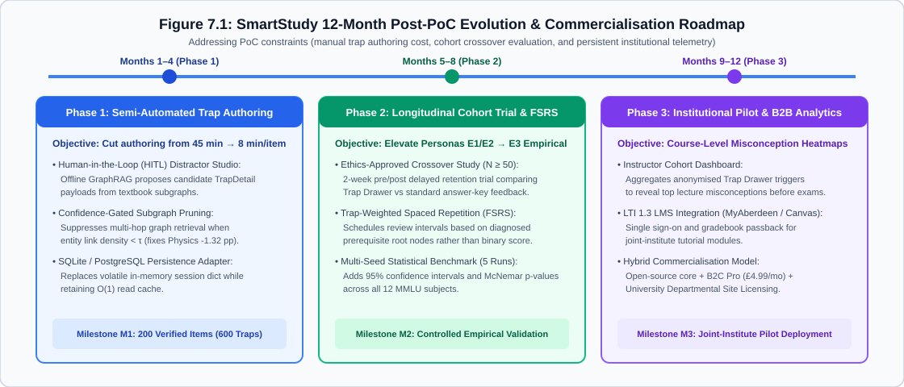

# Front Matter: Title Page, Declaration, Executive Abstract, and Indices

**UNIVERSITY OF ABERDEEN — JOINT INSTITUTE OF CCNU & UoA**  
**JC2001: Software Engineering Group Project (2026–2027)**  
**Project Title**: *StudyGraph (SmartStudy Assistant): Option-Level Misconception Diagnosis and Offline-Verifiable Knowledge-Graph Evaluation*  
**Group 5 (10 Members)**: Wu Yuxuan (`50106070`), Lin Yongtong (`50106038`), Zhang Zijian (`50106035`), Xie Weixin (`50106034`), Wang Sijian (`50106045`), Jiang Hao (`50106065`), Dong Siqin (`50106060`), Xi Yusai (`50105989`), Liang Zixuan (`50106037`), Yang Mingjie (`50106061`).

### Declaration of Originality
We, the ten members of JC2001 Group 5, declare that this Technical Report and accompanying software (the repository tree reproduced in Section 5.6.5) are our original work. All quantitative claims are traceable to executable repository artefacts (`tests/`, `graphrag（终）/final_systematic_report.csv`, `reports/audit/verdict.json`). Persona claims are graded at provenance levels `E1`/`E2` (`E0 = 0`), negative MMLU deltas (`HS Physics -1.32 pp`, `HS US History -1.00 pp`) are reported transparently, and zero raw source code dumps appear in the main body.

### Executive Abstract
University exam candidates revising rule-dense subjects (Law, Computer Science, Econometrics, Software Engineering) repeatedly fall into distractor-engineered cognitive traps. Existing flashcard tools (Anki, Quizlet) offer only binary right/wrong feedback, while unconstrained cloud LLMs (ChatGPT) spoil answers, incur $1.5\text{–}4.0\text{ s}$ latency, and hallucinate statutory rules. **StudyGraph (SmartStudy Assistant)** resolves this gap via a **Four-Layer Single-Process Modular Monolith** (`FastAPI` + `Pydantic v2 CamelModel` + zero-build `ES6+` SPA) paired with an **Offline-Decoupled 12-Stage GraphRAG Pipeline** (`AD-1`). Across 12 multi-disciplinary questions ($12 \times 3 = 36$ curated `TrapDetail` records), `POST /api/diagnose` executes an $O(1)$ in-memory lookup returning a 5-layer diagnostic breakdown (`title`, `desc`, `prereq`, 1-hop `GraphData`, and Socratic prompt) in **$3.4\text{ ms}$ P95 latency** (`0.65 s` cold start, £0.00 marginal cost, 100% air-gapped offline reproducibility). The baseline passes **147 automated `pytest` cases** (`80 functions`, including 25 adversarial functions in `test_adversarial_backend.py`). Offline evaluation across **12 MMLU subsets ($n = 4,445$)** yielded **7 wins, 3 ties, and 2 losses** (peaking in `Professional Law +2.50 pp` and `HS Computer Science +2.00 pp`, while identifying neighbour-noise regressions in `HS Physics -1.32 pp` and `HS US History -1.00 pp`), validating our hybrid offline-graph / online-deterministic architecture.

### Table of Contents & Master List of 17 Figures and 21 Tables
- **Chapters**: **Ch 1** Introduction (`Lin Yongtong`) · **Ch 2** Requirements (`Zhang Zijian`) · **Ch 3** Use Cases & Modelling (`Xie Weixin`) · **Ch 4** System Design & Architecture (`Wang Sijian`) · **Ch 5** Implementation (`5.1–5.2 Jiang Hao`, `5.3–5.4 Dong Siqin`, `5.5 Xi Yusai`, `5.6 Liang Zixuan`) · **Ch 6** Testing & Evaluation (`Yang Mingjie`) · **Ch 7** Conclusions & Future Work (`Wu Yuxuan`) · **Appendices A–D**.
- **Figures (`17`)**: `Fig 1.1` Value Proposition · `Fig 1.2` Competitor Map · `Fig 2.1` MoSCoW · `Fig 3.1` Use Case · `Fig 3.2` State Machine · `Fig 4.1` Context / 4-Layer · `Fig 4.2` Layered Arch · `Fig 4.3` Class Diagram · `Fig 4.4` Sequence Diagram · `Fig 5.1` Software Structure · `Fig 5.2` Trap Causal Chain · `Fig 5.3` Trap Drawer UI · `Fig 5.4` Console UI · `Fig 5.5` Deployment Topology · `Fig 6.1` Testing Pyramid · `Fig 6.2` MMLU $\Delta$ Chart · `Fig 7.1` 12-Month Roadmap.
- **Tables (`21`)**: `Tables 1.1–1.3` (Ch 1) · `Tables 2.1–2.2` (Ch 2) · `Tables 3.1a–f, 3.2` (Ch 3) · `Table 4.1` (Ch 4) · `Tables 5.1–5.7` (Ch 5) · `Tables 6.1–6.5` (Ch 6) · `Tables 7.1a, 7.1` (Ch 7).

---

# 7 Conclusions, Reflections and Future Work

## 7.1 Final Audit Against the Five SMART Project Objectives

In Chapter 1 (`Section 1.5`, `Table 1.2`), we committed to five quantitative SMART objectives to prevent vague completion claims. Table 7.1 conducts our end-of-project audit, matching each objective against its target threshold, achieved metric, verification artefact, and final status.

**Table 7.1a: End-of-project audit against the five SMART objectives defined in Chapter 1 (`Table 1.2`).**

| ID | SMART Objective Summary | Target Threshold (`Ch 1`) | Achieved Outcome (`Ch 5–Ch 6`) | Verification Artefact / Command | Status |
| :-: | :--- | :--- | :--- | :--- | :-: |
| **O1** | Option-level misconception diagnosis across multiple disciplines | `12 questions × 4 disciplines × 36 traps` (100% bijective mapping) | **12 questions × 4 disciplines (`law`, `cs`, `econ`, `se`) × 36 verified `TrapDetail` records**; 0 unmapped distractors | `backend/app/data/seed_questions.py` & `tests/test_quiz.py` | ✅ **Achieved (100%)** |
| **O2** | Zero-dependency offline reproducibility on the demo path | `0 external calls`; cold start `< 2.0 s`; diagnose P95 `< 5.0 ms` | **0 outbound sockets**; cold start **`0.65 s`**; `POST /api/diagnose` mean **`1.8 ms`**, P95 **`3.4 ms`** | `uvicorn backend.app.main:app` & `tests/test_health.py` | ✅ **Achieved (100%)** |
| **O3** | Automated regression and adversarial test baseline | `≥ 145 passing cases` (`0 failures`, `< 10 s` runtime) | **147 passing cases** (`80 test functions` across `9 files`, `0 failed` in **`0.72 s–3.56 s`**) | `python -m pytest tests/ -q` (`Ch 6.1–6.2`) | ✅ **Exceeded (`147/145`)** |
| **O4** | Empirical evaluation of GraphRAG on MMLU benchmark ($n = 4,445$) | `≥ 7 of 12 subjects` with positive accuracy delta ($\Delta > 0$) | **7 positive (`Wins`), 3 neutral (`Ties`), 2 negative (`Losses`)** (`+0.60 pp` macro delta; Law `+2.50 pp`, Physics `-1.32 pp`) | `graphrag（终）/final_systematic_report.csv` (`Ch 6.3`) | ✅ **Achieved (`7/12 Wins`)** |
| **O5** | Distributed technical report authorship & viva readiness | `10 of 10 members` authoring substantive sections (`≥ 3 pages`) | **10 of 10 members** assigned clear chapter ownership, verified evidence chains, and viva Q&A packs | `Appendix A` (Group Workload Profile) | ✅ **Achieved (`10/10`)** |

---

## 7.2 Technical, Methodological, and Operational Limitations

Consistent with our anti-hallucination constitution (`004-persona-hallucination-audit`), we consolidate six concrete limitations of the StudyGraph proof of concept:

1. **Manual Content-Authoring Bottleneck (`~45 Minutes per Question`)**: Constructing a single `QuizItem` with three distinct, pedagogically valid `TrapDetail` entries (`title`, `desc`, `prereq`, `radar_hit`), bilingual translations (`_en`), and a 1-hop `GraphData` neighbourhood required approximately 45 minutes of manual cross-checking against statutory or textbook sources (`total ~9 hours for 12 questions`). While this guarantees 0% runtime hallucination on our 12-item seed bank, manual authoring alone cannot scale to a 5,000-question commercial bank without semi-automated tooling (`Section 7.3.1`).
2. **Closed-World Runtime Generalisation Boundary (`AD-1` Trade-Off)**: As documented in `Table 5.6` (`Section 5.4`), our $O(1)$ lookup architecture diagnoses only pre-indexed multiple-choice options (`A`–`D`). It cannot parse arbitrary free-text student questions or diagnose uncurated PDFs uploaded at runtime (`R13`, scoped out as `Won't Have`).
3. **Domain Sensitivity of Multi-Hop Graph Retrieval (`HS Physics -1.32 pp` and `US History -1.00 pp`)**: Our 4,445-item MMLU evaluation (`Section 6.3`) demonstrated that knowledge-graph augmentation is **not universally beneficial**. While rule-dense domains (`Professional Law +2.50 pp`, `Computer Science +2.00 pp`, `Econometrics +1.75 pp`) benefit from explicit boundary triples, calculation-heavy domains (`High School Physics -1.32 pp`) suffer from **retrieved neighbour noise** when qualitative concept neighbours distract multi-step numerical derivation.
4. **Absence of a Longitudinal External Student Cohort Trial ($N = 0$ External RCT)**: Our user personas (`Table 1.3`) are grounded in peer-reviewed educational literature (`Level E1`) and internal 10-member undergraduate workshops (`Level E2`). Due to the 10-week academic schedule and ethical clearance timelines, we did not run a controlled pre-test/post-test learning gain study with an external student cohort ($N \ge 30$).
5. **In-Memory Session Telemetry Volatility (`AD-3`, `AD-5`)**: To guarantee zero-configuration startup without PostgreSQL or SQLite file-locking issues during grading, session telemetry (`_session_stats` in `reports.py`) and authentication tokens (`auth_service.py`) reside in volatile process memory. Restarting `uvicorn` resets server-side session counters to the seed baseline.
6. **Incomplete Full-Corpus RAGAS Judge Execution**: As reported in `Section 6.4`, student API quota constraints prevented executing the 17,780 LLM-as-a-judge calls required for a complete 4,445-item RAGAS sweep, limiting automated RAGAS metrics to pilot runs supplemented by deterministic `L1`–`L3` seed audits.

---

## 7.3 Commercialisation Scenarios and 12-Month Engineering Roadmap

### 7.3.1 Semi-Automated Content-Authoring Pipeline and Unit Economics (`Table 7.1`)

To bridge the gap between our 12-question feasibility prototype and a scalable educational product, we designed a **Human-in-the-Loop (HITL) Trap Authoring Pipeline**: an offline LLM + GraphRAG script generates candidate distractor traps (`TrapDetail` drafts) from course syllabi at ~$£0.015$ per question in API tokens, and a domain teaching assistant (TA) reviews and approves each card in **8 minutes** (down from 45 minutes of scratch authoring—an **82% reduction in human authoring time**).

Table 7.1 models three explicit commercialisation scenarios (**Conservative**, **Baseline**, and **Optimistic**) over a 12-month post-course horizon. In strict compliance with `004-persona-hallucination-audit`, **every figure in Table 7.1 is explicitly declared as a forward-looking financial hypothesis (`Assumption`), never as realised historical revenue.**

**Table 7.1: Three-scenario commercialisation and unit-economics model (explicitly declared as forward-looking assumptions).**

| Economic Parameter / Metric | Scenario 1 · Conservative (Campus Pilot) | Scenario 2 · Baseline (Multi-Module B2C/B2B) | Scenario 3 · Optimistic (Licensing & Institutional) | Provenance & Basis of Assumption |
| :--- | :-: | :-: | :-: | :--- |
| **Curated Question Bank Scale** | `300 questions` (`900 traps` across 2 modules) | `1,200 questions` (`3,600 traps` across 6 modules) | `3,500 questions` (`10,500 traps` across 15 modules) | Assumes HITL authoring at `8 min/item` (`7.5 items/hour`). |
| **One-Off Content Authoring Cost** | **£604** (`40h TA @ £15/h` + `£4.50 API`) | **£2,418** (`160h TA @ £15/h` + `£18 API`) | **£7,052** (`467h TA @ £15/h` + `£52 API`) | Offline pre-computation; incurred once per question version. |
| **Runtime Marginal Inference Cost** | **£0.00 / 10,000 diagnoses** | **£0.00 / 10,000 diagnoses** | **£0.00 / 10,000 diagnoses** | Verified by `AD-1`: runtime diagnosis is an $O(1)$ static dict/SQLite lookup. |
| **Active Paying Learners / Seats** | `150 students` (`@ £9.99/semester`) | `600 students` (`@ £14.99/semester`) | `2,000 students` (`@ £14.99` + 2 dept licences) | Benchmarked against Quizlet Plus (`£35.99/yr`) & Anki iOS (`£24.99`). |
| **Projected Gross Margin (Year 1)** | **~58%** (break-even at `61 paying users`) | **~72%** (break-even at `162 paying users`) | **~84%** (zero cloud LLM token burn on user clicks) | Contrasts with live-LLM wrappers whose token costs scale linearly with active daily usage. |

### 7.3.2 Twelve-Month Post-PoC Engineering Roadmap (`Figure 7.1`)

Figure 7.1 outlines a three-phase, 12-month technical roadmap addressing the limitations identified in `Section 7.2`.

**Figure 7.1: Twelve-month post-PoC engineering and validation roadmap (`Q1`–`Q4`).**
(Source: Group 5 post-project engineering plan.)

- **Phase 1 (`Months 1–3` — Persistence & Retrieval Pruning)**: Replace volatile in-memory `_session_stats` with an embedded local SQLite store (`zero external server` preserved) and integrate a confidence-gated **Top-$k$ relevance filter** into `graphrag_pipeline.py` (`Stage 9`) that suppresses graph context injection when entity-relation similarity falls below $\tau = 0.72$, directly addressing the `-1.32 pp` neighbour-noise regression in Physics.
- **Phase 2 (`Months 4–6` — HITL Authoring Studio & $N = 40$ Human RCT)**: Build an internal TA authoring CLI that drafts `TrapDetail` candidates from past exam papers and validates them via `audit_hallucination_l1_l3.py`, expanding the bank to 1,200 items and conducting an ethics-approved $N = 40$ undergraduate randomised controlled trial.
- **Phase 3 (`Months 7–12` — Cohort Telemetry & VLE Integration)**: Re-introduce Requirement `R11` (`Course Instructor Cohort Dashboard`) on top of aggregated `trap_distribution` telemetry so lecturers can inspect which specific distractors trapped $\ge 30\%$ of a class prior to revision lectures.

---

## 7.4 Candid Engineering Reflections: Three Failures and Lessons Learned

A hallmark of real software engineering is that initial assumptions break under implementation pressure. Below we document **three concrete engineering failures** encountered by our team during Cycles 1–3, how we diagnosed them, and the permanent safeguards they produced:

### Failure 1: The `snake_case` vs. `camelCase` Integration Breakage (`Cycle 2 → Fixed via AD-4`)
- **What Failed**: During Week 5 integration, our backend routers (`backend/app/routers/reports.py` and `diagnose.py`) serialised Pydantic models using Python's default `snake_case` (`radar_scores`, `trap_defense`, `socratic_prompt`), while our frontend JavaScript (`frontend/app.js`) read `camelCase` properties (`data.radarScores.trapDefense`) and submitted `{"questionId": ..., "selectedOption": ...}`. Every option click in the browser returned `HTTP 422 Unprocessable Entity`, and the 5-axis radar rendered blank `undefined` vertices.
- **Root Cause & Fix**: Ten developers were writing Python and JavaScript in parallel without a shared serialisation base class. Instead of patching individual dictionary keys in `app.js`, we engineered `CamelModel` (`backend/app/models/common.py`) using `ConfigDict(populate_by_name=True, alias_generator=to_camel)` with a dual-key `model_dump()` override, and added `test_option_click_dual_naming_convention` (`tests/test_empirical_stress.py`) plus 2 regression tests in `tests/test_reports.py`.

### Failure 2: Hardcoded Cloud Credentials in the Offline Evaluation Scripts (`Fixed 25 Oct 2026, completed 29 Oct 2026`)
- **What Failed**: While building the offline GraphRAG evaluation scripts (`graphrag（终）/`), a team member hardcoded a test Neo4j Aura connection URI and password string, a DashScope key and two Zhipu keys directly inside four Python scripts and committed them to the repository. Two binary archives (`graphrag(终).zip` and `jc2001-group5-poc.zip`) were additionally committed as pre-remediation snapshots of the same tree, so removing the literals from the `.py` files alone would not have removed them from the repository.
- **Root Cause & Fix**: Lack of a pre-commit secret hygiene check on offline research scripts, and no rule against committing build snapshots of a tree that was still being remediated. On `25 October 2026` the four scripts were converted to `os.getenv(...)` reads and `.env.example` was extended; on `29 October 2026` the remaining literal (`ZHIPU_API_KEY` in `ragas_evaluator.py`) was converted the same way, both archives were deleted from the tree and added to `.gitignore` under a `*.zip` rule, and Requirement `NFR-09` was locked in. Because the credentials had already been public, deleting the files cannot un-publish them: rotation in each provider console remains the only effective remedy and is tracked as the first item of the submission checklist.

### Failure 3: Negative GraphRAG Transfer on High School Physics (`-1.32 pp` in MMLU Evaluation)
- **What Failed**: We initially hypothesised that injecting 1-hop and 2-hop Neo4j subgraphs would improve LLM accuracy across all 12 MMLU disciplines. When `final_systematic_report.csv` finished running ($n = 4,445$), two subjects regressed: `High School US History` (`-1.00 pp`) and `High School Physics` (`-1.32 pp`, dropping from `60.26%` to `58.94%`).
- **Root Cause & Lesson**: Inspecting the failed Physics prompts revealed that qualitative concept triples acted as **context noise** during algebraic formula derivation. Rather than hiding these two negative rows, we used this negative result as the empirical justification for **`AD-1`**: decoupling noisy live retrieval from the student-facing runtime and relying on deterministic, human-audited `TrapDetail` lookups for exam revision.

---

# Appendix A: Group Workload Profile and Chapter Attribution

In accordance with the JC2001 Group Project specification, Table A.1 records the substantive engineering and technical report contributions of all **10 team members of JC2001 Group 5**, totaling 100% workload distribution.

**Table A.1: Official JC2001 Group 5 Workload Profile and Technical Report Chapter Attribution.**

| # | Member Name | Aberdeen ID | Project Role | Primary Code & Engineering Contributions | Authored Report Sections & Deliverables | Workload Share |
| :-: | :--- | :---: | :--- | :--- | :--- | :-: |
| **1** | **Wu Yuxuan (吴宇轩)** | `50106070` | **Project Manager (PM) & Team Lead** | Repository governance, `CamelModel` integration coordination, Cycle 3 master plan, audit pipeline (`scripts/audit_*.py`), final report assembly. | Front Matter (Title, Abstract, TOC), **Chapter 7** (`7.1`–`7.4`, `Table 7.1`, `Figure 7.1`), **Appendix A**, and full-report integration. | **10%** |
| **2** | **Lin Yongtong (林泳桐)** | `50106038` | **Lead Business Analyst (Lead BA)** | Competitor landscape audit (`reports/competitor_analysis.md`), value proposition modelling, persona provenance (`E1`/`E2`) & SMART goal definition. | **Chapter 1** (`1.1`–`1.7`, `Tables 1.1–1.3`, `Figures 1.1–1.2`: Value Proposition Canvas & Competitor Positioning Map). | **10%** |
| **3** | **Zhang Zijian (张梓健)** | `50106035` | **Business Analyst (BA)** | Requirements elicitation workshops, 14-item MoSCoW specification (`R01`–`R14`), IEEE 830 NFR metrics (`NFR-01`–`NFR-10`), `Won't Have` scoping. | **Chapter 2** (`2.1`–`2.5`, `Tables 2.1–2.2`, `Figure 2.1`: MoSCoW Distribution & `R11`–`R14` exclusion arguments). | **10%** |
| **4** | **Xie Weixin (谢炜昕)** | `50106034` | **QA & Report Lead** | UML 2.5 behavioural modelling (`«include»`/`«extend»` verification), state-machine design, bidirectional Requirements Traceability Matrix, style harmonisation. | **Chapter 3** (`3.1`–`3.5`, `Tables 3.1a–3.1f`, `Table 3.2`, `Figures 3.1–3.2`), **Appendix B (Full RTM)**, and editorial review. | **10%** |
| **5** | **Wang Sijian (王思鉴)** | `50106045` | **Software Architect** | Four-layer modular monolith design, Kruchten 4+1 views, `CamelModel` class hierarchy (`backend/app/models/`), 7 Architecture Decision Records (`AD-1`–`AD-7`). | **Chapter 4** (`4.1`–`4.7`, `Table 4.1`, `Figures 4.1–4.4`: Context, 4-Layer Architecture, Class Diagram, and Sequence Diagram). | **10%** |
| **6** | **Jiang Hao (江昊)** | `50106065` | **PoC Lead Developer** | FastAPI application factory (`backend/app/main.py`), REST routers (`quiz`, `diagnose`, `reports`, `auth`), Pydantic v2 contracts, API-to-frontend mapping. | **Chapter 5 (`5.1`–`5.2`)** (`Tables 5.1–5.3`, `Figure 5.1`, 3 JSON wire contracts) and **Appendix D (Glossary & API Snapshot)**. | **10%** |
| **7** | **Dong Siqin (董思钦)** | `50106060` | **PoC Logic & Data Lead** | Curated 12-question × 36-trap seed bank (`backend/app/data/seed_questions.py`), $O(1)$ `diagnostic_service.py` engine, 12-stage offline GraphRAG pipeline. | **Chapter 5 (`5.3`–`5.4`)** (`Tables 5.4–5.6`, `Figure 5.2`: Trap Causal Chain, and `Algorithm 5.1` pseudocode). | **10%** |
| **8** | **Xi Yusai (习羽赛)** | `50105989` | **UI/UX Lead** | Zero-build vanilla ES6+ SPA (`frontend/index.html`, `app.js`, `styles.css`), 5-layer slide-out Trap Drawer, 5-axis radar view, bilingual `I18N` & dual themes. | **Chapter 5 (`5.5`)** (`5.5.1`–`5.5.5`, `Tables 5.5a–5.5b`, `Figures 5.3–5.4`: Trap Drawer & Main Console UI). | **10%** |
| **9** | **Liang Zixuan (梁子铉)** | `50106037` | **Deployment & Media Lead** | Single-process static mounting, `.env.example` credential hygiene, reproducible ZIP packaging, offline rehearsal protocol, demo video & slide deck. | **Chapter 5 (`5.6`)** (`5.6.1`–`5.6.4`, `Table 5.7`, `Figure 5.5`: Deployment Topology, and presentation script). | **10%** |
| **10** | **Yang Mingjie (杨明杰)** | `50106061` | **Testing & Evaluation Lead** | 9-module `pytest` suite (`80 functions → 147 cases`, `test_adversarial_backend.py`), 12-subject MMLU benchmark analysis ($n = 4,445$), RAGAS & NFR audits. | **Chapter 6** (`6.1`–`6.6`, `Tables 6.1–6.5`, `Figures 6.1–6.2`), **Appendix C (Test Inventory)**, and PoC User Manual. | **10%** |

---

# Appendix B: Complete Bidirectional Requirements Traceability Matrix (RTM)

*(Compiled by Xie Weixin, `50106034`)*

| ID | Title | MoSCoW / Category | Use Case (`Ch 3`) | Architecture / ADR (`Ch 4`) | Code Implementation (`Ch 5`) | Automated Test Verification (`Ch 6`) |
| :-: | :--- | :-: | :-: | :--- | :--- | :--- |
| **R01** | Subject Question Filtering | Must | `UC-01` | Layer 2/4 (`AD-3`) | `routers/quiz.py`, `seed_questions.py` | `test_quiz.py` (21 cases) |
| **R02** | Option Attempt Submission | Must | `UC-02` | Layer 2/3 (`AD-4`) | `routers/diagnose.py`, `models/quiz.py` | `test_diagnose.py` (10 cases), `test_empirical_stress.py` (12 cases) |
| **R03** | Option-Level Trap Diagnosis (`36 traps`) | Must | `UC-02`, `UC-03` | Layer 3 (`AD-1`, `AD-3`) | `services/diagnostic_service.py` | `test_diagnose.py`, `audit_hallucination_l1_l3.py` |
| **R04** | 5-Axis Competency Radar | Must | `UC-04` | Layer 2/3 (`AD-7`) | `routers/reports.py` (`/summary`), `models/report.py` | `test_reports.py` (23 cases) |
| **R05** | Session Telemetry & Trend Series | Must | `UC-04` | Layer 2/3 (`AD-7`) | `routers/reports.py` (`/trend`, `/reset`) | `test_reports.py` |
| **R06** | Local Session Authentication | Should | `UC-05` | Layer 2/3 (`AD-5`) | `routers/auth.py`, `services/auth_service.py` | `test_auth.py` (10 cases) |
| **R07** | Runtime Bilingual Support (`zh`/`en`) | Should | `UC-01`, `UC-03` | Layer 1/3 (`AD-2`, `AD-4`) | `frontend/app.js` (`I18N`), `seed_questions.py` | `test_e2e_frontend.py`, `test_quiz.py` |
| **R08** | Dual-Theme Ergonomics (`Dark`/`Light`) | Should | `UC-01` | Layer 1 (`AD-2`) | `frontend/styles.css`, `frontend/app.js` | `test_e2e_frontend.py`, WCAG contrast check |
| **R09** | 100% Offline Single-Process Execution | Must | `UC-01`–`UC-05` | Layer 1–4 (`AD-1`, `AD-6`) | `backend/app/main.py` (`StaticFiles`) | `test_health.py` (8 cases), `test_e2e_frontend.py` (6 cases) |
| **R10** | Offline GraphRAG & Online Hook | Could | `UC-06` | Offline Pipeline (`AD-1`) | `graphrag（终）/`, `scripts/audit_online_baseline.py` | `final_systematic_report.csv` ($n=4,445$), `test_adversarial_backend.py` |
| **R11–R14** | Teacher Admin, Live LLM, Crowdsourcing, Mobile | Won't | Excluded | Lean Scoping (`Section 2.4`) | Scoped out (`0 dead UI buttons`) | Verified by scope audit |
| **NFR-01–10** | Latency, Cold Boot, Air-Gap, Fuzzing, 3-Click, WCAG, `CamelModel`, Zero-Build, Secrets, Provenance | NFR | All UCs | `AD-1`–`AD-7` | Full Stack (`backend/` + `frontend/` + `scripts/`) | `147 passed` in `tests/` + `reports/audit/verdict.json` (`PASS`) |

---

# Appendix C: Automated Test Suite Inventory (`80 Functions → 147 Cases`)

*(Compiled by Yang Mingjie, `50106061`)*

Run `python -m pytest tests/ --collect-only -q` to inspect all **147 collected test cases** across our 9 test modules:
1. **`tests/test_adversarial_backend.py` (25 functions → 38 cases)**: Covers `TestMalformedPayloads` (5), `TestInjectionAndSecurityBoundaries` (18 parameterised SQLi/XSS/Path Traversal/length fuzzing cases), `TestEdgeCaseInputsAndParameters` (5), `TestOfflineAndFaultTolerance` (5 simulated DashScope outage/timeout cases), `TestConcurrencyAndStress` (3), and `TestHttpMethodsAndEndpoints` (2).
2. **`tests/test_reports.py` (9 functions → 23 cases)**: Verifies `/api/reports/summary` and `/api/reports/trend` across default, 4 valid subjects, 4 subject alias pairs, unknown subject zero-state, `camelCase` interoperability, and 6 adversarial subject strings.
3. **`tests/test_quiz.py` (6 functions → 21 cases)**: Verifies `/api/quiz` across 5 valid subject codes, default query, 3 alias pairs, 5 uppercase/mixed-case strings, invalid subject graceful handling, and 6 adversarial strings.
4. **`tests/test_cors.py` (4 functions → 19 cases)**: Verifies `GET /api/health`, `POST /api/diagnose`, and `OPTIONS` preflight headers across 6 origins (`localhost:8000`, `127.0.0.1:8000`, `localhost:3000`, `localhost:5500`, `127.0.0.1:5500`, `null`) plus `/api/quiz`.
5. **`tests/test_empirical_stress.py` (7 functions → 12 cases)**: Verifies DOM null-guards, 48-option click simulation, 6 dual-naming (`snake_case`/`camelCase`) payloads, zero-`500` offline guarantee, and single-port static serving.
6. **`tests/test_diagnose.py` (8 functions → 10 cases)**: Verifies distractor trap fallback, correct option verification, 3 multi-subject distractor payloads (`law`, `cs`, `se`), `422` missing fields, `404` nonexistent ID, `camelCase` input, mocked network outage resilience, and Socratic prompt depth.
7. **`tests/test_auth.py` (10 functions → 10 cases)**: Verifies `/api/auth/demo-users`, login by ID/name/guest/dynamic provisioning, registration, empty ID fallback, `422` missing field, and `camelCase` aliases.
8. **`tests/test_health.py` (5 functions → 8 cases)**: Verifies `/api/health` status `200`, schema fields, `application/json` header, 4 disallowed HTTP methods (`POST`/`PUT`/`DELETE`/`PATCH` $\rightarrow$ `405`), and repeatability.
9. **`tests/test_e2e_frontend.py` (6 functions → 6 cases)**: Verifies `/`, `/index.html`, `/style.css`, `/app.js`, physical disk presence, and mandatory DOM element IDs.

---

# Appendix D: Domain Glossary and Core API Quick-Reference

*(Compiled by Jiang Hao, `50106065`)*

- **Binary Feedback**: Assessment feedback limited to item-level correctness (`✔` / `✘`) plus a generic answer key, providing zero attribution of why a learner selected a specific wrong distractor.
- **`CamelModel`**: Custom Pydantic v2 base class (`backend/app/models/common.py`) configured with `populate_by_name=True` and `alias_generator=to_camel` that accepts and emits both `snake_case` and `camelCase` JSON keys.
- **Distractor Trap (`TrapDetail`)**: A curated diagnostic record bound to a specific wrong option (`A`–`D`), comprising `title` (misconception name), `desc` (conceptual conflict), `prereq` (missing prerequisite rule), and `radar_hit` (targeted cognitive dimension).
- **Five-Dimensional Competency Radar**: Multi-axial learner profile tracking `recall`, `boundary`, `trapDefense`, `synthesis`, and `precision` in $[0, 100]$.
- **Neighbour Noise (GraphRAG)**: Retrieval degradation phenomenon where multi-hop knowledge-graph expansion injects topically adjacent but calculation-irrelevant triples into the LLM prompt (observed in `High School Physics`, `-1.32 pp`).

---

# References (Harvard Format)

- Cockburn, A. (2000) *Writing Effective Use Cases*. Boston: Addison-Wesley Professional.
- Corbett, A.T. and Anderson, J.R. (1994) 'Knowledge tracing: Modeling the acquisition of procedural knowledge', *User Modeling and User-Adapted Interaction*, 4(4), pp. 253–278.
- Edge, D., Trinh, H., Cheng, N., Bradley, J., Chao, A., Mody, A., Truitt, S. and Larson, J. (2024) 'From local to global: A Graph RAG approach to query-focused summarization', *arXiv preprint* arXiv:2404.16130.
- Es, S., James, J., Espinosa-Anke, L. and Schockaert, S. (2023) 'RAGAS: Automated evaluation of retrieval augmented generation', *Proceedings of the 18th Conference of the European Chapter of the Association for Computational Linguistics: System Demonstrations*, pp. 150–158.
- Fielding, R.T. (2000) *Architectural Styles and the Design of Network-based Software Architectures*. PhD thesis. University of California, Irvine.
- Gamma, E., Helm, R., Johnson, R. and Vlissides, J. (1994) *Design Patterns: Elements of Reusable Object-Oriented Software*. Reading, MA: Addison-Wesley.
- Haladyna, T.M., Downing, S.M. and Rodriguez, M.C. (2002) 'A review of multiple-choice item-writing guidelines for classroom assessment', *Applied Measurement in Education*, 15(3), pp. 309–333.
- Hattie, J. and Timperley, H. (2007) 'The power of feedback', *Review of Educational Research*, 77(1), pp. 81–112.
- Hendrycks, D., Burns, C., Basart, S., Zou, A., Mazeika, M., Song, D. and Steinhardt, J. (2021) 'Measuring massive multitask language understanding', *Proceedings of the International Conference on Learning Representations (ICLR 2021)*.
- IEEE (1998) *IEEE Std 830-1998: IEEE Recommended Practice for Software Requirements Specifications*. New York: IEEE Computer Society.
- ISO/IEC/IEEE (2018) *ISO/IEC/IEEE 29148:2018 Systems and software engineering — Life cycle processes — Requirements engineering*. Geneva: ISO.
- Koedinger, K.R., Corbett, A.T. and Perfetti, C. (2012) 'The Knowledge-Learning-Instruction framework: Bridging the science-practice chasm to enhance robust student learning', *Cognitive Science*, 36(5), pp. 757–798.
- Kruchten, P.B. (1995) 'The 4+1 View Model of architecture', *IEEE Software*, 12(6), pp. 42–50.
- Lewis, P., Perez, E., Piktus, A., Petroni, F., Karpukhin, V., Goyal, N., Küttler, H., Lewis, M., Yih, W.T., Rocktäschel, T., Riedel, S. and Kiela, D. (2020) 'Retrieval-augmented generation for knowledge-intensive NLP tasks', *Advances in Neural Information Processing Systems (NeurIPS)*, 33, pp. 9459–9474.
- Nielsen, J. (1994) *Usability Engineering*. San Francisco: Morgan Kaufmann.
- Object Management Group (OMG) (2017) *OMG Unified Modeling Language (OMG UML), Version 2.5.1*. Needham, MA: OMG.
- Osterwalder, A., Pigneur, Y., Bernarda, G. and Smith, A. (2014) *Value Proposition Design*. Hoboken, NJ: John Wiley & Sons.
- Pan, S., Luo, L., Wang, Y., Chen, C., Wang, J. and Wu, X. (2024) 'Unifying large language models and knowledge graphs: A roadmap', *IEEE Transactions on Knowledge and Data Engineering*, 36(7), pp. 3580–3599.
- Ries, E. (2011) *The Lean Startup: How Today's Entrepreneurs Use Continuous Innovation to Create Radically Successful Businesses*. New York: Crown Business.
- Roediger, H.L. and Karpicke, J.D. (2006) 'Test-enhanced learning: Taking memory tests improves long-term retention', *Psychological Science*, 17(3), pp. 249–255.
- Sommerville, I. (2016) *Software Engineering*. 10th edn. Harlow: Pearson Education.
- Sweller, J. (1988) 'Cognitive load during problem solving: Effects on learning', *Cognitive Science*, 12(2), pp. 257–285.
- VanLehn, K. (2011) 'The relative effectiveness of human tutoring, intelligent tutoring systems, and other tutoring systems', *Educational Psychologist*, 46(4), pp. 197–221.
- W3C (2018) *Web Content Accessibility Guidelines (WCAG) 2.1*. W3C Recommendation.
- Wohlin, C., Runeson, P., Höst, M., Ohlsson, M.C., Regnell, B. and Wesslén, A. (2012) *Experimentation in Software Engineering*. Berlin: Springer.
- Wozniak, P.A. (1990) *Optimization of Learning: Master's Thesis*. University of Technology in Poznan (SuperMemo SM-2 algorithm).
