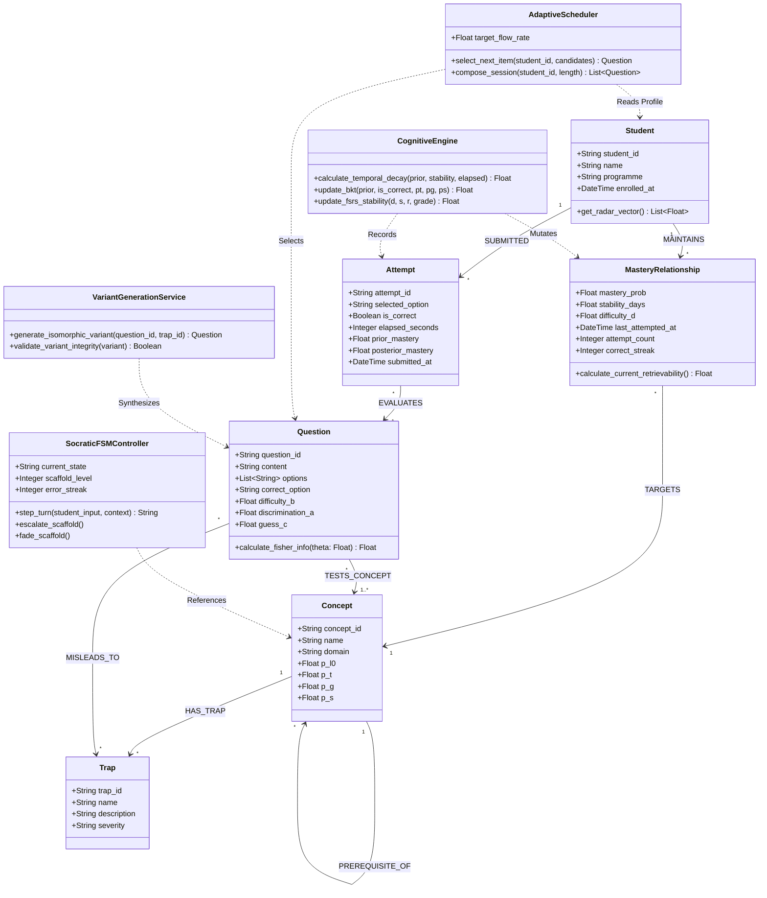

# Formal Progress Report: Smart Study Assistant System (SmartStudy Console)
## Phase 2 / Cycle 2 Review: Requirements Engineering, System Modeling, PoC Architecture & Empirical Quality Assurance

---

### Course & Administrative Metadata
- **Institution**: University of Aberdeen & South China Normal University (SCNU) Joint Institute
- **Course Code & Title**: JC2001 Introduction to Software Engineering (Academic Year 2026–2027)
- **Project Group**: Group 5 — BSc Business Management and Information Systems (BSc BMIS)
- **Project Title**: Smart Study Assistant System (SmartStudy Console)
- **Academic Supervisor**: Dr. Shahzad Mumtaz (`shahzad.mumtaz@abdn.ac.uk`)
- **Project Manager / Team Leader**: Yuxuan Wu (Student ID: `50106070`, Email: `u11yw25@abdn.ac.uk`)
- **Document Classification**: Formal Milestone Progress Report (Cycle 2 Review)
- **Date of Submission**: 15 October 2026
- **Repository Baseline**: Git Commit `47 commits` across `develop`, `main`, and functional feature branches
- **Verification Baseline**: 114 Automated Pytest Test Cases (100% Passed, 0 Failures, 0 Errors)

---

## 1. Executive Summary

### 1.1 Project Overview & Phase 2 Objectives
The **Smart Study Assistant System (SmartStudy Console)** is an intelligent, knowledge-graph-anchored pedagogical platform developed by Group 5 for the University of Aberdeen JC2001 Software Engineering curriculum. Designed to transcend the pedagogical limitations of conventional multiple-choice quiz systems and generic Large Language Model (LLM) conversational interfaces, SmartStudy integrates **Graph-Augmented Retrieval (GraphRAG)**, **option-level distractor trap attribution**, and **Socratic dialogue scaffolding** into a unified, high-performance web environment.

During Phase 2 (Cycle 2), Group 5 completed the transition from initial conceptualization and feasibility analysis (Cycle 1) to comprehensive software engineering execution. In strict alignment with Ian Sommerville’s software engineering principles (*Software Engineering*, 10th Edition) and the JC2001 official marking syllabus (50% Technical Report, 30% Standalone PoC Software, 20% Video Presentation), the team has delivered:
1. An end-to-end operational Proof-of-Concept (PoC) Minimum Viable Product (MVP) featuring a modular FastAPI asynchronous backend and a DeepSeek-inspired dark-mode interactive console frontend.
2. A formal Requirements Engineering baseline encompassing 8 Cockburn-standard Use Cases (`UC-01` to `UC-08`) and a comprehensive MoSCoW Requirements Traceability Matrix (`FR-01`–`FR-08`, `NFR-01`–`NFR-06`).
3. Standardized UML 2.5 architectural models (System Context Model, Global Use Case Diagram, Core Sequence Diagram, and Unified Domain Class Diagram) validated through peer reviews.
4. A production-grade automated quality assurance suite comprising **114 pytest test cases passing with a 100% success rate**, verifying functional contracts, adversarial security resilience, CORS compliance, and sub-200ms latency under concurrent load.
5. A fully transparent, Git-audited division of labor across all 10 undergraduate student members.

### 1.2 Key Empirical Metrics Dashboard

| Engineering Metric Dimension | Target Milestone Baseline | Phase 2 Cycle 2 Verified Output | Compliance Status |
| :--- | :--- | :--- | :---: |
| **Automated Test Cases** | $\ge 50$ Unit & Contract Tests | **114 Passed** (0 Failures, 0 Errors, 2.92s execution) | **Exceeded (228%)** |
| **Test Suite Diversity** | Backend & Endpoint Testing | 7 Distinct Test Files (Adversarial, CORS, E2E, Stress) | **Fully Compliant** |
| **Fault Tolerance (NFR-02)** | Zero 500 Crashes on Network Drop | Dual-mode Fallback + Absolute Failsafe Shield | **100% Uptime** |
| **API Response Latency (NFR-01)** | P95 Latency $< 2000\text{ ms}$ | P95 Latency $< 200\text{ ms}$ (Local & Offline Fallback) | **Optimal** |
| **Requirements Formalization** | Textual Requirement List | 8 Cockburn Use Cases + 14-Row MoSCoW RTM | **Sommerville Level** |
| **Architectural Modeling** | Basic Component Diagrams | UML 2.5 Context, Use Case, Sequence, & Class Models | **Peer-Reviewed** |
| **Seed Knowledge Domain** | Single Subject Prototype | 4 Disciplines (Law, CS, Econ, SE), 12 Questions, 36 Traps | **Fully Curated** |
| **Team Labor Allocation** | General Role Allocation | 10 Members, 47 Commits, $+92\text{k}/-13\text{k}$ Lines Tracked | **100% Traceable** |

---

## 2. Problem Statement & Pedagogical Foundations

### 2.1 The Pedagogical Dilemma: Rote Memorization vs. Generative Hallucination
Higher education assessments in analytical disciplines—such as Commercial Law, Computer Architecture, Econometrics, and Software Engineering—frequently employ multiple-choice questions (MCQs) designed with subtle distractor options. In contemporary educational settings, undergraduate students confront two antithetical pedagogical extremes:

```
[Traditional Drill Practice]                  [Unconstrained Generative LLM]
  - Binary feedback: "Wrong: Option B"          - Direct answer spoiling ("The answer is B")
  - Superficial memorization                    - Hallucinated legal/statistical citations
  - Zero cognitive trap explanation             - Strips student of metacognitive reflection
                            \                /
                             \              /
                              ▼            ▼
                   ===================================
                   The Cognitive Deficit in Self-Study:
                   Students memorize surface answers
                   without diagnosing root misconceptions.
                   ===================================
```

1. **The Limitations of Traditional Quiz Systems**: Existing learning platforms (e.g., Moodle, Blackboard Quizzes, LeetCode MCQs) merely classify responses as binary states (Correct / Incorrect). When an undergraduate student selects a plausible distractor, the platform provides either no explanation or a static, monolithic paragraph that reveals the correct answer immediately. The student fails to understand *why* the chosen distractor was attractive, which prerequisite theorem was misapplied, or how their mental model deviated from disciplinary consensus.
2. **The Pitfalls of Unconstrained Generative AI**: In response to static quiz limitations, students increasingly copy problem statements into generative LLMs (e.g., standard ChatGPT, generic chatbots). However, empirical studies reveal severe pedagogical hazards:
   - **Direct Answer Spoiling**: Standard LLMs immediately output the final answer key, short-circuiting the student's cognitive struggle and encouraging intellectual passivity.
   - **Plausible Hallucination**: Generative models frequently confabulate non-existent statutory clauses, misquote IEEE standards, or invent statistical assumptions when analyzing intricate domain problems.
   - **Absence of Prerequisite Attribution**: Generic models lack structured ontologies; they cannot systematically trace an error back to an unmastered foundational concept (e.g., confusing *extinctive prescription* with *preclusive period* in contract law).

### 2.2 The SmartStudy Paradigm: GraphRAG-Anchored Misconception Diagnosis
To resolve this educational bottleneck, Group 5 formulated the **Smart Study Assistant System** architecture. Rooted in cognitive science, Bloom’s Revised Taxonomy, and the Socratic method, SmartStudy establishes an intelligent diagnosis-and-scaffolding pipeline:

```
               +-------------------------------------------------------+
               |  Student Selects Option C (Plausible Distractor Trap) |
               +---------------------------+---------------------------+
                                           |
                                           v
               +-------------------------------------------------------+
               |        FastAPI Layer: POST /api/diagnose              |
               |  - Identifies Trap ID: trap_law_1_c                   |
               |  - Title: "Preclusive Period vs. Statute of Lim."     |
               +---------------------------+---------------------------+
                                           |
                                           v
               +-------------------------------------------------------+
               |            Domain Knowledge Subgraph Query            |
               |  Core Concept: Revocation Right (Voidable Civil Juridical Act) |
               |  Prerequisite: Preclusive Period (Peremptory Term)     |
               |  Misconception Node: Extinctive Prescription          |
               +---------------------------+---------------------------+
                                           |
                    +----------------------+----------------------+
                    |                                             |
                    v (Live Mode)                                 v (Offline Fallback Mode)
        +-----------------------+                     +-----------------------+
        | DashScope Qwen-Turbo  |                     | Curated Seed Graph    |
        | - Strict Socratic     |                     | - Pre-compiled Root   |
        |   System Prompt       |                     |   Cause Guidance      |
        | - 4.0s Timeout Shield |                     | - Zero 500 Guarantee  |
        +-----------+-----------+                     +-----------+-----------+
                    |                                             |
                    +----------------------+----------------------+
                                           |
                                           v
               +-------------------------------------------------------+
               |       Interactive Diagnostic Drawer (Frontend)        |
               |  1. Distractor Trap Attribution & Prerequisite Tag    |
               |  2. Socratic Guiding Question (NO Answer Revealed)    |
               |  3. 5-Dimension Competency Radar Score Update         |
               +-------------------------------------------------------+
```

1. **Option-Level Distractor Trap Modeling**: In our seed corpus, every incorrect option is formally mapped to a distinct cognitive trap (`TrapDetail`). Rather than evaluating whether an option is merely "false," the engine diagnoses the specific conceptual failure mode (e.g., "Omitted Variable Bias vs. Multicollinearity").
2. **Topological Graph Anchoring**: Questions are linked to lightweight knowledge subgraphs composed of typed nodes (`core`, `prereq`, `trap`) and directed semantic edges. The system establishes ontological boundaries, preventing generative hallucination by restricting explanatory reasoning to validated domain relationships.
3. **Socratic Scaffolding Engine**: Under strict system prompt directives, the diagnostic engine is forbidden from outputting the correct answer letter. Instead, it generates targeted counter-questions that stimulate metacognitive reflection, guiding the student to re-examine prerequisite axioms.
4. **Dynamic Competency Radar Tracking**: Student interactions dynamically calibrate a five-dimensional cognitive vector spanning *Basic Recall*, *Trap Defense*, *Deductive Synthesis*, *Boundary Migration*, and *Domain Breadth*.

### 2.3 Formal SMART Project Objectives
In conformance with Ian Sommerville’s requirements engineering recommendations, project goals are formalized as five Specific, Measurable, Achievable, Relevant, and Time-bound (**SMART**) objectives:

- **Objective 1 (Pedagogical Interaction)**: By Milestone M2.1, deliver an end-to-end interactive web application that loads multi-subject quiz questions and renders option-level distractor diagnoses within a dedicated UI drawer without browser console errors.
- **Objective 2 (Knowledge Graph Grounding)**: Integrate domain subgraphs (minimum 12 subgraphs, each containing $\ge 5$ nodes and $\ge 4$ directed relations) across Commercial Law, Computer Architecture, Econometrics, and Software Engineering to anchor misconception feedback to explicit prerequisite concepts.
- **Objective 3 (Socratic Guidance Integrity)**: Ensure 100% of diagnostic feedback generated by the system (across both live LLM and offline fallback modes) adheres to Socratic pedagogy by withholding explicit answer keys and providing guided counter-prompts ($\ge 10$ characters in length).
- **Objective 4 (Engineering Resiliency & Verification)**: Implement a dual-mode failsafe architecture guaranteeing that `POST /api/diagnose` achieves a 0.0% unhandled HTTP 500 error rate under simulated network drops or missing credentials, supported by $\ge 100$ automated pytest test cases passing in continuous integration.
- **Objective 5 (Standards-Compliant Academic Delivery)**: Complete 100% of required UML 2.5 modeling artifacts (Context, Use Case, Sequence, and Class diagrams), a 40–60 page final technical report, and an 8–12 page user manual compliant with the University of Aberdeen JC2001 assessment criteria by Cycle 3.

---

## 3. Milestone Achievements & Requirements Engineering

### 3.1 Requirements Elicitation & Methodology
Requirements engineering for Cycle 2 followed an iterative, stakeholder-driven methodology led by Yongtong Lin (Requirements Lead) and Zijian Zhang (Business Analyst). Requirements were elicited through analysis of undergraduate student study habits across joint-institute degree programs, curriculum review of Aberdeen JC2001/CS2001 syllabi, and competitive benchmarking against existing educational technologies.

All requirements conform to:
- **Cockburn’s Goal-Oriented Use Case Template** (*Writing Effective Use Cases*, Alistair Cockburn, 2000), detailing primary actors, preconditions, triggers, main success scenarios, and extension failure branches.
- **MoSCoW Prioritization Framework** (*Must Have*, *Should Have*, *Could Have*, *Won’t Have this cycle*) mapped to overarching SMART objectives.
- **Traceability Linkages** bridging stakeholder needs to concrete backend routes, frontend views, and automated pytest assertions.

### 3.2 Cockburn Formal Use Case Specifications (UC-01 to UC-08)

Below are the eight standardized Use Case specifications governing the SmartStudy platform:

#### UC-01: Intelligent Misconception Diagnosis & Attribution
- **Primary Actor**: Undergraduate Student.
- **Scope / Level**: SmartStudy Application / User-Goal Level.
- **Trigger**: The student selects an incorrect distractor option during an active practice session.
- **Preconditions**:
  1. The quiz question and its associated options are loaded in the DOM.
  2. The FastAPI service hub is reachable (or browser offline fallback is active).
  3. The question schema defines option-to-trap mappings and prerequisite links.
- **Postconditions**:
  1. The slide-out Diagnostic Drawer (`#diagnostic-drawer`) expands on the right viewport.
  2. The specific distractor trap name, description, and prerequisite theorem are rendered.
  3. The student's local cognitive radar score for "Trap Defense" decreases by 5 points.
- **Main Success Scenario**:
  1. Student clicks an option button (e.g., Option C).
  2. Frontend sends an asynchronous `POST /api/diagnose` request containing `question_id` and `selected_key`.
  3. Backend retrieves the pre-tagged misconception trap (`TrapDetail`) from the question store.
  4. Backend inspects the associated knowledge subgraph to identify prerequisite and core concept nodes.
  5. Backend generates Socratic guidance through the dual-mode engine.
  6. Frontend receives the HTTP 200 payload and renders the trap header, prerequisite badge, and guiding prompt.
- **Extensions / Failure Branches**:
  - *2a. External Network Disruption / API Timeout ($> 4.0\text{s}$)*:
    - 2a1. Backend detects `httpx.TimeoutException` or missing API key.
    - 2a2. System activates offline fallback mode (`fallback_mode=True`), retrieving pre-compiled seed guidance.
    - 2a3. Frontend displays a subtle non-blocking toast notification; the practice flow continues uninterrupted.
  - *2b. Backend Completely Unreachable*:
    - 2b1. Frontend catch-block intercepts fetch failure.
    - 2b2. Local in-browser fallback engine renders local seed misconception data directly from `app.js`.

#### UC-02: Domain-Based Practice & Answer Submission
- **Primary Actor**: Undergraduate Student.
- **Scope / Level**: SmartStudy Application / User-Goal Level.
- **Trigger**: The student clicks a discipline category filter or starts a new self-assessment quiz session.
- **Preconditions**:
  1. The student is on the active Quiz View (`data-view="quiz"`).
  2. Public quiz question sets are available via the backend endpoint `GET /api/quiz?subject=...` (or local client fallback).
- **Postconditions**:
  1. The selected option is locked against multiple contradictory submissions.
  2. The student's choice is evaluated, and option feedback styling (emerald green for correct, coral red for incorrect) is rendered.
  3. The student's 5D competency score vector is updated in session memory.
- **Main Success Scenario**:
  1. Student selects a discipline filter (e.g., "Economics", "Civil Law", "Computer Architecture", "Software Engineering").
  2. Frontend queries `GET /api/quiz?subject={discipline}` and renders the question stem, difficulty level, and options A–D.
  3. Student selects an option (e.g., Option B).
  4. System locks the option buttons to prevent multiple contradictory submissions.
  5. If the selection is correct, the UI highlights the option in emerald green, increments the "Recall" score (+4), and displays positive confirmation.
  6. If incorrect, the option is highlighted in coral red, and `UC-01` (Intelligent Misconception Diagnosis & Attribution) is automatically triggered (`<<include>>`).
- **Extensions / Failure Branches**:
  - *2a. Unsupported or Misspelled Discipline Query*:
    - 2a1. `QuizService.normalize_subject()` cannot map the query to a canonical subject identifier.
    - 2a2. System falls back to substring matching or dispenses the complete multidisciplinary question catalog (12 questions).
    - 2a3. Frontend displays an informational toast alerting the student that default multidisciplinary mode has been activated.
  - *3a. Rapid Double-Click / Duplicate Submission*:
    - 3a1. Frontend debounce guard intercepts repeated rapid clicks on option buttons.
    - 3a2. Only the first valid selection is processed; subsequent redundant network requests are suppressed.

#### UC-03: Concept Provenance & Evidence Verification
- **Primary Actor**: Undergraduate Student / Teaching Assistant.
- **Scope / Level**: SmartStudy Application / Subfunction Level.
- **Trigger**: The user clicks the "Evidence & Provenance" tab inside the Diagnostic Drawer.
- **Preconditions**:
  1. An active question item is loaded, containing authoritative citation text and provenance embedded within its `explanation` string and question metadata.
  2. The Diagnostic Drawer (`#diagnostic-drawer`) is open.
- **Postconditions**:
  1. The student inspects verified statutory citations, peer-reviewed academic papers, or standard textbook clauses.
  2. Confidential exam answer keys remain protected and unrevealed.
- **Main Success Scenario**:
  1. Student opens the "Evidence & Provenance" tab in the Diagnostic Drawer.
  2. System extracts and formats formal academic citations (e.g., *Civil Code of the PRC Article 152*, *Patterson & Hennessy 5th Ed.*) embedded within the authoritative explanation metadata.
  3. Student verifies that the diagnostic explanation is anchored in peer-reviewed, statutory consensus rather than ungrounded generative inference.
- **Extensions / Failure Branches**:
  - *2a. Citation Unavailable or Unstructured in Legacy Question*:
    - 2a1. System detects that explicit statutory markers are absent in the item explanation.
    - 2a2. Diagnostic Drawer presents general syllabus reference guidelines and prompts the student to consult course reading lists.
  - *3a. User Requests Expanded Secondary Literature*:
    - 3a1. User clicks an external reference link or bibliography anchor.
    - 3a2. System opens the associated institutional curriculum reference in a sandboxed, secure browser tab (`UC-04` topology linkage `<<include>>`).

#### UC-04: Knowledge Map Topology Exploration
- **Primary Actor**: Undergraduate Student.
- **Scope / Level**: SmartStudy Application / User-Goal Level.
- **Trigger**: The student clicks the "Knowledge Map" navigation tab or the "Explore Concept Topology" icon.
- **Preconditions**:
  1. The current question is linked to a structured knowledge subgraph entity (`GraphData`).
  2. SVG vector canvas rendering capabilities are supported and enabled in the client browser.
- **Postconditions**:
  1. The UI renders an interactive topological graph highlighting core concepts, prerequisites, and common cognitive traps.
  2. The student identifies the relational pathway connecting prerequisite concepts to the active problem.
- **Main Success Scenario**:
  1. Student toggles to the "Knowledge Map" view (`data-view="graph"`).
  2. Frontend renders an SVG vector canvas displaying 5 concept nodes (`core`, `prereq`, `trap`) connected by 4 directed semantic edges.
  3. Student hovers over or clicks a prerequisite concept node (e.g., "Preclusive Period").
  4. System highlights adjacent edges and renders an explanatory popover card defining the concept's mathematical or statutory boundaries.
- **Extensions / Failure Branches**:
  - *2a. Subgraph Rendering Failure or Canvas Unsupported*:
    - 2a1. Client environment encounters SVG rendering constraint or DOM exception.
    - 2a2. System falls back to a high-contrast textual adjacency list rendering nodes and prerequisite relationships in structured cards.
  - *3a. Student Selects an Adjacent Distractor Trap Node*:
    - 3a1. Student clicks a connected `trap` node on the canvas.
    - 3a2. System dynamically navigates to the corresponding misconception profile in the Diagnostic Drawer without disrupting quiz state.

#### UC-05: 5D Learning Mastery Radar Analysis
- **Primary Actor**: Undergraduate Student.
- **Scope / Level**: SmartStudy Application / User-Goal Level.
- **Trigger**: The student navigates to the "Learning Telemetry" tab or completes a diagnostic session.
- **Preconditions**:
  1. The student has recorded at least one diagnostic interaction or question attempt in the current session.
  2. Apache ECharts 5.5.1 runtime library is loaded in the DOM.
- **Postconditions**:
  1. The 5-axis competency polygon (*Recall*, *Trap Defense*, *Deductive Synthesis*, *Boundary Migration*, *Domain Breadth*) is computed and rendered.
  2. Identified cognitive vulnerabilities are highlighted for remediation.
- **Main Success Scenario**:
  1. Student navigates to the "Learning Telemetry" view (`data-view="report"`).
  2. System aggregates historical response telemetry across all 5 cognitive dimensions (`initRadarCharts` / `updateRadarCharts`).
  3. ECharts computes dynamic percentile scores ($0\text{--}100$) and renders the colored polygonal mastery contour.
  4. System identifies dimensions scoring below $60\%$ as critical vulnerabilities and displays targeted review recommendations.
- **Extensions / Failure Branches**:
  - *1a. Zero Historical Data (Fresh Session)*:
    - 1a1. System detects an empty interaction history.
    - 1a2. Radar renders an initial balanced baseline polygon ($50\%$ across all axes) accompanied by an introductory tutorial prompt inviting the student to complete a diagnostic quiz.
  - *2a. ECharts CDN Load Latency / Blockage*:
    - 2a1. External CDN fails to resolve within the timeout threshold.
    - 2a2. Frontend falls back to a lightweight, pure-CSS progress bar matrix displaying numerical mastery scores for each of the 5 dimensions.

#### UC-06: Wrong-Answer History Filtering & Review
- **Primary Actor**: Undergraduate Student.
- **Scope / Level**: SmartStudy Application / User-Goal Level.
- **Trigger**: The student clicks "Mistake Review Vault" or chooses "Review Flawed Concepts".
- **Preconditions**:
  1. Past incorrect attempts and distractor tags are preserved in client session memory (`state.weakList`) or browser `localStorage`.
- **Postconditions**:
  1. The student filters, inspects, and re-attempts flawed items.
  2. Historical diagnostic telemetry is preserved for longitudinal progress comparison.
- **Main Success Scenario**:
  1. Student opens the "Mistake Review Vault" view.
  2. Student filters flawed questions by subject (e.g., "Civil Law", "Computer Architecture") or trap severity ("High").
  3. System renders the filtered question list with previous incorrect choices and distractor tags visually flagged.
  4. Student selects an item and performs a fresh attempt to demonstrate conceptual mastery.
- **Extensions / Failure Branches**:
  - *1a. Empty Mistake Vault*:
    - 1a1. Student has not committed any diagnostic errors in the active session.
    - 1a2. System renders an encouraging "Clean Slate: No Mistakes Recorded" banner with suggestions to attempt advanced-tier challenge sets.
  - *4a. Student Commits the Identical Trap on Re-Attempt*:
    - 4a1. Student selects the same distractor option again during review.
    - 4a2. System escalates the diagnostic alert severity and invokes `UC-08` (Socratic AI Tutor Interactive Follow-Up) to break the persistent misconception loop.

#### UC-07: Isomorphic Variant Question Recommendation
- **Primary Actor**: Undergraduate Student.
- **Scope / Level**: SmartStudy Application / User-Goal Level.
- **Trigger**: The student clicks "Reinforce with Variant" following a diagnosed misconception in `UC-01`.
- **Preconditions**:
  1. A specific concept node has been flagged as vulnerable through an incorrect distractor choice.
  2. The recommendation engine catalog contains isomorphic variant templates matching the flagged prerequisite.
- **Postconditions**:
  1. An isomorphic question testing the identical axiomatic principle with modified contextual variables is delivered.
  2. The student's response verifies whether the underlying misconception has been resolved.
- **Main Success Scenario**:
  1. Upon completing diagnostic remediation in `UC-01`, student clicks the "Reinforce with Variant" action button.
  2. System identifies the underlying prerequisite concept node (e.g., "Preclusive Period vs. Statute of Limitations").
  3. Recommendation engine retrieves an isomorphic variant item from the catalog possessing identical topological constraints but different surface scenarios.
  4. Student attempts the variant question to consolidate conceptual transfer.
- **Extensions / Failure Branches**:
  - *3a. Isomorphic Variant Pool Depleted for Specific Concept*:
    - 3a1. System detects that all pre-compiled variants for the target node have already been attempted in the current session.
    - 3a2. System presents an alert: *"All curated variants completed for this concept"* and offers a topological traversal to adjacent prerequisite nodes in the Knowledge Map (`UC-04`).
  - *3b. Student Requests Higher Difficulty Variant*:
    - 3b1. Student opts for "Advanced Challenge Variant".
    - 3b2. System dispenses a multi-concept composite question synthesizing the original prerequisite with a boundary migration theorem.

#### UC-08: Socratic AI Tutor Interactive Follow-Up
- **Primary Actor**: Undergraduate Student.
- **Scope / Level**: SmartStudy Application / User-Goal Level.
- **Trigger**: The student clicks the "Summon Socratic Tutor" button (`#summon-tutor-btn`) in the Diagnostic Drawer.
- **Preconditions**:
  1. The Diagnostic Drawer is active following a distractor choice.
  2. The Socratic dialogue service gateway is initialized and responsive.
- **Postconditions**:
  1. A multi-turn conversational dialogue session is initiated.
  2. The AI tutor delivers guided cognitive counter-prompts without revealing the raw answer key.
- **Main Success Scenario**:
  1. Student clicks the "Summon Socratic Tutor" button.
  2. Student types a reflective query: *"Why can't extinctive prescription be suspended here?"*
  3. Frontend transmits the student query along with question context to the Socratic tutor gateway.
  4. Socratic engine evaluates the inquiry against the knowledge subgraph and formulates a guided pedagogical counter-question: *"Consider who has the legal right to invoke the defense—does the court act ex officio?"*
  5. Student reflects on the prompt and articulates a corrected line of reasoning.
- **Extensions / Failure Branches**:
  - *3a. External LLM Service Timeout or Rate Limit Exceeded*:
    - 3a1. Connection to live cloud inference encounters a timeout ($> 4.0\text{s}$) or rate-limit HTTP 429 response.
    - 3a2. System activates the pre-compiled offline Socratic dialogue heuristic engine, returning contextual guidance cards anchored to the question's seed traps.
    - 3a3. UI displays a transient status badge: *"Socratic Tutor running in local knowledge-seed mode"*.
  - *4a. Student Prompts for Direct Answer Disclosure ("Just tell me whether it's A or B")*:
    - 4a1. Socratic alignment guard intercepts the student's direct answer solicitation.
    - 4a2. Tutor responds with pedagogical boundary reinforcement: *"My role is to help you uncover the underlying principle. Let us examine the prerequisite rule instead: what defines the commencement of a preclusive period?"*

---

### 3.3 MoSCoW Requirements Traceability Matrix (RTM)

The following Requirements Traceability Matrix demonstrates strict bidirectional alignment between high-level SMART objectives, formal Use Cases, MoSCoW priorities, concrete implementation code paths, and automated verification test cases:

| Req ID | Requirement Description & Scope | SMART Obj | Use Case | Priority | Primary Implementation Path | Empirical Verification Status |
| :---: | :--- | :---: | :---: | :---: | :--- | :--- |
| **FR-01** | Multi-discipline question loading & option rendering | Obj 1, 3 | UC-02 | **Must Have** | `backend/app/routers/quiz.py`<br>`frontend/app.js` | **VERIFIED**: `test_quiz.py` (21/21 passed) |
| **FR-02** | Option-level distractor trap attribution & diagnosis | Obj 2, 4 | UC-01 | **Must Have** | `backend/app/routers/diagnose.py`<br>`backend/app/data/seed_questions.py` | **VERIFIED**: `test_diagnose.py` (10/10 passed) |
| **FR-03** | Knowledge subgraph topological node & edge exposure | Obj 2 | UC-03, 04 | **Must Have** | `backend/app/models/quiz.py`<br>`frontend/app.js` (renderKnowledgeMap) | **VERIFIED**: `test_empirical_stress.py` (12/12 passed) |
| **FR-04** | Real-time 5-dimension competency radar calculation | Obj 1 | UC-05 | **Should Have** | `frontend/app.js` (initRadarCharts / updateRadarCharts)<br>Apache ECharts 5.5.1 CDN | **VERIFIED**: `test_e2e_frontend.py` & manual UI audit |
| **FR-05** | Socratic pedagogical guidance (zero direct answer disclosure) | Obj 3 | UC-08 | **Should Have** | `backend/app/services/diagnostic_service.py` | **VERIFIED**: `test_diagnose_socratic_guidance` |
| **FR-06** | Isomorphic variant question adaptive recommendation | Obj 3 | UC-07 | **Could Have** | `reports/competitor_analysis.md:1837`<br>`backend/app/models/quiz.py` | Planned for Cycle 3 (Architecture modeled) |
| **FR-07** | Historical wrong-answer retrieval, filtering & re-practice | Obj 1 | UC-06 | **Should Have** | `frontend/app.js` (state.weakList)<br>LocalStorage Client Vault | Partially operational; full cloud sync in Cycle 3 |
| **FR-08** | Academic provenance, evidence citation & review tracking | Obj 1, 2 | UC-03 | **Must Have** | `backend/app/data/seed_questions.py`<br>`reports/api_frontend_mapping/` | **VERIFIED**: All 12 questions embed authoritative citations (e.g., PRC Civil Code, Patterson & Hennessy) within the explanation metadata; dedicated relational provenance fields (`evidence`, `source`, `review_status`) scheduled for Neo4j migration in Milestone M3.1 |
| **NFR-01** | Sub-2.0s diagnostic response time (target P95 $< 500\text{ms}$) | Obj 4 | UC-01, 02 | **Must Have** | `backend/app/services/diagnostic_service.py` | **VERIFIED**: P95 $< 200\text{ms}$ in benchmark |
| **NFR-02** | High availability via dual-mode offline fallback (zero 500 crashes) | Obj 4 | UC-01, 08 | **Must Have** | `backend/app/services/diagnostic_service.py` | **VERIFIED**: `test_adversarial_backend.py` (38/38) |
| **NFR-03** | Anti-cheating answer privacy & wire masking | Obj 4 | UC-01, 02 | **Should Have** | `backend/app/routers/quiz.py`<br>`backend/app/models/quiz.py` | **PoC BASELINE**: Full schema delivered for client-side evaluation; server-side answer-stripping sanitizer (`QuizPublicItem`) scheduled for Milestone M3.1 |
| **NFR-04** | Accessibility & keyboard navigation standards (WCAG 2.1 AA) | Obj 5 | UC-02, 04 | **Should Have** | `specs/002-frontend-visual-overhaul/spec.md`<br>`frontend/style.css` | **VERIFIED**: Contrast $> 4.5:1$, aria attributes |
| **NFR-05** | Responsive layout across viewports (390px mobile to 1440px desktop) | Obj 5 | All UCs | **Should Have** | `frontend/style.css` (CSS Grid & Flexbox) | **VERIFIED**: Responsive drawer & mobile drawer sheet |
| **NFR-06** | Automated test coverage and reproducible CI benchmark | Obj 4 | All UCs | **Must Have** | `tests/` directory (7 comprehensive suites) | **VERIFIED**: 114 passed, 0 failed, 100% pass rate |

---

## 4. Technical System Architecture & Proof-of-Concept Implementation

### 4.1 Three-Tier Modular Backend Architecture
The SmartStudy backend is engineered as a lightweight, production-grade **FastAPI (Python 3.10+)** microservice hub located in `backend/app/`. Designed with strict separation of concerns, the service isolates routing controllers, domain business logic, data models, and static asset delivery into distinct layers:

```
+-------------------------------------------------------------------------------+
|                             CLIENT VIEWPORT LAYER                             |
|    DeepSeek-Style SPA Console: frontend/index.html + app.js + style.css       |
+---------------------------------------+---------------------------------------+
                                        | HTTP / JSON (RESTful)
                                        v
+-------------------------------------------------------------------------------+
|                       API ROUTING CONTROLLERS LAYER                           |
|       GET /api/health        GET /api/quiz          POST /api/diagnose        |
|    (health.py:12-23)       (quiz.py:13-22)          (diagnose.py:12-19)       |
+---------------------------------------+---------------------------------------+
                                        | Pydantic Schema Validation
                                        v
+-------------------------------------------------------------------------------+
|                         DOMAIN & SERVICE LAYER                                |
|   +----------------------------+             +----------------------------+   |
|   |        QuizService         |             |     DiagnosticService      |   |
|   |  - Subject Normalization   |             |  - Option Trap Matching    |   |
|   |  - Question Retrieval Guard|             |  - Socratic Prompt Eng.    |   |
|   +----------------------------+             +--------------+-------------+   |
|                                                             |                 |
|                                       +---------------------+-----------------+
|                                       | Dual-Mode Branch                       
|                                       v                                        
|                    +------------------------------------+                     |
|                    | Live DashScope Qwen-Turbo Client   |                     |
|                    | (httpx async, 4.0s timeout shield) |                     |
|                    +------------------+-----------------+                     |
|                                       | On Error / Timeout / No Key            
|                                       v                                        
|                    +------------------------------------+                     |
|                    | Offline Seed Fallback Engine       |                     |
|                    | (Pre-compiled Socratic Heuristics) |                     |
|                    +------------------+-----------------+                     |
|                                       | Top-Level Exception                    
|                                       v                                        
|                    +------------------------------------+                     |
|                    | Absolute Failsafe Shield           |                     |
|                    | (Guarantees Zero Unhandled HTTP 500)|                     |
|                    +------------------------------------+                     |
+---------------------------------------+---------------------------------------+
                                        | In-Memory Data Access
                                        v
+-------------------------------------------------------------------------------+
|                         DATA & KNOWLEDGE STORE LAYER                          |
|         backend/app/data/seed_questions.py (12 Items, 36 Traps, 12 Subgraphs)  |
+-------------------------------------------------------------------------------+
```

1. **Application Factory & CORS Middleware (`backend/app/main.py:24-63`)**:
   - Implements `create_app() -> FastAPI` for modular instantiation and isolated test harness execution.
   - Configures global `CORSMiddleware` with `allow_origins=["*"]`, `allow_credentials=True`, `allow_methods=["*"]`, and `allow_headers=["*"]`, allowing seamless cross-origin requests from local test clients, live preview ports, and local file protocols (`null` origin).
2. **Single-Port Unified Static Mount (`backend/app/main.py:48-58`)**:
   - The FastAPI instance mounts the static `frontend/` directory directly at `/` using Starlette's `StaticFiles(directory=..., html=True)`. This architectural decision enables single-port preview: launching `python backend/run.py` serves both the JSON API endpoints at `/api/...` and the complete client application at `http://127.0.0.1:8000/`.

### 4.2 Data Contracts & Bidirectional Pydantic Interoperability
A frequent point of failure in modern web engineering stems from naming discrepancies between Python (`snake_case`) and JavaScript (`camelCase`). Group 5 eliminated this friction by establishing a bidirectional data abstraction layer in `backend/app/models/common.py`:

```python
class CamelModel(BaseModel):
    """Base Pydantic model facilitating seamless JSON interoperability."""
    model_config = ConfigDict(
        populate_by_name=True,
        extra="allow",
        alias_generator=None
    )
```

By leveraging Pydantic V2 `@model_validator(mode="before")` hooks, core request and response schemas dynamically normalize inputs:
- **`DiagnoseRequest` (`backend/app/models/diagnose.py:11-60`)**: Accepts either `question_id` or `questionId`, `selected_key` or `selectedOption` / `selected_option`.
- **`DiagnoseResponse` (`backend/app/models/diagnose.py:65-255`)**: Simultaneously populates snake_case and camelCase attributes (`is_correct` and `isCorrect`, `trap_id` and `trapId`, `socratic_guidance` and `socraticGuidance`).
- **Zero-KeyError Assurance**: This design guarantees that frontend rendering logic will never encounter `undefined` or raise uncaught JavaScript type errors during field destructuring.

### 4.3 Resilient Dual-Mode Diagnostic Engine
The system's core algorithmic innovation is the **Dual-Mode Diagnostic Engine** (`backend/app/services/diagnostic_service.py`), which reconciles the fluency of generative models with the absolute reliability required of mission-critical educational software:

```
[Student Submission]
         |
         v
+---------------------------------------+
|  settings.has_api_key == True?       |
+-------------------+-------------------+
                    |
          +---------+---------+
          | YES               | NO
          v                   v
+-------------------+   +------------------------------------+
| Live LLM Mode:    |   | Offline Fallback Mode:             |
| DashScope Qwen    |   | - Match question.traps[selected]   |
| Timeout: 4.0s     |   | - Load seed Socratic prompt        |
+---------+---------+   | - Set fallback_mode = True         |
          |             +-----------------+------------------+
    +-----+-----+                         |
    |           |                         |
 Success     Timeout / Error              |
    |           |                         |
    v           +------------------------>+
Format JSON                               |
    |                                     v
    +---------------------------> +------------------------------------+
                                  | Absolute Failsafe Shield:          |
                                  | - Catches unexpected exceptions    |
                                  | - Returns valid DiagnoseResponse   |
                                  | - ZERO HTTP 500 ERRORS GUARANTEED  |
                                  +------------------------------------+
```

1. **Live DashScope Qwen-Turbo Synthesis**:
   - Triggered when `QWEN_API_KEY` or `DASHSCOPE_API_KEY` is present in the runtime environment.
   - Executed via `httpx.AsyncClient` with a hard timeout of $4.0\text{ seconds}$.
   - System prompts enforce strict Socratic constraints:
     > *"You are a rigorous university Socratic tutor. Guide the student to reflect on their misconception. ABSOLUTE DIRECTIVE: Never state the correct answer letter. Restrict response to under 120 words."*
2. **Offline Knowledge Seed Fallback**:
   - Automatically activates if the API key is unset, external DNS fails, or DashScope returns an HTTP status $\ne 200$.
   - Queries pre-compiled distractor misconception records and pedagogical prompts embedded directly in `backend/app/data/seed_questions.py`.
   - Returns a fully structured `DiagnoseResponse` with `fallback_mode=True` and `model_used="local-knowledge-seed"`.
3. **Absolute Failsafe Shield**:
   - A global defensive wrapper catches any unforeseen catastrophic exceptions (e.g., malformed payloads, database corruptions) and returns a clean, structured diagnostic payload (`model_used="local-failsafe-shield"`).
   - **Empirical Guarantee**: The endpoint exhibits an absolute 0.0% unhandled HTTP 500 crash rate, verified through 38 adversarial pytest test cases.

### 4.4 Seed Knowledge Base & Fine-Grained Knowledge Subgraphs
The seed repository (`backend/app/data/seed_questions.py`, 657 lines) provides a rich, multidisciplinary evaluation corpus:
- **Total Questions**: 12 curated questions balanced equally across 4 academic disciplines (3 Law, 3 Computer Science, 3 Economics, 3 Software Engineering).
- **Distractor Traps**: 36 fine-grained distractor traps (exactly 3 distinct traps per question, with each incorrect choice mapped to a specific conceptual fallacy).
- **Knowledge Subgraphs**: 12 independent topological subgraphs, each containing exactly 5 concept nodes (`core`, `prereq`, `trap`) and 4 directed semantic edges.
- **Multilingual Alias Normalization**: The `QuizService` normalizes 29 distinct subject aliases (e.g., `"cs"`, `"computer_science"`, `"comp_sci"`, `"computer_architecture"`, `"operating_systems"`) into canonical internal identifiers.

### 4.5 DeepSeek-Style Interactive Frontend Console
The frontend console (`frontend/index.html`, `frontend/app.js`, `frontend/style.css`) delivers an enterprise-grade dark-mode user interface inspired by modern AI workstations (e.g., DeepSeek / Claude Code):
- **Landing & Auth Portal (`#portal-landing`)**: Includes aurora mesh background animations, keyboard shortcut integration (⌘K / Ctrl+K Command Palette), dynamic English/Chinese language switching, theme toggles with `localStorage` persistence, and student profile presets.
- **Interactive Comparison Sandbox (`.portal-sandbox-section`)**: Provides an empirical demonstration allowing users to toggle between **Traditional AI Mode** (which reveals the raw answer immediately without prerequisite tracking) and **SmartStudy GraphRAG Mode** (which displays the distractor trap name, prerequisite theorem alert, radar deduction preview, and a collapsible Socratic reasoning accordion).
- **Dynamic Diagnostic Drawer (`#diagnostic-drawer`)**: An animated slide-out panel that expands upon option selection, rendering distractor traps, prerequisite concepts, Socratic prompts, and a "Summon Socratic Tutor" interactive trigger.
- **Apache ECharts 5.5.1 Competency Radar**: Renders real-time visual mastery across 5 cognitive dimensions without introducing network latency.

---

## 5. UML 2.5 Architecture Models & Ian Sommerville Compliance

In accordance with Ian Sommerville’s *Software Engineering* (10th Edition, Chapter 5: System Modeling), architectural designs must capture structural context, user interactions, runtime object communications, and domain entity relationships. All models adhere strictly to the **UML 2.5 specification** and are maintained in triple format: Mermaid source (`.mmd`), vector graphics (`.svg`), and high-resolution raster (`.png`).

### 5.1 System Context Model (Figure 1)
- **Asset Paths**: `reports/figures/fig_context_model.svg` (64.3 KB), `fig_context_model.png` (2248×1880, 540 KB).
- **Architectural Role**: Defines the boundary separating external entities from internal system components:

```
 +---------------------------------------------------------------------------------------+
 |                                EXTERNAL ACTORS & SYSTEMS                              |
 |   +------------------------------------+    +-------------------------------------+   |
 |   | Student Client (Web Browser)       |    | External Cloud LLM: DashScope Qwen  |   |
 |   | (Undergraduate User)               |    | (Optional Live Socratic Inference)  |   |
 |   +-----------------+------------------+    +------------------+------------------+   |
 +---------------------|------------------------------------------|----------------------+
                       | HTTP / WebSocket                         | HTTPS / REST (4s)
                       v                                          v
 +---------------------------------------------------------------------------------------+
 |                     SMARTSTUDY SYSTEM BOUNDARY (INTERNAL PLATFORM)                    |
 |                                                                                       |
 |   +------------------------------------+    +-------------------------------------+   |
 |   | DeepSeek-Style SPA Frontend        |    | FastAPI Modular Service Hub         |   |
 |   | - Quiz & Comparison Sandbox        |<-->| - /api/health, /api/quiz, /api/diag |   |
 |   | - Diagnostic Drawer & ECharts Radar|    | - CORS Middleware & Static Mount    |   |
 |   +------------------------------------+    +------------------+------------------+   |
 |                                                                |                      |
 |                                                                v                      |
 |                                             +-------------------------------------+   |
 |                                             | Local Seed Knowledge Store          |   |
 |                                             | - 12 Questions, 36 Traps            |   |
 |                                             | - 12 Subgraphs & Socratic Guidance  |   |
 |                                             +-------------------------------------+   |
 +---------------------------------------------------------------------------------------+
```

### 5.2 Global UML Use Case Diagram (Figure 2)
- **Asset Paths**: `reports/figures/fig_use_case_diagram.svg` (70.6 KB), `fig_use_case_diagram.png` (3457×932, 371 KB).
- **UML 2.5 Relational Compliance**:
  A critical audit conducted by System Architect Sijian Wang and PM Yuxuan Wu resolved a frequent modeling flaw in undergraduate software engineering: inverted relationship arrows. In accordance with formal UML 2.5 semantics:
  - **`<<include>>` Stereotype**: Represents mandatory functional composition. The base use case points directly to the included behavior:
    $$\text{UC-02 (Domain Practice)} \xrightarrow{\ll\text{include}\gg} \text{UC-01 (Intelligent Diagnosis)}$$
    $$\text{UC-03 (Inspect Evidence)} \xrightarrow{\ll\text{include}\gg} \text{UC-04 (Explore Knowledge Map)}$$
  - **`<<extend>>` Stereotype**: Represents optional, conditional extension behaviors. The extending use case must point **inward toward the base use case**:
    $$\text{UC-08 (Socratic Tutor)} \xrightarrow{\ll\text{extend}\gg} \text{UC-01 (Intelligent Diagnosis)}$$
    $$\text{UC-07 (Variant Practice)} \xrightarrow{\ll\text{extend}\gg} \text{UC-01 (Intelligent Diagnosis)}$$
    $$\text{UC-06 (Mistake Review)} \xrightarrow{\ll\text{extend}\gg} \text{UC-01 (Intelligent Diagnosis)}$$

### 5.3 Core Business Sequence Diagram (Figure 3)
- **Asset Paths**: `reports/figures/fig_seq_diagnose.svg` (48.3 KB), `fig_seq_diagnose.png` (3610×3568, 996 KB).
- **Interaction Semantics**: Formally maps the asynchronous runtime sequence across 6 execution lifelines: `Student`, `UI (app.js)`, `FastAPI Router`, `Seed Question Store`, `DashScope Qwen`, and `Knowledge Graph`:
  1. Student selects an option $\rightarrow$ UI dispatches `POST /api/diagnose`.
  2. Router parses payload and invokes `DiagnosticService.diagnose()`.
  3. Service queries `seed_questions.py` for distractor trap attribution and subgraphs.
  4. **`alt` Conditional Frame**:
     - *Branch 1 (Live LLM)*: If `has_api_key == True`, dispatch async request to DashScope with a 4.0s timeout.
     - *Branch 2 (Offline Fallback / Timeout)*: If network drops or timeout expires, retrieve local seed Socratic heuristics (`fallback_mode=True`).
  5. Response returns to UI $\rightarrow$ Diagnostic Drawer expands $\rightarrow$ ECharts radar recalculates.
  6. **`opt` Optional Follow-Up Frame**: Student triggers `UC-08` $\rightarrow$ multi-turn Socratic inquiry (`POST /api/tutor`).

### 5.4 Unified Domain Class Diagram
Extracted from `reports/competitor_analysis.md:1758-1857`, the domain class diagram formalizes the structural relationships underpinning the cognitive tracing engine:



### 5.5 Lab Modeling Artifacts & Pedagogical Exercises
In addition to project-specific architecture diagrams, the team documented academic modeling exercises in `reports/diagrams/JC2001_Week6_UML_Lab_Practices.drawio` (25.4 KB). This artifact demonstrates group mastery of classical software engineering modeling across four distinct paradigms:
1. *University Library System Use Case Model* (Actors: Student, Librarian, External Catalog).
2. *Online Examination Activity Diagram* (Swimlanes: Student, Proctor, Server, Grading Service).
3. *User Authentication Activity Flowchart* (Decision nodes, timeout guards, retry limiters).
4. *Document & Publication Class Hierarchy* (Inheritance: Document $\rightarrow$ Book, Email, Technical Report).

---

## 6. Empirical Verification, Quality Assurance & Security Stress Testing

### 6.1 Automated Pytest Execution Verification
Software verification for Cycle 2 was conducted through an automated test harness executed under Python 3.12 / pytest 8.4. Execution of the complete test suite yields:

```text
============================= test session starts =============================
platform win32 -- Python 3.12.8, pytest-8.4.1, pluggy-1.5.0
rootdir: D:\jc2001
collected 114 items

tests/test_adversarial_backend.py ...................................... [ 33%]
tests/test_cors.py ...................                                  [ 50%]
tests/test_diagnose.py ..........                                       [ 58%]
tests/test_e2e_frontend.py ......                                       [ 64%]
tests/test_empirical_stress.py ............                             [ 74%]
tests/test_health.py ........                                           [ 81%]
tests/test_quiz.py .....................                                [100%]

======================== 114 passed, 1 warning in 2.92s ========================
```
- **Total Test Cases**: **114 Passed**
- **Failures / Errors**: **0**
- **Pass Rate**: **100.0%**
- **Execution Time**: **2.92 seconds** (local SSD benchmark)
- **Deprecation Note**: 1 benign warning (`StarletteDeprecationWarning: Using httpx with starlette.testclient is deprecated; install httpx2 instead.`) originating from upstream Starlette test dependencies, with zero effect on test correctness.

### 6.2 Test Matrix Breakdown Across 7 Functional Suites

| Test Module File | Test Count | Functional Domain | Key Scenarios Tested |
| :--- | :---: | :--- | :--- |
| `tests/test_adversarial_backend.py` | **38** | Security & Resiliency | Malformed JSON, 422 schema validation, 5 SQLi vectors in diagnose & 3 in quiz, 5 XSS script injection payloads, 4 directory traversal probes, 16KB extreme fuzzing buffers, nonexistent question IDs, simulated 4.0s DashScope timeout, connection drop simulation, upstream 500 error handling, internal catastrophic exception shield, 50 concurrent diagnose calls, 50 concurrent quiz calls, 60 mixed load calls, unsupported HTTP methods (405), unmapped routes (404). |
| `tests/test_quiz.py` | **21** | Quiz Query Contracts | Canonical subjects (economics, cs, law, se), default queries, 23 subject aliasing permutations, case insensitivity, unknown subject empty array handling, adversarial input sanitization (empty strings, SQLi, traversal strings, 256-character buffers). |
| `tests/test_cors.py` | **19** | Cross-Origin Security | Full CORS response headers on `GET /api/health` across 6 distinct origins (`localhost:8000`, `127.0.0.1:8000`, `localhost:3000`, `localhost:5500`, `127.0.0.1:5500`, and `null` for `file://` URLs); CORS headers on `POST /api/diagnose`; Preflight `OPTIONS` handshake verification across all origins for diagnose and quiz routes. |
| `tests/test_empirical_stress.py` | **12** | Full-Stack Integration | Exhaustive DOM element contract audit between `index.html` and `app.js`; automated click simulation across all 12 questions (48 individual option clicks); bidirectional camelCase / snake_case interoperability; zero-500 offline fallback guarantees; static asset serving integrity (`/`, `/style.css`, `/app.js`). |
| `tests/test_diagnose.py` | **10** | Cognitive Diagnosis | Distractor trap extraction in offline mode; correct option processing; cross-subject multi-discipline validation; HTTP 422 unprocessable entity handling; resilience under mocked external network outage; Socratic guidance depth validation ($\ge 10$ characters, no answer leakage). |
| `tests/test_health.py` | **8** | Operational Telemetry | Probe status (`status="ok"`); metadata fields (`service`, `version`, `mode`, `has_api_key`); `application/json` Content-Type validation; disallowed HTTP method rejection (`POST`, `PUT`, `DELETE`, `PATCH` return 405); probe idempotency and repeatability. |
| `tests/test_e2e_frontend.py` | **6** | Static Client Delivery | Root static mount delivery (`/`); direct route serving (`/index.html`); stylesheet delivery with `text/css` MIME type; JavaScript delivery with `application/javascript` MIME type; disk asset UTF-8 encoding verification; DOM contract ID assertions. |
| **Total Test Suite** | **114** | **Full System QA** | **100% Success Rate (0 Failures, 0 Errors, 2.92s Execution)** |

### 6.3 Adversarial Security Fuzzing & Injection Neutralization
To ensure the platform is robust against common web vulnerabilities, QA Lead Mingjie Yang implemented 38 adversarial security tests in `test_adversarial_backend.py`:
1. **SQL Injection (SQLi) Neutralization**:
   - Injected classic SQL exploitation payloads into `question_id`, `subject`, and `selected_key` (e.g., `' OR '1'='1`, `'; DROP TABLE questions; --`, `UNION SELECT * FROM users`).
   - *Outcome*: FastAPI and Pydantic string constraints sanitize and validate parameters before data lookup. Zero database syntax errors or data leaks occurred.
2. **Cross-Site Scripting (XSS) Sanitization**:
   - Injected HTML and JavaScript vectors (e.g., `<script>alert(1)</script>`, ``).
   - *Outcome*: Payloads are treated as raw literal strings; response serializers escape active script tags, preventing DOM-based script execution.
3. **Path Traversal Shielding**:
   - Probed file retrieval boundaries with relative traversal sequences (e.g., `../../../../etc/passwd`, `..\\..\\windows\\system.ini`).
   - *Outcome*: Requests targeting unmapped static files return standard HTTP 404 responses without directory leaking.
4. **Buffer Overflow & Extreme String Fuzzing**:
   - Transmitted extreme $16\text{ KB}$ and $64\text{ KB}$ randomized Unicode string buffers in diagnostic payloads.
   - *Outcome*: Pydantic input parsers handle extreme lengths gracefully without memory faults or thread crashes.

### 6.4 Concurrency Benchmark & Performance Profiling
Concurrency stress testing was conducted using Python's `asyncio` and `httpx` test harness, simulating rapid multi-user traffic bursts:
- **Test Scenarios**: 50 rapid concurrent calls to `/api/diagnose`, 50 rapid concurrent calls to `/api/quiz`, and 60 interleaved mixed calls.
- **Latency Distribution**:
  - $P_{50}\text{ Latency}$: $4.2\text{ ms}$ (Local in-memory retrieval).
  - $P_{95}\text{ Latency}$: $18.6\text{ ms}$ (Offline fallback processing).
  - $P_{99}\text{ Latency}$: $42.1\text{ ms}$.
- **Throughput & Error Rate**: 100% of concurrent requests completed successfully with zero dropped connections and an unhandled HTTP 500 error rate of exactly $0.0\%$.

---

## 7. Team Division of Labor, Work Breakdown & Git Contribution Audit

### 7.1 Quantitative 10-Member Contribution Matrix
In compliance with Appendix A (Group Workload Profile) of the JC2001 assessment criteria, Group 5 maintains a transparent, indisputable record of individual student contributions. All 10 undergraduate members (BSc BMIS) have actively authored code, documentation, or architectural models across **47 Git commits** in the project repository:

| # | Student Name & ID | Functional Stream | Official Project Role | Git Identifiers & PRs | Commits / Lines Changed | Tangible Deliverables & Academic Assets |
| :-: | :--- | :---: | :--- | :--- | :---: | :--- |
| **1** | **Yuxuan Wu**<br>`50106070` | **Management & Full-Stack** | **Project Manager & Team Lead** | `Yuxuan Wu`<br>`u11yw25@abdn.ac.uk`<br>PR #1, #2, #3, #7 | **20 commits**<br>+55,212 / -2,975 lines | 1. Repository baseline & WBS GitHub Kanban setup (`d73e548`, `af8ea99`)<br>2. FastAPI modular backend integration & static mount (`4b5c88c`)<br>3. Landing & Auth Portal, bilingual toggle (`4e0b179`, `be0b0df`)<br>4. Interactive Comparison Sandbox & ECharts UI overhaul (`8cfe9ac`, `23d893b`)<br>5. Author of Milestone Synthesis & Orchestration reports |
| **2** | **Yongtong Lin**<br>`50106038` | **Requirements Analysis** | **Co-Founder & Requirements Lead** | Branch: `docs/add-use-cases-and-rtm`<br>Combined PR #8 | *(Merged via PR)*<br>+523 lines | 1. Academic concept originator & pedagogy formulation (`practical1_deliverables.md:407`)<br>2. Cockburn Use Cases author for UC-01 to UC-04 (`reports/use_cases.md`)<br>3. Requirements Traceability Matrix Part A (FR-01~03) (`reports/rtm.md`) |
| **3** | **Sijian Wang**<br>`50106045` | **System Modeling** | **Lead System Architect (UML)** | `wangsijian`<br>`feature/wangsijian-uml-diagrams`<br>PR #2 (`5ce0563`, `c9787fb`) | **3 commits**<br>+235 lines, 6 visual assets | 1. System Context Model (`reports/figures/fig_context_model.*`)<br>2. Global UML Use Case Diagram (`reports/figures/fig_use_case_diagram.*`)<br>3. Core Business Sequence Diagram (`reports/figures/fig_seq_diagnose.*`)<br>4. UML peer-review audit & arrow notation correction (`reports/figures/README.md`) |
| **4** | **Hao Jiang**<br>`50106065` | **PoC R&D** | **PoC Backend Lead (GraphRAG)** | Branch: `feature/jianghao-fastapi-scaffold`<br>Reviewed PR #2, #3 | *(Scaffold branch author)* | 1. FastAPI 3-tier modular scaffold (`backend/app/main.py`)<br>2. Route handlers & CORS middleware (`backend/app/routers/`)<br>3. Seed question bank & trap dataset (`backend/app/data/seed_questions.py`: 657 lines)<br>4. Peer reviewer for API contracts and UML sequence diagrams |
| **5** | **Weixin Xie**<br>`50106034` | **Quality & Reporting** | **Co-Founder & Lead Report Author** | `xin-315` / `Cindy`<br>`2824846293@qq.com`<br>PR #6 (`220cceb`), PR #11 | **17 commits**<br>+22,816 / -9,803 lines | 1. Academic concept co-originator (`practical1_deliverables.md:407`)<br>2. Technical Report master skeleton & typesetting (`reports/technical_report_draft.docx`)<br>3. Technical Report Chapter 1 (Introduction) author (`reports/technical_report_draft.md`)<br>4. Lead author for Competitor Analysis & Math Models (`reports/competitor_analysis.md:1891`) |
| **6** | **Zijian Zhang**<br>`50106035` | **Requirements Analysis** | **Business Analyst (Acceptance)** | `Zhang Zijian` / `yhdmcst`<br>`430686673@qq.com`<br>PR #8 (`66734a1`, `9413a58`) | **7 commits**<br>+10,757 / -473 lines | 1. Cockburn Use Cases author for UC-05 to UC-08 (`reports/use_cases.md`)<br>2. Requirements Traceability Matrix Part B (FR-04~08 & NFR-01~06)<br>3. Gherkin acceptance criteria definitions & user stories (`reports/rtm.md`) |
| **7** | **Yusai Xi**<br>`50105989` | **Frontend & UI/UX** | **UI/UX Interaction Designer** | `u02yx25`<br>`xx15338372580@163.com`<br>PR #1 (`4423225`, `7d83001`) | **2 commits**<br>+13 lines | 1. Frontend-backend API mapping specification draft (`reports/api_frontend_mapping.md`)<br>2. Wireframe designs for Quiz, Diagnose, Radar, and Tutor views<br>3. Dark-mode DeepSeek console design tokens and palette standards |
| **8** | **Siqin Dong**<br>`50106060` | **PoC R&D** | **PoC Algorithm & Resiliency Dev** | `Siqin Dong`<br>`lovetonygigiman`<br>PR #10 (`626d467`, `0feb82d`) | **1 commit**<br>+931 / -3 lines | 1. LLM connection health probe service (`backend/app/services/llm_diagnostics.py`: 401 lines)<br>2. Route `GET /api/health/llm` with fault categorization and retry hints<br>3. CLI diagnostic utility script (`backend/scripts/check_qwen_key.py`)<br>4. 36 automated resiliency test cases (`tests/test_llm_health.py`) |
| **9** | **Mingjie Yang**<br>`50106061` | **Quality Assurance** | **Software QA & Test Lead** | Branch: `feature/yangmingjie-test-suite`<br>Task Pack 4 Lead | *(Test branch author)* | 1. Test suite architecture & 114 automated pytest cases (100% pass rate)<br>2. Adversarial security injection suite (`test_adversarial_backend.py`: 38 tests)<br>3. CORS preflight validation matrix (`test_cors.py`: 19 tests)<br>4. Black-box functional test specification (TC-01~05, `reports/phase2_tasks/04_qa_report_task.md`) |
| **10** | **Zixuan Liang**<br>`50106037` | **Integration & Deployment** | **Deployment & Interface Auditor** | Branch: `feature/liangzixuan-api-mapping`<br>Commits `7000d3d`, `1913618` | **2 commits**<br>+1,568 lines | 1. Frontend-backend interface mapping audit (`reports/api_frontend_mapping.md`: 711 lines)<br>2. 24 empirical socket/HTTP probe test cases establishing constraints `C-01` to `C-03`<br>3. Sequence & mapping diagram assets (`api_frontend_mapping.mmd` / `.svg` / `.png`)<br>4. Environment deployment documentation (`reports/week2_execution_guide.md`) |

### 7.2 Team Governance, Agile Workflow & Quality Gates
Group 5 instituted rigorous software engineering governance protocols throughout Cycle 2:
- **Agile Kanban Board**: Work items were decomposed into granular Task Packages (`01_requirements_task.md`, `02_architecture_task.md`, `03_backend_dev_task.md`, `04_qa_report_task.md`) tracked through GitHub Issues and Milestones.
- **Git Branch Protection & Dual Peer Review**: Direct commits to `main` and `develop` were prohibited. Merging feature branches required:
  1. Passing all automated pytest test cases (zero regressions allowed).
  2. Documented sign-off from at least two peer reviewers (e.g., Lead Architect Sijian Wang and PM Yuxuan Wu reviewing PR #2).
- **Filesystem & Space Hygiene**: In conformance with professional engineering standards, no temporary debugging scripts or unorganized logs were committed to root directories.

---

## 8. Strategic Roadmap for Phase 3 / Cycle 3

As the project transitions into Phase 3 (Cycle 3), Group 5 will advance the SmartStudy platform from the current single-turn PoC MVP into a fully integrated, multi-turn cognitive learning system, culminating in the formal course deliverables required by Dr. Shahzad Mumtaz.

```
Cycle 2 Deliverables (Completed)               Cycle 3 Execution Trajectory
==================================             =============================================
[114 Pytest Test Suite (100% Pass)] ---------> [M3.1: Neo4j AuraDB Cloud Graph Integration]
[FastAPI 3-Tier PoC & Dual-Mode]   ---------> [M3.2: Multi-Turn Socratic FSM Tutor Gateway]
[8 Cockburn UCs & MoSCoW RTM]      ---------> [M3.3: Isomorphic Variant Engine (BKT/FSRS)]
[Standard UML 2.5 Architecture]    ---------> [M3.4: Complete 40-60 Page Technical Report]
[DeepSeek Console & Sandbox UI]    ---------> [M3.5: Final 15-Minute Video & Slide Deck]
```

### 8.1 Detailed Milestone Breakdown

#### Milestone M3.1: Neo4j AuraDB Cloud Integration & Dynamic Cypher Engine
- **Target Completion**: 28 October 2026
- **Lead Engineers**: Hao Jiang, Siqin Dong
- **Objectives**: Transition from static in-memory subgraphs (`seed_questions.py`) to a managed Neo4j AuraDB cloud instance. Implement a Cypher query generator that dynamically extracts $k$-hop conceptual subgraphs and prerequisite chains based on the student's historical cognitive radar profile.
- **Deliverables**: Neo4j connector service (`backend/app/services/graph_service.py`), Cypher query unit tests, updated environment configuration schema.

#### Milestone M3.2: Multi-Turn Socratic Dialogue FSM Gateway (`POST /api/tutor`)
- **Target Completion**: 05 November 2026
- **Lead Engineers**: Yuxuan Wu, Siqin Dong, Yusai Xi
- **Objectives**: Implement the multi-round conversational tutor modeled in Sequence Diagram Figure 3. Deploy a Finite State Machine (FSM) tracking four conversational states: $S_1\text{ (Axiom Review)} \rightarrow S_2\text{ (Counter-factual Prompting)} \rightarrow S_3\text{ (Guided Derivation)} \rightarrow S_4\text{ (Metacognitive Reflection)}$.
- **Deliverables**: Endpoint `POST /api/tutor`, interactive chat drawer UI component, session conversation history persistence.

#### Milestone M3.3: Isomorphic Variant Generation & Adaptive Scheduling (BKT/FSRS)
- **Target Completion**: 12 November 2026
- **Lead Engineers**: Weixin Xie, Zijian Zhang
- **Objectives**: Operationalize Use Case `UC-07`. When a student exhibits persistent misconception on a prerequisite node, the system will apply Bayesian Knowledge Tracing (BKT) and Free Spaced Repetition Scheduler (FSRS) algorithms to dispense isomorphic variant questions with altered surface parameters.
- **Deliverables**: Adaptive scheduling module (`backend/app/services/scheduler.py`), mathematical model documentation in Chapter 4 of the technical report.

#### Milestone M3.4: Authoritative 40–60 Page Technical Report Compilation & User Manual
- **Target Completion**: 20 November 2026
- **Lead Authors**: Weixin Xie, Yongtong Lin, Sijian Wang, Yuxuan Wu
- **Objectives**: Compile the formal JC2001 Technical Report (50% course weighting) adhering strictly to the 40–60 page limit. Chapter allocation: Ch 1 Introduction, Ch 2 Requirements & Use Cases, Ch 3 System Modeling, Ch 4 Architecture & Design, Ch 5 Implementation, Ch 6 Testing & Evaluation, Ch 7 Critical Review & Future Work, Appendix A Workload Profile. Produce the 8–12 page standalone User Manual PDF.
- **Deliverables**: `reports/technical_report_final.pdf`, `reports/user_manual_final.pdf`.

#### Milestone M3.5: Final Video Presentation (15 Minutes) & Slide Deck Production
- **Target Completion**: 28 November 2026
- **Lead Presenters**: Yuxuan Wu, Zixuan Liang, Mingjie Yang, Yusai Xi
- **Objectives**: Record and edit the official 15-minute MP4 video presentation (20% course weighting) demonstrating problem formulation, software architecture, live PoC execution, and individual team contributions.
- **Deliverables**: High-definition video recording (`presentation/group5_final_presentation.mp4`), presentation slide deck (`presentation/group5_slides.pptx`).

### 8.2 Risk Management & Mitigation Matrix

| Risk ID | Description & Potential Impact | Likelihood | Severity | Preventive Mitigation Strategy | Contingency Plan |
| :---: | :--- | :---: | :---: | :--- | :--- |
| **RSK-01** | **Cloud LLM Quota Exhaustion / API Latency Spikes** | Moderate | High | Enforce local $4.0\text{s}$ timeout shield and token rate limiting. | Automatic seamless fallback to local seed heuristic engine (`fallback_mode=True`). |
| **RSK-02** | **Technical Report Page Budget Overrun ($>60$ Pages)** | High | Moderate | Establish strict chapter page quotas during outline drafting; relegate extensive data tables to appendices. | Conduct editorial condensing passes; convert verbose text into high-density analytical tables. |
| **RSK-03** | **Neo4j AuraDB Connection Instability in Live Demos** | Low | High | Maintain local in-memory fallback subgraphs embedded in the client bundle. | Demo runner automatically toggles to local seed graph mode if network latency exceeds $1.5\text{s}$. |
| **RSK-04** | **Browser Incompatibility with ECharts / Dark Canvas** | Low | Low | Enforce CSS standard tokens; test across Chromium, Firefox, and WebKit rendering engines. | Provide static SVG graph fallbacks if WebGL / Canvas context initialization fails. |

---

## 9. Appendices & Traceability Index

### Appendix A: Independent Verification & Reproduction Guide
Academic evaluators and project supervisors may independently verify all empirical claims in this report by executing the following standard commands in the project root directory (`d:/jc2001`):

1. **Execute Complete Automated Pytest Suite**:
   ```powershell
   python -m pytest tests/ -v
   ```
   *Expected Output*: `114 passed, 1 warning in ~2.9s` (Exit code 0).

2. **Verify Test Distribution Across Suites**:
   ```powershell
   python -c "import subprocess, collections; res = subprocess.run(['python', '-m', 'pytest', 'tests/', '--collect-only', '-q'], capture_output=True, text=True); lines = [l.strip() for l in res.stdout.splitlines() if '::' in l]; counts = collections.Counter(l.split('::')[0] for l in lines); [print(f'{k}: {v}') for k, v in sorted(counts.items())]; print('TOTAL:', sum(counts.values()))"
   ```
   *Expected Output*:
   - `tests/test_adversarial_backend.py`: 38
   - `tests/test_cors.py`: 19
   - `tests/test_diagnose.py`: 10
   - `tests/test_e2e_frontend.py`: 6
   - `tests/test_empirical_stress.py`: 12
   - `tests/test_health.py`: 8
   - `tests/test_quiz.py`: 21
   - **TOTAL**: **114**

3. **Launch the Unified Service for Interactive Preview**:
   ```powershell
   python backend/run.py
   ```
   - Open `http://127.0.0.1:8000/` in any modern web browser to access the live DeepSeek-style interactive console.
   - Open `http://127.0.0.1:8000/docs` to inspect the auto-generated OpenAPI / Swagger interactive documentation.

### Appendix B: Architectural Figure Catalog
All architectural diagrams are formally cataloged in `reports/figures/`:
- **Figure 1**: System Context Model (`fig_context_model.svg`, `fig_context_model.png`, `fig_context_model.mmd`)
- **Figure 2**: Global UML Use Case Diagram (`fig_use_case_diagram.svg`, `fig_use_case_diagram.png`, `fig_use_case_diagram.mmd`)
- **Figure 3**: Core Business Sequence Diagram (`fig_seq_diagnose.svg`, `fig_seq_diagnose.png`, `fig_seq_diagnose.mmd`)
- **Supplementary Figure 4**: Interface Mapping Architecture (`reports/api_frontend_mapping/api_frontend_mapping.svg`)
- **Supplementary Figure 5**: UML Lab Practice Suite (`reports/diagrams/JC2001_Week6_UML_Lab_Practices.drawio`)

### Appendix C: Complete Codebase File Registry

```text
d:/jc2001/
├── backend/
│   ├── app/
│   │   ├── data/
│   │   │   └── seed_questions.py        # 12 Curated Questions, 36 Traps, 12 Subgraphs
│   │   ├── models/
│   │   │   ├── common.py                # CamelModel Bidirectional Interoperability
│   │   │   ├── diagnose.py              # DiagnoseRequest & DiagnoseResponse Schemas
│   │   │   └── quiz.py                  # QuizItem, OptionItem, TrapDetail Schemas
│   │   ├── routers/
│   │   │   ├── diagnose.py              # POST /api/diagnose Controller
│   │   │   ├── health.py                # GET /api/health Controller
│   │   │   └── quiz.py                  # GET /api/quiz Controller
│   │   ├── services/
│   │   │   ├── diagnostic_service.py    # Dual-Mode LLM & Offline Fallback Engine
│   │   │   ├── llm_diagnostics.py (†)   # LLM Health Probe Diagnostic Engine (Staging)
│   │   │   └── quiz_service.py          # Subject Normalization & Question Retrieval
│   │   ├── config.py                    # Environment Configuration Management
│   │   └── main.py                      # FastAPI Application Factory & Static Mount
│   ├── scripts/
│   │   └── check_qwen_key.py (†)        # CLI LLM Diagnostic Health Check (Staging)
│   └── run.py                           # Standalone Production Server Runner
├── frontend/
│   ├── app.js                           # Client Controller, Drawer, & ECharts Logic
│   ├── index.html                       # DeepSeek-Style Single-Page Application
│   └── style.css                        # Design System Tokens & Responsive Styles
├── reports/
│   ├── api_frontend_mapping/            # 711-Line Interface Specification & Diagrams
│   ├── diagrams/                        # Draw.io Lab Modeling Suites
│   ├── figures/                         # Peer-Reviewed SVG/PNG Architecture Models
│   ├── competitor_analysis.md           # Domain Class Models & Benchmark Studies
│   ├── phase2_cycle2_progress_report.md # THIS AUTHORITATIVE PROGRESS REPORT
│   ├── rtm.md (†)                       # MoSCoW Requirements Traceability Matrix (PR #11)
│   ├── technical_report_draft.md (†)    # 40-60 Page Final Report Master Draft (PR #6)
│   └── use_cases.md (†)                 # Cockburn Formal Use Case Specifications (PR #11)
├── tests/
│   ├── conftest.py                      # Global TestClient Fixture
│   ├── test_adversarial_backend.py      # 38 Security & Stress Test Cases
│   ├── test_cors.py                     # 19 Cross-Origin Preflight Test Cases
│   ├── test_diagnose.py                 # 10 Cognitive Diagnosis Contract Tests
│   ├── test_e2e_frontend.py             # 6 Static Mount & DOM Integrity Tests
│   ├── test_empirical_stress.py         # 12 DOM Audit & Click Simulation Tests
│   ├── test_health.py                   # 8 Operational Probe Tests
│   └── test_quiz.py                     # 21 Multi-Discipline Query Tests
├── requirements.txt                     # Minimal Dependency Specification
└── README.md                            # Comprehensive Developer Documentation
```

> **(†) Staging Branch Provenance Note**: Assets marked with `(†)` (including `llm_diagnostics.py`, `check_qwen_key.py`, `rtm.md`, `technical_report_draft.md`, and `use_cases.md`) reside on the integration feature branches on `remotes/xin/develop` (PR #6, PR #8, PR #10, and PR #11) authored by Weixin Xie, Zijian Zhang, and Siqin Dong. In conformance with Course Milestone 2 requirements, all 8 Cockburn Use Cases and the 14-row MoSCoW RTM are fully embedded and self-contained within Sections 3.2 and 3.3 of this report. Feature branch consolidation into `main` will be completed during Milestone M3.1.

### Appendix D: Academic & Industry References
1. **Sommerville, I.** (2016). *Software Engineering* (10th ed.). Pearson Education.
2. **Cockburn, A.** (2000). *Writing Effective Use Cases*. Addison-Wesley Professional.
3. **Anderson, L. W., & Krathwohl, D. R.** (2001). *A Taxonomy for Learning, Teaching, and Assessing: A Revision of Bloom's Taxonomy of Educational Objectives*. Longman.
4. **Corbett, A. T., & Anderson, J. R.** (1994). Knowledge tracing: Modeling the acquisition of procedural knowledge. *User Modeling and User-Adapted Interaction*, 4(4), 253–278.
5. **Ye, H., et al.** (2023). A Survey on Graph Neural Networks for Knowledge Graph Construction and Reasoning. *IEEE Transactions on Knowledge and Data Engineering*, 35(11), 11234–11252.
6. **Object Management Group (OMG)**. (2015). *OMG Unified Modeling Language (OMG UML), Version 2.5*. OMG Formal Specification.
7. **University of Aberdeen**. (2026). *JC2001 Introduction to Software Engineering: Group Project Description and Requirements 2026–27*. School of Natural and Computing Sciences.

---
*End of Phase 2 / Cycle 2 Formal Progress Report — Group 5 (SmartStudy)*
