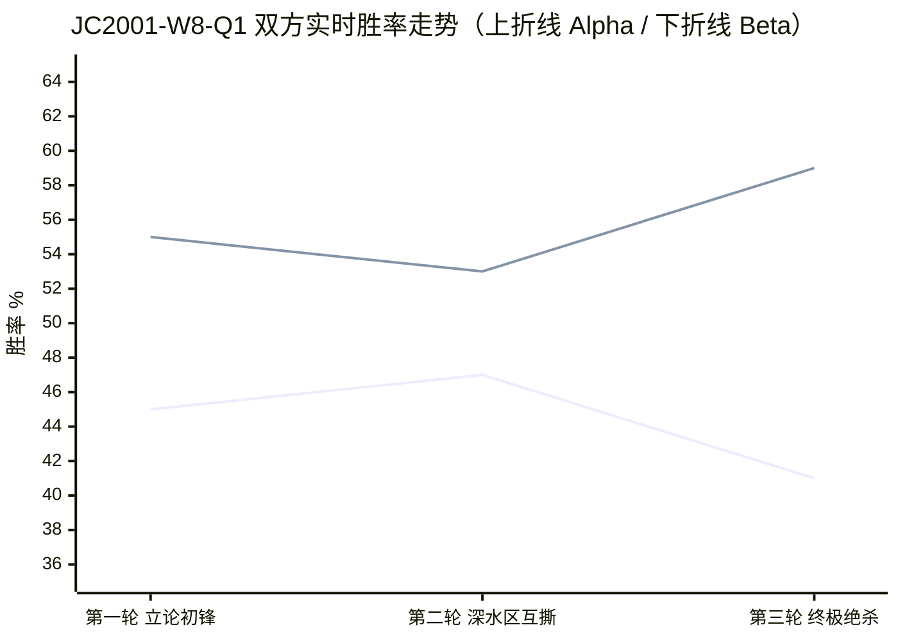

# 工作区证据对审法庭 · 终审裁决书

**案号**：JC2001-W8-Q1　**开庭日期**：2026-10-29
**议题**：`1-Scenario Based SW Testing.pdf#p1` Q1「The Banking App That Passed Every Test」——开发团队"转账功能工作正常"的结论是否成立？
**合议庭**：主审法官　**出庭**：正方 Alpha、反方 Beta

> 原题原文：A banking application allows customers to transfer between £1 and £5,000, provided they have sufficient balance. Testers tried £100, £500, and £2,000, and all tests passed. The development team concludes that the transfer feature is working correctly.
> 问：1. Do you agree with the team's conclusion? Why or why not?　2. Identify four additional test cases you would prioritise and explain what each could reveal.

---

## 一、开庭调查 · 证据底册（法官亲自勘验）

勘验方式：pdfplumber 逐页提取原文，全部引用与 PDF 实际文本逐字比对。

| 编号 | 证据文件 | 关键页 | 勘验结论 |
| :-: | :--- | :--- | :--- |
| E1 | `1-Scenario Based SW Testing.pdf` | p1 | Q1 原文属实：区间 £1–£5,000、前置条件 "sufficient balance"、实测 £100/£500/£2,000 全通过 |
| E2 | `(Week8)-JC2001-Lecture10-Software-Testing.pdf` | p5 | Validation 门槛原文 "at least one test for every requirement in the requirements document" |
| E3 | 同上 | p12 | 测试用例定义须含 "expected output… plus a statement of what is being tested" |
| E4 | 同上 | p21–p25 | 分区测试 + "a good rule of thumb is to choose test cases on the boundaries of these partitions" + "zero may behave differently" |
| E5 | 同上 | p46 | "requirements should be testable"；requirements-based testing "is validation rather than defect testing" |
| E6 | 同上 | p64 | "Testing can only show the presence of errors… cannot show that there are no remaining faults" |
| E7 | `(Week8)-JC2001-Practical10Exercise-SoftwareTestingStrategies.pdf` | p1 | 用例五要素模板：id / scenario / steps / expected / actual |
| E8 | `4-Software Testing MCQ Quiz.pdf` | p2 | Q8 标准答案取向：边界题唯一正确选项含 "17, 18, 65, 66"（界内界外各取） |

---

## 二、第一轮 · 立论初锋（对话录）

**〔Alpha〕** 团队结论在其自述需求范围内可辩护，它是一次 Validation 判断，不是"已穷尽"的声明。需求只有两条可测约束（E1）；E5 明言 requirements-based testing "is validation rather than defect testing"；E2 的及格线是 "every requirement"，**不是 every boundary**。E6 已声明穷尽不可能，故结论的合法上限是"未发现缺陷"。**我捍卫这个降级版；反方打的是"已穷尽"的加强版，那是他自己立的靶子。**

**〔Beta〕** 结论不成立，而且这批材料不足以称为"测试"。**① 只有三个数字，没有用例**——E3 要求 expected output 与被测陈述，E7 五要素一条不满足。**② 三个值全在合法区间内部**——E4 明写边界取值规则，£1/£5,000/£0.99/£5,001 一个没碰，这是同一等价类的三个内点。**③ "sufficient balance" 从未被测**——前置余额无一记录，无法证明任何一次转账进入过余额校验分支。**④ 只做 validation 没做 defect testing**。**⑤ 结论不可证伪**——E6 否定了从三次通过推出 "working correctly" 的推导。最锋利的一刀来自课程自己：E8 的 Q8，团队交的是 "20, 40, 60" 那一档。

**〔法官当庭质证〕**
Alpha 的 E5/E2 引用准确，但存在结构性隐患：他把 "every requirement" 当护盾，却没意识到团队在"余额充足"这条需求上**零举证**——这面盾随时会变成对方的刀。Beta 的 E3/E4/E8 引用全部核实无误，且第 ② 点"三个内点 ≠ 分区覆盖"是本案最干净的一击。

**📊 第一轮胜率：Alpha 45% ｜ Beta 55%**

---

## 三、第二轮 · 深水区互撕（对话录）

**〔Alpha · 补证防御〕**
①**成立**：三个数字不是 test case。②**成立**：边界一个没碰。③**成立且最重**：余额校验分支是否被执行无法证明。④**不成立，尺子错**——E4 的 p21 标题是 "Choosing unit test cases"，属 unit 段；拿 unit 级"两类用例"要求 release 级结论是层级错配。⑤**不成立**：E6 那句对任何测试集皆真，包括 Beta 自己的补测方案。
**反噬自答**：E2 的 "at least one test for every requirement" 保不住余额条款——三笔转账只是"满足"了这个前置，从未"检验"它。**此防线我撤回。**
**收口**：四条成立只等于"测试集不完备＋措辞过强＋举证不足"。Beta 由此推出"结论为假"是偷换——前者是证据学命题，后者是本体论命题。**他全篇零反例。**

**〔Beta · 深水区互撕〕**
**Alpha 的第 5 点反驳的是我没有提出的主张。** 我从未主张"未测边界就等于功能必错"。我只主张一句：`working correctly` 无范围、无判据、不可证伪。判定它不成立，不需要证明有 bug，只需证明支撑它的证据为空。Alpha 的反证法必须先替我虚构一个命题才能成立。
**引用 E5 反而对 Alpha 不利**：同页上一句是 "requirements should be testable"，而 "between £1 and £5,000" 未写明开闭，这条需求按原文不可测；验证不能在需求未澄清时宣告通过。
**引用 E2 会伤到 Alpha**：需求两条，团队对第二条零举证——这已超出"边界没测"，属于**整条需求没测**，连最低门槛都没过。Alpha 把 E2 当盾，实际交出了判决依据。
**降级版仍不接受**：降级前提是能界定等价类并留下记录，团队连等价类边界都没定义。且 p15 原文 "Development testing is primarily a defect testing process"——只走正常路径，主责尚未履行。
**第 4 点我部分接受**：并发与精度确在需求文本之外，标为待证假说合理，我不据此判负。但 "working correctly" 零限定词，是团队自己把断言扩展成了全称断言。

**〔法官当庭质证〕**
本轮出现四个必须记录的判点：

1. **Alpha 的 p21 层级反驳成立，本席予以采信。** 经核验，p21 确实标题为 "Choosing unit test cases"，位于 p15–p21 单元测试段。Beta 用 unit 级"两类用例"要求 release 级 requirements-based 结论，属**层级错配**，此处扣 Beta 抗辩有效性分。
2. **Alpha 的第 5 点构成稻草人，本席予以驳回。** Beta 从未主张"功能必错"，Alpha 虚构了一个对方未持有的命题再加以击破，属逻辑谬误。
3. **Alpha 主动撤回 E2 防线，是本案的诚实加分，也是本案的转折点。** 一位辩手当庭撤下自己的主盾，说明其已意识到该盾是反向证据。
4. **Beta 主动接受第 4 点（并发/精度属需求外），同样是诚实加分**——它换来了对其余论点的更高采信度。

**📊 第二轮胜率：Alpha 47% ｜ Beta 53%**

---

## 四、第三轮 · 终极绝杀（对话录）

**〔Alpha〕** **立场**：结论须降级为"金额维度未发现缺陷、余额维度零覆盖"，这是我方最后阵地。
**最狠一击**：Beta 四条成立只完成半个举证责任——证明团队没做够，未证明功能做错了。而 E6 那句若能否定团队，就同样能否定他自己的补测方案：**他赢的那一刻，药方一起作废。**

**〔Beta〕** **立场不变：结论不成立，而且不是"不完备"，是"空断言"。** 团队举不出"余额充足"这条需求的一次合格测试，E2 的 "at least one test for every requirement" 当场失效；E6 又排除了从三次通过推出 "working correctly" 的推导。**补测之前，这句话没有资格进报告。**

**〔法官当庭质证〕**
Alpha 的绝杀是**诉诸后果（tu quoque）**：E6 否定的是"全称断言"，而 Beta 的补测方案是**有界命题**，两者不同层次，药方不会随之作废。此击落空。
更致命的是：Alpha 的最终阵地（"金额维度未发现缺陷、余额维度零覆盖"）**已经不是本案的命题**。原命题是 "the transfer feature is working correctly"——无范围、无维度限定。**当一方在终局放弃了原命题的表述形式，胜负已分。**
Beta 的"空断言"一词本席予以部分修正：三次通过**并非字面意义的空**，它确实证明了金额维度内的正常路径可走通。准确表述应为「**半条需求有弱证据，一条需求零证据，全部边界零证据**」。但这一措辞瑕疵不改变结论方向。

**📊 第三轮胜率：Alpha 41% ｜ Beta 59%**

---

## 五、胜率实时走势图

**走势解读**：Alpha 在第二轮凭借"p21 层级错配"这一真实命中与当庭撤回防线的诚实姿态，短暂回升 2 个百分点；但第三轮以稻草人＋诉诸后果收场，并实质性放弃原命题表述，回落至 41%。Beta 全程平稳上行，未出现捏造引用或误引页码。

---

## 六、终审法官判词

### 胜负结果

**反方 Beta 胜（41% : 59%）。开发团队"转账功能工作正常"的结论，本席裁定：不成立。**

但本席必须把胜诉的**边界**划清楚，这不是和稀泥，而是判决主文的必要限定：

- **Beta 赢的是"结论不可采信"，不是"功能存在缺陷"。** Beta 全篇未举出任何一条失败记录（无 £5,000 转账失败、无透支被放行、无双花实证）。Alpha 关于"零反例"的指控成立，本席予以采信。因此本案的判决是**举证责任未履行**，不是**功能已被证伪**。
- **Alpha 赢的是两个战术点，本席予以确认**：其一，p21 层级错配的反驳正确；其二，"结论为假"与"结论未获充分支持"的区分是本案最精准的逻辑贡献。Alpha 之所以仍败诉，是因为他在终局放弃了原命题，改守一个对方本就无意攻击的降级版——**辩论的胜负由命题决定，不由辩手的真诚度决定**。

### 致命胜负手（唯一一条，其余皆为枝叶）

> **`(Week8)-JC2001-Lecture10-Software-Testing.pdf#p5` —— "at least one test for every requirement in the requirements document"，配合 `#p12` 的测试用例定义。**

需求共两条：① 金额区间 [£1, £5,000]；② "provided they have sufficient balance"。团队对第 ① 条给了三个内点，对第 ② 条**一次合格测试都没有**——没有前置余额、没有预期结果、没有被测对象陈述。**这不是"边界没测"的量刑问题，是"整条需求零覆盖"的定性问题。** 一条需求零覆盖，直接击穿 p5 的最低门槛，团队连"及格线"都没到，遑论 "working correctly"。

**次要胜负手**：`#p24` 的边界取值规则 vs. 团队三个内点；`4-Software Testing MCQ Quiz.pdf#p2` Q8——课程自己出的标准答案就是"界内界外各取一"，团队交的是最差那一档。**用课程自己的答案打课程作业，Beta 这一手无可辩驳。**

### 给主人的真实改进建议（无客套）

#### 一、这道题在考场上该怎么答（直接可交的答案）

**Q1-1：是否同意团队结论？——不同意。** 理由三句话：三个用例全部落在合法区间的**内部**，等价类划分与边界值一个未取（Lecture10 p24–p25）；"sufficient balance" 这条需求**零测试**，违反 p5 的 "every requirement" 门槛；从"三次通过"推出 "working correctly" 违反 p64 的认识论上限。**结论最多只能写成"在 £100/£500/£2,000 三个正常场景下未发现缺陷"。**

**Q1-2：四条优先补测用例（按杀伤力排序，可直接抄）**

| 优先级 | 用例 | 前置状态 | 预期结果 | 能揭示什么 |
| :-: | :--- | :--- | :--- | :--- |
| **P0** | 转账 £500 | 余额 £499.99 | 拒绝，余额不变，明确错误码 | **"sufficient" 判成 `>` 还是 `>=` 的差一错误**；余额校验分支是否存在 |
| **P0** | 转账 £5,000 | 余额 £6,000 | 成功，余额 £1,000 | 上界含端点；区间是否被误写成开区间 |
| **P1** | 转账 £5,000.01 | 余额 £6,000 | 拒绝，余额不变 | 越界放行、金额溢出、上界判定反向 |
| **P1** | 转账 £0.99 / £1.00 | 余额 £1,000 | £0.99 拒绝、£1.00 成功 | 下界开闭语义（需求原文 "between" 未声明，正是歧义点） |

**进阶四条（若答"再补"）**：£0.00 转账（p25 "zero may behave differently"）、−£100（符号校验）、同一请求 ID 重发两次（幂等/双扣）、两笔并发 £600 抢同一 £1,000 余额（**同份材料 Q2 的"两人同订最后一间房"就是同构反例**）。

#### 二、这道题真正的得分点在哪（阅卷人视角）

不要写成"应该多测几个值"。**要写成"需求有两条、证据有零条"的结构性指控**——把"余额充足"这条被全班忽略的需求单独拎出来，是这道题唯一的满分动作。绝大多数同学会只答边界值，那是 60 分的答案。

#### 三、反向提醒：别把 Beta 的话全信

Beta 的"空断言"措辞过强。三次通过确实证明了正常路径可走通，正确的学术表述是「**证据不足以支撑全称断言**」，而不是「**断言为空**」。写进作业时用前者，否则会被追问"那你凭什么说它连正常路径都没验证"。

---

**本席签名：主审法官 · 工作区证据对审法庭**
**勘验方式**：pdfplumber 逐页提取原文，全部引用与 PDF 实际文本逐字比对
