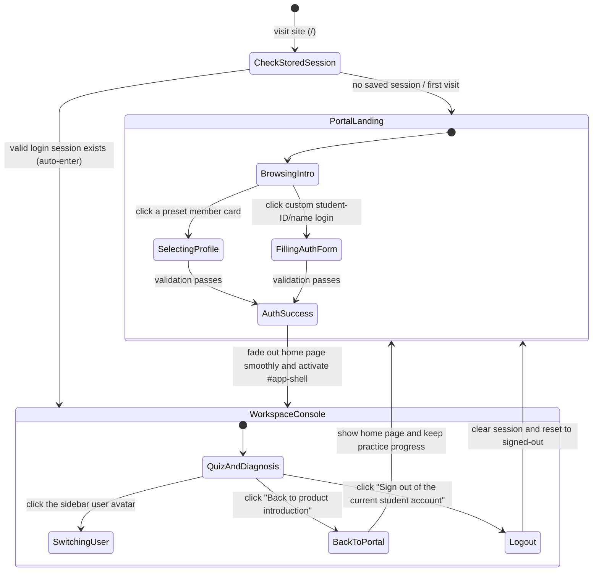

# Technical Research and Architecture Decision Report (Phase 0: Research)

**Feature ID**: `001-landing-and-auth-portal`  
**Related Specification**: `specs/001-landing-and-auth-portal/spec.md`  
**Completed**: 2026-10-08  

---

## 1. Research Background and Technical Selection Questions

To solve the problem that "going straight from the home page into the cold, dense Eval Harness makes the experience abrupt", and to respond to the user requirement "make a login or introduction page and then enter the interface I normally use", the team conducted dedicated research on system architecture, the state-machine model, and interaction design.

---

## 2. Core Architecture Decisions (Decisions, Rationale & Alternatives)

### Decision 1: Page hosting architecture — single-page dual-container switching (SPA Dual-Container) vs multiple physical pages (MPA)
- **Technical choice**: adopt the **SPA dual-container view switching architecture** (`#portal-landing` and `#app-shell` coexist in `frontend/index.html`).
- **Rationale**:
  1. **No white flash and instant response**: static resources (JetBrains Mono, SVG icons, ECharts engine) only need to load once on first entry; entering/leaving the workspace is a refresh-free transition taking < 150ms.
  2. **State preservation and smooth back-navigation**: when the user is on question 2 in the workspace, clicks "Back to introduction" to review the project background, and then clicks "Continue learning" to return, no question re-request is needed; the original practice state and drawer are fully preserved.
  3. **Zero breakage of the backend contract**: the FastAPI backend still only needs to mount the static directory `app.mount("/", StaticFiles(directory=FRONTEND_DIR, html=True), name="frontend")`, with no new or modified backend page route mapping.
- **Alternatives considered**:
  - *Option B (split into landing.html + app.html)*: requires maintaining two HTML skeletons and duplicated CSS variables, page navigation has a noticeable white-flash flicker, and passing practice state across pages would rely on complex Session Storage event listeners; therefore rejected.

---

### Decision 2: Student profile and identity authentication strategy — local student-record persistence + lightweight FastAPI simulation
- **Technical choice**: adopt **client-side intelligent persistent storage (`localStorage`) + a preset role matrix + an optional backend session contract**.
- **Rationale**:
  1. **Within the JC2001 undergraduate teaching and defence-demo boundary**: avoids introducing a heavy PostgreSQL/OAuth authentication database early in Phase 2, guaranteeing 100% demonstrability and zero failures in any offline, disconnected, or sandboxed environment.
  2. **Supports quick evaluation and one-click switching during the defence**: preset student cards for the University of Aberdeen Group 5 core members (Yuxuan Wu 50106070, Yongtong Lin 50106038, etc.), so the defence demo needs no manual entry of complex passwords - one click loads the dedicated role.
- **Alternatives considered**:
  - *Option B (JWT + SQLite centralised authentication)*: over-engineering at the early stage of Phase 2; likely to increase deployment failure rates for the dependency environment, and inconsistent with the "high-quality lightweight undergraduate engineering" principle.

---

### Decision 3: Visual style and design language — adaptive academic-tech dual mode (Adaptive Academic Tech)
- **Technical choice**: based on the existing CSS variables such as `--bg-main`, `--card-bg`, `--primary-500`, `--text-main`, build a responsive card grid that combines **Aberdeen Blue (`#1e3a8a`/`#3b82f6`)** with the **DeepSeek dark geek style**.
- **Rationale**:
  1. Guarantees high visual-gene consistency with the user's "everyday interface", avoiding the jarring split of "home page looks like e-commerce, backend looks like a terminal".
  2. Provides high-quality subtle-gradient backdrop blur and card hover animations to improve the first impression during review.
- **Alternatives considered**:
  - *Option B (introduce Bootstrap/Tailwind CDN)*: an external CSS framework would pollute the original native styles and cause class-name conflicts, so native CSS-variable extension is used throughout.

---

## 3. State Transition Matrix and Lifecycle (State Machine)

---

## 4. Key Unknowns and Clarification Resolutions

| Unknown / Clarification Point | Final Decision | Impact and Constraints |
| :--- | :--- | :--- |
| **Q1: Which page does the user see on first open?** | Show the **product introduction and login portal (Portal)** by default, so tutors and new users can understand the whole picture; if "remember me and enter the workspace directly next time" is checked or a persisted identity already exists, provide an obvious shortcut entry. | The home page must retain a prominent "Enter the system now" primary call-to-action button (CTA). |
| **Q2: Are the original 4 tabs and practice data affected?** | **Completely unaffected**. The existing `#view-quiz`, `#view-tutor`, `#view-graph`, `#view-report` are all preserved intact inside `#app-shell`. | Guarantees that all existing 114 pytest tests and E2E tests pass smoothly. |
| **Q3: Mobile/small-screen adaptation requirements?** | The portal uses CSS Grid / Flex responsive breakpoints (`@media (max-width: 768px)`); on small screens the cards adapt to a single-column waterfall layout. | Guarantees a good experience when viewed on phones or tablets. |
