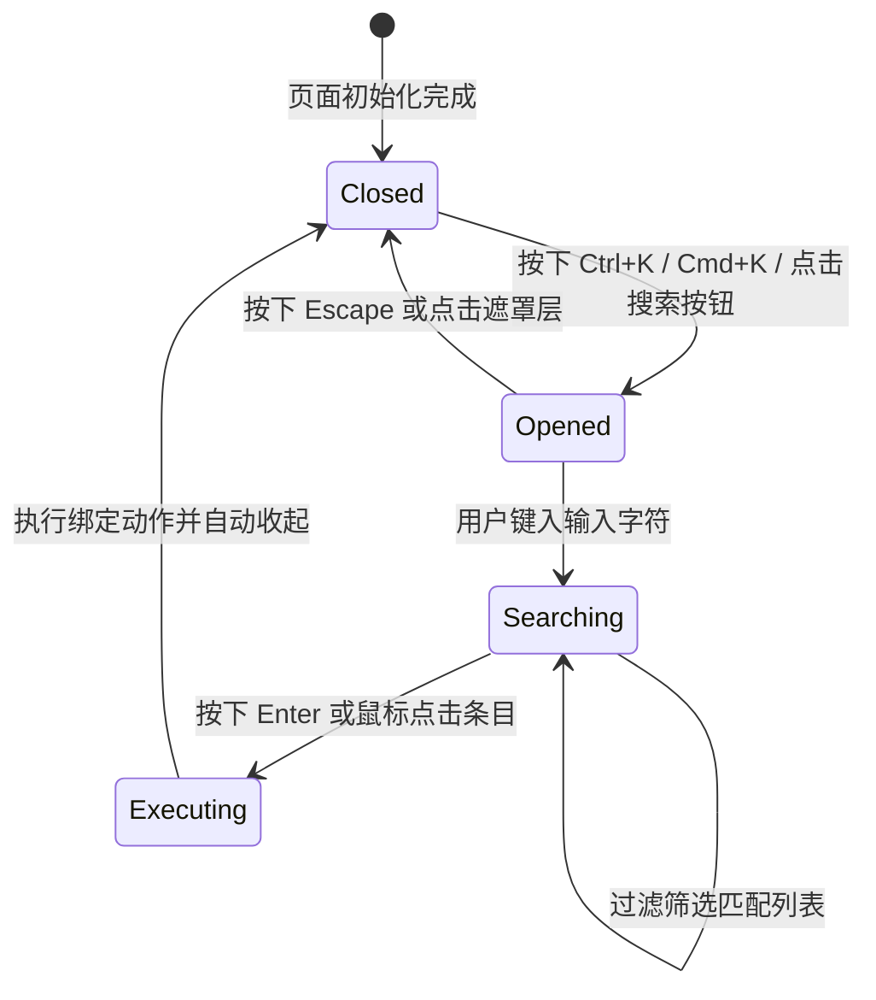
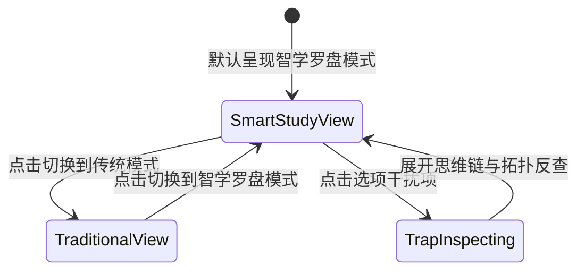

# 数据模型与实体规约：前端视觉巅峰重构 (Data Models & State Entities)

**功能编号**：`002-frontend-visual-overhaul`  
**所属项目**：JC2001 Group 5 — 智学罗盘 (SmartStudy Assistant System)  
**日期**：2026-10-10  
**状态**：APPROVED  

---

## 1. 核心实体模型 (Entity Definitions)

### 1.1 全局 HUD 指令条目 (`CommandPaletteItem`)
定义键盘快捷指令菜单中的每一个可执行操作：

```typescript
interface CommandPaletteItem {
  id: string;               // 唯一指令标识符，如 "nav_quiz", "disc_law"
  title: string;            // 指令主标题，如 "切换至民商法题库"
  subtitle?: string;        // 辅助说明，如 "民法典第152条与物权编"
  category: "navigation" | "discipline" | "action" | "identity"; // 类别分组
  keywords: string[];       // 搜索模糊匹配关键词列表
  icon: string;             // SVG 图标或 Emoji
  shortcut?: string;        // 提示快捷键，如 "Alt+1" 或 "Ctrl+D"
  action: () => void;       // 点击或回车时触发的回调操作
}
```

### 1.2 交互对比沙盒实体 (`ComparisonCase`)
定义门户交互式分屏对比演播台中的对比例题与响应数据：

```typescript
interface ComparisonCase {
  id: string;
  discipline: string;       // 学科分类，如 "民商法学"
  questionStem: string;     // 题干内容
  selectedOption: {
    key: "A" | "B" | "C" | "D";
    text: string;
    isCorrect: boolean;
  };
  traditionalFeedback: {
    statusBadge: "WRONG";   // 传统冷冰冰的判定
    directAnswer: string;   // 直接倾倒的答案
    drawbackNote: string;   // 暴露的痛点说明（剥夺自主思考、不查先修）
  };
  smartStudyFeedback: {
    statusBadge: "TRAP_TRIGGERED"; // 陷阱命中警报
    trapTitle: string;             // 陷阱名称
    misconceptionAnalysis: string; // 根因剖析
    prereqDeficiency: string;      // 先修知识薄弱点
    radarImpact: {
      dimension: string;          // 如 "trapDefense"
      scoreChange: number;        // 如 -5
    };
    reasoningTrace: ReasoningStep[]; // 4步思考过程
    socraticNudge: string;         // 苏格拉底反问
  };
}
```

### 1.3 深度思维链推理节点 (`ReasoningStep`)
仿 DeepSeek-R1 风格的思考过程节点：

```typescript
interface ReasoningStep {
  stepIndex: number;        // 步骤序号 (1-4)
  stepName: string;         // 步骤名称，如 "GraphRAG 考点拓扑召回"
  status: "completed" | "processing";
  detail: string;           // 具体的思考依据与反查节点
  badge: string;            // 如 "NEO4J_MATCH" 或 "ANTI_SPOILER"
}
```

### 1.4 学情防守战力勋章模型 (`RadarBadgeTier`)
五维雷达诊断与防守评级勋章模型：

```typescript
interface RadarBadgeTier {
  scoreRange: [number, number]; // 分数区间，如 [85, 100]
  rankTier: "S" | "A" | "B" | "C";
  title: string;                // "先锋破壁者" / "稳健精通者"
  color: string;                // 渐变主强调色 Token
  glowShadow: string;           // 对应的发光阴影 Token
  description: string;          // 评语与下一阶段突破建议
}
```

### 1.5 遥测指标卡片模型 (`TelemetryMetric`)
门户与侧边栏常驻的学术科技指标：

```typescript
interface TelemetryMetric {
  key: string;              // 如 "nodesCount", "trapsDefended", "radarScore"
  label: string;            // 显示标签
  value: string | number;   // 当前数值
  unit?: string;            // 单位，如 "个", "%"
  trend?: string;           // 趋势，如 "+12% vs 传统模式"
  colorVariant: "primary" | "emerald" | "amber" | "rose";
}
```

---

## 2. 状态机与生命周期 (State Machines)

### 2.1 全局 HUD 指令弹窗状态机 (`CommandPaletteState`)



### 2.2 对比沙盒即时切换状态机 (`SandboxState`)


