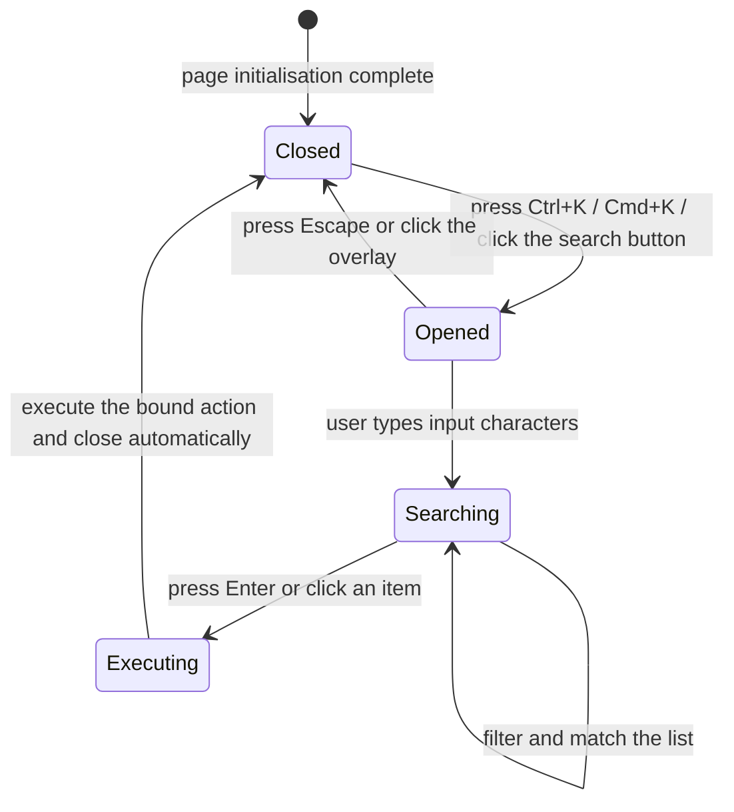
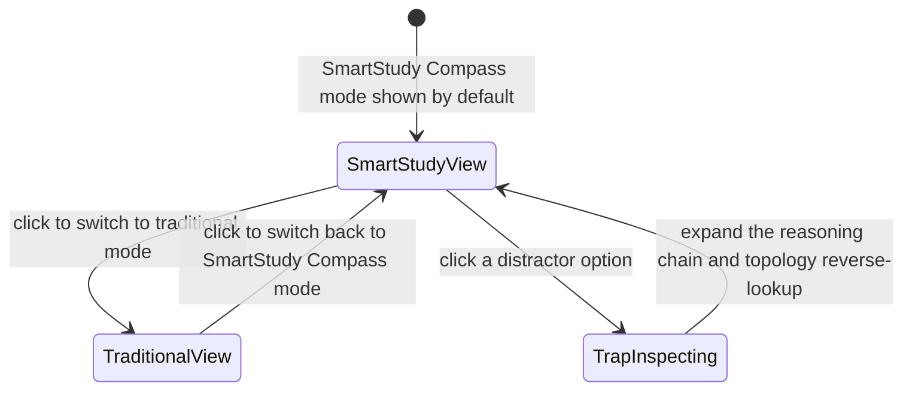

# Data Models and State Entities: Frontend Visual Overhaul (Data Models & State Entities)

**Feature ID**: `002-frontend-visual-overhaul`  
**Project**: JC2001 Group 5 — SmartStudy Compass (SmartStudy Assistant System)  
**Date**: 2026-10-10  
**Status**: APPROVED  

---

## 1. Core Entity Definitions

### 1.1 Global HUD Command Item (`CommandPaletteItem`)
Defines each executable action in the keyboard command menu:

```typescript
interface CommandPaletteItem {
  id: string;               // Unique command identifier, e.g. "nav_quiz", "disc_law"
  title: string;            // Command main title, e.g. "Switch to Civil & Commercial Law question bank"
  subtitle?: string;        // Supporting description, e.g. "Civil Code Article 152 and the Property Rights volume"
  category: "navigation" | "discipline" | "action" | "identity"; // Category grouping
  keywords: string[];       // Fuzzy-search matching keyword list
  icon: string;             // SVG icon or emoji
  shortcut?: string;        // Suggested shortcut, e.g. "Alt+1" or "Ctrl+D"
  action: () => void;       // Callback triggered on click or Enter
}
```

### 1.2 Interactive Comparison Sandbox Entity (`ComparisonCase`)
Defines the comparison questions and response data in the portal's interactive split-screen showcase:

```typescript
interface ComparisonCase {
  id: string;
  discipline: string;       // Subject category, e.g. "Civil & Commercial Law"
  questionStem: string;     // Question stem content
  selectedOption: {
    key: "A" | "B" | "C" | "D";
    text: string;
    isCorrect: boolean;
  };
  traditionalFeedback: {
    statusBadge: "WRONG";   // Traditional cold judgement
    directAnswer: string;   // Answer dumped directly
    drawbackNote: string;   // Exposed pain point (deprives independent thought, no prerequisite lookup)
  };
  smartStudyFeedback: {
    statusBadge: "TRAP_TRIGGERED"; // Trap-hit warning
    trapTitle: string;             // Trap name
    misconceptionAnalysis: string; // Root-cause analysis
    prereqDeficiency: string;      // Weak prerequisite knowledge point
    radarImpact: {
      dimension: string;          // e.g. "trapDefense"
      scoreChange: number;        // e.g. -5
    };
    reasoningTrace: ReasoningStep[]; // 4-step thinking process
    socraticNudge: string;         // Socratic follow-up question
  };
}
```

### 1.3 Deep Thinking-Chain Reasoning Node (`ReasoningStep`)
A thinking-process node modelled on the DeepSeek-R1 style:

```typescript
interface ReasoningStep {
  stepIndex: number;        // Step number (1-4)
  stepName: string;         // Step name, e.g. "GraphRAG exam-point topology recall"
  status: "completed" | "processing";
  detail: string;           // Specific reasoning evidence and reverse-looked-up nodes
  badge: string;            // e.g. "NEO4J_MATCH" or "ANTI_SPOILER"
}
```

### 1.4 Learning Defence Badge Tier Model (`RadarBadgeTier`)
Five-dimension radar diagnosis and defence rating badge model:

```typescript
interface RadarBadgeTier {
  scoreRange: [number, number]; // Score range, e.g. [85, 100]
  rankTier: "S" | "A" | "B" | "C";
  title: string;                // "Pioneer Breakthrough Scholar" / "Steady Mastery Scholar"
  color: string;                // Gradient primary accent colour token
  glowShadow: string;           // Corresponding glowing shadow token
  description: string;          // Assessment and next-stage breakthrough advice
}
```

### 1.5 Telemetry Metric Card Model (`TelemetryMetric`)
Academic-tech metrics permanently shown on the portal and sidebar:

```typescript
interface TelemetryMetric {
  key: string;              // e.g. "nodesCount", "trapsDefended", "radarScore"
  label: string;            // Display label
  value: string | number;   // Current value
  unit?: string;            // Unit, e.g. "items", "%"
  trend?: string;           // Trend, e.g. "+12% vs traditional mode"
  colorVariant: "primary" | "emerald" | "amber" | "rose";
}
```

---

## 2. State Machines and Lifecycles

### 2.1 Global HUD Command Palette State Machine (`CommandPaletteState`)



### 2.2 Comparison Sandbox Instant-Switch State Machine (`SandboxState`)


