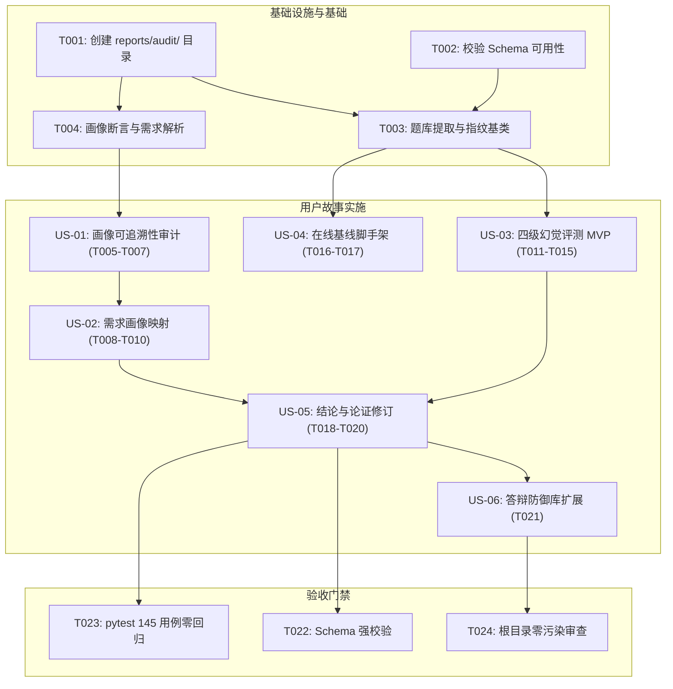

# 任务清单：基于用户画像的系统设计合理性审视与「幻觉降低」主张实证审计

**功能编号**：`004-persona-hallucination-audit` | **分支**：`004-persona-hallucination-audit`  
**输入**：来自 `specs/004-persona-hallucination-audit/` 的设计文档  
**先决条件**：[plan.md](plan.md)（必需），[spec.md](spec.md)（用户故事必需），[research.md](research.md)，[data-model.md](data-model.md)，[contracts/](contracts/)  

---

## 阶段 1：设置（共享基础设施）

**目的**：初始化审计产物空间与校验基准环境

- [ ] T001 创建审计专用数据产物目录 `reports/audit/`
- [ ] T002 [P] 校验 JSON Schema 校验环境与 `specs/004-persona-hallucination-audit/contracts/audit-result.schema.json` 模式可用性

---

## 阶段 2：基础（阻塞先决条件）

**目的**：提供所有用户故事脚本共享的基础数据加载与环境指纹功能

**⚠️ 关键**：在本阶段完成之前，用户故事审计脚本无法开始执行

- [ ] T003 在 `scripts/audit_hallucination_l1_l3.py` 中实现题库数据（12 题/48 选项/36 陷阱）提取与环境指纹生成基类
- [ ] T004 [P] 在 `scripts/audit_persona_claims.py` 中实现画像断言与 MoSCoW 14 条需求文本的解析工具函数

**检查点**：共享加载器与环境指纹就绪，用户故事实现可并行开始

---

## 阶段 3：用户故事 1 - 画像可追溯性审计 (US-01, 优先级: P0)

**目标**：逐条审计 Table 1.3 的 Persona 断言来源，建立 E0–E3 证据分级台账，识别核心假设

**独立测试**：运行 `python scripts/audit_persona_claims.py`，成功生成 `reports/audit/persona_provenance.csv`，覆盖 A/B/C 三张画像且 `evidence_level` 与 `source_type` 逻辑自洽（E0 严格对应无来源）

- [ ] T005 [P] [US1] 在 `scripts/audit_persona_claims.py` 中实现画像断言结构化抽取与四类来源（文献/竞品行为/组内讨论/无来源）分类器
- [ ] T006 [US1] 在 `scripts/audit_persona_claims.py` 中实现 E0–E3 证据等级计算及 `allowed_usage` 限制规则映射
- [ ] T007 [US1] 执行画像溯源审计并将结果导出至 `reports/audit/persona_provenance.csv`

**检查点**：此时用户画像证据等级已全部锁定，核心痛点是否依赖假设一目了然

---

## 阶段 4：用户故事 2 - 设计—画像映射与循环论证检测 (US-02, 优先级: P0)

**目标**：建立 14 条 MoSCoW 需求与 Persona 的双向映射，识别反向缺口，将循环论证重写为外部可证伪命题

**独立测试**：检查导出的 `reports/audit/requirement_persona_map.csv`，共 14 行且包含 `assumption_driven` 标志；R10 等自嗨需求被显式标记，循环论证行附带非空的 `external_falsifiable_claim`

- [ ] T008 [P] [US2] 在 `scripts/audit_persona_claims.py` 中实现 Ch2 14 条需求（R01–R14）到 PersonaClaim 的双向映射逻辑
- [ ] T009 [US2] 在 `scripts/audit_persona_claims.py` 中实现反向缺口检测（有功能无画像 / 有画像无功能）与循环自证识别算法
- [ ] T010 [US2] 执行映射分析并在 `reports/audit/requirement_persona_map.csv` 中注入 D1–D4 维度的外部可证伪命题

**检查点**：设计合理性论证脱离了画像自循环假设，转化为可独立检验的外部命题

---

## 阶段 5：用户故事 3 - 四级幻觉评测框架 (US-03, 优先级: P0) 🎯 MVP

**目标**：离线、确定性地完成 L1 内容、L2 归因、L3 泄漏评测，输出完整的结构化指标与确定性哈希

**独立测试**：执行 `python scripts/audit_hallucination_l1_l3.py`，产出 3 个 CSV 和 `verdict.json`；行数精确为 84 / 36 / 12；连续执行两次其 `determinism_check.identical` 为 True

- [ ] T011 [P] [US3] 在 `scripts/audit_hallucination_l1_l3.py` 中实现 48 选项与 36 陷阱事实性判定的 L1 内容审计器
- [ ] T012 [P] [US3] 在 `scripts/audit_hallucination_l1_l3.py` 中实现 36 陷阱命名区分度与误区映射一致性的 L2 归因审计器
- [ ] T013 [P] [US3] 在 `scripts/audit_hallucination_l1_l3.py` 中实现正确选项实体在引导语中提前泄漏（Answer Spoiling）的 L3 正则审计器
- [ ] T014 [US3] 在 `scripts/audit_hallucination_l1_l3.py` 中实现离线模式（L4 记为 N/A、无生成面）指标汇聚与双次运行确定性哈希校验逻辑
- [ ] T015 [US3] 运行脚本生成 `reports/audit/l1_content_audit.csv`、`reports/audit/l2_attribution_audit.csv`、`reports/audit/l3_leakage_audit.csv` 及 `reports/audit/verdict.json`

**检查点**：MVP 核心成立，L1–L3 具备精确可查验的分母分子，离线路径生成面被正式测量

---

## 阶段 6：用户故事 4 - 在线 LLM 路径的幻觉对照实验脚手架 (US-04, 优先级: P1)

**目标**：提供 A/B/C 三组对照评测实验框架，支持无 Key 优雅跳过并计算 Wilson 得分区间

**独立测试**：在未配置 API Key 环境下运行 `python scripts/audit_online_baseline.py`，返回码为 0 并生成 `reports/audit/online_baseline.skipped.json`；配置 Key 时产出有效对照统计与置信区间

- [ ] T016 [P] [US4] 在 `scripts/audit_online_baseline.py` 中实现检测不到 `QWEN_API_KEY` 时的优雅跳过机制与状态记录器
- [ ] T017 [US4] 在 `scripts/audit_online_baseline.py` 中实现 A/B/C 三组 prompt 采样调用、评分一致性（Cohen's κ）与 Wilson 95% 置信区间计算逻辑

**检查点**：在线对比实验脚手架就绪，完全满足无 Key 运行约束与小样本统计规范

---

## 阶段 7：用户故事 5 - 结论与论证修订 (US-05, 优先级: P0)

**目标**：汇聚实测数据锁定结论等级（V1），生成针对报告各章节的句子级改写对照清单并排查禁用词

**独立测试**：检查 `specs/004-persona-hallucination-audit/contracts/report-claim-contract.md` 包含 Ch1、Ch2、Ch6 的直接改写段落；禁用词扫描器返回 0 个违规项

- [ ] T018 [P] [US5] 依据审计实测在 `reports/audit/verdict.json` 中判定并固化系统结论等级为 V1（离线消除生成面）
- [ ] T019 [US5] 编制跨章节（Ch1 痛点、Ch2 需求、Ch6 评估）的改写对照表至 `specs/004-persona-hallucination-audit/contracts/report-claim-contract.md`
- [ ] T020 [US5] 在 `scripts/audit_hallucination_l1_l3.py` 中集成针对 master plan 禁用词表的文本扫描器并执行校验

**检查点**：报告的因果主张与学术防身表述完成句子级锁定，消除不可证吹嘘

---

## 阶段 8：用户故事 6 - 答辩防御弹药扩展 (US-06, 优先级: P2)

**目标**：为答辩人提供 5 个针对画像真实性与防幻觉能力的 30 秒诚实应答模板

**独立测试**：检查 `reports/supervisor_qa_defense_library.md` 包含 5 个指定审计 Q&A，各含实测具体数字与局限性自承

- [ ] T021 [P] [US6] 编写 5 个画像假设与幻觉主张的 30 秒答辩应答话术至 `reports/supervisor_qa_defense_library.md`

**检查点**：答辩防御库就绪，团队面对导师关于“画像真假”和“是否降低幻觉”的质询具备从容应对能力

---

## 阶段 9：完善与跨领域关注点 (Polish & Cross-Cutting)

**目的**：全系统质量门禁复核与空间纪律审计

- [ ] T022 使用 `specs/004-persona-hallucination-audit/contracts/audit-result.schema.json` 对 `reports/audit/verdict.json` 进行全模式强校验
- [ ] T023 运行 `python -m pytest tests/ -q`，确认现有 145 个自动化测试用例保持 100% 通过（零回归门禁）
- [ ] T024 审查仓库根目录与工作区，清理任何多余临时碎屑，确保严格符合零根目录污染守则

---

## 依赖关系与用户故事执行顺序

---

## 并行执行机会

1. **设置与基础阶段**：`T002` 与 `T001`、`T004` 与 `T003` 可并行实现。
2. **用户故事阶段**：
   - `US-01`（画像分析，负责文档）与 `US-03`（四级幻觉，负责代码）完全解耦，可由不同人员并行推进；
   - `T011`（L1）、`T012`（L2）、`T013`（L3）评测器可并行编写；
   - `US-04`（在线实验脚手架）可与 `US-03` 并行开发。
3. **收尾阶段**：`T021`（答辩文案）与 `T022`（模式校验）可完全并行进行。

---

## 实现策略（MVP 优先）

- **MVP 范围**：锁定 **US-03（四级幻觉评测装置，T011–T015）** + **US-01（画像溯源，T005–T007）**。完成这两部分即可获得第一手真实数据，回答用户最迫切的核心疑问（“到底有没有降低 AI 幻觉”）。
- **增量交付路线**：
  1. **增量 1 (MVP)**：完成离线 L1–L3 运行，拿到 84/36/12 分母，得出 V1 等级结论。
  2. **增量 2**：完成画像需求映射与循环论证解耦（US-02），重写可证伪命题。
  3. **增量 3**：在线对照实验可跳过脚手架就位（US-04），输出确定性 skip 记录。
  4. **增量 4**：改写报告关键结论与答辩防身库（US-05, US-06），通过 145 个测试全绿门禁。
