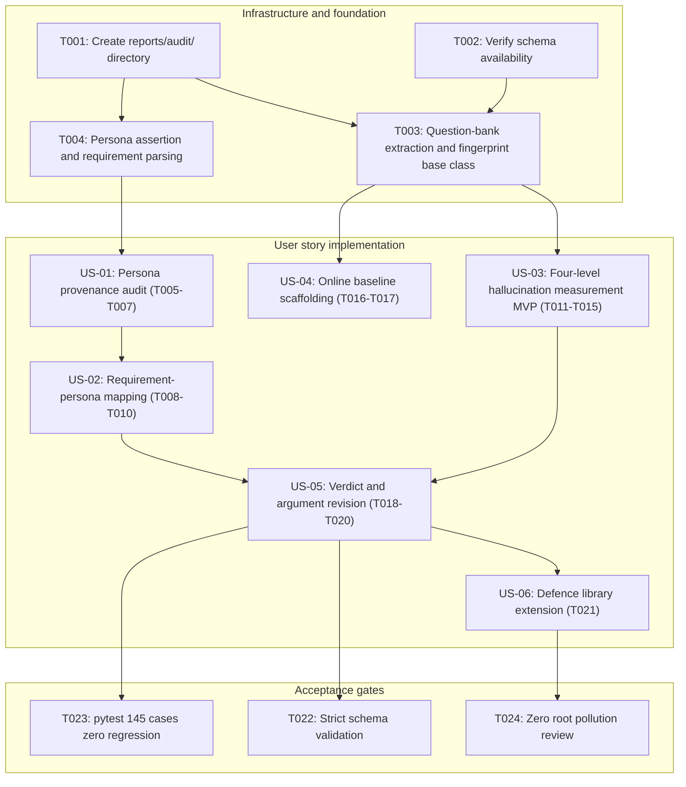

# Task List: User-Persona-Based Review of System Design Rationality and Empirical Audit of the "Hallucination Reduction" Claim

**Feature ID**: `004-persona-hallucination-audit` | **Branch**: `004-persona-hallucination-audit`  
**Input**: design documents from `specs/004-persona-hallucination-audit/`  
**Prerequisites**: [plan.md](plan.md) (required), [spec.md](spec.md) (required for user stories), [research.md](research.md), [data-model.md](data-model.md), [contracts/](contracts/)  

---

## Phase 1: Setup (shared infrastructure)

**Purpose**: initialise the audit output space and the validation baseline environment

- [ ] T001 Create the audit-specific data output directory `reports/audit/`
- [ ] T002 [P] Verify the JSON Schema validation environment and the availability of the `specs/004-persona-hallucination-audit/contracts/audit-result.schema.json` schema

---

## Phase 2: Foundation (blocking prerequisites)

**Purpose**: provide the base data-loading and environment-fingerprint functionality shared by all user-story scripts

**⚠️ Critical**: no user-story audit script can start before this phase is complete

- [ ] T003 Implement, in `scripts/audit_hallucination_l1_l3.py`, the base class for extracting question-bank data (12 questions / 48 options / 36 traps) and generating the environment fingerprint
- [ ] T004 [P] Implement, in `scripts/audit_persona_claims.py`, utility functions for parsing persona assertions and the text of the 14 MoSCoW requirements

**Checkpoint**: shared loader and environment fingerprint ready; user-story implementation may start in parallel

---

## Phase 3: User Story 1 - Persona Provenance Audit (US-01, priority: P0)

**Goal**: audit the provenance of each Table 1.3 persona assertion item by item, build the E0–E3 evidence-level ledger, and identify core assumptions

**Independent test**: run `python scripts/audit_persona_claims.py`; it successfully generates `reports/audit/persona_provenance.csv`, covering personas A/B/C, with `evidence_level` and `source_type` logically consistent (E0 strictly corresponds to no source)

- [ ] T005 [P] [US1] In `scripts/audit_persona_claims.py`, implement structured extraction of persona assertions and a classifier for the four source classes (literature / competitor behaviour / team discussion / no source)
- [ ] T006 [US1] In `scripts/audit_persona_claims.py`, implement E0–E3 evidence-level computation and the mapping of `allowed_usage` restriction rules
- [ ] T007 [US1] Run the persona provenance audit and export the results to `reports/audit/persona_provenance.csv`

**Checkpoint**: persona evidence levels are now fully locked; whether core pain points depend on assumptions is obvious at a glance

---

## Phase 4: User Story 2 - Design-Persona Mapping and Circular-Argument Detection (US-02, priority: P0)

**Goal**: build the bidirectional mapping between the 14 MoSCoW requirements and personas, identify reverse gaps, and rewrite circular arguments as external falsifiable propositions

**Independent test**: inspect the exported `reports/audit/requirement_persona_map.csv`; it has exactly 14 rows and includes the `assumption_driven` flag; self-serving requirements such as R10 are explicitly marked, and circular-argument rows carry a non-empty `external_falsifiable_claim`

- [ ] T008 [P] [US2] In `scripts/audit_persona_claims.py`, implement the bidirectional mapping logic from Ch2's 14 requirements (R01–R14) to `PersonaClaim`
- [ ] T009 [US2] In `scripts/audit_persona_claims.py`, implement reverse-gap detection (functionality without persona / persona without functionality) and the circular self-justification identification algorithm
- [ ] T010 [US2] Run the mapping analysis and inject the D1–D4 external falsifiable propositions into `reports/audit/requirement_persona_map.csv`

**Checkpoint**: the design-rationality argument has escaped the persona's self-referential assumption and been converted into independently testable external propositions

---

## Phase 5: User Story 3 - Four-Level Hallucination Measurement Framework (US-03, priority: P0) 🎯 MVP

**Goal**: complete the L1 content, L2 attribution and L3 leakage measurements offline and deterministically, and output complete structured metrics and a determinism hash

**Independent test**: run `python scripts/audit_hallucination_l1_l3.py`; it produces 3 CSVs and `verdict.json`; row counts are exactly 84 / 36 / 12; after two consecutive runs `determinism_check.identical` is True

- [ ] T011 [P] [US3] In `scripts/audit_hallucination_l1_l3.py`, implement the L1 content auditor for factual judgements on the 48 options and 36 traps
- [ ] T012 [P] [US3] In `scripts/audit_hallucination_l1_l3.py`, implement the L2 attribution auditor for trap-name discriminability and misconception-mapping consistency across the 36 traps
- [ ] T013 [P] [US3] In `scripts/audit_hallucination_l1_l3.py`, implement the L3 regex auditor for premature leakage (answer spoiling) of correct-option entities in the guidance text
- [ ] T014 [US3] In `scripts/audit_hallucination_l1_l3.py`, implement offline-mode metric aggregation (L4 recorded as N/A, no generation surface) and the double-run determinism hash check
- [ ] T015 [US3] Run the script to generate `reports/audit/l1_content_audit.csv`, `reports/audit/l2_attribution_audit.csv`, `reports/audit/l3_leakage_audit.csv` and `reports/audit/verdict.json`

**Checkpoint**: the MVP core holds; L1–L3 now have precise, inspectable denominators and numerators, and the generation surface of the offline path has been formally measured

---

## Phase 6: User Story 4 - Scaffolding for the Online LLM Path Hallucination Comparison Experiment (US-04, priority: P1)

**Goal**: provide the A/B/C three-group comparison experiment framework, supporting graceful skipping without a key and computing Wilson score intervals

**Independent test**: in an environment without an API key, running `python scripts/audit_online_baseline.py` returns code 0 and generates `reports/audit/online_baseline.skipped.json`; with a key configured, it produces valid comparison statistics and confidence intervals

- [ ] T016 [P] [US4] In `scripts/audit_online_baseline.py`, implement graceful skipping and a status recorder for when `QWEN_API_KEY` is not detected
- [ ] T017 [US4] In `scripts/audit_online_baseline.py`, implement A/B/C prompt sampling calls, rater agreement (Cohen's κ), and Wilson 95% confidence interval computation

**Checkpoint**: the online comparison scaffolding is ready and fully satisfies the no-key operation constraint and small-sample statistical conventions

---

## Phase 7: User Story 5 - Verdict and Argument Revision (US-05, priority: P0)

**Goal**: aggregate the measured data to lock the verdict level (V1), generate a sentence-level revision comparison list for each report chapter, and scan for banned words

**Independent test**: confirm that `specs/004-persona-hallucination-audit/contracts/report-claim-contract.md` contains the direct rewrite passages for Ch1, Ch2 and Ch6; the banned-word scanner returns 0 violations

- [ ] T018 [P] [US5] Based on the audit measurements, determine and freeze the system verdict level as V1 in `reports/audit/verdict.json` (offline elimination of the generation surface)
- [ ] T019 [US5] Compile the cross-chapter (Ch1 pain points, Ch2 requirements, Ch6 evaluation) revision comparison table into `specs/004-persona-hallucination-audit/contracts/report-claim-contract.md`
- [ ] T020 [US5] Integrate a text scanner for the master-plan banned-word list into `scripts/audit_hallucination_l1_l3.py` and run the validation

**Checkpoint**: the report's causal claims and academic defence wording are locked at sentence level, eliminating unprovable boasts

---

## Phase 8: User Story 6 - Defence Ammunition Extension (US-06, priority: P2)

**Goal**: provide the defence speaker with 5 honest 30-second answer templates addressing persona authenticity and hallucination-prevention capability

**Independent test**: confirm that `reports/supervisor_qa_defense_library.md` contains the 5 specified audit Q&A pairs, each with concrete measured numbers and a self-acknowledged limitation

- [ ] T021 [P] [US6] Write the 30-second defence answers for the 5 persona-assumption and hallucination-claim questions into `reports/supervisor_qa_defense_library.md`

**Checkpoint**: the defence library is ready; the team can calmly handle the supervisor's questions about "are the personas real" and "did you reduce hallucination"

---

## Phase 9: Polish and Cross-Cutting Concerns

**Purpose**: whole-system quality-gate review and workspace-discipline audit

- [ ] T022 Perform full-schema strict validation of `reports/audit/verdict.json` against `specs/004-persona-hallucination-audit/contracts/audit-result.schema.json`
- [ ] T023 Run `python -m pytest tests/ -q` and confirm that the existing 145 automated test cases still pass 100% (zero-regression gate)
- [ ] T024 Review the repository root and working tree, clean up any leftover temporary debris, and ensure strict compliance with the zero-root-pollution rule

---

## Dependencies and User Story Execution Order

---

## Parallel Execution Opportunities

1. **Setup and foundation phase**: `T002` and `T001`, `T004` and `T003` can be implemented in parallel.
2. **User story phase**:
   - `US-01` (persona analysis, documentation-oriented) and `US-03` (four-level hallucination, code-oriented) are fully decoupled and can be advanced in parallel by different people;
   - `T011` (L1), `T012` (L2) and `T013` (L3) auditors can be written in parallel;
   - `US-04` (online experiment scaffolding) can be developed in parallel with `US-03`.
3. **Wrap-up phase**: `T021` (defence wording) and `T022` (schema validation) can run fully in parallel.

---

## Implementation Strategy (MVP-first)

- **MVP scope**: lock onto **US-03 (four-level hallucination measurement harness, T011–T015)** + **US-01 (persona provenance, T005–T007)**. Completing these two parts already yields first-hand real data answering the user's most pressing core question ("has AI hallucination actually been reduced").
- **Incremental delivery route**:
  1. **Increment 1 (MVP)**: complete the offline L1–L3 run, obtain the 84/36/12 denominators, and reach a V1 verdict.
  2. **Increment 2**: complete the persona-requirement mapping and decouple the circular arguments (US-02), rewriting them as falsifiable propositions.
  3. **Increment 3**: the skippable online comparison scaffolding is in place (US-04), outputting a deterministic skip record.
  4. **Increment 4**: revise the report's key conclusions and the defence library (US-05, US-06), and pass the 145-test all-green gate.
